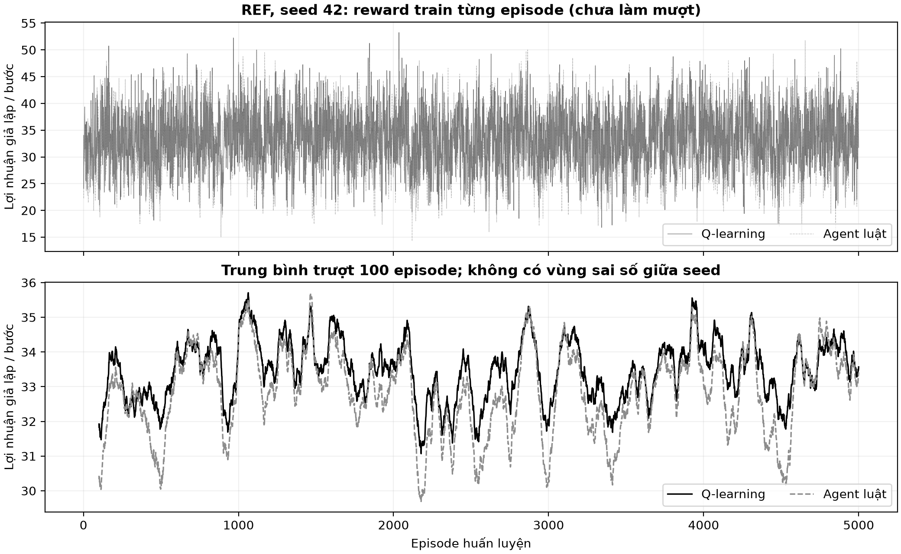
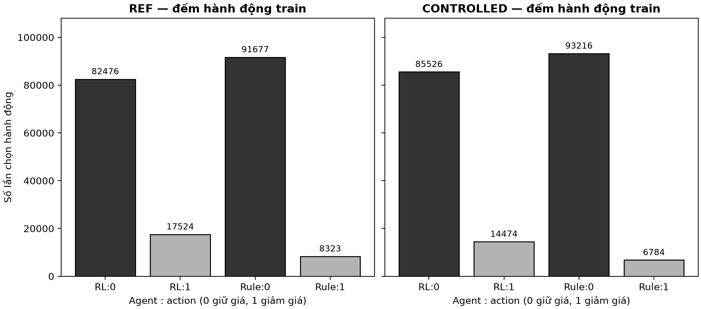

# Diễn giải hình phase 3

Dữ liệu mô phỏng synthetic; chưa phải final evaluation.

## ref_learning_curve

Nguồn: `{'path': 'artifacts/runs/ref/baseline/s0042/episode_rewards.csv', 'sha256': '81d02cc86118d91188cd2abe85fa573c70cff1aafe292dfc62bcd772214695df'}`.

REF seed 42: mỗi điểm ở phần trên là reward cả episode chia 20 bước; trục ngang là episode 1–5.000, trục dọc là lợi nhuận giả lập/bước. Đen liền là RL, xám đứt là rule. Phần dưới gộp cửa sổ 100 episode liên tiếp (2.000 bước), điểm đầu ở episode100; không đệm 0, không dùng dữ liệu tương lai. Mỗi track chỉ một seed, không có error band. RL: 100 episode đầu 31.9210, cuối 33.5690; rule: 30.4315 → 33.4115. Độ lệch chuẩn reward trung bình/bước giữa 5.000 episode: RL 5.2756, rule 5.6354 (ddof1, không phải std giữa training seed). Đường trượt RL vẫn dao động trong [31.0690, 35.7060]. Nhu cầu và doanh số ngẫu nhiên tạo nhiễu; epsilon giảm cũng làm đổi hành vi train. Rule cố định vẫn có reward đổi vì đối thủ RL và tình huống thị trường đổi. Làm mượt giúp đọc xu hướng, không chứng minh hội tụ/tối ưu hay hơn ngoài mẫu.

## controlled_learning_curve

Nguồn: `{'path': 'artifacts/runs/controlled/iid/baseline/s0011/episode_rewards.csv', 'sha256': '589febb133e08d0885fbbd49f366f2a73fa46b8a000c4fbda01be7196b505638'}`.

CONTROLLED seed 11: mỗi điểm ở phần trên là reward cả episode chia 20 bước; trục ngang là episode 1–5.000, trục dọc là lợi nhuận giả lập/bước. Đen liền là RL, xám đứt là rule. Phần dưới gộp cửa sổ 100 episode liên tiếp (2.000 bước), điểm đầu ở episode100; không đệm 0, không dùng dữ liệu tương lai. Mỗi track chỉ một seed, không có error band. RL: 100 episode đầu 30.2715, cuối 34.3120; rule: 29.0340 → 33.3620. Độ lệch chuẩn reward trung bình/bước giữa 5.000 episode: RL 5.3246, rule 5.6387 (ddof1, không phải std giữa training seed). Đường trượt RL vẫn dao động trong [30.2590, 35.6420]. Nhu cầu và doanh số ngẫu nhiên tạo nhiễu; epsilon giảm cũng làm đổi hành vi train. Rule cố định vẫn có reward đổi vì đối thủ RL và tình huống thị trường đổi. Làm mượt giúp đọc xu hướng, không chứng minh hội tụ/tối ưu hay hơn ngoài mẫu.

## q_tables

Nguồn: `q_table.json and policy.json in both saved run directories`.

Hai ô hình là Q cuối train của hai run, mỗi run một seed, không lấy trung bình. Trục dọc có 4 state (nhu cầu/hành động trước của đối thủ), trục ngang 2 action. Thang xám chung: tối hơn là Q lớn hơn; số trong ô là Q, không phải profit/bước DEV. REF: (0, 0)→[0], (0, 1)→[1], (1, 0)→[0], (1, 1)→[1]; CONTROLLED: (0, 0)→[0], (0, 1)→[0], (1, 0)→[0], (1, 1)→[0]. Hai track khác RNG và seed nên không dùng chênh Q để xếp hạng phương pháp. Q là ước lượng chịu chiết khấu, nhiễu và cập nhật terminal; bảng cuối không chứng minh policy tối ưu. Tập greedy giữ toàn bộ action đồng hạng theo isclose; Q và policy đầy đủ được lưu riêng.

## action_counts

Nguồn: `episode_rewards.csv action_counts, both runs`.

Trục ngang là 4 cặp agent/action; trục dọc là tổng lượt chọn trên 5.000×20 bước. Cột tối giữ giá, cột sáng giảm giá, số trên cột là count; mỗi cặp 0+1 của một agent bằng100.000. REF: RL giảm 17,524/100.000 (17.524%), rule giảm 8,323/100.000 (8.323%); CONTROLLED: RL giảm 14,474/100.000 (14.474%), rule giảm 6,784/100.000 (6.784%). Không gộp hai track thành n2, không có error bar. Đây là hành động lúc train còn exploration, không phải tần suất policy greedy DEV. Giảm giá nhiều hơn không tự chứng minh tốt hơn: lãi mỗi món từ5 còn3. Không thể quy khác biệt cho framework khi seed/RNG đã khác.
