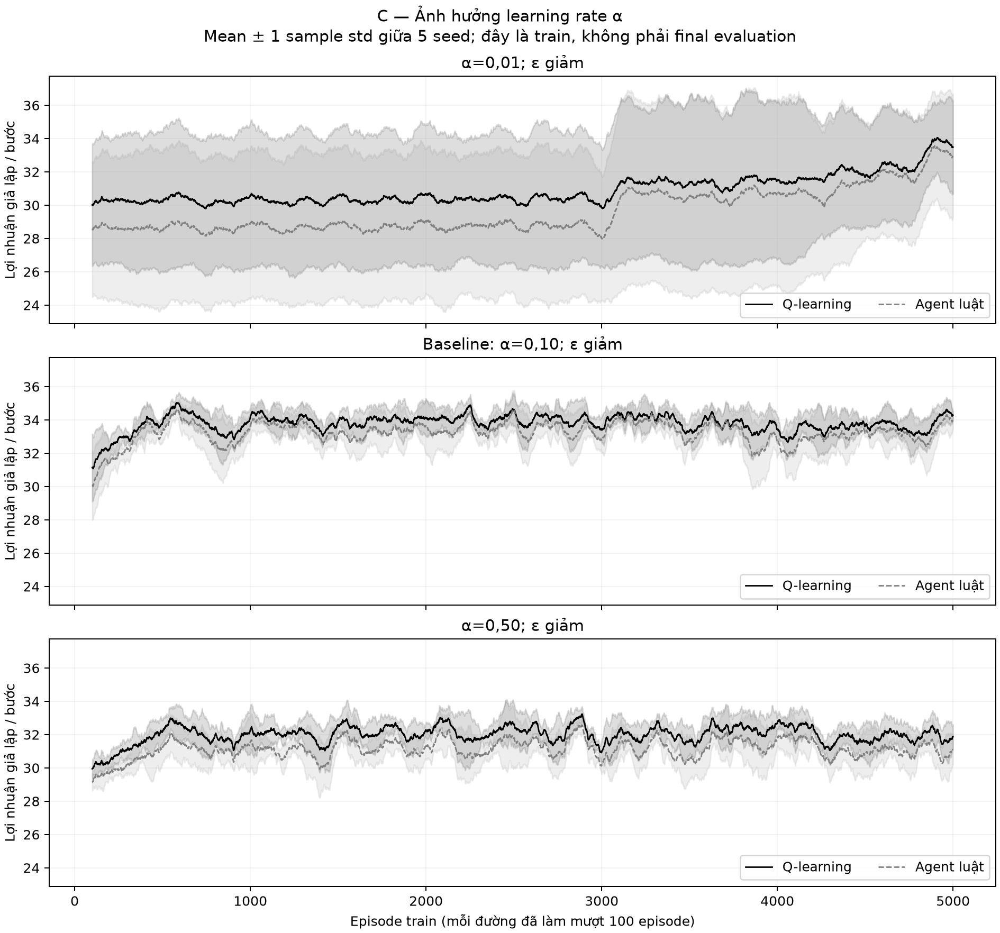
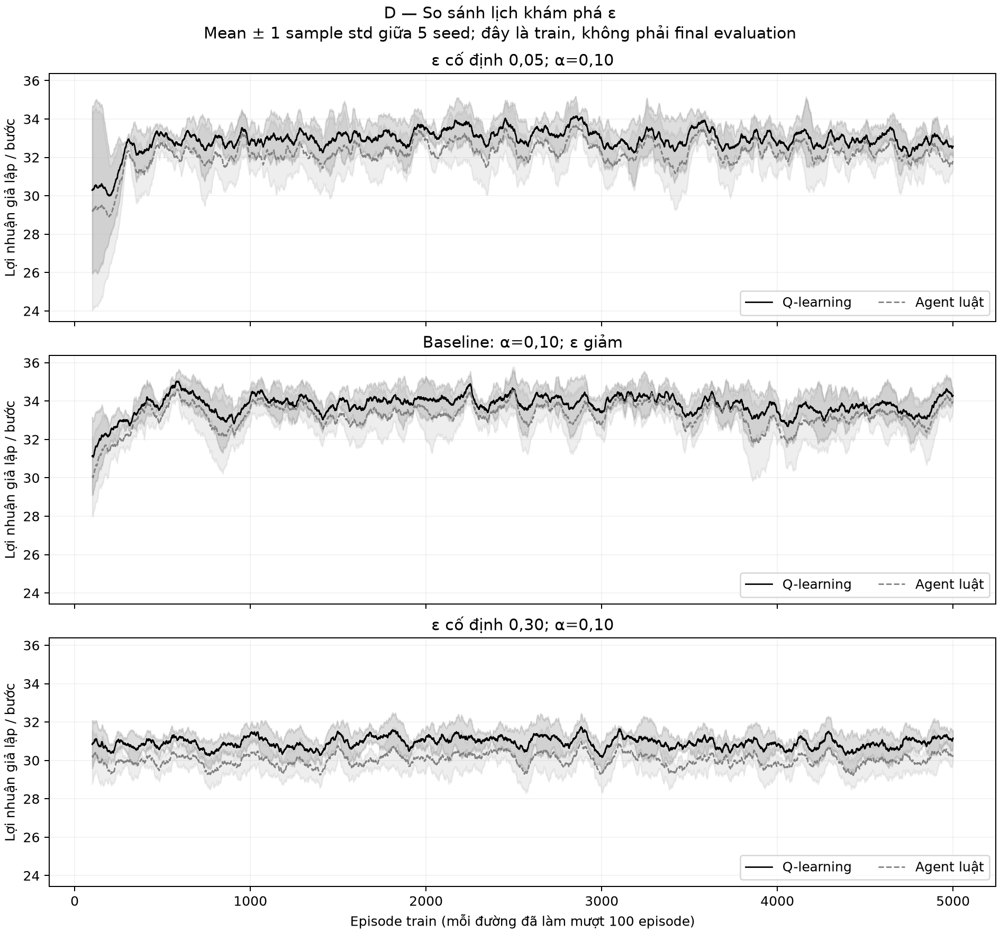
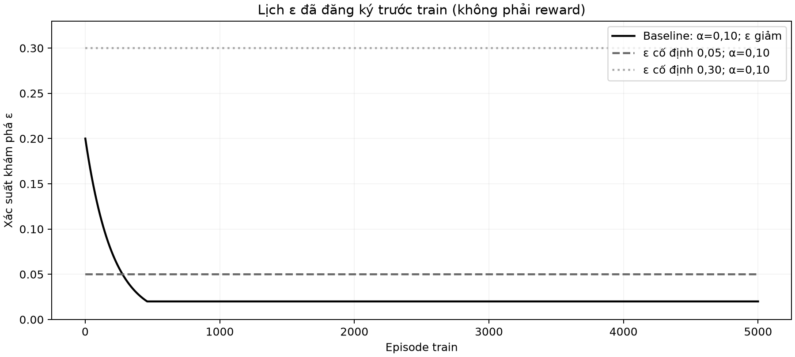

# Giải thích bốn biểu đồ phase 4

Dữ liệu synthetic từ simulator, chỉ kết quả train.

## alpha_curves

Mục đích: C/Q7: chỉ đổi α=0,01/0,10/0,50. Nguồn: `artifacts/metrics/phase04/curves_mean_std.csv; raw source index artifacts/metrics/phase04/source_index.json`.

Mỗi panel là một cấu hình. Trục x: episode 100–5.000; trục y: lợi nhuận giả lập/bước. Đường đen liền là RL, xám đứt là rule; mỗi seed được làm mượt bằng 100 episode trước, rồi lấy mean qua 5 seed (11/22/33/44/55). Vùng mờ là ±1 sample std giữa 5 đường đã làm mượt (ddof=1), không phải CI, không phải biến động từng timestep. α=0,01; ε giảm: RL cửa sổ đầu 30.0084, cuối 33.4916 ± 2.7860; Baseline: α=0,10; ε giảm: RL cửa sổ đầu 31.1301, cuối 34.2875 ± 0.2179; α=0,50; ε giảm: RL cửa sổ đầu 29.9442, cuối 31.8786 ± 0.7006. So sánh giữ cùng ngân sách 5.000×20, gamma, reward, kernel và bộ seed; chỉ đổi yếu tố đã nêu. Các cửa sổ kế tiếp chồng lấp nên không độc lập. Reward còn chịu exploration, đối thủ và nhiễu thị trường; không suy ra hội tụ/tối ưu hoặc thứ hạng final policy từ đường train. Rule không học vẫn đổi reward vì learner và tình huống đổi; phase5 mới đánh giá Q đóng băng.

## exploration_curves

Mục đích: D/Q4: đổi lịch ε, giữ α=0,10. Nguồn: `artifacts/metrics/phase04/curves_mean_std.csv; raw source index artifacts/metrics/phase04/source_index.json`.

Mỗi panel là một cấu hình. Trục x: episode 100–5.000; trục y: lợi nhuận giả lập/bước. Đường đen liền là RL, xám đứt là rule; mỗi seed được làm mượt bằng 100 episode trước, rồi lấy mean qua 5 seed (11/22/33/44/55). Vùng mờ là ±1 sample std giữa 5 đường đã làm mượt (ddof=1), không phải CI, không phải biến động từng timestep. ε cố định 0,05; α=0,10: RL cửa sổ đầu 30.2900, cuối 32.5748 ± 0.5543; Baseline: α=0,10; ε giảm: RL cửa sổ đầu 31.1301, cuối 34.2875 ± 0.2179; ε cố định 0,30; α=0,10: RL cửa sổ đầu 30.8379, cuối 31.1551 ± 0.3991. So sánh giữ cùng ngân sách 5.000×20, gamma, reward, kernel và bộ seed; chỉ đổi yếu tố đã nêu. Các cửa sổ kế tiếp chồng lấp nên không độc lập. Reward còn chịu exploration, đối thủ và nhiễu thị trường; không suy ra hội tụ/tối ưu hoặc thứ hạng final policy từ đường train. Rule không học vẫn đổi reward vì learner và tình huống đổi; phase5 mới đánh giá Q đóng băng.

## epsilon_schedules

Mục đích: Giải thích D/Q4. Nguồn: `docs/protocol_v1.json; artifacts/metrics/phase04/epsilon_schedules.csv`.

Trục x là episode 1–5.000, trục y là xác suất khám phá ε (không đơn vị). Baseline đen liền từ 0,20 xuống sàn 0,02 lần đầu ở episode 461; xám đứt giữ 0,05, xám chấm giữ 0,30. Đây là lịch định trước, trùng ở cả 5 seed; không có vùng sai số, không phải đường reward đo được. Ngẫu nhiên do exploration khác ngẫu nhiên phá đồng hạng Q; ε=0 vẫn có thể phá đồng hạng ngẫu nhiên. Khám phá nhiều giúp thử action nhưng có thể giảm profit khi train; không mặc định lịch nào tốt nhất.

## train_summary

Mục đích: Tổng hợp C/D train. Nguồn: `artifacts/metrics/phase04/config_train_summary.csv`.

Hai panel tách RL và rule. Trục ngang là 5 cấu hình; trục dọc là lợi nhuận giả lập/bước trung bình trên toàn 100.000 bước/run. Chiều cao cột là mean của 5 mean/run; whisker là sample std (ddof=1) của 5 mean/run, không phải std episode và không phải CI. Baseline: α=0,10; ε giảm: RL 33.76528 ± 0.09989, rule 33.22514 ± 0.12848; α=0,01; ε giảm: RL 30.91717 ± 3.91720, rule 29.64954 ± 4.42718; α=0,50; ε giảm: RL 31.97780 ± 0.12472, rule 31.11284 ± 0.20670; ε cố định 0,05; α=0,10: RL 32.89187 ± 0.18749, rule 32.17176 ± 0.27370; ε cố định 0,30; α=0,10: RL 30.92305 ± 0.09846, rule 30.02129 ± 0.07806. Baseline được tái dùng trong hai sweep; tổng là 25 run, không phải 30. Đây là lợi nhuận trong lúc học, có exploration và opponent phản ứng, chưa so sánh final policy trước cùng opponent/tape. Không chọn lại cấu hình/seed từ biểu đồ này, không coi overlap whisker là kiểm định.
