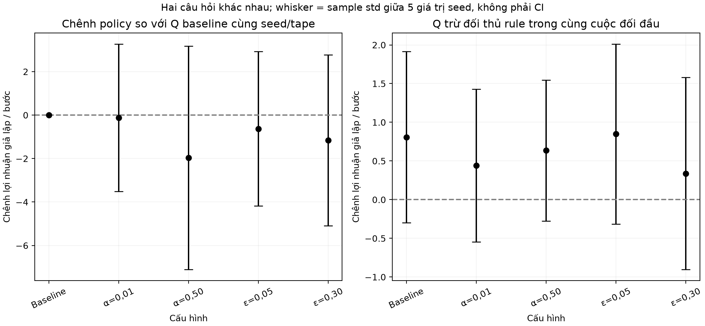
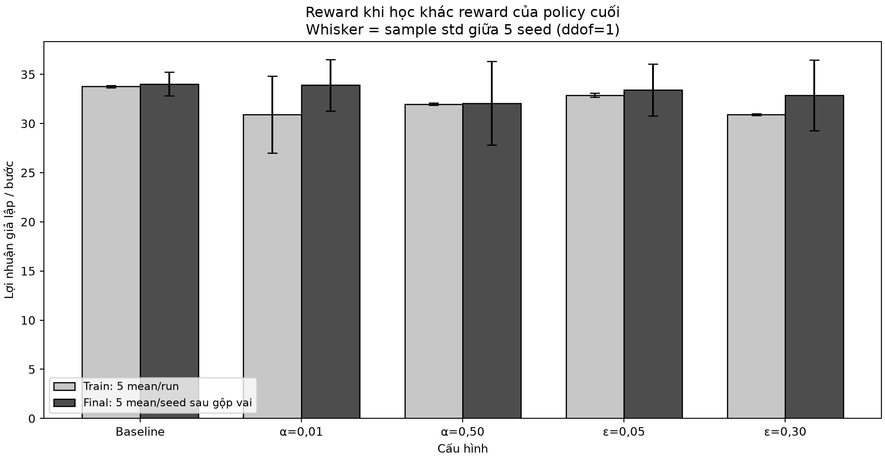
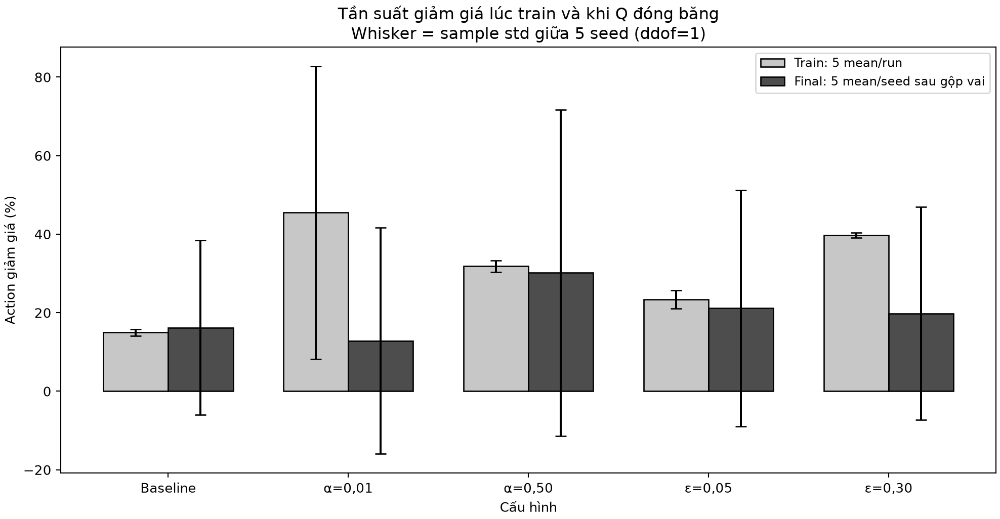

# Giải thích biểu đồ final phase5

Số đo synthetic; không chọn tham số từ kết quả cuối.

## final_profit

Nguồn: `artifacts/metrics/phase05/config_summary.json`.

Trục x: 5 cấu hình; y: profit giả lập/bước trước fixed-rule opponent. Cột xám là Q đóng băng, whisker là std giữa training seed; đường đứt là mean Rule-vs-rule qua5 kịch bản, không phải đối chứng đã train. Mỗi final claim có 500 episode×20 bước, mỗi Q chạy hai vai. Lấy mean hai vai trước, sau đó mean/sample std ddof=1 giữa 5 training seed. Không gộp 10 vai hoặc 5.000 episode thành learner độc lập. Không có CI/kiểm định ý nghĩa từ whisker; đây là mô phỏng, chỉ 5 seed. Baseline: 34.02786 ± 1.22178; α=0,01: 33.90382 ± 2.60833; α=0,50: 32.06337 ± 4.25085; ε=0,05: 33.39952 ± 2.64330; ε=0,30: 32.87013 ± 3.58062. Mean đối chứng 35.05235. Reward giữa các config được đo trên cùng tape theo seed và role. Không dùng final để tuning/chọn lại seed. Nếu hai policy cho cùng score, chỉ kết luận trên các trajectory này, không chứng minh tương đương mọi state.

## paired_and_match

Nguồn: `artifacts/metrics/phase05/paired_comparison.csv`.

Hai panel cùng trục x cấu hình, trục y chênh profit/bước; mốc đứt0 là bằng nhau. Trái ghép Q cấu hình trừ Q baseline cùng training seed, tape và fixed opponent; phải so chất lượng policy theo panel này. Panel phải là Q trừ reward của rule trong chính cuộc đối đầu, có thể chịu phản ứng của rule với learner. Chấm là mean, whisker sample std giữa5 delta seed, không phải CI. Mỗi final claim có 500 episode×20 bước, mỗi Q chạy hai vai. Lấy mean hai vai trước, sau đó mean/sample std ddof=1 giữa 5 training seed. Không gộp 10 vai hoặc 5.000 episode thành learner độc lập. Không có CI/kiểm định ý nghĩa từ whisker; đây là mô phỏng, chỉ 5 seed. Delta so baseline: Baseline: 0.00000 ± 0.00000; α=0,01: -0.12404 ± 3.39200; α=0,50: -1.96449 ± 5.13750; ε=0,05: -0.62834 ± 3.55259; ε=0,30: -1.15773 ± 3.92963. Không đánh đồng lợi thế trong trận với hơn một policy khác trước cùng opponent.

## train_vs_final

Nguồn: `artifacts/metrics/phase04/config_train_summary.csv; artifacts/metrics/phase05/config_summary.json`.

Trục x cấu hình, y profit/bước. Cột sáng lấy reward toàn giai đoạn học (còn exploration và Q đang đổi), cột tối lấy policy cuối đóng băng, tắt exploration và dùng final scenarios riêng. Hai loại whisker đều giữa5 seed, nhưng đo hai đại lượng khác nhau; không coi reward train thấp là final policy kém. Mỗi final claim có 500 episode×20 bước, mỗi Q chạy hai vai. Lấy mean hai vai trước, sau đó mean/sample std ddof=1 giữa 5 training seed. Không gộp 10 vai hoặc 5.000 episode thành learner độc lập. Không có CI/kiểm định ý nghĩa từ whisker; đây là mô phỏng, chỉ 5 seed. Final: Baseline: 34.02786 ± 1.22178; α=0,01: 33.90382 ± 2.60833; α=0,50: 32.06337 ± 4.25085; ε=0,05: 33.39952 ± 2.64330; ε=0,30: 32.87013 ± 3.58062. Chênh train/final có cả thay đổi policy, exploration và tập scenario, không quy toàn bộ tác dụng cho riêng việc tắt epsilon. Không gọi score tăng là chứng minh hội tụ.

## discount_rates

Nguồn: `artifacts/metrics/phase05/multi_seed.csv; phase04/seed_train_summary.csv`.

Trục x cấu hình; y tỷ lệ action giảm giá (%), không phải epsilon hay xác suất chuyển đổi mua hàng. Cột sáng toàn100.000 bước train/run, cột tối20.000 bước final/seed (hai vai); whisker sample std giữa5 seed, đơn vị điểm %. Final: Baseline: 16.212% ± 22.199 điểm %; α=0,01: 12.876% ± 28.792 điểm %; α=0,50: 30.186% ± 41.559 điểm %; ε=0,05: 21.160% ± 30.090 điểm %; ε=0,30: 19.824% ± 27.145 điểm %. Mỗi final claim có 500 episode×20 bước, mỗi Q chạy hai vai. Lấy mean hai vai trước, sau đó mean/sample std ddof=1 giữa 5 training seed. Không gộp 10 vai hoặc 5.000 episode thành learner độc lập. Không có CI/kiểm định ý nghĩa từ whisker; đây là mô phỏng, chỉ 5 seed. Giảm giá làm lãi mỗi món từ5 còn3; giảm giá nhiều không tự chứng minh profit tốt. Policy có thể khác ở state không đạt tới sau reset0. Tần suất là hành vi thực đo, không chỉ đọc argmax toàn bảng Q.
