# SO SÁNH TÁC TỬ HỌC TĂNG CƯỜNG VÀ TÁC TỬ THEO LUẬT TRONG MÔ PHỎNG THƯƠNG MẠI ĐIỆN TỬ

## 1. Thông tin báo cáo

Học viện Công nghệ Bưu chính Viễn thông

Môn học: Phát triển hệ thống thông minh — Intelligent System Development

Bài thí nghiệm: Agent02 — Reinforcement-Learning-Based Agents versus Rule-Based Agents

Sinh viên: Triệu Tuấn Anh

Mã sinh viên: B23DCCN053 — Lớp: D23CTPM01

Tháng 10 năm 2026

## 2. Mở đầu và mục tiêu

Trong mô phỏng hai cửa hàng, tác tử theo luật không học nhưng vẫn có thể thu lợi
nhuận tốt hơn tác tử Q-learning. Kết quả này đặt ra câu hỏi chính của bài: cần đo
thế nào để phân biệt một quyết định hợp lý về thiết kế với một chính sách thực sự
hiệu quả sau khi học? Báo cáo khảo sát câu hỏi đó bằng code và dữ liệu thực nghiệm,
thay vì mặc định phương pháp có khả năng học sẽ luôn thắng.

Bài làm thực hiện các thí nghiệm A–E của đề [S1]: tái lập baseline, theo dõi reward
khi học, đổi learning rate, đổi exploration và đánh giá policy riêng. Sau đó, bài
khảo sát hai tác tử cùng học, sửa động lực nhu cầu và kiểm chứng state có thêm trí
nhớ/thời gian. Tất cả dùng mô phỏng thương mại điện tử; không coi reward là doanh
thu của một cửa hàng thực hoặc kết quả kiểm chứng đầu tư.

### 2.1. Các khái niệm cần dùng

Một tác tử nhận thông tin về môi trường và chọn hành động để hướng đến mục tiêu.
Trong bài, thông tin gồm mức nhu cầu và lịch sử hành động; hành động là giữ giá
hoặc giảm giá; mục tiêu là tích lũy lợi nhuận. Một **policy** là cách ánh xạ thông
tin đang có sang hành động. Policy có thể được viết bằng luật hoặc hình thành
từ kinh nghiệm học. Không cần một mô hình ngôn ngữ lớn để tạo thành tác tử [S6,
trang PDF 3].

**Học tăng cường (RL)** học qua tương tác: chọn hành động, nhận reward, quan sát
kết quả và điều chỉnh quyết định. Khác với học có giám sát, dữ liệu ở đây không
cung cấp sẵn nhãn “hành động đúng” cho mọi tình huống. **Q-learning** lưu giá trị
ước lượng của từng cặp state–action trong bảng Q; giá trị này cân nhắc cả reward
hiện tại và lợi ích tương lai có chiết khấu [S4, trang PDF 1–7].

**Exploration** là thử hành động để có thêm kinh nghiệm; **exploitation** là chọn
hành động đang được đánh giá tốt. Epsilon điều khiển xác suất chọn ngẫu nhiên khi
train, còn alpha điều khiển mức sửa giá trị Q. Đây là hai vai trò khác nhau. Khi
đánh giá policy cuối, bài tắt exploration, nhưng vẫn phá đồng hạng gần nhau có
seed theo quy tắc của code.

Một **episode** là một lượt thị trường dài 20 bước, sau đó khởi tạo lại tình huống.
Một **training seed** tạo một lượt học riêng. Nhiều episode trong cùng một lượt
học không phải nhiều learner độc lập. Dùng nhiều seed giúp thấy kết quả thay đổi
ra sao khi kinh nghiệm học khác nhau, nhưng năm seed vẫn là một mẫu nhỏ.

**Hệ đa tác tử (MAS)** có nhiều tác tử tương tác qua môi trường chung, thông điệp
hoặc trạng thái dùng chung. Hai cửa hàng trong bài tác động đến kết quả của nhau
qua lựa chọn giảm giá. Đây là tương tác cạnh tranh trong simulator; không phải
một nhóm LLM phối hợp bằng trao đổi văn bản. Tài liệu [S5, trang PDF 1,9] giúp phân
biệt các kiểu tương tác; bài chỉ dùng ý tưởng nền, không triển khai dự án LLM/MAS
riêng trong slide.

## 3. Môi trường và hai loại tác tử

### 3.1. Mô hình thị trường

Mỗi shop chọn một trong hai action:0 giữ giá,1 giảm giá. Giá gốc 10, chi phí một món 5,
giảm giá 20%. Nhu cầu có hai mức thấp/cao, tương ứng 10/20 khách mô phỏng mỗi bước.
Doanh số được lấy ngẫu nhiên theo xác suất mua hàng; reward là doanh số nhân
lợi nhuận mỗi món. Các con số là giả định giảng dạy từ [S1–S3].

Xác suất mua được tính từ bốn yếu tố đơn giản: mức nền 0,30; thêm 0,25 khi nhu cầu
cao; thêm 0,15 nếu shop giảm giá; trừ 0,10 nếu shop đối thủ giảm giá. Code chặn xác
suất vào khoảng 0,05–0,95. Nói cách khác, giảm giá có thể làm tăng xác suất mua,
nhưng đồng thời làm giảm lãi trên mỗi món; reward profit mới phản ánh đánh đổi này.

Hai shop cùng chọn trước khi môi trường thực hiện một bước. Sau đó môi trường
sinh doanh số/reward, lưu hai action thành lịch sử và lấy mức nhu cầu tiếp theo.
Trong baseline, nhu cầu bước sau được lấy cân bằng 0/1, không phụ thuộc action.
Doanh số hai shop được sinh riêng; không giả định một khách chỉ mua ở đúng một
shop, nên tổng sales không phải phép đo thị phần độc quyền hoặc trò chơi zero-sum.

Luồng quyết định là: **quan sát → hai shop chọn action → môi trường trả reward
và state mới → learner cập nhật Q → lặp đến hết episode**. Reward không được đưa
cho learner trước khi action hiện tại được chọn.

### 3.2. State và tác tử theo luật

State local cũ là `(demand, competitor_previous_action)`: nhu cầu hiện tại và
action trước của đối thủ. Mỗi biến có hai giá trị nên có 4 state; với 2 action, Q-table
của một learner có 8 giá trị. Agent không thấy action hiện tại mà đối thủ sắp chọn.
Ở đầu episode, lịch sử hai action bằng 0.

Ba nhánh của rule gốc rút gọn thành: chỉ giảm giá khi nhu cầu cao **và** đối thủ
đã giảm giá ở bước trước; các trường hợp khác giữ giá. Tác tử luật không có Q-table,
không cập nhật sau reward và không có pha train. Đoạn E01 giữ đúng hành vi đó:

```python
def act(self, state):
    demand, competitor_previous = state_pair(state)
    return int(demand == 1 and competitor_previous == 1)
```

Nguồn E01: `code/controlled.py`, dòng 167–169; SHA256 `df92154dea7a9573…` (hash đầy đủ trong code_excerpt_index.json).

Rule cố định không đồng nghĩa reward cố định. Nhu cầu, doanh số và hành động của
learner vẫn thay đổi. Vì vậy đường reward của rule vẫn dao động dù code quyết
định của nó không đổi.

### 3.3. Tác tử Q-learning và hai track thực nghiệm

Learner chọn action theo epsilon-greedy và sửa một ô Q sau mỗi bước. Reward mới
không thay thế toàn bộ bảng, mà điều chỉnh dần giá trị của cặp state–action vừa
được trải nghiệm. Bước cuối episode không dùng giá trị tương lai để bootstrap.
Ý nghĩa và phép tính cụ thể được trình bày ở câu 3.

**REF** tái lập code thầy với seed 42, giữ thuật toán và thứ tự RNG gốc. **CONTROLLED**
giữ luật môi trường/reward nhưng tách RNG nhu cầu, doanh số và policy để thiết kế
đánh giá ghép cặp. Hai track khác seed và cách quản lý số ngẫu nhiên; không gộp
REF thành lần lặp thứ sáu của CONTROLLED. Bản Python được sao nguyên byte từ file
thầy mang đuôi `.tex`; thay đổi phục vụ thí nghiệm nằm trong module riêng [S3,D3].

Một số câu trong đề nhắc hai RL agent, trong khi companion/code triển khai một RL
đối đầu một rule. Baseline của báo cáo theo implementation được cung cấp; thí
nghiệm hai learner cùng học được tách riêng để trả lời câu 8 [S1, trang PDF 6–8;
S2, trang PDF 4; S3].

## 4. Thiết lập, code thiết yếu và cách đánh giá

### 4.1. Cấu hình và ma trận chạy

Mỗi run train 5.000 episode × 20 bước, bắt đầu Q bằng 0. Baseline dùng α 0,10, γ 0,90,
epsilon bắt đầu 0,20, nhân 0,995 sau mỗi episode và không xuống dưới 0,02. Các seed
CONTROLLED là 11,22,33,44,55; seed 42 của REF được giữ riêng. Toàn bài chạy 56 lượt
thị trường và 61 learner instance vì 5 lượt two-learners có hai Q-table mỗi lượt.

| Nhóm | Kernel/cấu hình | Số market train run |
|---|---|---:|
| REF | Baseline theo code thầy, seed 42 |1|
| Core CONTROLLED | Baseline, α 0,01, α 0,50, ε cố định 0,05, ε cố định 0,30; mỗi cấu hình 5 seed |25|
| Hai learner | Hai Q-learning cùng học, IID,5 pair seed |5|
| Sửa môi trường | Persistent và Gold, mỗi kernel 5 seed |10|
| State memory/time | IID/persistent/Gold, mỗi kernel 5 seed |15|

Baseline α 0,10/epsilon giảm được dùng chung cho hai sweep, không train lại để
làm hai đối chứng. Tổng 56 run tương ứng 5.600.000 market step; không đếm đôi market
step khi có hai learner. Smoke kỹ thuật và DEV được lưu riêng, không đưa vào
các bảng final. Các cấu hình, seeds và ngân sách được định trước trong protocol [D2].

Runtime là Python 3.11.17 trên WSL Ubuntu, NumPy float64 CPU. Q-table nhỏ nên bài
không dùng GPU hoặc thêm mạng học sâu chỉ để làm thuật toán phức tạp hơn. Mỗi run
có raw reward theo episode, Q/policy, visitation, trace mẫu và checkpoint mỗi 100
episode, gồm cả RNG để khôi phục đúng trạng thái. Tên run/config/seed và hash nằm
trong manifests kèm source.

### 4.2. Chọn action, cập nhật và tương tác

E02 cho thấy epsilon chỉ điều khiển nhánh khám phá. Nếu không khám phá, code chọn
ngẫu nhiên trong tập Q gần bằng giá trị lớn nhất; vì vậy greedy không luôn đồng
nghĩa deterministic. Quy tắc đồng hạng này cũng được giữ khi đánh giá:

```python
def act(self, state, epsilon, *, explore=True):
    state = state_pair(state)
    if not np.isfinite(epsilon) or not 0 <= epsilon <= 1:
        raise ValueError('epsilon must be in [0,1]')
    values = self.q[state]
    if not np.isfinite(values).all():
        raise ValueError('Nonfinite Q values')
    if explore and self.rng.random() < epsilon:
        return int(self.rng.integers(2))
    # Same near-tie convention as the reference, made explicit in the protocol.
    best = np.flatnonzero(np.isclose(values, values.max(), rtol=1e-5, atol=1e-8))
    return int(self.rng.choice(best))
```

Nguồn E02: `code/controlled.py`, dòng 179–190; SHA256 `df92154dea7a9573…` (hash đầy đủ trong code_excerpt_index.json).

E03 là phần cập nhật Q. Nhánh `terminal` giữ target bằng reward hiện tại; không
cộng Q của một episode mới vào bước cuối episode cũ:

```python
def learn(self, state, action, reward, following, terminal):
    state, following, action = state_pair(state), state_pair(following), binary(action, 'action')
    if not np.isfinite(reward):
        raise ValueError('Nonfinite reward')
    target = reward if terminal else reward + self.config.gamma * float(self.q[following].max())
    key = (*state, action)
    self.q[key] += self.config.alpha * (target - self.q[key])
    if not np.isfinite(self.q[key]):
        raise ValueError('Nonfinite Q update')
```

Nguồn E03: `code/controlled.py`, dòng 192–200; SHA256 `df92154dea7a9573…` (hash đầy đủ trong code_excerpt_index.json).

E04 trích đúng một đoạn trong vòng lặp train. Hai action được lấy từ cùng snapshot
trước `env.step`; learner chỉ học sau khi nhận reward/state mới. Đoạn trích phục
vụ giải thích; module nguồn có đầy đủ reset, logging và checkpoint.

```python
for step in range(self.market.steps):
    # Neither policy sees the other's current action before choosing.
    actions = (self.agent.act(states[0], epsilon), self.rule.act(states[1]))
    result = self.env.step(actions)
    self.agent.learn(states[0], actions[0], result.rewards[0], result.states[0], result.done)
    self.visits[(*states[0], actions[0])] += 1
    total += result.rewards
```

Nguồn E04: `code/training.py`, dòng 46–52; SHA256 `e3e43418373866f9…` (hash đầy đủ trong code_excerpt_index.json).

### 4.3. Đánh giá riêng và mẫu số

Mỗi policy cuối được đo 500 episode × 20 bước **mỗi vai**. Trước tiên gộp hai vai của
cùng training seed, sau đó lấy mean và sample std qua 5 seed (ddof 1). Rule không
được train: n 5 của đối chứng là năm scenario panel, không phải năm rule learner.
Whisker/dải mean±std mô tả độ phân tán, không phải khoảng tin cậy hay kiểm định.

Scenario final dùng các seed 2000011,2000022,2000033,2000044,2000055, tách khỏi seed
train và DEV. Trong cùng kernel/seed, các policy nhận cùng chuỗi nhu cầu và cùng
các số Uniform cho khách hàng/role. Sales được tính bằng số Uniform nhỏ hơn xác
suất mua, giữ phân phối Binomial nhưng tạo tình huống ghép cặp. Chỉ “cùng seed”
cho một RNG chung chưa chắc giữ cùng nhu cầu nếu số lần rút ngẫu nhiên phụ thuộc
action; vì thế bài tách các dòng ngẫu nhiên và tạo tapes riêng [D2,D5].

E05 sao Q sang bản chỉ đọc trước evaluation. E06 kiểm hash sau khi kết thúc. Các
đoạn này không thay cho toàn bộ loop; vòng lặp gốc không gọi `learn` và dùng
`explore=False` khi lấy action.

```python
def evaluate_tapes(q, market, *, episodes, scenario_seed, role, kind='q', guard=None):
    budget(episodes, role)
    fingerprint = policy_hash(q, kind)
    before = q_digest(q) if kind == 'q' else None
    learner = None
    if kind == 'q':
        learner = QAgent(LearningConfig(), int(np.random.SeedSequence([scenario_seed, 4]).generate_state(1)[0]))
        learner.q[:] = q
        learner.q.flags.writeable = False
```

Nguồn E05: `code/evaluation/final_v1.py`, dòng 29–37; SHA256 `504176cd6e96e569…` (hash đầy đủ trong code_excerpt_index.json).

```python
after = q_digest(q) if kind == 'q' else None
if before != after or (learner is not None and q_digest(learner.q) != before):
    raise RuntimeError('Frozen Q changed')
```

Nguồn E06: `code/evaluation/final_v1.py`, dòng 69–71; SHA256 `504176cd6e96e569…` (hash đầy đủ trong code_excerpt_index.json).

Mỗi final claim được ghi trước khi chạy, có kết quả/CSV và receipt count 1 sau khi
hoàn tất. Bảng và hình đọc output đã lưu, không chạy lại policy để “lấy kết quả
đẹp”. Hai câu hỏi được tách: shop nào lời hơn **trong cùng trận**, và policy nào
tốt hơn **trước cùng một fixed opponent/tape**. Kết quả của hai so sánh không
nhất thiết cùng dấu.

## 5. Kết quả, bảng và giải thích hình

Các giá trị dưới đây có đơn vị lợi nhuận giả lập/bước nếu không ghi đơn vị khác.
Kết quả train đo lúc Q còn đổi và có exploration; final đo Q cuối đóng băng.
Chữ số trong bảng lấy từ artifact, có thể làm tròn khi trình bày. REF/native và
CONTROLLED luôn được ghi rõ, không gộp thành cùng một nhóm thống kê.

### 5.1. A–B: baseline, Q-table và diễn biến học

**Bảng B01. Reward và action trong hai baseline train riêng biệt.** Mỗi agent có
100.000 action; các tổng reward được chia đúng 100.000 bước để tính mean [D3].

|Track/seed|Agent|Total profit|Profit/bước|Giữ giá|Giảm giá|
|---|---|---|---|---|---|
|REF/42|RL|3.345.548|33,45548|82.476|17.524|
|REF/42|RULE|3.283.930|32,83930|91.677|8.323|
|CONTROLLED/11|RL|3.374.759|33,74759|85.526|14.474|
|CONTROLLED/11|RULE|3.328.637|33,28637|93.216|6.784|

**Bảng B02. Q và policy cuối train, không phải profit final.** Action 0 giữ giá,
action 1 giảm giá. Tập greedy được tính trực tiếp từ hai Q-value ở mỗi state [D3].

|Track|State (nhu cầu,đối thủ trước)|Q giữ giá|Q giảm giá|Greedy action|
|---|---|---|---|---|
|REF|(0, 0)|228,30|178,85|0|
|REF|(0, 1)|177,99|207,21|1|
|REF|(1, 0)|246,88|235,23|0|
|REF|(1, 1)|211,42|242,96|1|
|CONTROLLED|(0, 0)|233,67|197,14|0|
|CONTROLLED|(0, 1)|213,65|171,28|0|
|CONTROLLED|(1, 0)|265,03|225,54|0|
|CONTROLLED|(1, 1)|249,42|224,71|0|

REF giảm giá ở hai state có action trước của đối thủ bằng 1; CONTROLLED seed 11
chọn giữ giá ở cả bốn state. Hai Q-table này khác nhau, nhưng policy có thể cho
cùng hành vi ở các state thực sự đạt tới sau reset. Điều đó không chứng minh hai
bảng tương đương trên mọi trạng thái hoặc môi trường.

**Hình F01. REF: reward thô và moving average 100 episode.**


X là episode train, Y là reward cả episode chia 20 bước; đen liền là RL, xám đứt là
rule. Panel dưới làm mượt 100 episode; chỉ có một seed, không có dải sai số giữa
seed. RL tăng từ 31,92100 ở 100 episode đầu lên
33,56900 ở 100 episode cuối. Reward vẫn dao động;
nhu cầu/doanh số ngẫu nhiên và policy đang học cùng ảnh hưởng đường vẽ. Làm mượt
không chứng minh hội tụ hoặc ưu thế ngoài mẫu. Nguồn: D3, run REF42.

**Hình F02. CONTROLLED seed 11: cùng cách đọc nhưng là run khác.**

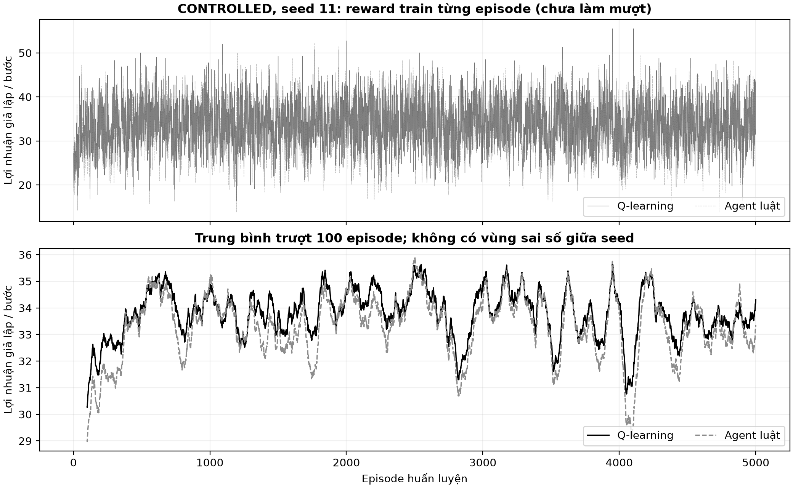

X là episode train, Y là profit/bước; đen RL, xám đứt rule. Panel dưới là MA 100;
chỉ một seed 11, không có dải sai số giữa seed và không phải các learner độc lập.
RL đầu/cuối là 30,27150/
34,31200, rule là
29,03400/
33,36200. Rule không học vẫn thay reward
do learner và thị trường đổi. Không lấy chênh giữa F01–F02 để xếp hạng cách quản
lý RNG vì cả seed cũng khác. Nguồn: D3, run CONTROLLED11.

**Hình F03. Tám Q-value của mỗi baseline.**

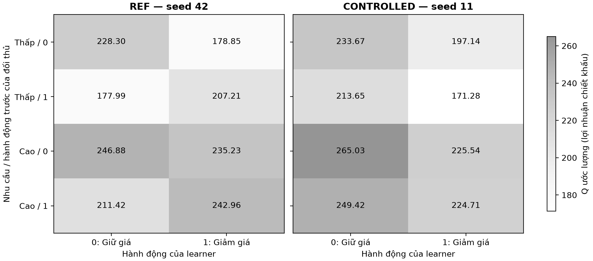

Hàng là bốn state nhu cầu/action trước của đối thủ; cột là hai action. Ô tối hơn
có Q lớn hơn, số trong ô là Q chịu chiết khấu, không phải profit/bước. Không lấy
trung bình hai track hoặc vẽ error bar. B02 cho thấy REF chọn 1 ởstate(0,1)/(1,1),
trong khi CONTROLLED chọn 0 ởcảbốnstate. State ít hoặc không gặp trong policy greedy
có thể không ảnh hưởng score của kịch bản hiện tại. Nguồn: D3, Q/policy cuối.

**Hình F04. Action count lúc train.**


X là từng cặp agent/action; Y là tổng số lần chọn trên 100.000 bước/run. Cột tối giữ
giá, cột sáng giảm giá; không có std vì mỗi track chỉ một seed. REF learner giảm
17524 lần, CONTROLLED giảm 14474 lần.
Đây là hành vi khi còn exploration, không phải tỷ lệ epsilon hoặc tần suất của
policy cuối. Giảm giá nhiều hơn không tự mang lợi nhuận cao hơn. Nguồn: D3, action_counts.

### 5.2. C–D: learning rate và exploration

**Bảng B03. Ba learning rate, các tham số khác giữ nguyên.** Các cột mean±std
đều tính qua 5 seed nhưng train và final đo hai giai đoạn khác nhau [D4,D5].

|Cấu hình|Train Q mean±std|Final Q mean±std|
|---|---|---|
|Baseline (α 0,10; ε giảm)|33,76528 ± 0,09989|34,02786 ± 1,22178|
|α 0,01|30,91717 ± 3,91720|33,90382 ± 2,60833|
|α 0,50|31,97780 ± 0,12472|32,06337 ± 4,25085|

**Hình F05. Reward curves khi đổi alpha.**


Mỗi panel ứng với α 0,01/0,10/0,50; X là episode, Y là profit/bước. Đen RL, xám đứt rule;
MA 100 riêng từng seed trước rồi mean±sample std qua 5 seed. Cuối cửa sổ, RL lần lượt
33,49160,34,28750,
31,87860. Alpha lớn cập nhật mạnh nhưng không
tạo final mean cao hơn trong mẫu này. Vùng mờ giữa seed khác với nhiễu từng bước;
không dùng overlap của dải để làm kiểm định. Nguồn: D4, curves_mean_std.

**Bảng B04. Ba lịch exploration với alpha giữ 0,10.**

|Cấu hình|Train Q mean±std|Final Q mean±std|
|---|---|---|
|Baseline (α 0,10; ε giảm)|33,76528 ± 0,09989|34,02786 ± 1,22178|
|ε cố định 0,05|32,89187 ± 0,18749|33,39952 ± 2,64330|
|ε cố định 0,30|30,92305 ± 0,09846|32,87013 ± 3,58062|

**Hình F06. Train curves của ba lịch epsilon.**


X là episode, Y là profit/bước; đen RL, xám đứt rule. MA 100 riêng từng seed rồi
mean/std qua 5 seed như F05; chỉ thay lịch khám phá. RL ở cửa sổ cuối của
epsilon 0,05, baseline giảm, epsilon 0,30 lần lượt
32,57480,
34,28750,
31,15510. Khám phá cao có thể làm reward
train thấp vì tiếp tục thử action, nhưng không kết luận chỉ từ train rằng policy
cuối kém hơn. Nguồn: D4.

**Hình F07. Lịch epsilon định trước.**


X là episode, Y là xác suất khám phá, không có đơn vị reward. Đường đen giảm 0,20 → 0,02;
hai đường còn lại giữ 0,05/0,30. Đây là cấu hình chung cho cả 5 seed, không phải số đo
ngẫu nhiên nên không có dải std. Epsilon chỉ là xác suất chọn action ngẫu nhiên;
tỷ lệ giảm giá còn phụ thuộc action được chọn khi khám phá và policy khi khai thác.
Nguồn: D2,D4, epsilon_schedules.

**Hình F08. Mean reward toàn giai đoạn train.**

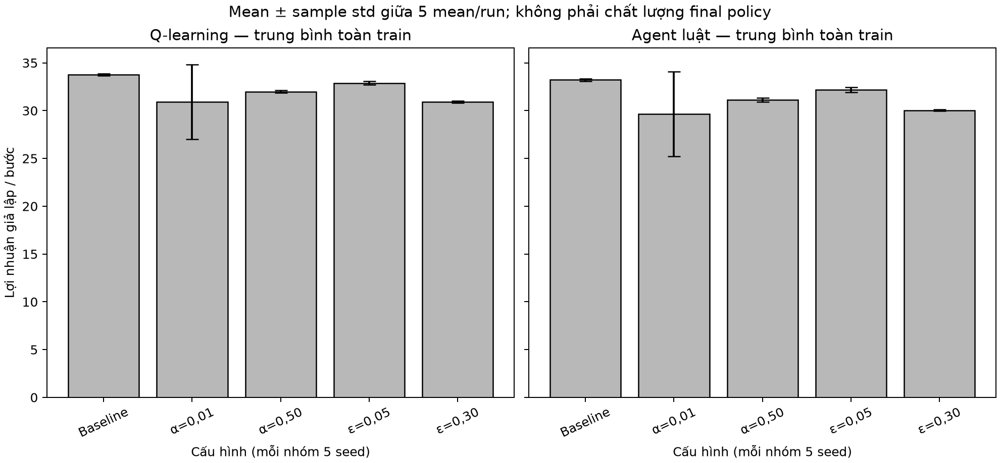

Hai panel tách RL và rule; X là cấu hình, Y là mean profit/bước trên 100.000 bước/run. Cột là
mean 5 run, whisker là sample std của 5 mean/run. Baseline RL
33,76528±0,09989; alpha 0,01
30,91717±3,91720. Dải của
alpha 0,01 lớn hơn nhiều giữa seed; không bỏ seed bất lợi. Đó là train score, chưa
phải chất lượng cuối đo trước cùng opponent/tape. Nguồn: D4.

### 5.3. E: đánh giá policy công bằng

**Bảng B05. Final của năm cấu hình core.** Rule cùng trận có thể phản ứng với
lịch sử learner; policy rule đối chứng được đo trước cùng fixed rule/tape [D5].

|Cấu hình|Q final mean±std|Rule cùng trận mean±std|Q−rule cùng trận|Q−policy rule|
|---|---|---|---|---|
|Baseline (α 0,10; ε giảm)|34,02786 ± 1,22178|33,21968 ± 2,32629|0,80818|-1,02449|
|α 0,01|33,90382 ± 2,60833|33,46195 ± 3,59374|0,44187|-1,14853|
|α 0,50|32,06337 ± 4,25085|31,42880 ± 5,12948|0,63457|-2,98898|
|ε cố định 0,05|33,39952 ± 2,64330|32,55158 ± 3,75356|0,84794|-1,65283|
|ε cố định 0,30|32,87013 ± 3,58062|32,53152 ± 3,61138|0,33861|-2,18222|

Mean đối chứng Rule-vs-rule là 35,05235. Baseline Q lời hơn đối thủ
rule trong cùng cuộc đối đầu 0,80818/bước,
nhưng chênh policy Q trừ policy rule đối chứng là
-1,02449/bước. Hai dấu này trả lời hai câu
hỏi khác nhau, không phải lỗi tính toán.

**Hình F09. Profit của Q cuối trước fixed rule.**

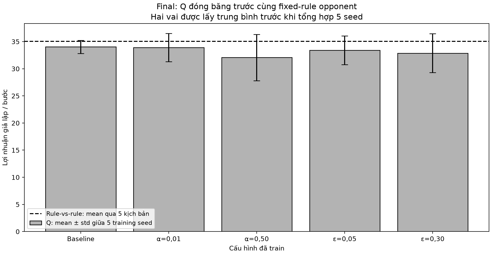

X là năm cấu hình,Y là profit/bước; cột mean, whisker là std qua 5 training seed sau gộp vai.
Đường đứt là mean Rule-vs-rule qua 5 scenario panel, không phải rule đã train. Baseline
34,02786 cao nhất trong năm mean quan sát, alpha 0,50 là
32,06337; không từ đó chọn lại cấu hình hoặc khẳng định
ưu thế thống kê/phổ quát. Nguồn: D5, config_summary.

**Hình F10. Chênh policy và lợi thế trong trận.**


Hai panel cùng X là cấu hình,Y là chênh profit/bước; chấm mean, whisker sample std qua 5 delta
seed, đường 0 là không chênh. **Panel trái** là Q cấu hình trừ Q baseline cùng seed/tape;
**panel phải** là Q trừ rule trong chính trận đó. Alpha 0,50 có delta so baseline
-1,96449, nhưng delta trong trận
0,63457. Không dùng panel phải để tuyên bố
Q tốt hơn policy rule trước cùng opponent. Nguồn: D5, paired_comparison.

**Hình F11. Train và final không đo cùng một đại lượng.**


X là cấu hình,Y là profit/bước; cột sáng là toàn quá trình học, cột tối là policy cuối
đóng băng trên scenario riêng, whisker đều giữa 5 seed. Alpha 0,01 train mean
30,91717 còn finalmean 33,90382.
Chênh lệch gồm cả policy thay đổi, exploration và tập tình huống; không quy toàn
bộ cho việc tắt epsilon hoặc gọi score tăng là hội tụ. Nguồn: D4,D5.

**Hình F12. Tỷ lệ giảm giá đo từ action.**


X là cấu hình,Y là tỷ lệ giảm giá(%); cột sáng train 100.000 bước/run, tối final 20.000 bước/seed
gộp hai vai. Whisker là sample std giữa 5 seed, đơn vị điểm%. Final baseline
16,212%, alpha 0,50 30,186%.
Tỷ lệ không bằng epsilon. Whisker mean±std có thể xuống dưới 0 khi độ phân tán lớn;
từng tỷ lệ quan sát vẫn 0–100%, whisker không phải khoảng xác suất/CI. Nguồn: D4,D5.

**Bảng B06. Từng seed baseline final và REF native riêng.** Cột steps ghi tổng
bước đã gộp vai, không phải budget của một vai. REF_NATIVE chỉ role 0 [D5].

|Track/seed|Profit Q|Profit rule|Tổng reward Q|Tổng reward rule|Bước gộp vai|
|---|---|---|---|---|---|
|CONTROLLED/11|34,98425|34,98425|699.685|699.685|20.000|
|CONTROLLED/22|32,60005|30,56260|652.001|611.252|20.000|
|CONTROLLED/33|32,79050|30,78705|655.810|615.741|20.000|
|CONTROLLED/44|34,76675|34,76675|695.335|695.335|20.000|
|CONTROLLED/55|34,99775|34,99775|699.955|699.955|20.000|
|REF_NATIVE/42|35,12750|34,96850|351.275|349.685|10.000|

### 5.4. Hai learner và sửa động lực nhu cầu

**Bảng B07. Hai Q-learning cùng học: đo checkpoint trước fixed rule.** Hai learner
trong một pair phụ thuộc nhau; gộp hai vai, rồi hai learner trong pair, sau đó mới
lấy mean/std qua năm pair seed. Các checkpoint là các phép đo lặp của cùng quá
trình học, không phải bốn nhóm độc lập [D6].

|Checkpoint episode|Mean profit/bước ±std qua 5 pair seed|
|---|---|
|0|29,55358 ± 0,19596|
|1000|34,48443 ± 1,32679|
|2500|34,23232 ± 0,70593|
|5000|31,58872 ± 2,75761|

**Hình F13. Dữ liệu vàng và kernel dùng hiệu chỉnh kịch bản.**

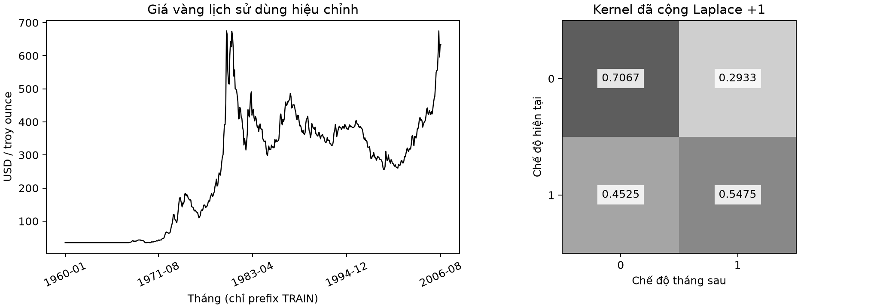

Trái: X là tháng, Y là USD/troy ounce; đường đen là 560 giá tháng
trong prefix TRAIN, 01/1960–08/2006. Phải: hàng là regime hiện tại, cột là regime
tháng sau, số trong ô là xác suất sau cộng Laplace 1. Regime 1 là giá tăng; regime 0
gồm giảm hoặc giữ nguyên. P 00=0,706745, P 11=0,547511, khác kernel
persistent giữ chế độ với xác suất 0,9. Đây là hướng biến động **giá**, không phải
nhu cầu vàng thực đo; không diễn giải thành quan hệ nhân quả hay backtest đầu tư.
Nguồn: S7,D6, Gold TRAIN prefix/kernel.

**Bảng B08. Count chuyển regime và kernel sau hiệu chỉnh.** Chỉ dùng các tháng
liền kề; không impute hoặc nối qua tháng thiếu. Prefix này có 560 giá hợp lệ,
559 regime và 558 transition. Nhu cầu mô phỏng vẫn khởi tạo cân bằng 0/1 [D6].

|Regime hiện tại|Count → 0|Count → 1|P → 0 sau cộng 1|P → 1 sau cộng 1|
|---|---|---|---|---|
|0|240|99|0,706745|0,293255|
|1|99|120|0,452489|0,547511|

**Hình F14. Reward khi hai learner cùng cập nhật.**

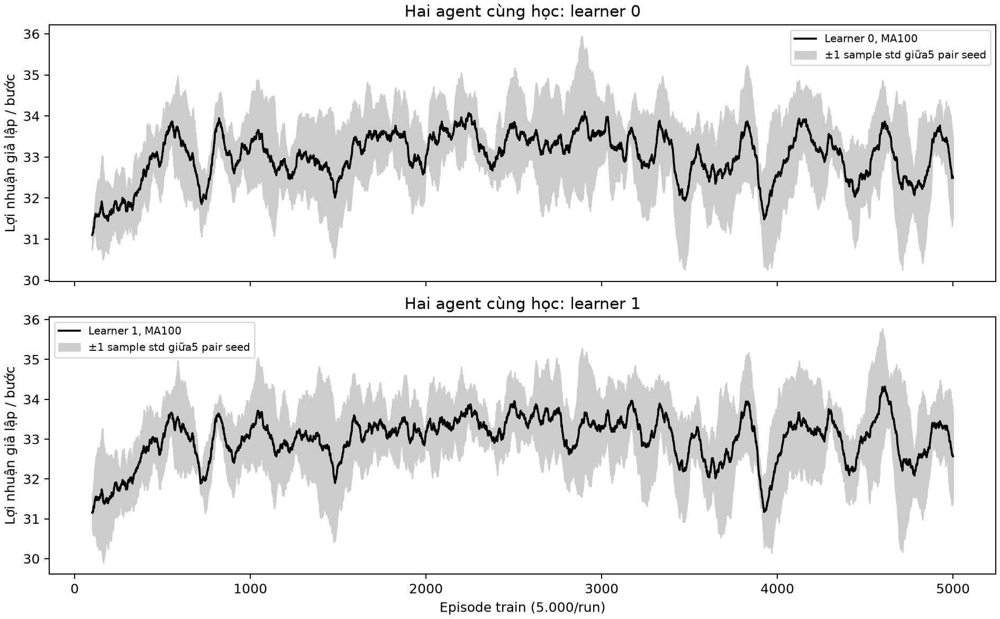

Hai panel tách learner 0/1; X là episode train, Y là profit/bước. Đường đen là mean
của MA 100 riêng từng seed; dải xám là ±sample std qua năm pair seed. Hai đường
vẫn dao động; mean train của learner 0/1 là 32,99454/
32,98117, không tăng đều đến cuối. Đây là quá trình cả hai
policy đang đổi; vùng mờ còn chứa khác biệt kinh nghiệm giữa seed. Không từ đó
quy riêng biến động cho non-stationarity hoặc kết luận hội tụ. Nguồn: D6, pair_train_curves.

**Hình F15. Checkpoint return và policy drift.**

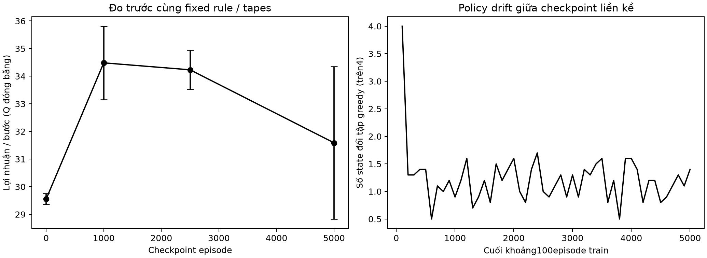

Trái: X là checkpoint, Y là profit/bước khi Q đóng băng trước fixed rule; chấm
mean, whisker là std sau gộp vai/learner trong pair, n 5 pair seed. Mean ở 1.000 episode
là 34,48443, ở 5.000 là 31,58872. Phải: X là cuối
mỗi khoảng 100 episode, Y là số state đổi tập greedy trên bốn state, lấy mean qua
10 learner thuộc 5 pair. Có 612 state-change trên 500 learner-interval; không phải
số lần đổi action trong timestep. Drift ở state ít gặp có thể không đổi return;
không chọn checkpoint 1.000 làm kết quả cuối chỉ vì mean cao hơn. Nguồn: D6.

**Bảng B09. Khi chỉ thay kernel: policy IID cũ và policy train lại.** Các policy
được đo trước cùng fixed rule và tapes trong từng kernel; n 5 seed/panel [D6].

|Kernel|Q IID cũ mean±std|Q train lại mean±std|Rule mean±std|
|---|---|---|---|
|persistent|34,54252 ± 0,71342|33,06165 ± 2,63493|35,02665 ± 0,25749|
|gold|30,16204 ± 1,09861|29,35694 ± 2,78040|31,07485 ± 0,21348|

**Hình F16. Robustness dưới persistent và Gold.**

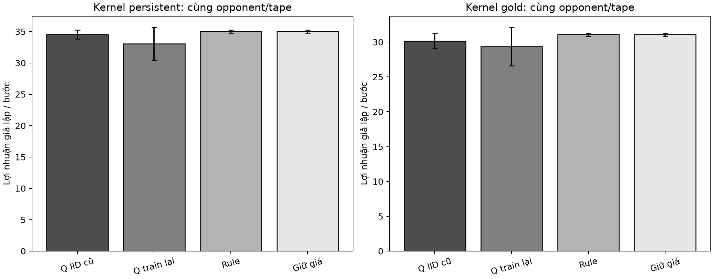

Mỗi panel là một kernel; X gồm Q IID cũ, Q train lại, rule và no-discount; Y là
profit/bước. Cột mean, whisker là std sau gộp hai vai. Delta train lại trừ Q IID cũ
là-1,48087±2,70026 ởpersistent,
-0,80510±3,54276 ởGold. Rule-vs-rule và
no-discount trùng hành vi giữ giá từ lịch sử reset 0, nên không coi hai cột đó là
hai chuẩn hành vi độc lập. Không so raw profit xuyên kernel như cùng phân phối.
Nguồn: D6, variant_seed/variant_summary/variant_deltas.

### 5.5. State bổ sung memory/time

**Bảng B10. Ba policy trên ba kernel.** Baseline ở đây đã train trên **cùng kernel**
với agent mới. Kết quả baseline/rule được reuse từ D5/D6; chỉ 30 claim của augmented
là đánh giá mới. Gộp hai vai trước, rồi mean/std qua năm seed [D7].

|Kernel|Memory/time mean±std|Baseline cùngkernel mean±std|Rule mean±std|
|---|---|---|---|
|iid|30,27341 ± 0,60242|34,02786 ± 1,22178|35,05235 ± 0,22585|
|persistent|30,97311 ± 1,69375|33,06165 ± 2,63493|35,02665 ± 0,25749|
|gold|27,10489 ± 0,28315|29,35694 ± 2,78040|31,07485 ± 0,21348|

**Hình F17. Train curves khi thay state.**

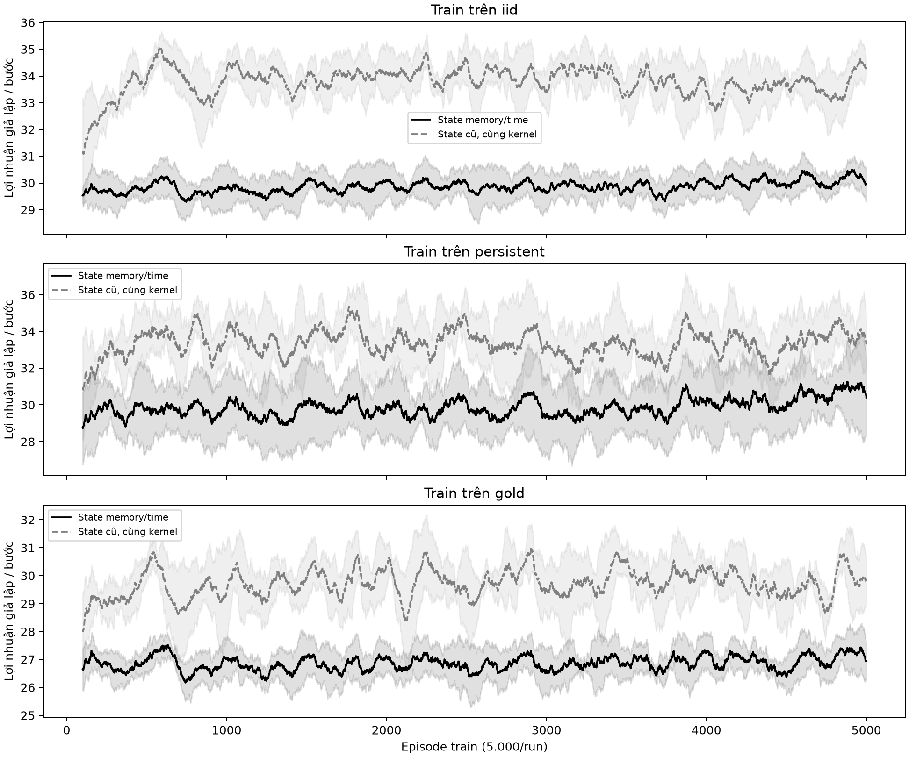

Ba panel là IID/persistent/Gold; X là episode, Y là profit/bước. Đen liền là state
memory/time, xám đứt là state cũ train cùng kernel; mỗi đường là mean MA 100 qua
năm seed, dải là sample std tương ứng. Ở cả ba panel, đường memory/time quan sát
thấp hơn phần lớn quá trình. Train reward còn exploration và Q thay đổi; không
thay nó cho final hoặc suy ra nguyên nhân chỉ từ hình. Nguồn: D7, train_curves.

**Hình F18. Final profit: state mới chưa vượt hai đối chứng.**

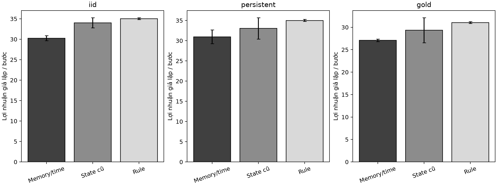

X là ba policy, Y là profit/bước; cột mean và whisker sample std, n 5 sau gộp vai.
IID memory/time đạt 30,27341 so với baseline
34,02786; Gold lần lượt
27,10489/29,35694.
Kết quả có std nhỏ hơn không đủ để gọi robust hơn nếu mean thấp hơn. Các panel
khác phân phối nên so trong từng kernel là chính. Nguồn: D7, policy_summary.

**Bảng B11. Delta ghép cặp của memory/time.**

|Kernel|Memory/time−baseline mean±std|Memory/time−rule mean±std|
|---|---|---|
|iid|-3,75445 ± 1,52304|-4,77894 ± 0,53768|
|persistent|-2,08854 ± 3,69446|-4,05354 ± 1,74828|
|gold|-2,25205 ± 2,93133|-3,96996 ± 0,40610|

**Hình F19. Chênh lệch theo seed, cùng opponent/tapes.**

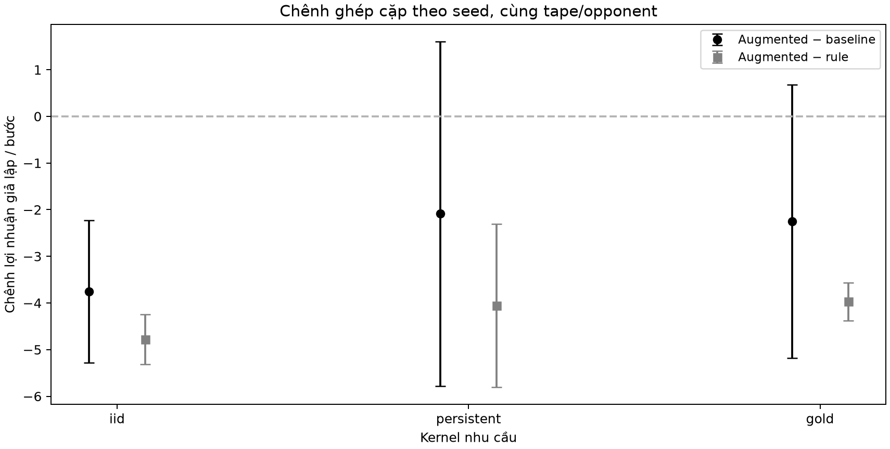

X là kernel, Y là profit augmented trừ đối chứng/bước. Tròn đen trừ baseline,
vuông xám trừ rule; đường đứt 0 là không chênh. Điểm là mean, whisker là sample
std của năm delta seed. Mean trừ baseline âm ở cả ba kernel: B11 ghi rõ mức chênh.
Whisker qua 0 không phải kiểm định; không loại seed bất lợi hoặc tăng budget sau
khi xem score để đảo kết luận. Nguồn: D7, paired_deltas/delta_summary.

**Hình F20. Visitation và chi phí của bảng lớn hơn.**

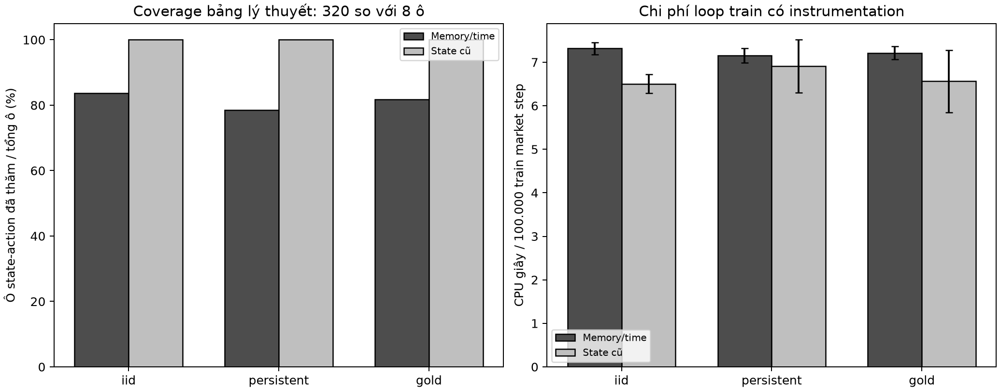

X là kernel. Trái: Y là phần trăm ô state–action đã được thăm trên tổng ô lý thuyết;
phải: Y là CPUgiây/100.000 train market step. Cột đậm memory/time, nhạt baseline;
panel phải có whisker là std qua 5 seed. Agent mới thăm 83,6%/78,4%/
81,8% của 320 ô trênIID/persistent/Gold, baseline
thăm 100% của 8 ô; một số fullstate không đạt được từ reset/horizon nên phần chưa
thăm không tự là lỗi. Qpayload float64 tăng 64 → 2.560 byte, không phải peakRAM. CPU
loop không gồm checkpointI/O và không phải benchmark hệ thống. Nguồn: D7, cost_coverage.

**Bảng B12. Kỳ vọng phân tích trên simulator đã biết, không phải score sampled.**
Oracle biết transition/reward và đối thủ rule; learner không nhận Q/action tối ưu
làm nhãn train. Cột γ 1 có cùng đơn vị profit/bước với metric chính [D7].
Mỗi learner có kỳ vọng riêng; cột memory/time lấy mean qua 5 policy đã train.
Oracle là một giá trị theo mô hình cho mỗi kernel, không phải năm lần train.

|Kernel|Oracle expected profit/bước (γ 1)|Memory/time expected profit/bước|
|---|---|---|
|iid|35,00000|30,21586|
|persistent|35,00000|30,96036|
|gold|31,01586|27,04324|

Rule từ reset có gap kỳ vọng 0 trong simulator này. Score 500 episode có thể hơi
cao hơn kỳ vọng oracle vì nhiễu: rule IID quan sát 35,05235 so với
kỳ vọng 35,00000. Không sửa score
để ép nằm dưới bound. Giá trị γ 0,9 trong CSV là discounted total riêng, không
trộn với profit/bước không chiết khấu hoặc gọi oracle là learner model-free.

## 6. Trả lời mười câu hỏi thí nghiệm

### 6.1. Câu 1 — Mô hình tác tử và môi trường

Hai tác tử là hai shop, dùng policy Q-learning và rule trong baseline. Môi trường
chung gồm nhu cầu, lịch sử action, cơ chế xác suất mua và reward. State local cũ
có bốn khả năng từ nhu cầu 0/1 và action trước của đối thủ 0/1; action giữ/giảm giá;
reward là profit. Sau action đồng thời, môi trường sinh sales, lưu action, lấy
nhu cầu mới và trả state/reward tiếp theo. E04 thể hiện đúng thứ tự này.

Theo PEAS, tiêu chí thành công là profit; môi trường là thị trường mô phỏng; bộ
chấp hành là quyết định giữ/giảm giá; thông tin quan sát là nhu cầu/lịch sử. Hai
policy cùng tác động đến xác suất mua và lịch sử của nhau nên đây là MAS qua môi
trường chung, dù không gửi thông điệp [S1, trang PDF 3–7; S6, trang PDF 3–5].

### 6.2. Câu 2 — Quyết định học từ kinh nghiệm và theo luật

| Khía cạnh | Rule-based | Q-learning |
|---|---|---|
| Ra quyết định | Theo nhánh điều kiện do người thiết kế viết | Theo Q đã học và epsilon khi train |
| Kinh nghiệm | Không tự sửa rule sau reward | Reward dùng sửa giá trị action |
| Thích nghi | Cần đổi rule nếu giả định thay đổi | Có thể học lại nhưng không bảo đảm tốt hơn |
| Chi phí | Không train; điều kiện đơn giản | Cần tương tác, lưu Q và kiểm tra nhiều seed |
| Giải thích | Chỉ ra nhánh luật đã dùng | Đọc state/action/Q và kết quả kiểm chứng |

Rule phù hợp khi ràng buộc rõ, cần quyết định nhất quán: ví dụ lọc nhà theo ngân
sách hoặc kiểm hồ sơ đặt lịch tư vấn tiểu đường có đủ trường thông tin. Ví dụ này
không đề xuất chẩn đoán/điều trị từ một nhãn dữ liệu. RL đáng cân nhắc khi quyết
định lặp lại có reward dài hạn và có môi trường thử nghiệm phù hợp, chẳng hạn
chính sách khuyến mãi trong simulator được kiểm chứng trước khi áp dụng.

Trong mẫu đang xét, rule control có mean 35,05235, cao hơn baseline
Q 34,02786; vì vậy khả năng học không đồng nghĩa ưu thế
mặc định. Kết quả này chỉ áp dụng simulator, budget và bộ seed hiện tại (B05,F09).

### 6.3. Câu 3 — Ý nghĩa cập nhật Q và phép tính cụ thể

Công thức cần dùng là:

**Q mới = Q cũ + α × [r + γ × max Q ở state kế − Q cũ].**

Q cũ là đánh giá đang có cho action vừa chọn. r là reward vừa nhận; maxQ ở state
kế là ước lượng tốt nhất cho bước tiếp theo; γ làm giảm trọng số lợi ích xa hơn.
Phần trong ngoặc là chênh giữa target mới và đánh giá cũ; α quyết định sửa bao
nhiêu phần của chênh đó. Ở terminal, target chỉ bằng r vì episode đã kết thúc.

Với số **giả định đề cho**, Q cũ 4, α 0,1, r 6, γ 0,9, maxQ kế 5:

1. Giá trị tương lai có chiết khấu:0,9 × 5=4,5.
2. Target:6+4,5=10,5.
3. Chênh target so Q cũ:10,5−4=6,5.
4. Phần cập nhật:0,1 × 6,5=0,65.
5. Q mới:4+0,65=**4,65**.

Q tăng từ 4 lên 4,65 vì tín hiệu mới tốt hơn đánh giá cũ, nhưng không nhảy thẳng lên
10,5 do alpha chỉ 0,1. Đây là phép tính giả định, không phải một reward hoặc Q đo
từ run. E03 và unit test kiểm đúng phép tính, đồng thời kiểm terminal. Công thức
theo [S1, trang PDF 6,10] và code; survey [S4] được dùng cho phần nền RL.

### 6.4. Câu 4 — Khám phá và khai thác

Epsilon-greedy chọn action ngẫu nhiên với xác suất epsilon; ngoài nhánh đó chọn Q
lớn nhất. Khám phá giúp thử action chưa biết rõ; khai thác dùng kinh nghiệm hiện
tại để thu reward. Khám phá quá nhiều có thể tiếp tục chọn action kém; dừng quá sớm
có thể giữ một đánh giá lệch vì ít được thử lại. Đây là đánh đổi, không phải quy
tắc “epsilon càng cao càng tốt”.

B04,F06–F07 so lịch giảm với epsilon 0,05 và 0,30 cố định. Mean train tương ứng
33,76528,32,89187,
30,92305; final tương ứng
34,02786,33,39952,
32,87013. Các số cuối đều đo với exploration
tắt, không phải vẫn giữ epsilon train. Lịch giảm có mean quan sát cao hơn trong
mẫu này, nhưng độ phân tán seed và n nhỏ hạn chế khẳng định tổng quát. E02 cho
thấy random tie vẫn khác exploration.

### 6.5. Câu 5 — Reward và mục tiêu kinh doanh

Không giảm giá: giá 10−chi phí 5=**5** lợi nhuận/món. Giảm 20%: giá mới 10 × 0,8=8,
lợi nhuận 8−5=**3**/món. Do đó sales tăng chưa chắc profit tổng tăng. Reward trong
bài ưu tiên profit, không đơn thuần số lượng bán [S1, trang PDF 4–5,10].

Nếu reward chỉ đếm sales, learner có thể thích action tăng xác suất mua dù margin
thấp. Nếu thêm tồn kho, phí khuyến mãi hoặc mục tiêu duy trì khách, hành vi tối ưu
cũng có thể khác. Đây là đề xuất thiết kế, không phải các reward đã được triển
khai trong số đo hiện tại. F04/F12 phản ánh action rate thực đo, không chứng minh
mối quan hệ nhân quả giữa giảm giá và profit ngoài mô hình.

### 6.6. Câu 6 — Tính reward trung bình và giới hạn một run

**Reward trung bình mỗi bước = tổng reward / tổng số bước.** B01 có ví dụ REF
train:3.345.548/100.000=33,45548 cho RL và
3.283.930/100.000=32,83930 cho rule. Đây là train
score, không phải kết quả policy cuối.

Với final native REF, tổng Q là 351275, rule
349685, mỗi shop 10000 bước;
mean tương ứng 35,12750/34,96850.
Native chỉ role 0 và RNG gốc, không đưa vào nhóm CONTROLLED n 5 (B06).

Baseline CONTROLLED sau gộp vai có Q mean 34,02786±
1,22178, rule trong cùng trận
33,21968±2,32629. Khi đối chứng
policy rule trước cùng fixed opponent, mean lại là 35,05235. Vì
đối thủ phản ứng với lịch sử, hai phép so sánh không được dùng thay nhau (B05,F10).

Một run chỉ quan sát một chuỗi kinh nghiệm. Nhu cầu, sales, exploration và phá
đồng hạng có thể làm Q cuối khác nhau giữa seed; B06 cho thấy các mean khác nhau
thật. Năm seed và sample std hữu ích hơn một run, nhưng không chứng minh ưu thế
ở thị trường thật hoặc coi mọi timestep là mẫu độc lập.

### 6.7. Câu 7 — Learning rate và độ ổn định

Alpha nhỏ chỉ sửa Q một phần nhỏ sau reward mới; alpha lớn phản ứng mạnh hơn với
quan sát gần nhất. Cập nhật mạnh có thể phản ứng nhanh nhưng cũng nhạy với nhiễu;
alpha nhỏ không tự bảo đảm policy tốt nếu budget hữu hạn và kinh nghiệm khác nhau.

B03,F05 đo α 0,01/0,10/0,50 với các phần khác giữ nguyên. Final mean±std lần lượt
33,90382±2,60833,
34,02786±1,22178,
32,06337±4,25085. Alpha 0,50
có độ phân tán final lớn nhất trong ba nhóm, trong khi std của mean **train** của
nó không lớn như vậy. Hai đại lượng đo khác nhau, nên không dùng curve train
ổn định hơn để kết luận policy cuối ổn định hơn. Kết luận giới hạn ở cấu hình,
budget và seed đã đo; không chọn lại alpha sau final.

### 6.8. Câu 8 — Tương tác và non-stationarity

Action hiện tại của đối thủ ảnh hưởng xác suất mua của shop mình; action trước
ảnh hưởng observation và phản ứng của rule ở bước sau. Khi hai Q-learning cùng
sửa policy, learner gặp một “đối thủ đang thay đổi”: cùng local observation/action
có thể cho kết quả khác do lựa chọn của đối thủ khác, ngoài nhiễu sales vốn có.
Điều này làm việc học khó hơn so với giả định đối thủ cố định.

Một thay đổi thực nghiệm là đóng băng checkpoint rồi đo trước cùng fixed opponent
và tapes. Bài đã thực hiện năm pair seed, hai learner riêng Q/RNG và bốn mốc 0/
1.000/2.500/5.000. B07,F15 có mean 34,48443 ởmốc 1.000 rồi
31,58872 ởmốc 5.000. Không có xu hướng final return tăng đều.
Policy drift và reward dao động chưa tách được riêng tác động nhân quả của đối
thủ đang học, vì alpha, observation và nhiễu vẫn tồn tại. Không chọn mốc tốt nhất
để thay checkpoint cuối hoặc xem 10 learner phụ thuộc là 10 replicate độc lập.

### 6.9. Câu 9 — Hạn chế và sửa môi trường thật sự

Ít nhất năm hạn chế là: conversion chỉ giả định minh họa; nhu cầu IID quá đơn giản;
state cũ thiếu lịch sử của mình/thời gian còn lại; không có inventory hoặc dị biệt
khách; hai shop không chia một lượng sales độc quyền. Gold bổ trợ vẫn là proxy
từ hướng giá, không phải dữ liệu cầu đo được. Các giả định này giới hạn khả năng
suy rộng, kể cả khi mean/std đã được tính đúng.

Sửa đổi đã triển khai là dùng demand Markov: persistent giữ chế độ với xác suất 0,9,
hoặc kernel hiệu chỉnh từ TRAIN Gold. Các phần giá/reward/action/rule/budget giữ
nguyên. E07 tạo các MarketConfig tương ứng; TrainSession cũ dùng đúng kernel đó,
không sửa thuật toán baseline để tạo kết quả thắng:

```python
def markets():
    data = protocol()
    baseline = MarketConfig(**data['market'])
    return {'iid': baseline, 'persistent': replace(baseline, kernel=data['future_variants']['persistent']['kernel']),
        'gold': replace(baseline, kernel=json.loads((BASE/'data/derived/gold_regime_kernel_v1.json').read_text())['kernel'])}
```

Nguồn E07: `phase06.py`, dòng 43–47; SHA256 `6cfec22472893221…` (hash đầy đủ trong code_excerpt_index.json).

Chỉ dùng 560 giá tháng đến 08/2006 để fit kernel (B08,F13). Trên mỗi
kernel mới, đo cả Q IID cũ đóng băng và Q train lại trước cùng fixed rule/tape.
Paired delta retrain−baseline ởpersistent là-1,48087,
ởGold-0,80510 (B09,F16). Trong budget này, train lại không
cải thiện mean. Không từ đó kết luận retrain luôn kém: từng seed khác nhau, chỉ
hai kịch bản sửa môi trường và n 5 nhỏ. Sửa kernel giúp kiểm độ bền trước thay đổi
nhu cầu giả lập, chưa giải quyết toàn bộ các hạn chế trên.

### 6.10. Câu 10 — Thiết kế agent đầy đủ hơn và kiểm chứng

Đề xuất thêm own_previous và remaining_steps vào state, giữ action giữ/giảm giá
và reward profit, dùng Q-learning 320 giá trị. Lý do là hai lịch sử cùng observation
cũ có thể làm rule hiện tại chọn khác nhau; thời gian còn lại cũng quyết định có
nên tính giá trị tương lai hay không. E08 cho thấy thời gian phải giảm đúng 1 và
terminal chỉ nhận reward hiện tại:

```python
def learn(self, state, action, reward, following, terminal):
    index = state_index(state)
    action = binary(action, 'action')
    if not np.isfinite(reward) or bool(terminal)!=(state[3]==1):
        raise ValueError('Invalid reward/terminal time')
    if terminal:
        target = reward
    else:
        following_index = state_index(following)
        if following[3]!=state[3]-1:
            raise ValueError('Remaining time must decrease exactly1')
        target = reward+self.config.gamma*float(self.q[following_index].max())
    key = (*index, action)
    self.q[key] += self.config.alpha*(target-self.q[key])
    if not np.isfinite(self.q[key]):
        raise ValueError('Nonfinite augmented Q update')
```

Nguồn E08: `code/augmented.py`, dòng 73–88; SHA256 `3638a130760b2bc3…` (hash đầy đủ trong code_excerpt_index.json).

Để kiểm robust, train trên ba kernel với cùng 5 seed và 5.000 × 20 budget, sau đó đo Q
đóng băng 500 episode/vai trước cùng fixed rule/tapes. So với baseline **đã train
trên cùng kernel** và rule; đọc paired return, std giữa seed, action rate và cost.
Các đối chứng cũ được reuse output, không forward lại để thay điểm (B10–B12,F17–F20).

Trong thực nghiệm, augmented−baseline mean là-3,75445
trênIID,-2,08854 trênpersistent và
-2,25205 trênGold. Mean đều thấp hơn đối chứng nên
chưa đạt mục tiêu cải thiện robust. State biểu diễn đầy đủ hơn là một lý do thiết
kế, không phải bảo đảm học tốt hơn dưới budget cố định. Bảng lớn hơn/cùng số tương
tác là một giả thuyết cần khảo sát thêm, chưa được chứng minh là nguyên nhân duy nhất.

Oracle tính lùi bằng simulator đã biết chỉ dùng đối chiếu kỳ vọng (B12). Nó không
cấp action/Q tối ưu làm nhãn hoặc khởi tạo learner; không gọi là tác tử model-free
đã học. Không dùng kết quả âm để âm thầm tăng budget hoặc tune lại. Một nghiên cứu
tiếp theo có thể đăng ký trước budget/ablation mới, rồi thu bộ đánh giá mới để
kiểm giả thuyết, thay vì sử dụng lại các score cuối hiện tại.

## 7. Thảo luận, hạn chế và hướng cải tiến

Kết quả chính là sự khác nhau giữa **có khả năng học** và **đã học được policy tốt**.
Trong core, baseline có mean final cao nhất trong năm cấu hình quan sát, nhưng
vẫn thấp hơn policy rule control. Trong phần mở rộng, retrain hoặc state nhiều
thông tin hơn cũng chưa bảo đảm profit cao hơn. Những kết quả không thuận kỳ vọng
được giữ đủ, giúp kiểm giả định thay vì chỉ chọn hình đẹp.

Một nguyên nhân khiến việc diễn giải dễ nhầm là reward của rule phụ thuộc policy
learner trong cùng trận. Q có thể lời hơn shop rule bên cạnh mà vẫn kém policy
rule khi cùng được đặt trước một fixed rule. Mặt khác, hai policy có Q khác ở
state không đạt tới có thể cùng score trên kịch bản reset hiện tại. Cần đọc cả
visitation và action thực tế, không chỉ argmax toàn bảng hoặc so một mean đơn lẻ.

Các dải và whisker đang mô tả sample std qua năm seed/panel, không phải CI. Các
checkpoint của cùng learner và hai learner cùng pair còn phụ thuộc nhau. Khi
không giữ đúng mẫu số này, báo cáo dễ phóng đại độ chắc chắn bằng cách coi hàng
nghìn episode/step là hàng nghìn learner độc lập. Bài không đưa ra kiểm định ý
nghĩa thống kê hoặc kết luận kinh doanh từ mức chênh nhỏ.

Gold được ưu tiên vì phù hợp câu hỏi thay đổi động lực theo thời gian, nhưng chỉ
chuyển **hướng giá lịch sử** thành một kernel nhu cầu giả lập. Không có bằng chứng
rằng giá gây cầu, dữ liệu không phải thời gian thực và vintage có thể sửa hồi tố.
Ngược lại, bảng tiểu đường hoặc giá bán nhà lịch sử không có chuỗi action–reward
do can thiệp, nên không được gán thành môi trường RL điều trị/giao dịch chỉ để
đủ miền dữ liệu. Các ví dụ tiểu đường/nhà trong câu 2 chỉ minh họa lựa chọn policy.

Hướng tiếp theo đáng kiểm là bổ sung inventory/khách hàng, kiểm các trạng thái
reachable rõ hơn, khảo sát budget học lớn hơn cho bảng state lớn và đối thủ khác.
Mỗi hướng phải thay một yếu tố có kiểm soát, giữ baseline và định trước đánh giá.
Các đề xuất này chưa có số đo trong bài. Không xem oracle tối ưu theo simulator
là chứng minh policy nào sẽ tối ưu khi các giả định thị trường không còn đúng.

Về tái lập, full source, raw reward, checkpoint/RNG, Q/policy, saved evaluation,
CSV, figure notes và manifests đi kèm. Trích code E01–E08 có vị trí và hash nguồn;
hash đầy đủ nằm trong chỉ mục code. Các bảng được dựng từ saved artifact có hash,
không chép expected results. Bản Python thầy, raw dữ liệu và kết quả các bài cũ
không được sửa hoặc chạy lại khi biên soạn báo cáo này.

## 8. Kết luận

Bài đã mô hình hóa hai shop tương tác, triển khai rule và Q-learning, chạy các
thí nghiệm A–E, lặp nhiều seed, đánh giá Q đóng băng và khảo sát hai phần mở rộng.
Kết quả thực cho thấy learner không luôn vượt rule, train reward không thay thế
final return và việc thêm state hoặc train lại không tự bảo đảm cải thiện.

Giá trị của bài nằm ở phép so sánh có thể truy ngược: giữ nguyên reward/đối chứng,
công khai seed và mẫu số, tách các nguồn ngẫu nhiên, báo đủ kết quả bất lợi và
giải thích đúng điều mỗi bảng/hình đo được. Các kết luận giới hạn trong simulator,
budget và kịch bản hiện tại; chưa chứng minh hiệu quả ở hệ thống kinh doanh thực.

## 9. Tài liệu tham khảo và nguồn số liệu

[S1] Tài liệu giảng dạy được cung cấp, *Intelligent System Development Laboratory
Experiment 02: Reinforcement-Learning-Based Agents versus Rule-Based Agents*,
`assignment_Agent02_due_29.10.pdf`,13 trang. Yêu cầu A–E: trang PDF 8–9;10 câu:10–11;
cấu trúc báo cáo/rubric:11–12. Bản gốc và hash tại sources/manifest.json.

[S2] Tài liệu giảng dạy được cung cấp, *AGENT02: Python Implementation —
Reinforcement-Learning-Based Agents and Rule-Based Agents*,
`agent02_complementary_code.pdf`,7 trang, đặc biệt trang PDF 4–7. Bản cung cấp là
companion hướng dẫn; code Python đầy đủ ở S3.

[S3] Mã tham chiếu thầy cung cấp, `agent02_code.tex` (nội dung Python),966 dòng.
Bản byte-identical ở `code/agent02_experiment.py`; source hash trong
sources/manifest.json và evidence/phase01/input_lock.json.

[S4] Muddasar Naeem, Syed Tahir Hussain Rizvi và Antonio Coronato (2020), *A Gentle
Introduction to Reinforcement Learning and Its Application in Different Fields*,
IEEE Access. DOI:10.1109/ACCESS.2020.3038605. Bản PDF thầy cung cấp,25 trang; dùng
phần nền RL. Công thức và phép tính Q trong bài đối chiếu với S1/code.

[S5] Khanh-Tung Tran, Dung Dao, Minh-Duong Nguyen, Quoc-Viet Pham, Barry O’Sullivan,
Hoang D. Nguyen (2025), *Multi-Agent Collaboration Mechanisms: A Survey of LLMs*,
arXiv:2501.06322v1, 35 trang. Chỉ tham khảo khái niệm/kiểu tương tác, không triển khai
hệ LLM hoặc lấy kết quả survey làm kết quả thí nghiệm này.

[S6] Tài liệu giảng dạy được cung cấp, *Developing Multiagent Systems: A Practical
Tutorial with Python and PyTorch*, `slide_multiAgent_system_20.10.2026.pdf`,25 trang.
Dùng phần agents/MAS/PEAS để đối chiếu; các bài MAS riêng trong slide không thuộc
phạm vi Agent02 đã xác nhận.

[S7] World Bank, *Commodity Price Data (The Pink Sheet), Historical Monthly Prices*.
Nguồn dataset: https://www.worldbank.org/en/research/commodity-markets . Snapshot
local `CMO-Historical-Data-Monthly.xlsx`; bài này chỉ dùng prefix TRAIN Gold
1960-01–2006-08. Provenance/cutoff/source/split/TRAIN IDs có hash trong
data/derived/gold_regime_kernel_v1.json, không tuyên bố dùng giá validation/TEST.

[D2] Protocol/code và phép tính kiểm thử Agent02, docs/protocol_v1.json,
docs/model_core_v1.md; khóa evidence/phase02/protocol_lock.json.

[D3] Baseline train/DEV/Q/policy, artifacts/runs/ref/baseline/s0042 và
artifacts/runs/controlled/iid/baseline/s0011; metrics phase 03 và khóa
evidence/phase03/experiment_lock.json. DEV/smoke không gộp vào final.

[D4] Sweeps train 25 run, artifacts/metrics/phase04/ và artifacts/figures/phase04/;
khóa evidence/phase04/experiment_lock.json.

[D5] Final core/control/native, artifacts/evaluation/phase05/ và
artifacts/metrics/phase05/; khóa evidence/phase05/experiment_lock.json.

[D6] Two-learners/variant/Gold, artifacts/metrics/phase06/,
artifacts/evaluation/phase06/ và data/derived/gold_regime_kernel_v1.json;
khóa evidence/phase06/experiment_lock.json.

[D7] Memory/time và oracle tách biệt, artifacts/metrics/phase07/,
artifacts/evaluation/phase07/, code/market_oracle.py; khóa
evidence/phase07/experiment_lock.json. Chỉ mục reference ghi 60 claim được reuse,
không tính chúng thành forward mới.
