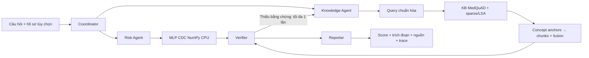

# Kiến trúc chốt ở Phase 1

## Bài toán và phạm vi

Người dùng đặt câu hỏi kiến thức, cung cấp hồ sơ khảo sát có cấu trúc, hoặc yêu cầu cả hai. Hệ quyết định gọi công cụ cần thiết, kiểm kết quả và trả phản hồi có trace/nguồn. Đây là hệ điều phối nhiều vai trò theo luật, không phải mô hình LLM-agent, không học chính sách mới và không nhận nhiệm vụ mở.

Một yêu cầu có cả hồ sơ và câu hỏi liên quan sẽ có **hai kết quả specialist thật** trong shared state, sau đó mới tổng hợp. Không yêu cầu người dùng biết chunk ID; ID chỉ là locator của bằng chứng sau search.

## Năm vai trò

| Agent | Input | Quyết định / tool được phép | Output / giới hạn |
|---|---|---|---|
| Coordinator | mode, question, profile, language | Kiểm schema/phạm vi; gọi risk, knowledge hoặc cả hai; lập lịch hữu hạn | Plan + trạng thái; không đoán feature còn thiếu |
| Risk Agent | 21 trường đúng schema | Xác nhận đủ trường/mã; frozen preprocessing → MLP → sigmoid | Score/nhãn lịch sử + model hash; không chẩn đoán, không giải thích nhân quả |
| Knowledge Agent | Câu hỏi, normalized query, evidence request tùy chọn | Sparse/LSA search, concept-anchor lookup, rank fusion, chọn trích đoạn hỗ trợ | Chunk/document/score/path/source; thiếu bằng chứng trả trạng thái thiếu, không bịa |
| Verifier | Specialist outputs, evidence, receipts | Kiểm profile/model contract, số/đơn vị, tồn tại và nội dung citation; yêu cầu retrieval bổ sung tối đa 1 lần | Accepted / clarification / insufficient / rejected; hash không thay bằng chứng ngữ nghĩa |
| Reporter | Chỉ các mục đã được xác nhận hoặc trạng thái lỗi | Kết hợp kết quả số và bằng chứng đúng scope; không tự gọi model/tool hoặc thêm phát biểu mới | Phản hồi có các phần rõ: score, kiến thức, nguồn, hạn chế |

## Hợp các hàm

`validate_request → plan_request → {validate_profile → transform → predict; normalize_query → search_sparse/search_lsa → graph_candidates → fuse → extract} → verify → [retrieve_again ≤ 1] → compose → emit_trace`.

| Hàm | Input → xử lý → output |
|---|---|
| validate_request | JSON hữu hạn → kiểm trường/mode/ngôn ngữ/độ dài → request hợp lệ hoặc lỗi |
| plan_request | Yêu cầu + profile → quyết định tool cần thiết theo intent → danh sách hành động và lý do ngắn có cấu trúc |
| validate_profile | Profile → kiểm đủ 21 trường, finite, mã/range → danh sách thiếu/sai hoặc profile đúng |
| transform | Profile hợp lệ → dùng mean/std TRAIN đã khóa theo thứ tự canonical → tensor float32 (1,21) |
| predict | Tensor + weights pin → 6 Dense, activations, sigmoid → score [0,1], nhãn theo `p > 0.5` |
| normalize_query | Query en/vi → giữ tiếng Anh hoặc ánh xạ cụm từ giới hạn → query và bản ghi mapping; không dịch toàn văn |
| search_sparse/search_lsa | Query → tìm trong hai index đã fit → danh sách chunk có score hữu hạn |
| graph_candidates | Concept lexical match → đường concept → chunk đã có → candidate/path; không suy luận quan hệ nhân quả |
| fuse | Sparse/dense/graph ranks → dùng trọng số/rank fusion đã khai báo → top-k |
| extract | Query + evidence → chọn câu/trích đoạn hỗ trợ đúng chủ đề → answer draft + citation hoặc insufficient |
| verify | Số, evidence và answer draft → kiểm integrity và hỗ trợ nội dung riêng biệt → acceptance/errors/retrieval request |
| compose | Các output được phép → trình bày bằng template → câu trả lời; score không được đổi thành phát biểu lâm sàng |
| emit_trace | Shared state → chỉ ghi hành động/tool/result/timing → trace; không chain-of-thought |

Đây là hợp hàm cần triển khai ở Phase 2, không phải danh sách hàm đã hiện diện hoàn chỉnh trong Phase 1.

## KB, KG và RAG thực tế

- KB: 762 đoạn/247 document MedQuAD từ snapshot đã bảo toàn.
- Graph: 62 nút neo khái niệm với quan hệ tới chunk. Chỉ dùng hỗ trợ candidate/ranking; không gọi là ontology y khoa đầy đủ hoặc tự suy bệnh theo đường graph.
- RAG: nhận text → retrieval/fusion → trả lời trích xuất có nguồn. Không LLM, không neural embedding; dense là TF–IDF/SVD LSA.
- Medical indexes mới chỉ nạp đúng hash; corpus/graph container đang chung với finance nhưng loader project chỉ giữ miền medical. Phase 2 đóng gói subset medical nhỏ, có lineage và parity, không rebuild index/tune bằng TEST cũ.
- Compact corpus thiếu raw URL từng document. Citation hiển thị repository/commit MedQuAD + document/chunk locator + hash, không suy đoán một URL NIDDK hoặc khẳng định đã xác minh nguồn y khoa hiện tại.

## State, budget và lỗi

Shared state một request: `request_id, intent, profile_validation, query_original, query_normalized, mapping, plan, risk_result, evidence, graph_paths, verification, answer, trace, elapsed_ms`.

State machine: `received → validated → planned → specialists_done → verified → [retrieve_once → verified] → reported`; nhánh dừng là `clarification / refused / insufficient_evidence / unavailable / timeout`. Request tổng tối đa 30s, tối đa 8 tool attempts, mỗi tool retry transient tối đa 1 lần, retrieval bổ sung tối đa 1 lần, mọi lần thử đều vào budget. Chạy model/index CPU trong worker có thể kết thúc thực sự khi quá giờ; không dùng timeout chỉ đổi nhãn trong khi process vẫn chạy.

Knowledge-only không bắt profile; numeric-only không tạo citation y khoa giả; combined thiếu feature vẫn có thể trả phần kiến thức nhưng phải nêu rõ phần dự đoán chưa chạy. Verifier không sửa score, không tự thêm evidence, không trả nội dung bị tool lỗi như thể thành công.

## Web/API dự kiến cho Phase 2

React dùng style tiểu luận3 với bốn khu: câu hỏi/hồ sơ, kết quả/nguồn, trace, so sánh. Python backend export từ notebook với module namespace project riêng; một đường implementation cho notebook và web.

- `GET /health`: process sống; `GET /ready`: model/index/source parity sẵn sàng hay thiếu artifact.
- `POST /api/v1/assist`: `{mode: knowledge|numeric|combined, question, profile?, language: en|vi}` → `{request_id,status,risk?,knowledge?,verification,trace,limitations}`.
- Schema chi tiết, lỗi HTTP và test input triển khai Phase 2. Không tạo upload pickle, shell tool, URL tool hoặc quyền đọc path từ câu hỏi.

Runner hiện tại riêng `project01/scripts/run.ps1`, không thay registry 11 bài. Runtime view tiểu luận3 chỉ dùng cho compatibility serialized class/module ở probe Phase 1; thư mục output project tách biệt.
