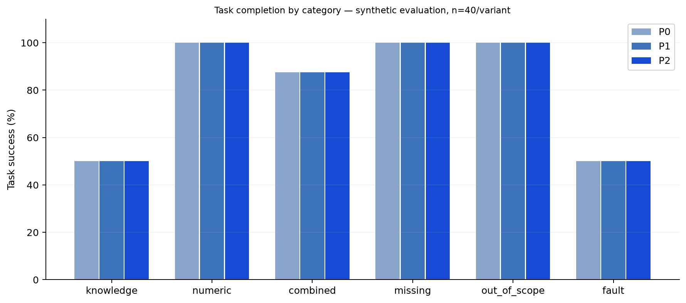
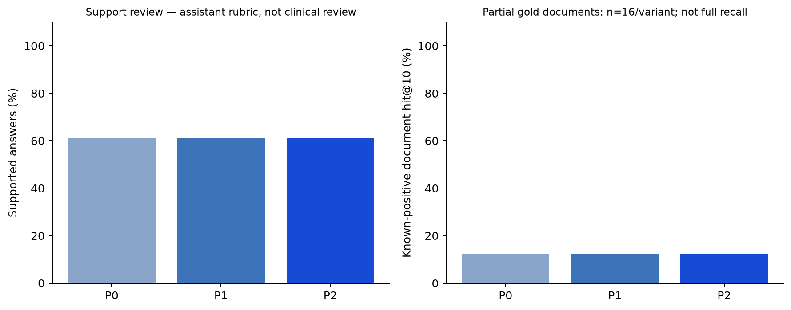
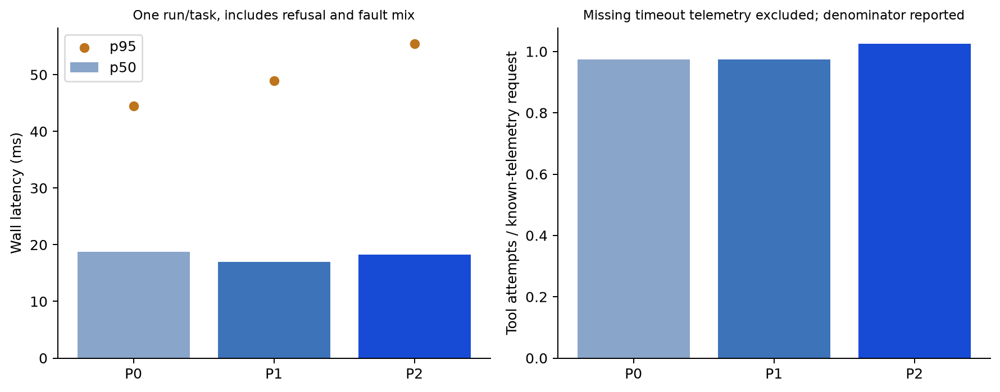

# Project01 — Hệ đa agent cho tiểu đường

## Bài toán, dữ liệu và code

Coordinator chọn tool; Risk Agent kiểm đủ21 field rồi gọi model; Knowledge Agent tìm theo câu hỏi trong KB, dùng graph hỗ trợ ranking; Verifier kiểm số/citation/nội dung và có thể yêu cầu retrieval thêm một lần; Reporter trình bày kết quả được phép. Đây là điều phối theo luật, không LLM/học phối hợp mở, không chẩn đoán. Combined gọi cả model và RAG thật; không yêu cầu người dùng nhập chunk/record ID như demo cũ. Trace ghi hành động/tool/result/timing, không chain-of-thought. Budget30s/request,≤8 attempts; timeout terminate/join worker thật.

CDC binary253.680 dòng/21 feature; positive gộp prediabetes/diabetes. Dùng scratch seed42 với6 Dense64/64/32/32/16/1 và frozen TRAIN preprocessing. Score class-weighted không phải xác suất mắc mới đã hiệu chuẩn; không train hoặc mở predictive TEST cũ.

MedQuAD762 chunk/247 document tiếng Anh;62 lexical anchor→chunk, không ontology đầy đủ. BM25/LSA giữ nguyên index; LSA không neural embedding. Fusion sparse0,6/dense0,1/graph0,3, RRF k60,top10. Citation chỉ repository/commit/local locator, không dựng URL riêng từng bài hoặc nhận là tài liệu y khoa hiện hành. Glossary tiếng Việt hữu hạn, không dịch máy.

Full code nằm trong3 notebook và export một chiều cho backend. Package medical-only4.772.359 byte. Index parity với implementation gốc PASS3 query×2 index; model parity PASS3 TRAIN profile, tolerance1e-6. Web có input validation, package/notebook/export checks, CORS allowlist và giới hạn concurrency/rate. Fault injection không vào public API.

## Thiết kế đánh giá

20 development và40 evaluation mới. Evaluation gồm knowledge8,numeric8,combined8,missing6,out-of-scope6,fault4. Profile synthetic, không bệnh án; gold evidence chọn theo nội dung corpus, không theo ranking/QA TEST cũ. Hai split không giao exact profile hash/gold document/selected text; task vẫn theo template, không đại diện mọi câu hỏi ngoài đời.

P0 gọi tool trực tiếp, combined được gọi cả hai; P1 thêm điều phối/specialists; P2 thêm verifier/reporter và một retrieval loop. Cùng model/corpus/budget/policy. Freeze sau development,18 integration test và15 browser checks; đủ120 unique pair/claim/raw output, không rerun. Review54 answer/citation do **Codex assistant** đọc theo rubric, không independent human/clinical review. Metric cuối không chỉ dựa HTTP200 hoặc citation tồn tại.

## Kết quả

| Biến thể | Task success | Automatic checks | Support đầy đủ | Known-positive doc hit@10 | p50/p95(ms) |
|---|---:|---:|---:|---:|---:|
| P0 |33/40=82,5%|38/40=95%|11/18=61,1%|2/16=12,5%|18,79/44,49|
| P1 |33/40=82,5%|38/40=95%|11/18=61,1%|2/16=12,5%|16,99/48,97|
| P2 |33/40=82,5%|40/40=100%|11/18=61,1%|2/16=12,5%|18,21/55,48|

Không kết luận P2 tăng chất lượng end-to-end. P2 chặn score bị sửa và phục hồi citation sai, nên automatic checks tăng2 ca; nhưng phần giải thích trong các ca đó vẫn chỉ là navigation text, review cuối chưa đạt. Cần phân biệt ngăn lỗi công cụ và tạo một câu trả lời đầy đủ. Benign numeric/combined giữ48/48 numeric parity (16×3), không phải predictive accuracy với nhãn bệnh.

### Hình1 — Task success theo nhóm

Trục ngang6 category, trục dọc tỷ lệ hoàn thành đầy đủ(%), màu là P0/P1/P2. Mẫu số mỗi variant:knowledge8,numeric8,combined8,missing6,out-of-scope6,fault4. Knowledge4/8,combined7/8,fault2/4; numeric/missing/out-of-scope đạt toàn bộ. Ba cột bằng nhau cho thấy thêm agent chưa sửa được lớp trích xuất chung. Missing100% nghĩa là yêu cầu bổ sung hồ sơ đúng, không phải chẩn đoán đúng.

### Hình2 — Support và retrieval

Trái:variant trên trục ngang, tỷ lệ supported trên trục dọc, mẫu số18/variant (16 knowledge/combined và2 fault có answer). Phải:known-positive document hit@10 trên16 case có gold. Kết quả11/18 và2/16.

Gold chỉ là một ví dụ supporting document, không exhaustive qrels. Câu hỏi rộng/corpus nhiều tài liệu tương tự nên có thể lấy đoạn đúng từ document khác. **12,5% không phải recall đầy đủ**, không đồng nghĩa87,5% answer sai. Review nội dung bổ sung cho metric ID nhưng chỉ do trợ lý thực hiện; cần nhiều reference và review độc lập để kết luận mạnh hơn.

### Hình3 — Chi phí phối hợp

Trái:cột p50/chấm p95 wall latency(ms),40task/variant gồm cả từ chối/fault; không là tốc độ model riêng hoặc số đo Render. Phải:mean tool attempts trên39 request có telemetry/variant, khoảng0,974/0,974/1,026. Một timeout không nhận được trace nên loại khỏi mean, không điền0. Task bị từ chối/thiếu field không gọi tool nên trung bình có thể dưới1. P2 thêm retrieval loop khi evidence không hợp lệ. Một lượt/task trên WSL không chứng minh ưu thế tốc độ tổng quát.

## Demo, hạn chế và bàn giao

Web có4 khu câu hỏi/hồ sơ, kết quả/nguồn, trace và so sánh. Bấm chạy gọi cả3 phương pháp thật; benchmark table đọc saved summary. Desktop/mobile kiểm trình duyệt không mock; API không lưu hồ sơ. Source notebook/export/package có parity check; gói serving không cần dữ liệu tài chính/raw CSV.

Thất bại đã quan sát:retinopathy chỉ còn fragment; type1 nhận câu type2 bị cắt; prediabetes chỉ trả ‘Learn more’; neuropathy/hypoglycemia thiếu ngữ cảnh subtype. Verifier dùng integrity/numeric/verbatim/topic-token heuristic, không semantic entailment y khoa mạnh. Giữ nguyên source/evaluation sau khi thấy lỗi. Cải thiện sentence selection/context/qrels hoặc thêm LLM phải là thử nghiệm mới độc lập, không tune bộ này rồi báo lại số đẹp.

Raw giữ ở `evaluation/raw_results`, bản derived chỉ thêm review/task labels và dẫn nguồn hash; số model/trace/timing không đổi. Ba plot đã QA, chỉnh style font/bounding box bằng wrapper gọi hàm plot frozen trong notebook03, không đổi dữ liệu. Render mới là template/source check local, chưa deploy. Phase3 đưa case study vào DOCX final; không cần DOCX project riêng.
