# MỞ ĐẦU

## 0.1. Lý do chọn đề tài

Một bộ dữ liệu sức khỏe có thể được dùng để phân loại nhãn khảo sát, một bức ảnh để nhận
diện vật thể, còn lịch sử giá vàng để dự đoán các mốc tiếp theo. Cả ba đều tạo ra đầu ra
từ dữ liệu, nhưng cách tổ chức thông tin khác nhau. Dữ liệu bảng cần quan tâm ý nghĩa
cột; ảnh cần giữ quan hệ không gian; chuỗi cần giữ thứ tự thời gian. Chọn mô hình mà
không xét những khác biệt đó dễ dẫn đến một chương trình chạy được nhưng kết luận sai.

Tiểu luận khảo sát lịch sử AI và thực nghiệm các kỹ thuật ML, CNN, RNN–LSTM, KB/KG–RAG
và hệ đa tác tử. Nội dung nối các bài thực hành bằng một quy trình chung: xác định bài
toán, kiểm tra dữ liệu, mô tả phép biến đổi, học mô hình, đánh giá và đưa checkpoint
vào giao diện minh họa. Lịch sử giúp hiểu vì sao các ý tưởng xuất hiện; thực nghiệm
cho biết chúng hoạt động đến đâu trong điều kiện cụ thể của đề tài.

Các miền tiểu đường, giá nhà và giá vàng được ưu tiên ở nơi phù hợp. Với dữ liệu bảng,
CDC và Ames tạo hai bài toán phân loại/hồi quy. Ảnh võng mạc IDRiD tạo ví dụ liên quan
biến chứng tiểu đường, nhưng không thay thế việc đọc ảnh của bác sĩ. Chuỗi vàng World
Bank và chỉ số nhà BIS cho thấy bài toán dự báo cần xử lý lịch, đơn vị và thời điểm
thông tin khả dụng. Dữ liệu đối chứng ở những miền khác giúp tránh đồng nhất một kỹ
thuật với một ứng dụng duy nhất.

Việc học từ đầu bằng NumPy làm rõ các phép tính mà một lời gọi thư viện có thể che đi.
Keras và PyTorch giúp đối chiếu cách tổ chức mô hình, tự động vi phân và chạy GPU.
So sánh này chỉ có nghĩa khi chúng nhận cùng dữ liệu, cùng kiến trúc và cùng ngân sách.
Do đó, trọng tâm không phải chọn một tên framework “tốt nhất”, mà là giải thích được
đầu vào đi qua những hàm nào và số liệu cuối được tạo ra như thế nào.

## 0.2. Mục tiêu và câu hỏi nghiên cứu

Mục tiêu của đề tài là xây dựng một khảo sát cơ bản, dễ theo dõi và có bằng chứng thực
nghiệm. Phần lý thuyết đi từ bài toán, ví dụ và luồng xử lý đến các phép tính cần để đọc
code scratch. Không dùng khai triển toán dài thay cho giải thích hoạt động của mô hình.

Các câu hỏi chính được gắn với chương thực nghiệm:

- Với dữ liệu bảng, ba implementation MLP khác nhau thế nào về chất lượng, thời gian,
  bộ nhớ và khả năng đóng gói khi so với mô hình ML cổ điển?
- Với ba miền ảnh, CNN cùng kiến trúc có tạo ra kết quả tương tự giữa scratch, Keras
  và PyTorch không? Những lỗi nào vẫn xuất hiện dù đã đủ độ sâu?
- Trên các chuỗi vàng, nhà và điện năng, LSTM có giảm sai số so với RNN và các quy tắc
  dự đoán đơn giản không? Kết luận thay đổi thế nào theo horizon và giai đoạn?
- Bổ sung knowledge graph vào truy hồi có cải thiện việc tìm đúng bằng chứng không?
  Citation hợp lệ có đồng nghĩa với câu trả lời đúng không?
- Thêm router, verifier và reporter có giúp kiểm soát lỗi công cụ so với gọi trực tiếp
  không, và chi phí phối hợp thể hiện ở đâu?

Không câu hỏi nào mặc định mô hình sâu hơn hoặc hệ nhiều vai trò hơn phải tốt hơn.
Kết quả âm được giữ lại để phân biệt giới hạn của cấu hình với lỗi đo lường hoặc lỗi mã.

## 0.3. Đối tượng và phạm vi

Chương1 dùng Iris, MNIST và metadata ImageNet làm ba trường hợp lịch sử, không huấn luyện
mô hình. Chương2 khảo sát CDC Diabetes, Ames Housing và Bank Marketing. Chương3 dùng
IDRiD, EuroSAT và CIFAR-10. Chương4 dùng vàng World Bank, chỉ số nhà BIS và điện năng
Household Power, với cả RNN và LSTM. Chương5 giữ MedQuAD, FinQA và Wikidata; hai nguồn
đầu có benchmark QA, còn Wikidata phục vụ cấu trúc/liên kết thực thể. Chương6 dùng ba
bộ nhiệm vụ mới theo miền tiểu đường, nhà và vàng, xây trên snapshot đã có.

Mạng MLP, RNN và LSTM có sáu lớp học được; CNN có bảy lớp. Input, activation, pooling,
bước thời gian và từng cổng LSTM không được dùng để tăng số đếm. Độ sâu này phục vụ
yêu cầu môn học và tính đối chiếu, không phải bằng chứng kiến trúc tối ưu. Mã đầy đủ
được giữ trong module và notebook mỏng; thân chương chỉ trích phần cần để hiểu cơ chế.

KB/KG–RAG trong đề tài dùng truy hồi và trả lời trích xuất có nguồn, không tái tạo toàn
bộ mô hình sinh trong công trình RAG gốc [1]. Hệ đa tác tử là điều phối
nhiều vai trò theo luật xác định, không phải LLM tự chủ hoặc hệ suy luận mở. Hai phạm
vi này cần được phân biệt với các thuật ngữ rộng hơn trong nghiên cứu.

## 0.4. Phương pháp thực hiện

Dữ liệu được thu nhận từ nguồn có provenance và lưu phiên bản/hash. Trước khi train,
EDA xác định kích cỡ, phân bố, nhãn thiếu, trùng lặp và giới hạn giấy phép. Dữ liệu bảng
được xử lý theo nhóm trùng khi cần; ảnh giữ official TEST; chuỗi chia theo lịch của
target. Scaler, imputer, vocabulary và trọng số lớp chỉ dùng phần train đã khóa.

Ba implementation cùng họ dùng cùng canonical weights ban đầu, thứ tự batch, split và
budget. Một số tập train lớn dùng matched subset đã khai báo để scratch có thể chạy;
full validation và TEST được giữ. Các bảng không ghép matched-subset với full-train
như cùng điều kiện. Ba seed mô tả độ ổn định, không tạo thành ba quần thể độc lập.

Validation dùng chọn checkpoint. TEST mở sau khi khóa cấu hình, mã đánh giá và danh
sách lượt chạy; các bảng/hình tiếp theo đọc prediction đã lưu. Một sự cố schema khi
hoàn tất TEST chuỗi được phục hồi bằng output cũ và journal có phiên bản, không dự
đoán lại những claim đã sử dụng. Cách xử lý này được trình bày cùng giới hạn số đo ở
Chương4 để không biến lỗi vận hành thành kết quả thuận lợi hơn.

Phân loại đọc đồng thời macro-F1, recall và confusion matrix thay vì chỉ accuracy.
Hồi quy/dự báo dùng sai số theo đơn vị gốc, tách horizon và chuỗi. Truy hồi tách tìm
bằng chứng, trả lời và citation. Tác tử tách hoàn thành câu trả lời với từ chối đúng
rubric. Thời gian và bộ nhớ luôn đi kèm điều kiện đo; số chưa đo không được điền0.

Mô hình được train offline trên NumPy CPU hoặc TensorFlow/PyTorch GPU trong hai môi
trường đã khóa. API CPU dùng NumPy portable để phục vụ weights; chế độ local GPU dùng
framework native. Giao diện React cho chọn chương/dataset, nhập một input chung và xem
các implementation. Inference minh họa không phải một lần kiểm tra TEST hoặc phép đo
chất lượng mới. Triển khai cloud chưa được coi là thành công chỉ vì build local đạt.

## 0.5. Ý nghĩa và giới hạn sử dụng

Đóng góp học tập của đề tài nằm ở việc liên kết cơ chế với mã và kết quả có thể kiểm
tra. Hợp hàm mô tả toàn luồng, còn bảng từng hàm giải thích input/output, shape, tham
số và trường hợp biên. Cùng contract được dùng trong code, báo cáo và web để hạn chế
việc ba nơi mô tả ba kiến trúc khác nhau.

Các snapshot có giới hạn đại diện. CDC là khảo sát tự báo cáo; ảnh y khoa có dữ liệu
ít; Ames phản ánh giao dịch lịch sử ở một địa phương. BIS là chỉ số, không phải giá
một căn nhà. Vàng và BIS không có bộ vintage đầy đủ để chứng minh thông tin đã được
công bố đúng ngày dự báo. Điện năng chỉ từ một hộ. Benchmark tác tử có template tổng
hợp và quyền công cụ hẹp, không phản ánh mọi câu hỏi thực tế.

Vì vậy, output không dùng cho chẩn đoán, quyết định điều trị, định giá hiện tại hoặc
mua bán tài sản. Nguồn dẫn có thật cũng không chứng minh nội dung đúng chuyên môn.
Những giới hạn này được giữ ngay cạnh kết quả và khi trình diễn giao diện.

## 0.6. Bố cục tiểu luận

Chương1 trình bày các mốc AI và ba benchmark lịch sử. Chương2 đi từ ML cơ bản đến MLP
trên dữ liệu bảng. Chương3 giải thích CNN và thực nghiệm ảnh. Chương4 phát triển RNN
sang LSTM, so sánh trên cùng chuỗi. Chương5 tổ chức tri thức và truy hồi bằng chứng.
Chương6 kiểm tra sự phối hợp và kiểm chứng giữa nhiều vai trò. Cuối mỗi chương thực
nghiệm có một mục triển khai ngắn; hướng dẫn thao tác dài đặt ở phụ lục. Kết luận
tổng hợp các câu trả lời, giới hạn và hướng nghiên cứu tiếp theo.


# CHƯƠNG 1. LỊCH SỬ PHÁT TRIỂN TRÍ TUỆ NHÂN TẠO

Lịch sử AI thường được kể bằng một chuỗi mốc công nghệ. Cách kể đó hữu ích nhưng chưa đủ: cùng một ý tưởng có thể xuất hiện sớm hơn nhiều so với thời điểm nó trở nên khả thi. Tiến bộ chỉ bền vững khi bốn thành phần gặp nhau: biểu diễn phù hợp, thuật toán học hoặc suy luận, dữ liệu đủ chất lượng và năng lực tính toán đáp ứng quy mô bài toán. Chương này vì vậy không xem lịch sử như cuộc thay thế tuyến tính giữa “AI cũ” và “AI mới”. Nó theo dõi sự thay đổi trọng tâm từ quy tắc được mã hóa bằng tay sang mô hình học từ dữ liệu, đồng thời giữ lại những đóng góp còn giá trị của tìm kiếm, biểu diễn tri thức và đánh giá thực nghiệm.

## 1.1. Tiền đề lý thuyết trước khi AI thành ngành

### 1.1.1. Logic hình thức, tính toán và neuron nhân tạo

Trước khi thuật ngữ “artificial intelligence” xuất hiện, hai câu hỏi nền tảng đã được đặt ra. Thứ nhất, suy luận có thể được biểu diễn bằng ký hiệu và quy tắc hình thức hay không. Thứ hai, một quá trình cơ học có thể thực hiện các quy tắc ấy đến mức nào. Logic toán học cung cấp ngôn ngữ để mô tả mệnh đề và suy diễn; lý thuyết tính toán làm rõ khái niệm thuật toán, trạng thái và giới hạn của phép tính. Các hướng này biến “trí tuệ” từ một khái niệm chỉ thuộc triết học thành đối tượng có thể mô hình hóa từng phần.

Sự chuyển đổi quan trọng nằm ở việc tách chức năng khỏi vật liệu sinh học. Một hệ thống không cần tái tạo toàn bộ bộ não để thực hiện một thao tác được xem là thông minh; nó có thể biểu diễn đầu vào, áp dụng quy tắc và sinh đầu ra. Quan điểm chức năng này mở đường cho hai truyền thống. Truyền thống biểu tượng mô tả tri thức bằng cấu trúc rời rạc và thao tác logic. Truyền thống kết nối mô tả hành vi bằng mạng gồm nhiều đơn vị đơn giản. Hai truyền thống nhiều lần cạnh tranh về nguồn lực và kỳ vọng, nhưng AI hiện đại sử dụng thành phần của cả hai: mạng neuron học biểu diễn, còn hệ thống triển khai vẫn cần quy tắc, tìm kiếm, bộ nhớ và kiểm tra ràng buộc.

### 1.1.2. McCulloch–Pitts và mô hình hóa hoạt động thần kinh

Năm 1943, Warren McCulloch và Walter Pitts công bố một mô hình neuron trừu tượng. Mỗi đơn vị nhận các tín hiệu nhị phân, kết hợp chúng theo một ngưỡng và phát tín hiệu đầu ra. Công trình cho thấy mạng các đơn vị đơn giản có thể biểu diễn những quan hệ logic nhất định [2]. Đóng góp chính không nằm ở độ trung thực sinh học. Mô hình đã tạo một cầu nối giữa hoạt động thần kinh, logic mệnh đề và tính toán.

Neuron McCulloch–Pitts chưa phải mô hình học theo nghĩa hiện nay. Trọng số và cấu trúc không tự điều chỉnh từ dữ liệu; chúng phải được thiết kế để thực hiện hàm mong muốn. Tuy nhiên, ba thành phần của nó—tổng hợp tín hiệu, ngưỡng kích hoạt và kết nối giữa các đơn vị—trở thành ngôn ngữ nền tảng cho perceptron và mạng neuron nhiều lớp. Đây cũng là ví dụ sớm về sự đánh đổi giữa mô hình hóa và hiện thực: lược bỏ nhiều chi tiết sinh học giúp phân tích toán học rõ hơn, nhưng kết quả không cho phép suy ra rằng hệ thống đã tái tạo hoạt động của não người.

## 1.2. Turing và câu hỏi về trí tuệ máy

### 1.2.1. Imitation Game năm 1950

Năm 1950, Alan Turing mở đầu bài báo “Computing Machinery and Intelligence” bằng cách thay câu hỏi “máy có thể suy nghĩ không?” bằng một phép thử hành vi cụ thể hơn. Trong Imitation Game, người đánh giá trao đổi qua kênh văn bản và cố phân biệt người với máy. Turing không đưa ra một danh sách thuộc tính nội tâm cần chứng minh; ông chuyển vấn đề sang khả năng tạo hành vi ngôn ngữ khó phân biệt trong một điều kiện tương tác xác định [3].

Cách đặt vấn đề này có hai giá trị. Thứ nhất, nó tạo một tiêu chí có thể quan sát thay cho tranh luận thuần định nghĩa. Thứ hai, nó thừa nhận rằng nhiều năng lực phải phối hợp trong hội thoại: ngôn ngữ, kiến thức, suy luận, duy trì ngữ cảnh và xử lý câu hỏi bất ngờ. Bài báo cũng xem xét một số phản biện đối với trí tuệ máy và nêu ý tưởng về máy học, thay vì giả định mọi hành vi phải được lập trình trực tiếp.

### 1.2.2. Ý nghĩa và giới hạn của phép thử hành vi

Imitation Game có ảnh hưởng lớn nhưng không phải thước đo đầy đủ cho mọi dạng trí tuệ. Một hệ thống có thể hoàn thành tốt một nhiệm vụ đối thoại mà vẫn không có khả năng tri giác, thao tác vật lý hoặc khái quát ngoài phân phối dữ liệu đã gặp. Ngược lại, một hệ thống dự báo ảnh hoặc điều khiển robot có thể hữu ích dù không hướng đến việc bắt chước hội thoại của con người. Kết quả của phép thử còn phụ thuộc người đánh giá, thời lượng tương tác, chủ đề và tiêu chí chấp nhận.

Giới hạn này dẫn đến một bài học về đánh giá: tiêu chí phải phù hợp với năng lực đang được tuyên bố. Accuracy trên một dataset không đo trực tiếp “trí tuệ”; nó chỉ đo tỷ lệ dự đoán đúng theo nhãn và mẫu của protocol. Tương tự, hội thoại thuyết phục không tự động chứng minh tính đúng đắn. Trong tiểu luận này, mỗi mô hình vì vậy được đánh giá bằng metric gắn với bài toán cụ thể, kèm baseline, phân bố lớp và trường hợp thất bại.

## 1.3. Dartmouth 1955–1956 và sự hình thành tên gọi AI

### 1.3.1. Mục tiêu trong đề xuất Dartmouth

Ngày 31 tháng 8 năm 1955, John McCarthy, Marvin Minsky, Nathaniel Rochester và Claude Shannon đề xuất một dự án nghiên cứu mùa hè tại Dartmouth College. Tài liệu sử dụng cụm từ “artificial intelligence” và dự kiến một nhóm nhỏ làm việc trong mùa hè năm 1956. Giả thuyết trung tâm là các khía cạnh của học tập hoặc trí tuệ có thể được mô tả đủ chính xác để máy mô phỏng [4]. Mốc 1956 thường được xem là thời điểm AI hình thành như một lĩnh vực nghiên cứu có tên gọi và cộng đồng rõ hơn.

Đề xuất nêu nhiều chủ đề vẫn còn hiện diện: sử dụng ngôn ngữ, hình thành trừu tượng, giải quyết vấn đề, tự cải thiện và mô phỏng neuron. Điều này cho thấy AI ngay từ đầu không đồng nhất với mạng neuron hoặc logic biểu tượng. Lĩnh vực được xác lập bởi mục tiêu xây dựng năng lực trí tuệ bằng máy, còn phương pháp có thể thay đổi theo từng giai đoạn.

### 1.3.2. Kỳ vọng ban đầu và những hướng nghiên cứu chính

Kỳ vọng của giai đoạn đầu được thúc đẩy bởi thành công trên các miền có luật rõ. Logic Theory Machine của Newell, Shaw và Simon dùng heuristic để chứng minh một số định lý trong logic mệnh đề, cho thấy tìm kiếm có hướng có thể giảm không gian phương án so với liệt kê mù [5]. Các chương trình chơi trò chơi cũng cung cấp môi trường thuận lợi: trạng thái, hành động hợp lệ và điều kiện thắng có thể định nghĩa chính xác.

Từ đây hình thành ba hướng chính. Hướng thứ nhất là tìm kiếm và giải quyết vấn đề: biểu diễn trạng thái rồi tìm chuỗi hành động dẫn đến mục tiêu. Hướng thứ hai là biểu diễn tri thức và suy luận: mã hóa sự kiện, quan hệ và luật để hệ thống rút ra kết luận. Hướng thứ ba là học từ dữ liệu hoặc kinh nghiệm. Trong nhiều thập niên, hai hướng đầu chiếm ưu thế vì máy tính và dữ liệu còn hạn chế, còn tri thức chuyên gia có thể được chuyển thành luật trong các miền hẹp. Tuy nhiên, thành công trong môi trường đóng cũng tạo kỳ vọng rằng phương pháp sẽ nhanh chóng mở rộng sang thế giới thực. Đây là điểm mà lịch sử sau đó nhiều lần điều chỉnh.

## 1.4. Từ AI biểu tượng đến các chu kỳ hưng thịnh–suy giảm

### 1.4.1. Tìm kiếm, biểu diễn tri thức và hệ chuyên gia

AI biểu tượng xem giải quyết vấn đề như thao tác trên các biểu diễn có ý nghĩa rõ. Trong tìm kiếm, node mô tả trạng thái, cạnh mô tả hành động và heuristic ước lượng hướng đi triển vọng. Trong hệ dựa trên luật, tri thức thường được biểu diễn dưới dạng điều kiện–kết luận. Ưu điểm của cách tiếp cận này là đường suy luận có thể kiểm tra: người phát triển biết quy tắc nào được kích hoạt và vì sao hệ thống đưa ra kết luận.

Hệ chuyên gia mở rộng ý tưởng đó bằng cách thu thập tri thức của chuyên gia cho một miền hẹp. DENDRAL hỗ trợ suy luận cấu trúc phân tử từ dữ liệu hóa học và được mô tả như một trong các hệ tri thức chuyên biệt quy mô lớn đầu tiên [6]. Những hệ như DENDRAL cho thấy hiệu quả không nhất thiết đến từ một cơ chế suy luận hoàn toàn tổng quát; tri thức miền và cách biểu diễn có thể quyết định chất lượng.

Tuy nhiên, tri thức mã hóa thủ công tạo ra nút thắt. Luật khó bao phủ mọi ngoại lệ, tốn công duy trì và có thể xung đột khi hệ thống lớn lên. Các khái niệm hiển nhiên với con người—bối cảnh, quan hệ nhân quả thông thường hoặc nghĩa linh hoạt của ngôn ngữ—khó chuyển thành tập luật đầy đủ. Hệ thống cũng dễ suy giảm khi đầu vào lệch khỏi miền đã thiết kế. Thành công trong miền hẹp vì vậy không đồng nghĩa trí tuệ tổng quát.

### 1.4.2. AI winter: giới hạn dữ liệu, tính toán và kỳ vọng

Thuật ngữ “AI winter” mô tả các giai đoạn đầu tư và quan tâm suy giảm sau khi kỳ vọng không được đáp ứng. Không nên quy lịch sử này cho một sự kiện duy nhất. Trong dịch máy, báo cáo ALPAC năm 1966 đánh giá tiến độ, chi phí và triển vọng của dịch tự động trong bối cảnh cụ thể của Hoa Kỳ; ảnh hưởng của nó gắn trực tiếp với tài trợ cho xử lý ngôn ngữ và dịch máy [7]. Tại Anh, báo cáo Lighthill đầu thập niên 1970 phê phán khả năng mở rộng của nhiều hướng AI đương thời và trở thành một tài liệu quan trọng trong tranh luận về tài trợ [8].

Các khó khăn kỹ thuật có tính lặp lại. Không gian tìm kiếm tăng theo cấp số khi số biến hoặc độ sâu kế hoạch tăng. Bộ nhớ và tốc độ máy tính giới hạn độ lớn bài toán. Dữ liệu số hóa còn ít và thiếu chuẩn đánh giá chung. Hệ chuyên gia cần tri thức được thu thập, chuẩn hóa và cập nhật bằng tay. Đối với mạng neuron, việc huấn luyện nhiều lớp chưa có quy trình ổn định ở quy mô lớn. Khi các demo trong miền hẹp được diễn giải thành lời hứa về năng lực tổng quát, khoảng cách giữa kỳ vọng và kết quả càng lớn.

Làn sóng hệ chuyên gia trong thập niên 1980 tạo một chu kỳ thương mại hóa mới, nhưng chi phí xây dựng và bảo trì cơ sở tri thức tiếp tục là vấn đề. AI winter thứ hai thường được gắn với cuối thập niên 1980 và đầu thập niên 1990, khi thị trường và tài trợ điều chỉnh. Cách đọc thận trọng là: hoạt động nghiên cứu không dừng hoàn toàn trong “mùa đông”; nhiều công trình nền tảng về học máy, thị giác và mạng neuron vẫn tiếp tục. Sự suy giảm chủ yếu cho thấy tên gọi và nguồn lực của lĩnh vực nhạy với kỳ vọng hơn là ý tưởng kỹ thuật biến mất.

## 1.5. Sự trỗi dậy của machine learning và deep learning

### 1.5.1. Perceptron, backpropagation và học biểu diễn

Perceptron của Frank Rosenblatt đưa cơ chế học vào mô hình neuron. Mô hình kết hợp các đặc trưng theo trọng số, thêm độ lệch rồi so với ngưỡng để tạo nhãn; khi phân loại sai, quy tắc học điều chỉnh trọng số từ ví dụ đó. Bài báo năm 1958 mô tả perceptron như một mô hình xác suất cho lưu trữ và tổ chức thông tin [9]. Giá trị thực nghiệm của perceptron nằm ở việc tham số có thể được suy ra từ ví dụ thay vì thiết lập hoàn toàn bằng tay.

Perceptron một lớp chỉ tạo biên quyết định tuyến tính. Các phân tích về perceptron làm rõ những hàm mà cấu trúc này không biểu diễn được [10]. Giới hạn đó là giới hạn của kiến trúc và thuật toán đang xét, không phải chứng minh rằng mọi mạng neuron đều bất khả thi. Mạng nhiều lớp có thể tạo biên phi tuyến, nhưng cần cách phân bổ sai số từ output về các lớp trước.

Backpropagation giải quyết bài toán này bằng quy tắc dây chuyền. Sai số được truyền ngược qua đồ thị tính toán để thu gradient của loss theo từng tham số, sau đó optimizer cập nhật trọng số. Công trình của Rumelhart, Hinton và Williams năm 1986 cho thấy mạng có thể học các biểu diễn nội bộ hữu ích khi tối ưu bằng lan truyền ngược [11]. Cơ chế này hiện vẫn là nền tảng của MLP, CNN, RNN và Transformer.

Song song với mạng neuron, statistical machine learning phát triển các mô hình có giả định và biên quyết định khác nhau. k-nearest neighbors dự đoán dựa trên các mẫu gần trong không gian đặc trưng [12]. Support Vector Machine tối đa hóa biên và có thể dùng kernel để tạo biên phi tuyến [13]. Random Forest kết hợp nhiều cây để giảm phương sai và tăng độ ổn định [14]. Sự phát triển này chuyển trọng tâm đánh giá sang khả năng khái quát trên dữ liệu chưa thấy, từ đó hình thành quy trình train/validation/test và so sánh bằng benchmark.

### 1.5.2. CNN, ImageNet và bước ngoặt AlexNet

CNN đưa một inductive bias phù hợp với ảnh vào kiến trúc. Thay vì mỗi neuron nối với toàn bộ pixel, convolution dùng kernel cục bộ và chia sẻ trọng số qua các vị trí. Cách tổ chức này giảm số tham số và cho phép phát hiện cùng một mẫu ở nhiều vùng ảnh. Pooling hoặc bước nhảy làm giảm kích thước không gian, còn các lớp sâu dần kết hợp cạnh, texture và cấu trúc thành đặc trưng cấp cao hơn. LeNet và các hệ nhận dạng tài liệu cho thấy học dựa trên gradient có thể hoạt động end-to-end trên ảnh chữ số và ký tự [15].

Deep learning chưa bùng nổ ngay sau các kết quả đó. Mạng sâu khó tối ưu, dữ liệu gán nhãn còn nhỏ và huấn luyện tốn thời gian. Nghiên cứu về tiền huấn luyện các mạng niềm tin sâu năm 2006 là một trong các tín hiệu phục hồi quan tâm đối với kiến trúc nhiều lớp [16]. Đồng thời, dữ liệu quy mô lớn và phần cứng song song thay đổi điều kiện thực nghiệm. ImageNet cung cấp cơ sở dữ liệu ảnh phân cấp quy mô lớn và một benchmark có tính cạnh tranh, giúp đo tiến bộ trên cùng bài toán [17].

Năm 2012, AlexNet đạt kết quả nổi bật trong ImageNet Large Scale Visual Recognition Challenge. Mạng gồm năm lớp convolution cùng các lớp fully connected, được huấn luyện trên khoảng 1,3 triệu ảnh thuộc 1.000 lớp và khai thác GPU để thực hiện tính toán lớn [18]. Bước ngoặt không đến từ một thành phần duy nhất: dữ liệu, GPU, activation, regularization và quy trình huấn luyện cùng tạo hiệu quả. Sau AlexNet, CNN sâu trở thành hướng chủ đạo trong nhiều bài toán thị giác.

Lịch sử CNN cũng cảnh báo về cách hiểu benchmark. Một kiến trúc đạt kết quả cao trên ImageNet không mặc nhiên tối ưu cho ảnh 64×64, dữ liệu y tế dạng bảng hay thiết bị giới hạn. Trong Chương 3, CNN nhỏ được so sánh dưới topology và split đã khóa. Mục tiêu là quan sát phép convolution và sai khác implementation, không tái hiện quy mô AlexNet hoặc tuyên bố state-of-the-art.

### 1.5.3. RNN, LSTM, attention và Transformer

Dữ liệu chuỗi đặt ra yêu cầu khác ảnh. Thứ tự có ý nghĩa và dự đoán tại thời điểm hiện tại có thể phụ thuộc các bước trước. RNN xử lý lần lượt từng phần tử, cập nhật trạng thái ẩn bằng một hàm của input hiện tại và trạng thái trước, rồi dùng trạng thái này cho output. Elman chỉ ra rằng biểu diễn phân tán trong mạng hồi quy có thể học cấu trúc theo thời gian [19]. Khi unroll mạng qua các bước, Backpropagation Through Time (BPTT) tính gradient trên chuỗi đồ thị lặp.

Vanilla RNN gặp khó khi học phụ thuộc dài. Khi truyền ngược qua nhiều bước, tín hiệu học có thể giảm rất nhỏ hoặc tăng mất kiểm soát; nghiên cứu thực nghiệm và lý thuyết đã chỉ rõ khó khăn của gradient descent trong bối cảnh này [20]. Gradient clipping xử lý trường hợp bùng nổ bằng cách chặn norm, nhưng không tự giải quyết việc thông tin dài hạn bị mất.

Long Short-Term Memory (LSTM) đưa vào đường truyền trạng thái và các cổng điều khiển việc ghi, giữ và đọc thông tin. Kiến trúc được thiết kế để duy trì dòng gradient tốt hơn qua nhiều bước [21]. LSTM và các biến thể sau đó trở thành lựa chọn phổ biến cho tiếng nói, ngôn ngữ và chuỗi thời gian. Tuy vậy, xử lý tuần tự làm hạn chế mức song song và trạng thái cố định vẫn tạo nút thắt khi chuỗi dài.

Attention cho phép mô hình gán trọng số trực tiếp lên những vị trí liên quan thay vì buộc toàn bộ thông tin đi qua một trạng thái duy nhất. Transformer năm 2017 xây dựng kiến trúc dựa chủ yếu trên self-attention, bỏ recurrence trong khối chính và nhờ đó tăng khả năng song song khi huấn luyện [22]. Mỗi token có thể tổng hợp thông tin từ các vị trí khác theo trọng số attention; positional encoding bổ sung thông tin thứ tự mà phép attention tự thân không mang.

Transformer không làm RNN trở nên vô nghĩa. RNN vẫn phù hợp để giảng giải trạng thái, BPTT và suy luận streaming với mô hình nhỏ. Chương4 hiện thực cả Vanilla RNN và LSTM bằng scratch, Keras và PyTorch trên cùng ba chuỗi. Attention và Transformer chỉ đặt bối cảnh lịch sử, không thuộc ma trận thực nghiệm của đề tài.

Từ Transformer, tiền huấn luyện trên tập dữ liệu rộng rồi thích nghi cho nhiều nhiệm vụ trở thành một mô hình phát triển quan trọng. GPT-3 cho thấy một mô hình ngôn ngữ tự hồi quy quy mô 175 tỷ tham số có thể thực hiện nhiều nhiệm vụ zero-shot hoặc few-shot thông qua ngữ cảnh mà không cập nhật gradient cho từng nhiệm vụ [23]. Khái niệm “foundation model” nhấn mạnh các mô hình được huấn luyện trên dữ liệu rộng, có thể thích nghi cho nhiều tác vụ hạ nguồn, đồng thời lưu ý rằng lỗi và thiên lệch của mô hình nền tảng có thể truyền sang nhiều ứng dụng [24].

AI tạo sinh mở rộng từ sinh văn bản sang ảnh, âm thanh và dữ liệu đa phương thức. Diffusion model học quá trình đảo nhiễu và đạt kết quả sinh ảnh chất lượng cao, tạo một hướng khác với mô hình tự hồi quy và GAN [25]. Việc ChatGPT được giới thiệu công khai dưới dạng research preview vào ngày 30 tháng 11 năm 2022 làm giao diện hội thoại của mô hình ngôn ngữ trở nên phổ biến hơn; thông báo ban đầu đồng thời ghi nhận các hạn chế như câu trả lời nghe hợp lý nhưng sai và độ nhạy với cách diễn đạt prompt [26]. Vì vậy, sự phát triển của generative AI tăng cả năng lực lẫn yêu cầu đánh giá: fluency không thay thế kiểm tra factuality, và khả năng đa nhiệm không loại bỏ rủi ro dữ liệu, bias hoặc misuse.

## 1.6. Bài học lịch sử cho thực nghiệm hiện đại

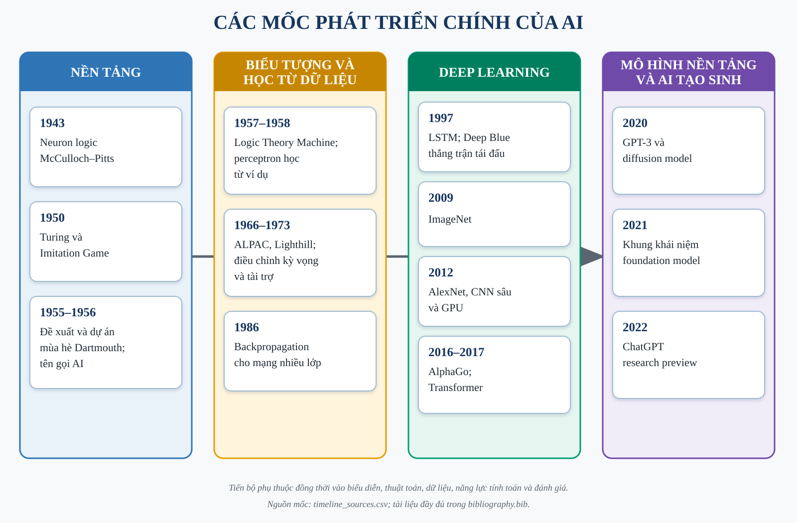

*Nguồn: tác giả tổng hợp từ các tài liệu gốc; ánh xạ từng mốc nằm trong `timeline_sources.csv`.*

### 1.6.1. Dữ liệu, compute, kiến trúc và protocol đánh giá

Timeline ở Hình 1.1 cho thấy các bước tiến không phân bố đều. Mô hình neuron xuất hiện từ năm 1943, nhưng cần thuật toán học, dữ liệu và compute mới phát triển thành deep learning quy mô lớn. CNN đã có ứng dụng thực tế trước AlexNet, nhưng ImageNet và GPU tạo điều kiện so sánh và mở rộng. RNN đặt nền tảng cho mô hình chuỗi, LSTM xử lý một phần phụ thuộc dài, còn attention và Transformer thay đổi đường truyền thông tin và mức song song. Foundation model tiếp tục mở rộng quy mô tiền huấn luyện, nhưng vẫn dựa trên backpropagation và học biểu diễn đã hình thành từ các giai đoạn trước.

Từ đó có thể rút ra bốn điều kiện cho một kết quả thực nghiệm có ý nghĩa. Một là **dữ liệu**: nhãn, phân bố, kích thước và split quyết định câu hỏi mà mô hình thực sự trả lời. Hai là **kiến trúc**: inductive bias phải tương ứng cấu trúc dữ liệu; CNN giả định locality, RNN giả định thứ tự, còn mô hình bảng có thể không hưởng lợi từ các giả định này. Ba là **compute**: giới hạn thiết bị ảnh hưởng batch size, số epoch và khả năng chạy nhiều seed, nên phải được ghi thay vì che giấu. Bốn là **protocol**: nếu preprocessing hoặc tập TEST được dùng để chọn mô hình, metric có thể lạc quan dù code không lỗi.

Các mốc thi đấu giữa máy và người cũng cần được đặt đúng ngữ cảnh. Deep Blue đánh bại Garry Kasparov trong trận tái đấu sáu ván năm 1997 nhờ tìm kiếm, phần cứng song song, hàm đánh giá và cơ sở dữ liệu cờ; đó là thành công lớn trong cờ vua, không phải phép đo mọi dạng trí tuệ [27]. AlphaGo năm 2016 kết hợp policy network, value network và Monte Carlo tree search để xử lý không gian cờ vây [28]. Hai hệ thống cho thấy học và tìm kiếm có thể bổ sung nhau, đồng thời nhắc rằng kết quả phải gắn với miền nhiệm vụ.

Tiểu luận chuyển các bài học này thành matched protocol. Ba framework trong cùng track dùng đúng sample keys, split, dữ liệu sau preprocessing và topology logic. Validation quyết định checkpoint; TEST không tham gia chọn cấu hình. Metric được tái tính từ prediction artifact. Nếu giới hạn phần cứng buộc dùng subset, cả ba framework dùng cùng subset. Như vậy, so sánh không loại bỏ mọi nguồn biến thiên, nhưng các nguồn chính được kiểm soát và công bố.

### 1.6.2. Tính tái lập, đạo đức và giới hạn suy diễn

Tái lập không chỉ là chạy lại một notebook mà không báo lỗi. Một kết quả có thể chạy lại nhưng vẫn không kiểm chứng được nếu thiếu phiên bản dữ liệu, split indices, model weights hoặc quy tắc tính metric. Báo cáo này dùng provenance theo chuỗi: raw source → preprocessing → split → model → prediction → metric → figure/table. Mỗi mắt xích quan trọng cần có đường dẫn tương đối, cấu hình hoặc hash phù hợp. Duration chỉ mô tả lần chạy trên môi trường ghi nhận, không phải benchmark phổ quát cho Keras, PyTorch hay NumPy.

Đạo đức và giới hạn suy diễn cũng là một phần của chất lượng kỹ thuật. Dataset sức khỏe có thể chứa mất cân bằng và sai lệch đại diện; recall của lớp thiểu số cần được xem cùng precision và false positive. Dữ liệu giá vàng và chỉ số nhà có tự tương quan và distribution shift; split ngẫu nhiên có thể gây leakage theo thời gian. Foundation model có thể truyền lỗi và bias đến nhiều ứng dụng hạ nguồn [24]. Việc mô hình tạo output thuyết phục không làm mất nhu cầu kiểm tra nguồn, bảo vệ dữ liệu và xác định trách nhiệm của người sử dụng.

Chương 1 cho thấy lịch sử AI là lịch sử của cả ý tưởng lẫn điều kiện kiểm chứng. Chương 2 bắt đầu từ machine learning có giám sát và các thuật toán cơ bản, nơi split, preprocessing và baseline được định nghĩa rõ. Chương 3 đi sâu vào CNN để xem inductive bias không gian hoạt động trên ba miền ảnh IDRiD, EuroSAT và CIFAR-10. Chương4 so sánh RNN–LSTM, BPTT và dữ liệu tuần tự, nơi thứ tự thời gian trở thành ràng buộc của thiết kế thực nghiệm. Ba chương không cố tái hiện toàn bộ lịch sử; chúng chọn các mô hình đủ nền tảng để cài đặt từ scratch, đủ phổ biến để đối chiếu framework và đủ khác nhau để làm rõ quan hệ giữa dữ liệu, kiến trúc và đánh giá.


## 1.7. Ba benchmark minh họa lịch sử

Iris, MNIST và ImageNet đại diện cho ba cách đặt bài toán phân loại ở quy mô khác
nhau. Iris bắt đầu từ vài phép đo mô tả bông hoa; MNIST dùng ảnh chữ số đã chuẩn hóa;
ImageNet đưa đánh giá nhận dạng ảnh sang nhiều lớp và hình ảnh tự nhiên phức tạp hơn.
Chúng được dùng ở đây để hiểu vai trò của dữ liệu và benchmark, không tạo thêm một
cuộc thi mô hình trong chương lịch sử.

### 1.7.1. Iris và phân loại từ các phép đo

Một bông hoa được mô tả bằng chiều dài/rộng đài và cánh. Mỗi hàng đi kèm tên loài đã
ghi nhận. Luồng nhiệm vụ là **bốn phép đo → quy tắc hoặc mô hình phân loại → tên loài**.
Vì đầu vào ít chiều và nhãn rõ, người học có thể quan sát quan hệ giữa đặc trưng và
lớp trước khi dùng mô hình nhiều tham số. Bảng hồ sơ bên dưới trình bày ba input/output
nguồn, không phải dự đoán do tiểu luận tạo ra.

Iris phù hợp để học cách chia dữ liệu và đọc confusion matrix. Quy mô nhỏ và các lớp
cân bằng lại khiến nó không thể đại diện cho khó khăn của khảo sát sức khỏe mất cân
bằng hoặc dữ liệu có drift. Một thuật toán thành công trên Iris chưa được chứng minh
phù hợp với tiểu đường. Chương2 vì vậy dùng snapshot CDC cùng baseline và group audit.

### 1.7.2. MNIST và học biểu diễn từ điểm ảnh

Ảnh chữ số giữ cấu trúc hai chiều thay vì một vector mô tả hình học đã được người thu
thập chọn sẵn. Luồng nhiệm vụ là **ảnh xám → đặc trưng học được → xác suất chữ số**.
Các mẫu trong hồ sơ lấy official train; nhãn là chữ số nguồn. Không huấn luyện hoặc
đo accuracy MNIST trong tiểu luận này.

LeNet cho thấy mạng tích chập có thể kết hợp việc học đặc trưng với nhận dạng tài liệu
[15]. MNIST giúp nhiều phương pháp được so trên cùng dữ liệu, nhưng
ảnh nhỏ và đã chuẩn hóa khác ảnh đáy mắt độ phân giải cao hoặc ảnh vệ tinh nhiều kiểu
kết cấu. Việc chuyển sang ba dataset Chương3 là để quan sát những khác biệt đó, không
vì một kết quả MNIST đủ chứng minh năng lực nhận dạng ngoài thực tế.

### 1.7.3. ImageNet và giới hạn của metadata

ILSVRC2012 tổ chức bài toán phân loại ảnh với1.000 category công bố. AlexNet kết hợp
mạng tích chập, dữ liệu và tính toán GPU trong bối cảnh đánh giá này
[18, 29]. Mốc này nên được hiểu là một kết
quả nhận dạng trong protocol cụ thể, không phải thời điểm máy có mọi năng lực trí tuệ.

Snapshot local của tiểu luận chỉ gồm trang metadata chính thức. Không có ảnh ImageNet
local, nên không dựng ba ảnh mẫu, phân bố lớp hay metric huấn luyện giả. Ví dụ duy
nhất có thể đối chiếu là trang metadata và thông tin category công bố. Sự khác biệt
giữa kích cỡ công bố và số đã thu nhận phải được giữ rõ ngay trong hồ sơ dữ liệu.

### 1.7.4. Liên hệ với các chương thực nghiệm

Ba benchmark không tạo thành thang đo chung để xếp hạng mọi hệ AI. Số lớp, cách lấy
mẫu, dữ liệu đã chuẩn hóa và quyền truy cập đều khác nhau. Một pipeline đáng kiểm tra
cần giữ nguồn, định nghĩa nhãn và protocol trước khi đọc con số. Chương2–4 áp dụng
nguyên tắc ấy trên dữ liệu bảng, ảnh và chuỗi. Chương5 bổ sung nguồn bằng chứng còn
Chương6 kiểm quyền gọi công cụ và sự phối hợp. Dù hình thức thay đổi, câu hỏi vẫn là
hệ nhận thông tin nào, được phép làm gì và kết luận được đo trong điều kiện nào.

### Hồ sơ ch1_iris_history

Phạm vi: **historical_case**. Không huấn luyện hay đánh giá TEST trong Phase 24.

#### Nguồn, kích cỡ và cấu trúc

Nguồn: [Fisher, R. A. (1936). Iris. UCI Machine Learning Repository. DOI:10.24432/C56C76.](https://archive.ics.uci.edu/static/public/53/iris.zip)
Phiên bản: UCI 53 original Iris snapshot; sha256:d11fe30213d36434a0879aab7cb00ce3c812eb7ba2495874438abff7b7b762e9

Giấy phép/phạm vi: CC BY 4.0; attribution required. https://archive.ics.uci.edu/dataset/53/iris

Raw: 3,738 byte; 150 raw rows.

Số đo và schema phần dùng trong V3:

Bảng 1.1. Nguồn, kích cỡ và cấu trúc

| Trường | Giá trị |
|---|---|
| records | 150 |
| features | 4 |
| unit | raw rows |


#### Mẫu input/output

Mẫu nguồn phục vụ lịch sử, không phải output của mô hình được train trong Phase24.

Bảng 1.2. Mẫu input/output

| input | known_output |
|---|---|
| [5.1, 3.5, 1.4, 0.2] | Iris-setosa |
| [4.9, 3.0, 1.4, 0.2] | Iris-setosa |
| [4.7, 3.2, 1.3, 0.2] | Iris-setosa |


#### Phân bố và chất lượng dữ liệu

Bảng 1.3. Phân bố và chất lượng dữ liệu

| Trường | Giá trị |
|---|---|
| Iris-setosa | 50 |
| Iris-versicolor | 50 |
| Iris-virginica | 50 |


#### Cách chia tập và tiền xử lý

Ch1 không huấn luyện. Giữ official split nếu có; không tạo TEST hay preprocessing fit cho chương lịch sử.

#### Nhận xét và giới hạn

- Benchmark nhỏ, cân bằng; chỉ minh họa lịch sử phân loại, không có thí nghiệm V3 Ch1.

#### Bằng chứng tái lập

Chi tiết: `artifacts/manifests/phase24/ch1_iris_history/eda.json`.
Nguồn Phase23, raw và TEST Ch5 giữ nguyên; số đo mới không ghi ngược vào protocol.

### Hồ sơ ch1_mnist_history

Phạm vi: **historical_case**. Không huấn luyện hay đánh giá TEST trong Phase 24.

#### Nguồn, kích cỡ và cấu trúc

Nguồn: [LeCun, Y., Cortes, C., and Burges, C. MNIST handwritten digit database; NPZ distributed by Keras.](https://storage.googleapis.com/tensorflow/tf-keras-datasets/mnist.npz)
Phiên bản: Keras sanctioned MNIST NPZ; original 60000/10000 split; sha256:731c5ac602752760c8e48fbffcf8c3b850d9dc2a2aedcf2cc48468fc17b673d1

Giấy phép/phạm vi: CC BY-SA 3.0 as explicitly documented at https://keras.io/api/datasets/mnist/; retain attribution/share-alike for adaptations.

Raw: 11,490,434 byte; 70000 images (official 60000 train + 10000 test).

Số đo và schema phần dùng trong V3:

Bảng 1.4. Nguồn, kích cỡ và cấu trúc

| Trường | Giá trị |
|---|---|
| records | 70000 |
| features | 784 |
| unit | images (official 60000 train + 10000 test) |


#### Mẫu input/output

Mẫu nguồn phục vụ lịch sử, không phải output của mô hình được train trong Phase24.

Bảng 1.5. Mẫu input/output

| input | known_output |
|---|---|
| official train index 0, uint8 28x28 | 5 |
| official train index 1, uint8 28x28 | 0 |
| official train index 2, uint8 28x28 | 4 |


#### Phân bố và chất lượng dữ liệu

Bảng 1.6. Phân bố và chất lượng dữ liệu

| Trường | Giá trị |
|---|---|
| 0 | 6903 |
| 1 | 7877 |
| 2 | 6990 |
| 3 | 7141 |
| 4 | 6824 |
| 5 | 6313 |
| 6 | 6876 |
| 7 | 7293 |
| 8 | 6825 |
| 9 | 6958 |


#### Cách chia tập và tiền xử lý

Ch1 không huấn luyện. Giữ official split nếu có; không tạo TEST hay preprocessing fit cho chương lịch sử.

#### Nhận xét và giới hạn

- MNIST là case study lịch sử; không thay IDRiD/EuroSAT/CIFAR trong ma trận CNN V3.
- Official train có 0 ảnh trùng pixel; không tạo random split mới hay train Ch1.

#### Bằng chứng tái lập

Chi tiết: `artifacts/manifests/phase24/ch1_mnist_history/eda.json`.
Nguồn Phase23, raw và TEST Ch5 giữ nguyên; số đo mới không ghi ngược vào protocol.

### Hồ sơ ch1_imagenet_history

Phạm vi: **historical_case_metadata_only**. Không huấn luyện hay đánh giá TEST trong Phase 24.

#### Nguồn, kích cỡ và cấu trúc

Nguồn: [Russakovsky, O. et al. (2015). ImageNet Large Scale Visual Recognition Challenge. IJCV. DOI:10.1007/s11263-015-0816-y.](https://www.image-net.org/challenges/LSVRC/2012/index.php)
Phiên bản: ILSVRC 2012 official challenge metadata only; sha256:9d63dd697cceeeb640da708183bbbd6f4c35f98175d4cbec0439c3f3ea4373cc

Giấy phép/phạm vi: Only a local provenance copy of the public challenge webpage, not an image dataset license. Cite/paraphrase metadata; no redistribution of page or ImageNet images. Full image access remains subject to ImageNet terms.

Raw: 18,582 byte; 1 official metadata webpage, ZERO local images.

Số đo và schema phần dùng trong V3:

Bảng 1.7. Nguồn, kích cỡ và cấu trúc

| Trường | Giá trị |
|---|---|
| records | 1 |
| features | null |
| unit | official metadata webpage, ZERO local images |


#### Mẫu input/output

Mẫu nguồn phục vụ lịch sử, không phải output của mô hình được train trong Phase24.

Bảng 1.8. Mẫu input/output

| input | known_output |
|---|---|
| Trang metadata ILSVRC2012 đã lưu | 1000 categories công bố; không có ảnh local |


#### Phân bố và chất lượng dữ liệu

Bảng 1.9. Phân bố và chất lượng dữ liệu

| Trường | Giá trị |
|---|---|
| local_metadata_page | 1 |
| local_images | 0 |


#### Cách chia tập và tiền xử lý

Ch1 không huấn luyện. Giữ official split nếu có; không tạo TEST hay preprocessing fit cho chương lịch sử.

#### Nhận xét và giới hạn

- Chỉ metadata/citation lịch sử. Không bịa ảnh mẫu, phân bố ảnh hay thí nghiệm trên full ImageNet.
- Quy mô ảnh công bố trong source card không phải số mẫu đo trên máy.

#### Bằng chứng tái lập

Chi tiết: `artifacts/manifests/phase24/ch1_imagenet_history/eda.json`.
Nguồn Phase23, raw và TEST Ch5 giữ nguyên; số đo mới không ghi ngược vào protocol.

## 1.8. Tiểu kết

Dữ liệu, mô hình và cách đánh giá cùng quyết định ý nghĩa một thành công AI. Các chương sau kiểm chứng từng phạm vi cụ thể, không dùng một benchmark để suy ra trí tuệ tổng quát.


# CHƯƠNG 2. CÁC KỸ THUẬT MACHINE LEARNING CƠ BẢN

## 2.1. Mở đầu

Machine Learning (ML), hay học máy, xây dựng cách dự đoán từ những ví dụ đã biết thay vì viết toàn bộ quy tắc bằng tay. Với một căn nhà, đầu vào có thể là diện tích, năm xây dựng và chất lượng công trình; đầu ra là giá bán. Với bộ dữ liệu sức khỏe, đầu vào là các chỉ báo khảo sát; đầu ra là nhãn đã ghi nhận trong nguồn dữ liệu. Đây là hai dạng học có giám sát: hồi quy dự đoán một giá trị số, còn phân loại dự đoán một nhãn.

Chương này đặt câu hỏi: khi giữ nguyên dữ liệu và kiến trúc, MLP tự viết, Keras và PyTorch khác nhau thế nào về chất lượng, thời gian và bộ nhớ? Các mô hình cổ điển được dùng làm mốc đối chiếu. Mạng nhiều lớp không được mặc định là tốt hơn; một mô hình tuyến tính hoặc rừng cây vẫn có thể phù hợp hơn với dữ liệu bảng.

Ba bài toán được chọn là nhận diện nhãn tiểu đường trong khảo sát CDC, ước lượng giá nhà Ames và dự đoán đăng ký tiền gửi Bank Marketing. Hai bài toán đầu gắn với các miền ưu tiên của tiểu luận; bài toán còn lại giúp kiểm tra sự khác biệt trên dữ liệu mất cân bằng ở một miền khác. Các kết quả sức khỏe chỉ phục vụ học thuật, không phải chẩn đoán.

## 2.2. Những kỹ thuật nền tảng

### 2.2.1. Tiền xử lý và chia dữ liệu

Một mô hình không đọc trực tiếp các trường văn bản như loại nhà hay nghề nghiệp. Trước tiên, các trường số được điền thiếu bằng trung vị rồi chuẩn hóa bằng thống kê của tập huấn luyện. Trường phân loại được chuyển thành các cột one-hot: mỗi cột biểu thị có hay không một giá trị danh mục. Danh mục chưa gặp khi huấn luyện được mã hóa thành toàn số 0 ở nhóm cột tương ứng, không tự mở rộng đầu vào.

Luồng xử lý là: **bản ghi gốc → kiểm schema → điền thiếu/chuẩn hóa/one-hot → vector số → mô hình → xác suất hoặc giá nhà**. Mã định danh và nhãn không được đưa vào vector đầu vào. Riêng Bank, `duration` bị loại vì chỉ biết sau cuộc gọi, trong khi bài toán cần dự đoán trước cuộc gọi.

Tập train dùng để học tham số; validation dùng để chọn checkpoint; TEST chỉ dùng để đánh giá cuối. Những bản ghi trùng đặc trưng được gom trước khi chia để hạn chế một ví dụ xuất hiện ở cả hai phía. Thống kê điền thiếu, scaler, từ vựng và trọng số lớp đều chỉ được fit trên matched train đã khóa. Với Ames, giá nhà được chuẩn hóa khi train và đổi ngược sang USD khi tính sai số. Nhãn thật tính metric vẫn lấy giá gốc, tránh sai số làm tròn do đổi ngược nhãn float32.

### 2.2.2. Mô hình đơn giản và mô hình tuyến tính

Baseline đơn giản trả về lớp phổ biến nhất ở bài toán phân loại hoặc trung vị giá nhà ở bài toán hồi quy. Nó không học quan hệ giữa đặc trưng và đầu ra. Vai trò của baseline là cho biết mô hình phức tạp có thực sự tạo thêm ích lợi hay chỉ hưởng lợi từ phân bố dữ liệu.

Logistic Regression kết hợp các đặc trưng theo trọng số rồi chuyển điểm số thành xác suất nhị phân. Ridge Regression cũng học một tổ hợp tuyến tính nhưng thêm ràng buộc để trọng số không quá lớn. Cả hai đều nhanh, dễ đóng gói và tạo mốc đối chiếu hữu ích với MLP. Chúng có thể bỏ sót những quan hệ phi tuyến nếu chỉ dùng các đặc trưng gốc.

Random Forest kết hợp nhiều cây quyết định. Một cây đặt các câu hỏi liên tiếp về đặc trưng; kết quả của rừng là trung bình xác suất hoặc giá trị từ các cây. Rừng cây có thể biểu diễn tương tác phi tuyến mà không cần thiết kế tầng mạng. Đổi lại, checkpoint và thời gian dự đoán có thể lớn hơn mô hình tuyến tính. Khái niệm “trên 5 layer” không áp dụng cho các baseline cổ điển này.

Trong code, `fit_baseline(name,x,y,task,seed)` trả mô hình đã fit và một bản portable chỉ gồm các mảng số. `PortableBaseline.predict(x)` nhận `[B,D]` và trả `[B,2]` xác suất phân loại hoặc `[B,1]` giá đã chuẩn hóa. Luồng Logistic là **vector số → tổ hợp tuyến tính → sigmoid → hai xác suất**; Ridge là **vector số → tổ hợp tuyến tính → đổi ngược giá sang USD**; Random Forest là **vector số → đi qua từng cây theo ngưỡng → lấy giá trị ở lá → trung bình các cây → hậu xử lý**. Các hàm dự đoán không fit lại, từ chối sai số chiều hoặc giá trị không hữu hạn. Baseline hằng bỏ qua đặc trưng và chỉ lặp giá trị đã học từ train.

### 2.2.3. MLP và sáu lớp học được

MLP biến vector đầu vào qua nhiều lớp Dense. Mỗi lớp Dense học một phép kết hợp mới; hàm ReLU ở giữa cho phép biểu diễn quan hệ phi tuyến. Chương này dùng năm lớp ẩn có độ rộng **64, 64, 32, 32, 16**, sau đó là một lớp đầu ra một chiều. Tổng cộng có **sáu lớp có tham số học được**; Input và ReLU không được tính vào con số này.

Luồng shape, với `B` là số mẫu trong batch và `D` là số đặc trưng sau tiền xử lý:

`[B,D] → Dense64 → ReLU → Dense64 → ReLU → Dense32 → ReLU → Dense32 → ReLU → Dense16 → ReLU → Dense1 → [B,1]`.

Tại một lớp Dense, phép tính cốt lõi là `z = xW + b`: `x` là ma trận đầu vào `[B,d_in]`, `W` là trọng số `[d_in,d_out]`, `b` là vector lệch `[d_out]` và `z` có shape `[B,d_out]`. Ví dụ, lớp đầu của CDC nhận `[B,21]`, dùng trọng số `[21,64]` và trả về `[B,64]`. ReLU giữ số dương và đưa số âm về 0, nên không đổi shape và không thêm tham số.

Ở bài toán phân loại, Dense cuối trả về logit, chưa phải xác suất. Sigmoid chuyển logit thành xác suất lớp 1; lớp 0 có xác suất bằng một trừ giá trị đó. Chọn lớp 1 khi xác suất lớn hơn 0,5; trường hợp đúng bằng 0,5 chọn lớp 0 theo quy ước argmax đã khóa. Với Ames, đầu ra là giá đã chuẩn hóa và phải đổi ngược đơn vị trước khi hiển thị.

### 2.2.4. Hợp các hàm và vai trò từng hàm

Mô hình đầy đủ có thể viết ngắn gọn `F = f_L ∘ ... ∘ f_2 ∘ f_1`, nghĩa là **đầu ra của bước trước trở thành đầu vào của bước sau**, đọc từ phải sang trái. Trong triển khai này, các bước là tiền xử lý, chuỗi Dense/ReLU và hậu xử lý. Công thức chỉ mô tả luồng xử lý, không phải thêm một thuật toán khác.

Bảng 2.1. Hợp các hàm và vai trò từng hàm

| Hàm/signature | Input → output | Vai trò và tham số | Trường hợp cần chú ý |
|---|---|---|---|
| `TensorAdapter.transform(frame)` | Bản ghi đúng schema → `[B,D]` float32 | Dùng thống kê/từ vựng train đã khóa, không fit lại | Từ chối thừa/thiếu cột; danh mục mới thành all-zero |
| `dense(x,W,b)` | `[B,d_in]` → `[B,d_out]` | Học `W,b`, tạo tổ hợp đặc trưng | Phải đúng thứ tự feature và shape trọng số |
| `relu(x)` | `[B,d]` → `[B,d]` | Phi tuyến, không có tham số | Giá trị âm thành 0; tại 0 dùng quy ước đạo hàm trong core |
| `loss_and_gradient(logits,y,task,weights)` | Dự đoán/nhãn cùng batch → loss và gradient đầu ra | BCE ổn định cho nhị phân; MSE cho hồi quy | Nhãn/weight không hợp lệ hoặc loss không hữu hạn bị từ chối |
| `loss_gradients(x,y,task,weights)` | Batch → loss, gradient theo từng tensor | Scratch lan truyền ngược qua từng lớp; native dùng autodiff | Không dùng autograd trong scratch; không bỏ batch cuối |
| `clip_gradients(grads)` | Các gradient → gradient đã giới hạn và norm ban đầu | Chặn global norm ở 1 để hạn chế cập nhật quá lớn | Không tự sửa NaN/Inf; phải báo lỗi |
| `Adam.step(weights,grads)` | Trọng số/gradient → trọng số mới | Dùng lịch sử gradient và bình phương gradient | Resume phải giữ cả trọng số, moment và số bước |
| `predict_batches(trainer,x)` | `[N,D]` → `[N,1]` | Dự đoán theo lô, giữ thứ tự mẫu | Từ chối tập rỗng hoặc kết quả không hữu hạn |
| `task_outputs(logits,"binary")` | `[N,1]` → `[N,2]` | Đổi logit thành xác suất hai lớp | Không nhầm logit với xác suất |
| `TensorAdapter.inverse_target(value)` | Giá chuẩn hóa → USD | Khôi phục đơn vị giá nhà bằng scaler train | Không dùng scaler mới fit trên validation/TEST |

Đối chiếu ba implementation: Dense/ReLU scratch nằm trong `src/common/numpy_engine.py`; Keras dùng `keras.layers.Dense` và `Activation`; PyTorch dùng `torch.nn.Linear` và `ReLU` thông qua adapter trong `src/common/backend_models.py`. Torch lưu ma trận trọng số theo layout khác, nên adapter chuyển vị khi trao đổi canonical weights. Bảng shape, parameter count và giải thích chi tiết từng function ID được sinh trực tiếp từ `model_contract.json`, không chép lại bằng tay.

### 2.2.5. Học trọng số và chọn checkpoint

Mỗi batch đi qua bốn bước: dự đoán, tính loss, tính gradient và cập nhật trọng số. Loss cho biết dự đoán lệch nhãn bao nhiêu. Gradient chỉ hướng thay đổi loss khi điều chỉnh từng trọng số. Scratch tự tính các đạo hàm và lan truyền ngược bằng NumPy; hai framework còn lại tính đạo hàm tự động trên cùng kiến trúc.

Adam dùng hai bộ nhớ phụ: trung bình gradient và trung bình bình phương gradient. Dạng cập nhật cần để đọc code là `w ← w − η m̂/(√v̂ + ε)`. Ở đây `w` là một trọng số, `η` là learning rate, `m̂` và `v̂` là hai bộ nhớ đã hiệu chỉnh bước đầu, còn `ε` tránh mẫu số bằng 0. Chi tiết hiệu chỉnh nằm trong mã và tài liệu kỹ thuật của core. Cả ba implementation dùng epsilon **sau căn của v đã hiệu chỉnh**, không thay bằng Adam mặc định có quy ước epsilon khác.

Sau mỗi epoch, mô hình được đánh giá trên toàn validation. Checkpoint có validation loss nhỏ nhất được giữ lại. Patience 6 và min_delta chỉ điều khiển lúc dừng; chúng không được dùng để bỏ qua một checkpoint có loss nhỏ hơn. Nếu bị ngắt, trạng thái resume giữ optimizer, lịch sử, checkpoint tốt nhất và trạng thái dừng sớm; không bắt đầu một thực nghiệm mới ngầm.

### 2.2.6. Liên hệ trực tiếp ba đường code

Kiến trúc không được viết thành ba bản thông số khác nhau. Cả ba dùng một computational plan, rồi adapter tạo các layer tương ứng:

```python
plan = build_plan("mlp", [D], outputs=1)
weights = canonical_weights(plan, seed=42)
```

`D` lần lượt là 21, 313 hoặc 50; plan chứa sáu Dense và năm ReLU. Đoạn chung chỉ tạo kiến trúc/trọng số ban đầu, chưa phải checkpoint đã train. Ba cách tạo trainer dưới đây là ba lựa chọn riêng, chạy trong đúng môi trường, không import hai framework GPU vào cùng process:

```python
# Scratch: môi trường scratch/torch, phép toán học bằng NumPy
trainer = ScratchTrainer(plan, weights)
```

```python
# Keras: môi trường keras, backend TensorFlow độc lập
trainer = KerasTrainer(plan, weights, device="gpu")
```

```python
# PyTorch: môi trường torch, native CUDA
trainer = TorchTrainer(plan, weights, device="gpu")
```

Vòng huấn luyện dùng cùng interface `step(x_batch, y_batch, task, sample_weight)` và `predict(x_batch)`. Trong scratch, `NumpyNetwork.forward` lặp từng bước của plan, tính `x @ W + b`, lưu activation và tự tính gradient theo chiều ngược lại trong `loss_gradients`. Keras xây functional model từ Dense/Activation rồi dùng GradientTape trong graph step; Torch xây ModuleDict gồm Linear/ReLU và dùng autograd. Chuẩn hóa layout trọng số và optimizer không làm scratch trở thành lời gọi framework. Toàn bộ mã nằm trong `src/common/numpy_engine.py`, `src/common/backend_models.py` và `src/ch02_ml/training.py`; notebook chỉ gọi lại module, không chứa bản thuật toán sao chép.

## 2.3. Dữ liệu và giao thức thực nghiệm

### 2.3.1. Ba bộ dữ liệu

Bảng 2.2. Ba bộ dữ liệu

| Bộ dữ liệu | Nguồn và phạm vi | Snapshot local | Đầu vào mô hình | Matched train / validation / TEST |
|---|---|---:|---:|---:|
| CDC Diabetes | [UCI 891](https://archive.ics.uci.edu/dataset/891/cdc+diabetes+health+indicators), BRFSS 2015 | 253.680 dòng; CSV 13.494.568 byte | 21 biến; nhãn 1 gộp tiền tiểu đường/tiểu đường | 20.000 / 38.053 / 38.122 |
| Ames Housing | [De Cock, JSE 2011](https://jse.amstat.org/v19n3/decock/AmesHousing.txt) | 2.930 nhà; TXT 960.807 byte | 79 trường gốc, thành 313 chiều; giá bán USD | 2.051 / 439 / 440 |
| Bank Marketing | [UCI 222](https://archive.ics.uci.edu/dataset/222/bank+marketing) | 45.211 dòng; ZIP 1.023.843 byte | 15 biến sau khi bỏ duration, thành 50 chiều | 10.000 / 6.781 / 6.782 |

CDC có giấy phép CC0 xác minh từ nguồn upstream; Bank dùng CC BY 4.0 và phải giữ attribution. Nguồn TXT Ames phục vụ dạy học/nghiên cứu nhưng không công bố SPDX rõ ràng; tiểu luận giữ trích dẫn, không mặc định giấy phép GPL của package khác áp dụng cho TXT và không phân phối lại raw. ZIP Bank là kích thước gói nguồn, không phải chỉ dung lượng bảng dùng train. Các SHA-256, schema đầy đủ và ngày thu nhận nằm trong data cards Phase 23–24.

Ví dụ từ matched train: CDC `row_0048946` có high_bp=1, high_chol=1, BMI=24, smoker=0 và nhãn nguồn 0; Ames `row_0001475` có lot_area=8.450, ms_zoning=RL và giá nguồn 210.000 USD; Bank `row_0030605` có age=31, job=self-employed, balance=0 và nhãn nguồn 0. Đây là **nhãn quan sát**, không phải kết quả mô hình; bản ghi đầy đủ và ba mẫu mỗi dataset nằm trong `report/references/dataset_cards/v3_eda/`.

CDC mất cân bằng: train đầy đủ có 152.760 nhãn 0 và 24.745 nhãn 1. Bank có 27.946 nhãn 0 và 3.702 nhãn 1 trong train đầy đủ. Vì vậy không chỉ báo cáo accuracy: dự đoán mọi mẫu là lớp phổ biến vẫn có thể đạt accuracy cao nhưng recall lớp 1 bằng 0. Ames có trung vị giá train 160.000 USD, phân bố lệch và giá trị lớn; RMSE nhạy với vài căn dự đoán sai nhiều, nên cần đọc kèm MAE và biểu đồ sai số.

CDC có 25.772 dòng trùng feature; một số nhóm có nhãn mâu thuẫn. Các dòng này được gom khi chia, không sửa nhãn cho mô hình dễ học hơn. Ames có trường thiếu đáng kể như alley và pool_qc; thiếu có thể liên quan việc không có tiện ích, không tự hiểu là 0. Bank có giá trị danh mục `unknown` và 16 dòng trùng feature; `unknown` vẫn được giữ như một mức danh mục. Không tự xóa outlier để cải thiện kết quả.

Chia nhóm/ngẫu nhiên chỉ đánh giá khả năng tổng quát trên snapshot này. Không có patient/customer ID xác minh cho CDC và Bank, nên không khẳng định độc lập theo bệnh nhân/khách hàng. Kết quả Ames không chứng minh dự báo thị trường tương lai hoặc chuyển sang địa phương khác.

### 2.3.2. Điều kiện so sánh đã khóa

Mỗi dataset dùng ba seed 17, 42, 73. Mỗi seed có ba MLP và ba baseline, tổng cộng 54 run; trong đó có 27 run mạng sâu. Cùng một seed dùng cùng canonical initial weights và cùng thứ tự batch cho ba MLP. Tập matched train cố định theo seed lấy mẫu 42; thay seed huấn luyện không thay dữ liệu. Full validation và full TEST luôn được giữ nguyên, không gọi kết quả này là full-train track.

Cùng seed không có nghĩa quá trình train của ba framework phải giống từng bit. Thứ tự phép tính dấu phẩy động và kernel CPU/GPU có thể tạo sai khác nhỏ; qua nhiều lần cập nhật, các đường hội tụ có thể tách nhau. Vì vậy kiểm parity dùng tolerance đã khóa trên cùng bộ trọng số; độ ổn định kết quả huấn luyện được mô tả riêng bằng ba seed, không che sai khác bằng cách sao chép checkpoint từ một implementation sang hai implementation còn lại.

MLP dùng float32, batch 32, tối đa 40 epoch, learning rate 0,001, Adam beta 0,9/0,999, epsilon 10⁻⁷ và global clipping 1. Chỉ có một cấu hình siêu tham số đã khai báo; không tìm lại cấu hình sau khi nhìn TEST. Phân loại dùng trọng số lớp fit trên matched train; baseline majority không dùng trọng số. Forest có 200 cây, max_depth=12, min_samples_leaf=5, hai CPU worker. Logistic dùng C=1, lbfgs, max_iter=1.000; Ridge dùng alpha=1.

Scratch chạy NumPy trên CPU. Keras giữ TensorFlow độc lập và chạy GPU bằng `tf.function`, không XLA; PyTorch chạy CUDA eager. Đây là khác biệt đường thực thi được công khai, nên số đo không chỉ phản ánh tên framework. Hai môi trường WSL2 dùng Python 3.11.17, NumPy/dữ liệu chung và dependency đã khóa. GPU là RTX 5050 Laptop khoảng 8 GiB. TensorFlow trên sm_120 có cảnh báo PTX JIT; không gọi đường chạy này là hỗ trợ kernel native đầy đủ.

### 2.3.3. Cách đánh giá và giới hạn số đo

Phân loại dùng macro-F1, accuracy, weighted-F1, recall từng lớp, AUROC, average precision và confusion matrix. Brier và ECE với 10 bin mô tả độ lệch giữa xác suất và tần suất thực tế. Chúng chỉ là chẩn đoán: không fit thêm bộ hiệu chỉnh xác suất và không thay threshold từ TEST. Trọng số lớp có thể tăng recall nhưng làm xác suất lệch so với tần suất tự nhiên; phải đọc cả hai mặt.

Giá nhà được đánh giá bằng MAE/RMSE theo USD, R², MAPE và sMAPE. Metric không xác định được lưu null cùng lý do, không thay bằng 0. Bảng tổng hợp dùng trung bình và độ lệch chuẩn mẫu trên ba seed. Với majority/median/Logistic/Ridge, các lần chạy có thể trả cùng kết quả; không xem đó là ba tập dữ liệu độc lập hay bằng chứng kiểm định ý nghĩa thống kê.

Phân tích nhóm được khai báo trước: CDC theo mã sex của nguồn; Bank theo age dưới 60 và từ 60; Ames theo năm xây trước/từ 1980. Chỉ báo cáo support và sai số/recall/FPR phù hợp, không gọi là chứng nhận công bằng hay kết luận nhân quả. Nhóm không có lớp dương/âm được ghi rõ metric không xác định.

Thời gian huấn luyện MLP gồm các epoch, validation và ghi progress checkpoint; không gồm khởi tạo framework và kiểm parity đầu vào. Thời gian baseline gồm fit và xuất mô hình portable. Inference đo một mẫu TRAIN cố định, warm-up 5 lần rồi đo 30 lần, có đồng bộ và chuyển dữ liệu host/device; không gồm tiền xử lý hay đổi ngược đơn vị. RAM là high-water RSS của cả process riêng, không phải RAM tăng thêm của riêng mạng. VRAM là peak allocator của framework, không phải tổng VRAM trong Task Manager. Checkpoint size chỉ tính file trọng số NPZ, metadata ghi riêng.

Baseline cổ điển được fit bằng scikit-learn nhưng thời gian inference trong bảng đo bản NumPy portable, không phải `sklearn.predict` tối ưu. Đặc biệt, bản rừng cây duyệt từng cây bằng Python; số đo mô tả đường đóng gói demo đang dùng, không chứng minh Random Forest nói chung chậm hơn mạng nơ-ron.

TEST được mở theo ba batch niêm phong, mỗi batch dataset có 18 run đã khai báo. Mã evaluator, cấu hình và tất cả checkpoint được khóa trước lần mở. Mỗi run nhận một claim không thể lặp; nếu bị ngắt sau claim mà chưa có kết quả đầy đủ thì niêm phong lỗi, không tự dự đoán lại. Các phân tích và hình sau đó đọc prediction artifact đã lưu, không gọi mô hình trên TEST thêm lần nữa.


## 2.4. Kết quả thực nghiệm

Các bảng sau tính từ prediction/metric artifact đã lưu. Mỗi ô là trung bình ± độ lệch chuẩn mẫu trên ba seed 17, 42, 73; mọi phương pháp cùng matched train và full TEST. Hình minh họa cố định seed 42, không chọn seed tốt nhất.


Cấu hình đo: 13th Gen Intel(R) Core(TM) i7-13620H (10 lõi/16 luồng), RTX 5050 Laptop 8151 MiB, driver 591.74; WSL2 Ubuntu 24.04/Python 3.11.17; NumPy CPU, PyTorch 2.14.1+cu130, Keras 3.15.1/TensorFlow 2.21.0. MLP float32, batch train 32; inference batch 1, warm-up 5/đo 30 lần. Không khóa xung hay trạng thái nhiệt của máy.


### 2.4.1. CDC Diabetes

Bảng 2.3. CDC Diabetes

| Phương pháp | Macro-F1 | AUROC | Recall lớp 1 | Accuracy |
|---|---:|---:|---:|---:|
| MLP NumPy | 0.6285 ± 0.0078 | 0.8291 ± 0.0017 | 0.8011 ± 0.0111 | 0.7208 ± 0.0110 |
| MLP Keras/TF | 0.6288 ± 0.0078 | 0.8290 ± 0.0020 | 0.7982 ± 0.0142 | 0.7215 ± 0.0112 |
| MLP PyTorch | 0.6290 ± 0.0085 | 0.8288 ± 0.0019 | 0.7977 ± 0.0171 | 0.7218 ± 0.0125 |
| Majority | 0.4627 ± 0.0000 | 0.5000 ± 0.0000 | 0.0000 ± 0.0000 | 0.8612 ± 0.0000 |
| Logistic | 0.6355 ± 0.0000 | 0.8283 ± 0.0000 | 0.7782 ± 0.0000 | 0.7328 ± 0.0000 |
| Random Forest | 0.6508 ± 0.0007 | 0.8297 ± 0.0004 | 0.7477 ± 0.0006 | 0.7557 ± 0.0007 |

Majority đạt accuracy 0.8612 nhưng recall lớp 1 bằng 0. MLP scratch có recall lớp 1 0.8011, đổi lại accuracy thấp hơn. Vì vậy không chọn mô hình chỉ từ accuracy; cần đọc đồng thời macro-F1, recall và số cảnh báo sai. Xác suất của mô hình có class weighting cũng không được xem trực tiếp là nguy cơ bệnh đã hiệu chỉnh.


Trong cấu hình đã khóa, Random Forest có trung bình macro-F1 cao nhất. Đây là mô tả trên ba seed và một split, không phải kết luận hơn hẳn về mặt thống kê hoặc trên mọi dữ liệu. Không điều chỉnh mô hình theo thứ hạng TEST này.


### 2.4.2. Ames Housing

Bảng 2.4. Ames Housing

| Phương pháp | MAE (USD) | RMSE (USD) | R² |
|---|---:|---:|---:|
| MLP NumPy | 15,364 ± 63 | 35,973 ± 1,439 | 0.8416 ± 0.0125 |
| MLP Keras/TF | 15,433 ± 169 | 33,990 ± 2,742 | 0.8581 ± 0.0226 |
| MLP PyTorch | 15,366 ± 59 | 35,973 ± 1,440 | 0.8416 ± 0.0125 |
| Median | 59,470 ± 0 | 93,455 ± 0 | -0.0681 ± 0.0000 |
| Ridge | 17,156 ± 0 | 38,218 ± 0 | 0.8214 ± 0.0000 |
| Random Forest | 18,487 ± 129 | 34,024 ± 372 | 0.8584 ± 0.0031 |

Chênh lệch RMSE trung bình giữa MLP Keras và Random Forest chỉ khoảng 33 USD, trong khi độ lệch chuẩn RMSE của Keras là 2,742 USD. Không đủ căn cứ để khẳng định Keras thắng ổn định. Với MLP, RMSE lớn hơn nhiều MAE và biểu đồ có điểm lệch xa đường chéo; giữ nguyên những ví dụ sai số lớn này thay vì lọc TEST sau khi thấy kết quả.


Trong cấu hình đã khóa, MLP Keras/TF có trung bình RMSE thấp nhất. Đây là mô tả trên ba seed và một split, không phải kết luận hơn hẳn về mặt thống kê hoặc trên mọi dữ liệu. Không điều chỉnh mô hình theo thứ hạng TEST này.


### 2.4.3. Bank Marketing

Bảng 2.5. Bank Marketing

| Phương pháp | Macro-F1 | AUROC | Recall lớp 1 | Accuracy |
|---|---:|---:|---:|---:|
| MLP NumPy | 0.6290 ± 0.0075 | 0.7715 ± 0.0045 | 0.6045 ± 0.0388 | 0.7804 ± 0.0163 |
| MLP Keras/TF | 0.6269 ± 0.0110 | 0.7716 ± 0.0046 | 0.6079 ± 0.0442 | 0.7773 ± 0.0216 |
| MLP PyTorch | 0.6282 ± 0.0089 | 0.7712 ± 0.0043 | 0.6050 ± 0.0395 | 0.7794 ± 0.0180 |
| Majority | 0.4689 ± 0.0000 | 0.5000 ± 0.0000 | 0.0000 ± 0.0000 | 0.8829 ± 0.0000 |
| Logistic | 0.6080 ± 0.0000 | 0.7636 ± 0.0000 | 0.6196 ± 0.0000 | 0.7527 ± 0.0000 |
| Random Forest | 0.6538 ± 0.0013 | 0.7845 ± 0.0004 | 0.5936 ± 0.0040 | 0.8094 ± 0.0020 |

Majority đạt accuracy 0.8829 nhưng không phát hiện được lớp đăng ký. Ba MLP có macro-F1 gần nhau; khác biệt giữa framework cần đọc cùng độ lệch chuẩn ba seed. Do duration đã bị bỏ để đúng bối cảnh trước cuộc gọi, không so trực tiếp bảng này với thực nghiệm dùng duration như thể cùng điều kiện.


Trong cấu hình đã khóa, Random Forest có trung bình macro-F1 cao nhất. Đây là mô tả trên ba seed và một split, không phải kết luận hơn hẳn về mặt thống kê hoặc trên mọi dữ liệu. Không điều chỉnh mô hình theo thứ hạng TEST này.


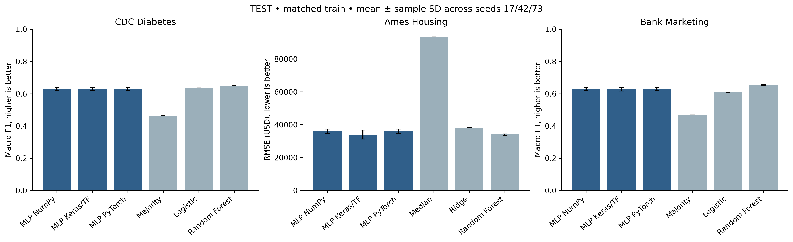

Hình 2.1. Chất lượng trên full TEST; error bar là độ lệch chuẩn giữa seed, không phải khoảng tin cậy theo dân số.


### 2.4.4. Thời gian, bộ nhớ và kích thước

Bảng 2.6. Thời gian, bộ nhớ và kích thước

| Dataset / phương pháp | Train (s) | Inference p50 (ms) | Peak RSS (MiB) | Peak allocator VRAM (MiB) | NPZ (KiB) |
|---|---:|---:|---:|---:|---:|
| CDC Diabetes / MLP NumPy | 4.13 ± 0.13 | 0.075 ± 0.030 | 258.7 ± 0.4 | 0.0 ± 0.0 | 39.1 ± 0.0 |
| CDC Diabetes / MLP Keras/TF | 72.72 ± 11.81 | 1.911 ± 0.457 | 1,469.3 ± 5.2 | 2.9 ± 0.0 | 39.1 ± 0.0 |
| CDC Diabetes / MLP PyTorch | 35.99 ± 9.02 | 0.494 ± 0.020 | 1,652.2 ± 0.3 | 66.2 ± 0.0 | 39.1 ± 0.0 |
| CDC Diabetes / Majority | 0.02 ± 0.01 | 0.008 ± 0.000 | 252.2 ± 0.3 | 0.0 ± 0.0 | 0.3 ± 0.0 |
| CDC Diabetes / Logistic | 0.03 ± 0.01 | 0.010 ± 0.001 | 252.4 ± 0.2 | 0.0 ± 0.0 | 0.6 ± 0.0 |
| CDC Diabetes / Random Forest | 1.18 ± 0.12 | 17.569 ± 0.091 | 286.6 ± 1.0 | 0.0 ± 0.0 | 11,535.7 ± 46.1 |
| Ames Housing / MLP NumPy | 2.34 ± 0.43 | 0.040 ± 0.001 | 228.4 ± 0.1 | 0.0 ± 0.0 | 112.1 ± 0.0 |
| Ames Housing / MLP Keras/TF | 13.17 ± 1.77 | 1.407 ± 0.284 | 1,430.7 ± 4.2 | 1.3 ± 0.0 | 112.1 ± 0.0 |
| Ames Housing / MLP PyTorch | 6.50 ± 0.33 | 0.480 ± 0.005 | 1,670.5 ± 0.6 | 65.1 ± 0.0 | 112.1 ± 0.0 |
| Ames Housing / Median | 0.01 ± 0.00 | 0.005 ± 0.000 | 225.1 ± 0.3 | 0.0 ± 0.0 | 0.3 ± 0.0 |
| Ames Housing / Ridge | 0.02 ± 0.01 | 0.008 ± 0.004 | 230.1 ± 0.5 | 0.0 ± 0.0 | 1.7 ± 0.0 |
| Ames Housing / Random Forest | 1.80 ± 0.04 | 16.689 ± 0.413 | 230.5 ± 1.4 | 0.0 ± 0.0 | 3,301.5 ± 10.1 |
| Bank Marketing / MLP NumPy | 2.66 ± 0.35 | 0.040 ± 0.001 | 236.6 ± 0.6 | 0.0 ± 0.0 | 46.3 ± 0.0 |
| Bank Marketing / MLP Keras/TF | 28.01 ± 4.88 | 1.242 ± 0.135 | 1,446.9 ± 8.4 | 3.0 ± 0.0 | 46.3 ± 0.0 |
| Bank Marketing / MLP PyTorch | 15.07 ± 2.51 | 0.439 ± 0.022 | 1,627.7 ± 0.1 | 66.2 ± 0.0 | 46.3 ± 0.0 |
| Bank Marketing / Majority | 0.01 ± 0.00 | 0.008 ± 0.001 | 227.8 ± 0.3 | 0.0 ± 0.0 | 0.3 ± 0.0 |
| Bank Marketing / Logistic | 0.03 ± 0.00 | 0.011 ± 0.000 | 229.0 ± 0.8 | 0.0 ± 0.0 | 0.7 ± 0.0 |
| Bank Marketing / Random Forest | 0.72 ± 0.03 | 17.333 ± 0.361 | 239.8 ± 0.5 | 0.0 ± 0.0 | 4,698.9 ± 14.0 |

Tiền xử lý đo riêng trên một bản ghi TRAIN đã nạp trong RAM, CPU, warm-up 5 và 30 lần đo; không fit lại scaler và không đọc TEST. Đây là số đo hậu kiểm trong runtime local, không phải chi phí huấn luyện. Trường `preprocessing_seconds` cũ trong validation_details thực tế đo bước nạp/cache development trước run, không phải thời gian fit scaler.

Bảng 2.7. Thời gian, bộ nhớ và kích thước

| Dataset | Transform p50 (ms) | Transform p95 (ms) |
|---|---:|---:|
| CDC Diabetes | 1.350 | 1.872 |
| Ames Housing | 6.083 | 6.489 |
| Bank Marketing | 1.141 | 1.478 |

CPU scratch và GPU native khác thiết bị; TensorFlow graph và PyTorch eager khác đường thực thi. Với mạng nhỏ và batch 32, chi phí gọi kernel/đồng bộ/chuyển dữ liệu có thể đáng kể. Không suy từ bảng rằng GPU luôn nhanh hơn CPU hoặc một framework luôn tốt hơn. p95, thời gian tiền xử lý và provenance đầy đủ nằm trong CSV/JSON kèm theo. VRAM bằng 0 biểu thị phương pháp chạy CPU, không phải số đo bị thiếu.


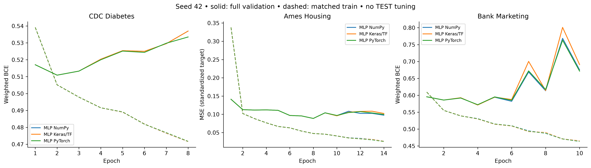

Hình 2.2. Loss train/validation seed 42. Train loss là trung bình trong lúc trọng số thay đổi; validation tính sau epoch, nên không cần bằng nhau ngay cả khi dùng cùng loss.


### 2.4.5. Xác suất, sai số và phân tích nhóm


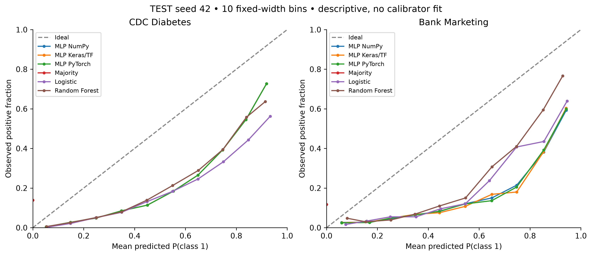

Hình 2.3. Reliability diagram từ prediction TEST đã lưu; bin rỗng không nối thành số 0. Class weighting làm mục tiêu học khác tần suất tự nhiên, nên phân biệt chất lượng phân lớp với hiệu chỉnh xác suất.


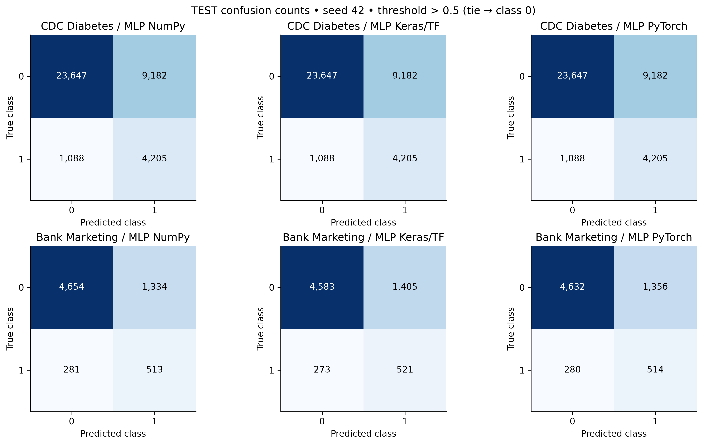

Hình 2.4. Confusion matrix seed 42, số đếm thật. Đọc false negative cùng recall lớp 1; accuracy cao không đồng nghĩa phát hiện tốt lớp thiểu số.


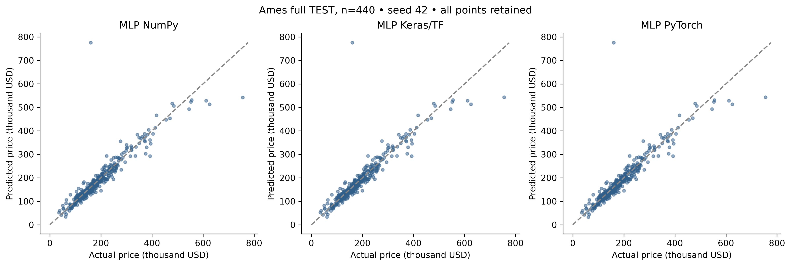

Hình 2.5. Giá thật và dự đoán của 440 nhà TEST. Điểm lệch xa đường chéo là ví dụ sai số lớn; không loại chúng khỏi metric.


Bảng 2.8. Xác suất, sai số và phân tích nhóm

| Dataset / nhóm / MLP seed 42 | Support | Recall / MAE | FPR / RMSE |
|---|---:|---:|---:|
| CDC Diabetes / 0 / MLP NumPy | 21307 | 0.8032 | 0.2597 |
| CDC Diabetes / 1 / MLP NumPy | 16815 | 0.7848 | 0.3056 |
| CDC Diabetes / 0 / MLP Keras/TF | 21307 | 0.8032 | 0.2597 |
| CDC Diabetes / 1 / MLP Keras/TF | 16815 | 0.7848 | 0.3056 |
| CDC Diabetes / 0 / MLP PyTorch | 21307 | 0.8032 | 0.2597 |
| CDC Diabetes / 1 / MLP PyTorch | 16815 | 0.7848 | 0.3056 |
| Ames Housing / built_before1980 / MLP NumPy | 248 | 11832.3644 | 15882.6170 |
| Ames Housing / built_from1980 / MLP NumPy | 192 | 19773.6979 | 52289.7107 |
| Ames Housing / built_before1980 / MLP Keras/TF | 248 | 11845.0106 | 15890.5580 |
| Ames Housing / built_from1980 / MLP Keras/TF | 192 | 19773.8759 | 52288.9432 |
| Ames Housing / built_before1980 / MLP PyTorch | 248 | 11845.0125 | 15890.5599 |
| Ames Housing / built_from1980 / MLP PyTorch | 192 | 19773.8779 | 52288.9440 |
| Bank Marketing / age_ge60 / MLP NumPy | 272 | 0.8367 | 0.6149 |
| Bank Marketing / age_lt60 / MLP NumPy | 6510 | 0.6193 | 0.2110 |
| Bank Marketing / age_ge60 / MLP Keras/TF | 272 | 0.8367 | 0.6379 |
| Bank Marketing / age_lt60 / MLP Keras/TF | 6510 | 0.6307 | 0.2226 |
| Bank Marketing / age_ge60 / MLP PyTorch | 272 | 0.8367 | 0.6207 |
| Bank Marketing / age_lt60 / MLP PyTorch | 6510 | 0.6207 | 0.2147 |

Với Ames, hai cột cuối là MAE và RMSE theo USD; với CDC/Bank là recall lớp 1 và FPR theo tỷ lệ. Chênh lệch giữa nhóm chỉ mô tả snapshot và chịu ảnh hưởng cỡ mẫu, thành phần đặc trưng và nhãn; không đủ để suy quan hệ nhân quả hay chứng nhận công bằng. Kết quả mọi seed, Brier/ECE và lý do metric không xác định nằm trong `test_groups.csv` và `test_details.json`.


## 2.5. Kiểm chứng mã và hợp đồng mô hình

Scratch tự thực hiện forward, loss, backward và Adam bằng NumPy. Keras dùng TensorFlow autodiff và graph step; PyTorch dùng CUDA autodiff. Cả ba đi từ cùng canonical weights; trước train kiểm forward/gradient trên mẫu TRAIN cố định, sau train đối chiếu native với NumPy. Các test tổng hợp kiểm numerical/parity core, cập nhật có trọng số, resume optimizer và dừng sớm; chúng không được trình bày như kết quả dữ liệu thật.


Bảng 2.9. Kiểm chứng mã và hợp đồng mô hình

| Dataset | Learnable layers | Tổng tham số MLP | Input → output |
|---|---:|---:|---|
| CDC Diabetes | 6 | 9,249 | ['batch', 21] → ['batch', 1] |
| Ames Housing | 6 | 27,937 | ['batch', 313] → ['batch', 1] |
| Bank Marketing | 6 | 11,105 | ['batch', 50] → ['batch', 1] |

Parameter count giống nhau giữa ba implementation; không đếm ReLU như lớp có tham số. Bảng từng lớp/shape nằm trong `layers.csv`; giải thích function ID, signature, công thức cần thiết, input/output và mapping framework nằm trong `report/references/functions/v3_ch2/`, sinh từ cùng contract. Không đưa toàn bộ vòng train dài vào thân tiểu luận.


## 2.6. Tiểu kết

Chương này hoàn thiện một quy trình ML có dữ liệu, baseline, MLP sáu lớp và bằng chứng so sánh ba implementation. Kết quả cần được đọc cùng track lấy mẫu, đơn vị sai số, mất cân bằng lớp và giới hạn phần cứng. Độ sâu đáp ứng yêu cầu môn học nhưng không tự bảo đảm chất lượng; đánh giá có kiểm soát và khả năng truy nguồn quan trọng hơn việc chỉ chọn số metric đẹp.


## 2.7. Mẫu dữ liệu và đường dẫn hồ sơ

### ch2_cdc_diabetes

Ba mẫu thuộc matched train, output là nhãn/giá nguồn, không phải dự đoán. Input hiển thị tối đa 8 biến; samples.json chứa đủ biến.

Bảng 2.10. ch2_cdc_diabetes

| Mã mẫu | Input minh họa | Output nguồn |
|---|---|---|
| row_0048946 | {"bmi": 24, "chol_check": 1, "heart_diseaseor_attack": 0, "high_bp": 1, "high_chol": 1, "phys_activity": 1, "smoker": 0, "stroke": 0} | 0 |
| row_0129953 | {"bmi": 21, "chol_check": 1, "heart_diseaseor_attack": 0, "high_bp": 0, "high_chol": 0, "phys_activity": 1, "smoker": 0, "stroke": 0} | 0 |
| row_0216399 | {"bmi": 22, "chol_check": 1, "heart_diseaseor_attack": 0, "high_bp": 0, "high_chol": 0, "phys_activity": 1, "smoker": 0, "stroke": 0} | 0 |

Nguồn đầy đủ: `report/references/dataset_cards/v3_eda/ch2_cdc_diabetes.md`; mọi đoạn rút gọn được ghi là trích.

Hồ sơ nguồn, dung lượng, schema, phân bố và giới hạn đầy đủ ở Phụ lục A, mục `ch2_cdc_diabetes`.

### ch2_ames_housing

Ba mẫu thuộc matched train, output là nhãn/giá nguồn, không phải dự đoán. Input hiển thị tối đa 8 biến; samples.json chứa đủ biến.

Bảng 2.11. ch2_ames_housing

| Mã mẫu | Input minh họa | Output nguồn |
|---|---|---|
| row_0001475 | {"alley": null, "land_contour": "Lvl", "lot_area": 8450, "lot_frontage": 65.0, "lot_shape": "Reg", "ms_sub_class": 20, "ms_zoning": "RL", "street": "Pave"} | 210000 |
| row_0001603 | {"alley": null, "land_contour": "Lvl", "lot_area": 6951, "lot_frontage": 37.0, "lot_shape": "IR1", "ms_sub_class": 20, "ms_zoning": "RL", "street": "Pave"} | 119500 |
| row_0001732 | {"alley": null, "land_contour": "Lvl", "lot_area": 9729, "lot_frontage": 63.0, "lot_shape": "IR1", "ms_sub_class": 60, "ms_zoning": "RL", "street": "Pave"} | 198444 |

Nguồn đầy đủ: `report/references/dataset_cards/v3_eda/ch2_ames_housing.md`; mọi đoạn rút gọn được ghi là trích.

Hồ sơ nguồn, dung lượng, schema, phân bố và giới hạn đầy đủ ở Phụ lục A, mục `ch2_ames_housing`.

### ch2_bank_marketing

Ba mẫu thuộc matched train, output là nhãn/giá nguồn, không phải dự đoán. Input hiển thị tối đa 8 biến; samples.json chứa đủ biến.

Bảng 2.12. ch2_bank_marketing

| Mã mẫu | Input minh họa | Output nguồn |
|---|---|---|
| row_0030605 | {"age": 31, "balance": 0, "default": "no", "education": "secondary", "housing": "no", "job": "self-employed", "loan": "yes", "marital": "single"} | 0 |
| row_0032873 | {"age": 32, "balance": 453, "default": "no", "education": "secondary", "housing": "yes", "job": "services", "loan": "no", "marital": "divorced"} | 0 |
| row_0038552 | {"age": 28, "balance": 278, "default": "no", "education": "primary", "housing": "yes", "job": "blue-collar", "loan": "yes", "marital": "married"} | 0 |

Nguồn đầy đủ: `report/references/dataset_cards/v3_eda/ch2_bank_marketing.md`; mọi đoạn rút gọn được ghi là trích.

Hồ sơ nguồn, dung lượng, schema, phân bố và giới hạn đầy đủ ở Phụ lục A, mục `ch2_bank_marketing`.

## 2.8. Triển khai ngắn

API V3 và tab ML đã được kiểm thử local trên cùng checkpoint seed42. Người dùng chọn CDC, Ames hoặc Bank, nhập một bản ghi và gửi một job để nhận ba MLP; baseline lịch sử vẫn đọc ở phần kết quả, không bị gọi thành framework thứ tư. Tiền xử lý giữ đúng canonical feature order, schema và scaler đã khóa. Chế độ CPU dùng NumPy portable cho cả ba bộ weights, còn local_gpu dùng TensorFlow/PyTorch native và scratch CPU. Hai loại timing phải được đọc riêng.

Đường dẫn minh họa: `/ml?dataset=ch2_ames_housing&section=run`. Model contract, checkpoint hash, input hash và actual backend/device có trong kết quả. Job chỉ inference, không fit lại từ input người dùng. Không dùng CDC để chẩn đoán hoặc Ames để định giá thị trường hiện tại.

Python API và React UI đã được kiểm thử local; không có endpoint train/TEST. Job có kiểm schema/hash/quyền đọc, timeout và giới hạn tài nguyên. Demo không là chẩn đoán, định giá hiện tại hay khuyến nghị đầu tư. Blueprint CPU dành Render và Static Site đã chuẩn bị, nhưng chưa cloud deploy; cần API HTTPS và CORS chính xác khi build. Hướng dẫn dài ở Phụ lục C.


# CHƯƠNG 3. MẠNG NƠ-RON TÍCH CHẬP (CNN)

## 3.1. Mở đầu

Một ảnh RGB không chỉ là danh sách các con số: vị trí của từng điểm ảnh và quan hệ với vùng lân cận cũng mang thông tin. Khi phân biệt rừng với khu dân cư, mô hình cần nhận ra những mẫu màu và cấu trúc lặp lại. Với ảnh đáy mắt, các chi tiết nhỏ có thể liên quan đến nhãn mức độ bệnh đã được chuyên gia gán trong bộ dữ liệu. Việc làm phẳng toàn bộ ảnh ngay từ đầu khiến quan hệ không gian khó được khai thác trực tiếp.

Mạng nơ-ron tích chập, hay Convolutional Neural Network (CNN), xử lý các vùng ảnh bằng những bộ lọc có thể học. Các lớp đầu tạo đặc trưng cục bộ; các lớp sau kết hợp đặc trưng đó trước khi đưa ra điểm số cho từng lớp. Chương này dùng CNN cho ba bài toán: phân loại DR grade trên IDRiD, lớp phủ đất trên EuroSAT và vật thể trên CIFAR-10. Đây là ba miền có mức độ chi tiết và quy mô khác nhau, không phải ba tập thay thế cho nhau.

Câu hỏi thực nghiệm là: khi giữ nguyên ảnh đầu vào, kiến trúc, trọng số khởi tạo và lịch batch, cách tự viết bằng NumPy, Keras và PyTorch khác nhau thế nào về chất lượng và chi phí chạy? Mục tiêu là hiểu và kiểm chứng cách triển khai, không cạnh tranh với các mạng pretrained lớn. Đặc biệt, mô hình IDRiD chỉ phục vụ học thuật, không dùng để chẩn đoán hay quyết định điều trị.

## 3.2. Các thành phần cơ bản

### 3.2.1. Ảnh, kênh màu và batch

Một ảnh màu được biểu diễn bằng chiều cao, chiều rộng và ba kênh đỏ–lục–lam. Ví dụ, một ảnh CIFAR-10 có shape `[32,32,3]`; một batch 16 ảnh có shape canonical `[16,32,32,3]`. Sau khi giải mã RGB và resize bằng Pillow BILINEAR, giá trị uint8 từ 0 đến 255 được đổi thành float32 rồi chia 255. Đây là phép đổi thang cố định, không phải thống kê fit trên validation hoặc TEST.

Scratch và Keras dùng NHWC: batch, cao, rộng, kênh. PyTorch thực hiện các phép tích chập ở NCHW: batch, kênh, cao, rộng. Adapter đổi layout, không đổi nội dung hay thứ tự ID. Trong các hàm parity, đầu vào vẫn là NHWC và TorchBackend tự chuyển nội bộ; chuyển vị thêm một lần bên ngoài sẽ làm sai dữ liệu. Hai định dạng này cũng được mô tả trong [tài liệu Conv2D của Keras](https://keras.io/api/layers/convolution_layers/convolution2d/) và [Conv2d của PyTorch](https://docs.pytorch.org/docs/2.14/generated/torch.nn.Conv2d.html).

### 3.2.2. Tích chập: học một bộ lọc dùng ở nhiều vị trí

Có thể hình dung một bộ lọc 3×3 như một cửa sổ nhỏ trượt trên ảnh. Tại mỗi vị trí, mô hình nhân các giá trị trong cửa sổ với trọng số tương ứng, cộng chúng rồi thêm bias. Cùng một bộ trọng số được dùng ở nhiều vị trí. Nhiều bộ lọc tạo thành nhiều kênh đặc trưng đầu ra.

Biểu thức cần để đọc code là `y = conv_same(x,W) + b`. Ở đây `x` là batch ảnh/đặc trưng, `W` là bộ lọc học được, `b` là bias theo kênh đầu ra và `y` là bản đồ đặc trưng mới. `conv_same` trong thí nghiệm dùng bộ lọc 3×3, stride 1 và đệm một hàng/cột số 0 quanh biên, nên giữ chiều cao/rộng. Tên convolution trong hai framework ở đây dùng phép tương quan chéo, không lật kernel; scratch dùng đúng cùng quy ước, được kiểm bằng parity.

Ví dụ, Conv đầu nhận `[B,32,32,3]`, có 8 bộ lọc và trả `[B,32,32,8]`. Bộ trọng số canonical có shape `[3,3,3,8]`; thêm 8 bias được 224 tham số. Mỗi bộ lọc dùng chung ở mọi vị trí nên số tham số không tăng khi thay ảnh 32×32 bằng ảnh 128×128. Tuy nhiên, số phép tính và bộ nhớ kích hoạt vẫn tăng theo diện tích ảnh.

Trong scratch, code duyệt chín vị trí của kernel và dùng `np.einsum` để nhân–cộng theo kênh. Đây là phép tính mảng NumPy, không gọi layer hay autograd của framework. Phần backward tự cộng gradient trọng số từ các vùng ảnh và phân phối gradient về các điểm ảnh đầu vào. Mã đầy đủ nằm trong `src/common/numpy_engine.py` đã được kiểm chứng ở Phase25; không chỉ có hàm forward.

### 3.2.3. ReLU và pooling

ReLU giữ giá trị dương và đưa giá trị âm về 0. Nó tạo khả năng biểu diễn phi tuyến nhưng không thay shape và không có tham số học được. Khi truyền ngược, vị trí có đầu vào dương cho gradient đi qua; vị trí còn lại nhận 0 theo quy ước của core.

Max pooling 2×2 giữ giá trị lớn nhất của mỗi ô 2×2, làm chiều cao/rộng giảm một nửa. Ví dụ minh họa synthetic, ô có các số `[1,4;2,3]` trở thành `4`. Backward đưa gradient về vị trí cực đại đã lưu; nếu có nhiều giá trị bằng nhau, scratch chọn vị trí đầu theo thứ tự duyệt. Việc kiểm tra gradient tránh điểm không trơn và đối chiếu backend, không suy rằng mọi trường hợp đồng hạng sẽ có gradient duy nhất về mặt toán học.

Sau lớp Conv cuối, global average pooling lấy trung bình theo hai chiều không gian của từng kênh. Với `[B,8,8,32]`, kết quả là `[B,32]`. Bước này tạo một vector đặc trưng gọn trước Dense. Nó có thể làm mất thông tin vị trí chi tiết; đây là giới hạn đáng chú ý ở bài toán ảnh y khoa. ReLU, max pooling và global average pooling đều không được tính vào bảy lớp học được.

### 3.2.4. Dense, logits, softmax và loss

Dense kết hợp các đặc trưng theo phép `z = xW + b`. Trong chương này, Dense32 nhận 32 đặc trưng sau global pooling và tạo 32 giá trị mới; Dense cuối tạo 5 logit cho IDRiD hoặc 10 logit cho hai bộ còn lại. Logit chỉ là điểm số chưa chuẩn hóa, không phải xác suất.

Softmax chuyển các logit thành xác suất có tổng bằng 1. Code trừ logit lớn nhất của từng mẫu trước khi lấy hàm mũ để tránh tràn số; phép trừ chung này không thay kết quả softmax. Lớp dự đoán là lớp có xác suất lớn nhất. Nếu bằng nhau, `argmax` chọn ID nhỏ hơn theo thứ tự cố định.

Cross-entropy phạt dự đoán đặt xác suất thấp vào nhãn thật. Scratch tính loss ổn định và gradient tại logits rồi tự lan truyền ngược; hai backend native dùng phép loss tương ứng trên cùng nhãn ID. IDRiD dùng trọng số lớp đã fit từ train để tăng đóng góp của lớp ít mẫu. Loss có trọng số được chia cho tổng trọng số của batch, không chia tùy ý theo số ảnh. Metric cuối vẫn tính trên các ảnh thật, không nhân trọng số để làm đẹp accuracy/F1.

Adam cập nhật trọng số từ gradient và hai bộ nhớ moment. Cả ba đường dùng learning rate 0,001, betas 0,9/0,999, epsilon 1e-7 sau căn của moment bình phương đã hiệu chỉnh, cùng giới hạn global gradient norm bằng 1. Keras ở đây dùng cập nhật TensorFlow native với slots rõ ràng để khớp quy ước đã khóa; không thay bằng stock Adam có quy ước epsilon khác.

## 3.3. Kiến trúc và hợp các hàm

### 3.3.1. Bảy lớp học được

Luồng tổng quát là:

`Ảnh RGB → resize/rescale → Conv8/ReLU → Conv8/ReLU → MaxPool → Conv16/ReLU → Conv16/ReLU → MaxPool → Conv32/ReLU → GlobalAverage → Dense32/ReLU → DenseC → softmax → nhãn/xác suất`.

`B` là batch size, `C` là số lớp. Có **5 Conv + 2 Dense = 7 lớp có tham số học được**. Đếm lớp không dựa vào số dòng code, số đối tượng container hay số bước pooling.

Bảng 3.1. Bảy lớp học được

| Bước | IDRiD: shape một mẫu | EuroSAT/CIFAR-10: shape một mẫu | Tham số |
|---|---|---|---:|
| RGB đã resize | 128×128×3 | 32×32×3 | 0 |
| Conv1 + ReLU | 128×128×8 | 32×32×8 | 224 |
| Conv2 + ReLU | 128×128×8 | 32×32×8 | 584 |
| MaxPool1 | 64×64×8 | 16×16×8 | 0 |
| Conv3 + ReLU | 64×64×16 | 16×16×16 | 1.168 |
| Conv4 + ReLU | 64×64×16 | 16×16×16 | 2.320 |
| MaxPool2 | 32×32×16 | 8×8×16 | 0 |
| Conv5 + ReLU | 32×32×32 | 8×8×32 | 4.640 |
| Global average | 32 | 32 | 0 |
| Dense32 + ReLU | 32 | 32 | 1.056 |
| DenseC | 5 | 10 | 165 / 330 |
| **Tổng** | **10.157** | **10.322** | **7 lớp học được** |

Các shape/count trên lấy từ computational plan và model contract Phase25, được dùng lại nguyên vẹn trong Phase27. IDRiD có đầu ra ít lớp hơn nên ít tham số hơn, dù ảnh đầu vào lớn hơn. Pooling nằm sau Conv thứ hai và thứ tư; chỉ số `[1,3]` trong config là chỉ số bắt đầu từ 0.

### 3.3.2. Hợp hàm: đầu ra bước trước là đầu vào bước sau

Viết ngắn gọn `F = f_L ∘ ... ∘ f_1` chỉ có nghĩa là thực hiện `f_1` trước, đưa kết quả vào `f_2`, rồi tiếp tục đến bước cuối `f_L`. `F` là mô hình đầy đủ, các `f` là bước xử lý đã nêu và `L` là tổng số bước. Số bước này còn tính activation/pooling nên không đồng nhất với bảy lớp học được. Luồng bằng lời ở trên là cách đọc chính; không cần suy diễn một công thức tích chập nhiều chỉ số để theo dõi pipeline.

Code `render_functions(model_contract)` sinh hợp hàm theo đúng function ID, shape và parameter count. Ví dụ Conv1 là `conv2d_1`, ReLU đầu là `activation_2`, Dense cuối là `dense_16`. Bảng chi tiết của ba framework cho từng dataset ở `report/references/functions/v3/`; mỗi run có bản `functions.json` gắn với checkpoint/config. Không thay thế bảng này bằng một sơ đồ kiến trúc khác khi đưa vào UI.

Bảng 3.2. Hợp hàm: đầu ra bước trước là đầu vào bước sau

| Hàm/signature | Input → output | Vai trò và tham số | Lưu ý |
|---|---|---|---|
| `decode_rows(dataset,path,rows,resolution)` | Archive + ID → ảnh uint8 HWC | Đọc RGB/BILINEAR theo index; không học tham số | Không extract/pickle; kiểm hash pixel đã khóa |
| `ImageCache.batch(ids,implementation)` | ID → batch float32 và nhãn ID | Giữ thứ tự, rescale/layout; không fit | Từ chối ID lạ/trùng; development không chứa TEST |
| `conv2d(x,W,b)` | NHWC → bản đồ đặc trưng | Kernel 3×3, bias theo kênh | Same-padding, canonical HWIO; Torch đổi OIHW |
| `relu(x)` | Tensor → tensor cùng shape | Giữ tín hiệu dương | Không tham số; gradient theo quy ước tại 0 |
| `max_pool2(x)` | H×W×K → H/2×W/2×K | Giữ cực đại từng ô | Backward dùng vị trí cực đại đã lưu |
| `global_average(x)` | H×W×K → K | Trung bình từng kênh | Gradient chia đều theo số vị trí |
| `dense(x,W,b)` | Vector → vector mới | Kết hợp đặc trưng, học W/b | Dense cuối trả logits, chưa phải xác suất |
| `probabilities(logits)` | N×C → N×C | Softmax ổn định | Không nhận NaN/Inf; không dùng để tính loss lần hai |
| `loss_and_gradient(logits,y,"multiclass",weights)` | Logits/nhãn → loss, gradient | Cross-entropy, chuẩn hóa tổng weight | Nhãn phải thuộc 0…C−1; trọng số không âm |
| `loss_gradients(x,y,task,weights)` | Batch → loss/gradient | Scratch tự backward từng lớp | Native parity API chỉ nhận loss không trọng số; weighted update có test riêng |
| `trainer.step(x,y,task,weights)` | Batch → loss/norm và tham số mới | Clip global norm, Adam | Native giữ gradient/update trên GPU |
| `fit_images(...)` | Cache + train/val ID → checkpoint tốt nhất | Lịch batch chung, early stopping | Không lấy TEST để chọn epoch hoặc seed |
| `export_state()/restore_state(state)` | Trainer ↔ weights/m/v/step | Tiếp tục đúng optimizer | Conv slots phải đổi HWIO↔OIHW, không dùng `.T` cho tensor 4 chiều |

### 3.3.3. Ba cách triển khai cùng một mô hình

Scratch dùng NumPy cho Conv, pooling, Dense, loss, backward và Adam; không gọi autograd. Keras tạo lớp `Conv2D`, `MaxPooling2D`, `GlobalAveragePooling2D`, `Dense` trên backend TensorFlow độc lập. PyTorch dùng `Conv2d`, `MaxPool2d`, `AdaptiveAvgPool2d`, `Linear`. Cả hai native lấy canonical weights chung, không dùng initialization mặc định khác nhau.

Đường code scratch: `src/common/numpy_engine.py` → `CnnScratchTrainer`. Đường Keras: `KerasBackend` → `CnnKerasTrainer._cnn_step`. Đường PyTorch: `TorchBackend` → `NativeAdam` và `CnnTorchTrainer`. Adapter/backend nằm trong `src/common/backend_models.py`; runner và checkpoint riêng của chương nằm trong `src/ch03_cnn/`. Các lớp core đã khóa không được chỉnh ngầm trong lúc train.

```python
# Minh họa cách gọi; không phải kết quả của một lượt train mới.
plan = build_plan("cnn", [32, 32, 3], outputs=10)
weights = canonical_weights(plan, seed=42)
scratch = CnnScratchTrainer(plan, weights)       # NumPy CPU
keras = CnnKerasTrainer(plan, weights, "gpu")    # chạy ở env Keras riêng
torch = CnnTorchTrainer(plan, weights, "gpu")    # chạy ở env Torch riêng
# Cùng x NHWC, y class ID và sample_weight cho mỗi step.
```

Ba đối tượng trong ví dụ được tạo ở process/env phù hợp, không import đồng thời hai GPU framework trong một kernel. Notebook cung cấp đường demo CPU từ checkpoint đã train; chạy lại notebook demo không tự train hoặc mở lại TEST. Số liệu so sánh phải đọc artifact đo thật, không suy ra từ ví dụ code.

## 3.4. Dữ liệu và giao thức đánh giá

### 3.4.1. Ba nguồn ảnh và kích cỡ

Bảng 3.3. Ba nguồn ảnh và kích cỡ

| Dataset / nguồn | Kích cỡ nguồn local | Ảnh / lớp | Shape gốc → model | Matched train / validation / TEST |
|---|---:|---:|---|---:|
| [IDRiD, B. Disease Grading](https://ieee-dataport.org/open-access/indian-diabetic-retinopathy-image-dataset-idrid) | 212.405.123 byte | 516 / 5 | 4288×2848 RGB → 128×128 | 348 / 64 / 103 |
| [EuroSAT RGB](https://zenodo.org/records/7711810) | 94.658.721 byte | 27.000 / 10 | 64×64 RGB → 32×32 | 3.000 / 4.050 / 4.050 |
| [CIFAR-10 binary](https://www.cs.toronto.edu/~kriz/cifar.html) | 170.052.171 byte | 60.000 / 10 | 32×32 RGB → 32×32 | 5.000 / 5.000 / 10.000 |

Đây là byte của archive thực tải, không phải dung lượng float32 trong RAM. IDRiD có giấy phép CC BY 4.0 theo file kèm nguồn. EuroSAT dùng gói RGB, có thông tin MIT trong metadata Zenodo và cần tôn trọng điều khoản dữ liệu Sentinel liên quan. CIFAR là benchmark nghiên cứu công khai do tác giả lưu trữ; không tự gán giấy phép SPDX chưa được xác minh hoặc đóng gói lại raw để phân phối.

IDRiD ưu tiên miền tiểu đường theo định hướng tiểu luận. Hai tập còn lại kiểm tra mô hình ở ảnh vệ tinh và vật thể. Không ép dữ liệu bảng giá nhà/giá vàng thành ảnh chỉ để dùng CNN khi mục tiêu bài toán không phù hợp; các miền đó được khai thác ở Chương 2 và Chương 4.

### 3.4.2. Mẫu đầu vào/nhãn thật và phân bố

IDRiD có các lớp DR grade 0–4. Phân bố toàn bộ nguồn lần lượt là 168, 25, 168, 93, 62 ảnh; matched train là 113, 16, 116, 63, 40 ảnh. Lớp 1 rất ít mẫu nên accuracy đơn lẻ có thể che việc bỏ sót lớp nhỏ. Ví dụ train đã kiểm nguồn: `train/IDRiD_001 → grade 3`, `train/IDRiD_003 → grade 2`, `train/IDRiD_006 → grade 4`. Đây là **nhãn thật**, không phải dự đoán từ ảnh người dùng.

EuroSAT có AnnualCrop, Forest, HerbaceousVegetation, Highway, Industrial, Pasture, PermanentCrop, Residential, River, SeaLake. Số ảnh toàn nguồn lần lượt là 3.000, 3.000, 3.000, 2.500, 2.500, 2.000, 2.500, 3.000, 2.500, 3.000. Ví dụ: `AnnualCrop_1.jpg → AnnualCrop`, `Forest_100.jpg → Forest`, `HerbaceousVegetation_1003.jpg → HerbaceousVegetation`; ID đầy đủ luôn kèm thư mục lớp. Ảnh chỉ có RGB, không suy luận rằng mô hình đã sử dụng các băng phổ khác.

CIFAR-10 có 6.000 ảnh mỗi lớp trong toàn nguồn, 500 ảnh mỗi lớp ở validation và 1.000 ảnh mỗi lớp ở TEST. Ba ví dụ train: `data_batch_1.bin/00026 → cat`, `data_batch_1.bin/00028 → deer`, `data_batch_1.bin/00029 → airplane`. Nhãn ID 0–9 và thứ tự tên lớp lấy từ metadata binary, không tự sắp xếp lại theo tên tiếng Việt.


Thẻ dữ liệu đầy đủ, hình phân bố và mẫu có ID nằm ở `report/references/dataset_cards/v3_eda/ch3_*.md`. Số đo được giữ nguyên từ Phase24; không tính lại bộ chia dựa trên kết quả CNN.

### 3.4.3. Chống rò rỉ và phạm vi so sánh

IDRiD giữ official TEST 103 ảnh. Một ảnh official train trùng pixel với TEST đã được quarantine ở Phase24, nên 348 train + 64 validation + 103 TEST + 1 quarantine bằng 516. Nguồn còn có các nhóm ảnh trùng và nhãn mâu thuẫn; giữ nhãn gốc, không sửa bằng bỏ phiếu đa số. Không có patient ID đã xác minh nên không gọi đây là chia độc lập bệnh nhân. Resize trực tiếp từ ảnh chữ nhật về 128×128 vừa giảm chi tiết vừa thay tỉ lệ hình; track này không dùng crop hoặc bảo toàn tỉ lệ bằng padding.

EuroSAT có 18.900 ảnh train đầy đủ nhưng matched track chỉ học trên 3.000 ID đã chọn trước. CIFAR có 45.000 train sau khi tách validation, matched track học trên 5.000 ID cố định. Validation và TEST luôn đầy đủ cho cả scratch/Keras/PyTorch. Không so kết quả matched train với một mô hình khác đã học toàn bộ train rồi gọi đó là chênh lệch do framework. EuroSAT không có khóa vị trí địa lý đã xác minh, nên kiểm trùng pixel không chứng minh độc lập không gian.

Matched preprocessing đã khóa quy định **không augmentation**. Phase27 giữ điều này ở cả ba implementation; thêm xoay/lật/màu sắc phải tạo track bổ sung riêng, và mọi biến đổi ngẫu nhiên chỉ được phép ở train. Chọn không augmentation ở track này không có nghĩa augmentation nói chung không hữu ích.

### 3.4.4. Huấn luyện, metric và chi phí chạy

Thực nghiệm dùng ba seed 17/42/73; mỗi dataset có ba implementation cho mỗi seed, tổng 27 lượt CNN. Baseline majority luôn chọn lớp phổ biến nhất từ matched train rồi trả phân bố one-hot; được lưu theo cùng ma trận seed để đối chiếu, nhưng không coi các bản baseline giống nhau là bằng chứng độc lập mới.

Mỗi lượt có batch size 16, tối đa 40 epoch, patience 6, min_delta 1e-5, giới hạn 120 phút. Lưu checkpoint có validation loss nhỏ nhất thật; min_delta chỉ kiểm soát patience. Các lượt dùng cùng thứ tự batch theo seed và cùng initial weights. Từ chối NaN/OOM/timeout, không ngầm giảm batch, độ sâu hoặc số mẫu riêng cho một implementation.

Macro-F1 là metric chính: mỗi lớp góp phần như nhau, nên nhạy hơn accuracy với lớp nhỏ. Báo thêm accuracy, weighted-F1, recall từng lớp, confusion matrix, AUROC/AP khi đủ support. Confusion matrix có hàng là nhãn thật, cột là dự đoán. AUROC/AP không xác định khi thiếu support sẽ được ghi null kèm lý do, không gán 0 để lấp bảng.

So sánh ba seed dùng mean và sample standard deviation, không gọi độ lệch chuẩn là khoảng tin cậy hay kết luận có ý nghĩa thống kê từ ba lượt. Timing train bao gồm validation, chuyển batch và ghi trạng thái tiến trình. Inference đo batch 1, 5 warmup, 30 lần, đồng bộ GPU; gồm model/layout/transfer nhưng tách tiền xử lý ảnh. RAM là peak RSS cả đời process, VRAM là peak allocator framework, không phải tổng VRAM của máy.

Scratch chạy CPU; Keras và PyTorch chạy GPU local trong hai env khóa riêng. Vì thiết bị và chế độ graph/eager khác nhau, timing mô tả **các triển khai đã đo trên máy này**, không phải bằng chứng một ngôn ngữ/framework luôn nhanh hơn. Sai khác làm tròn tích chập có thể tích lũy trong quá trình học dù kiểm tra khởi tạo đạt tolerance. Không chọn seed hay sửa hyperparameter dựa trên TEST.

Máy đo dùng Intel Core i7-13620H (10 core/16 luồng phía host) và NVIDIA GeForce RTX 5050 Laptop, driver 591.74, VRAM được driver báo 8.151 MiB. Runtime khóa là WSL2/Python 3.11.17; PyTorch 2.14.1+cu130, Keras 3.15.1/TensorFlow 2.21.0 trong hai venv riêng. Code scratch/native CPU đặt chính sách hai luồng tính toán; GPU dùng float32, không mixed precision. Bằng chứng môi trường và metadata máy tại `artifacts/manifests/environment.json`, `uv.lock`, `artifacts/manifests/phase27/hardware_snapshot.json` và chi tiết từng run.

Toàn bộ config, code, evaluator, approved run IDs và checkpoint validation phải được khóa trước một batch TEST duy nhất cho mỗi dataset. Mỗi run tiêu thụ một claim; lỗi hoặc gián đoạn không cấp quyền dự đoán lại. Các phân tích sau TEST chỉ đọc prediction đã lưu. TEST Ch2 và Ch5 không được chạy lại để hoàn thiện chương này.


## 3.5. Kết quả thực nghiệm

Toàn bộ 27 CNN và 9 baseline đã hoàn tất. Các bảng dưới dùng full TEST, mean ± sample SD trên ba seed 17/42/73. Không chọn seed tốt nhất theo TEST. Baseline lặp theo seed để cùng định dạng, có kết quả giống nhau vì không có bước học ngẫu nhiên.

Bảng 3.4. Kết quả thực nghiệm

| Dataset | Cách triển khai | Macro-F1 | Accuracy | Weighted-F1 | AUROC |
|---|---|---:|---:|---:|---:|
| IDRiD | scratch | 0.1804 ± 0.0878 | 0.3754 ± 0.0569 | 0.2649 ± 0.1092 | 0.5527 ± 0.0149 |
| IDRiD | keras | 0.1579 ± 0.0570 | 0.3657 ± 0.0561 | 0.2523 ± 0.0946 | 0.5529 ± 0.0158 |
| IDRiD | pytorch | 0.1454 ± 0.0457 | 0.3139 ± 0.0826 | 0.2246 ± 0.0745 | 0.5592 ± 0.0009 |
| IDRiD | majority | 0.0948 ± 0.0000 | 0.3107 ± 0.0000 | 0.1473 ± 0.0000 | 0.5000 ± 0.0000 |
| EuroSAT | scratch | 0.6738 ± 0.0157 | 0.6995 ± 0.0179 | 0.6845 ± 0.0156 | 0.9534 ± 0.0053 |
| EuroSAT | keras | 0.6902 ± 0.0215 | 0.7082 ± 0.0155 | 0.7001 ± 0.0203 | 0.9573 ± 0.0043 |
| EuroSAT | pytorch | 0.6983 ± 0.0472 | 0.7137 ± 0.0429 | 0.7096 ± 0.0439 | 0.9574 ± 0.0075 |
| EuroSAT | majority | 0.0200 ± 0.0000 | 0.1111 ± 0.0000 | 0.0222 ± 0.0000 | 0.5000 ± 0.0000 |
| CIFAR-10 | scratch | 0.5199 ± 0.0137 | 0.5301 ± 0.0121 | 0.5199 ± 0.0137 | 0.9019 ± 0.0042 |
| CIFAR-10 | keras | 0.5086 ± 0.0448 | 0.5162 ± 0.0383 | 0.5086 ± 0.0448 | 0.8958 ± 0.0134 |
| CIFAR-10 | pytorch | 0.5201 ± 0.0111 | 0.5304 ± 0.0075 | 0.5201 ± 0.0111 | 0.9009 ± 0.0024 |
| CIFAR-10 | majority | 0.0182 ± 0.0000 | 0.1000 ± 0.0000 | 0.0182 ± 0.0000 | 0.5000 ± 0.0000 |


IDRiD: macro-F1 trung bình scratch/Keras/PyTorch lần lượt là 0.1804, 0.1579, 0.1454; majority là 0.0948. Đây là kết quả của kiến trúc nhỏ và matched train đã khóa, không phải chất lượng tối đa có thể đạt trên bộ dữ liệu.

EuroSAT: macro-F1 trung bình scratch/Keras/PyTorch lần lượt là 0.6738, 0.6902, 0.6983; majority là 0.0200. Đây là kết quả của kiến trúc nhỏ và matched train đã khóa, không phải chất lượng tối đa có thể đạt trên bộ dữ liệu.

CIFAR-10: macro-F1 trung bình scratch/Keras/PyTorch lần lượt là 0.5199, 0.5086, 0.5201; majority là 0.0182. Đây là kết quả của kiến trúc nhỏ và matched train đã khóa, không phải chất lượng tối đa có thể đạt trên bộ dữ liệu.

### 3.5.1. Recall từng lớp và lỗi nhầm lẫn

Confusion matrix dùng seed42 đã định trước để minh họa, không chọn seed bằng TEST. Hàng là nhãn thật, cột là dự đoán. Ba triển khai dùng cùng thang màu số đếm trong mỗi dataset. Với 10 lớp, không in số ở từng ô để tránh chồng chữ; ma trận số đầy đủ nằm trong `runs/<run_id>/test_details.json` của manifest Phase27. Bảng recall dùng cả ba seed; giá trị nhỏ cho biết mô hình bỏ sót nhiều ảnh của lớp đó.

#### IDRiD

Bảng 3.5. IDRiD

| Lớp nguồn | Scratch recall | Keras recall | PyTorch recall |
|---|---:|---:|---:|
| 0: DR grade 0 | 0.5098 ± 0.4871 | 0.4804 ± 0.4464 | 0.3922 ± 0.4493 |
| 1: DR grade 1 | 0.0000 ± 0.0000 | 0.0000 ± 0.0000 | 0.1333 ± 0.2309 |
| 2: DR grade 2 | 0.6250 ± 0.3750 | 0.6667 ± 0.3130 | 0.5729 ± 0.3702 |
| 3: DR grade 3 | 0.0000 ± 0.0000 | 0.0000 ± 0.0000 | 0.0000 ± 0.0000 |
| 4: DR grade 4 | 0.1026 ± 0.1776 | 0.0000 ± 0.0000 | 0.0000 ± 0.0000 |


scratch, seed42: cặp nhầm nhiều nhất là DR grade 3 → DR grade 2, 15 ảnh. Đây là mô tả lỗi từ prediction đã lưu, không dùng để thay dữ liệu hoặc tuning sau TEST.

keras, seed42: cặp nhầm nhiều nhất là DR grade 3 → DR grade 2, 16 ảnh. Đây là mô tả lỗi từ prediction đã lưu, không dùng để thay dữ liệu hoặc tuning sau TEST.

pytorch, seed42: cặp nhầm nhiều nhất là DR grade 0 → DR grade 1, 20 ảnh. Đây là mô tả lỗi từ prediction đã lưu, không dùng để thay dữ liệu hoặc tuning sau TEST.

#### EuroSAT

Bảng 3.6. EuroSAT

| Lớp nguồn | Scratch recall | Keras recall | PyTorch recall |
|---|---:|---:|---:|
| 0: AnnualCrop | 0.7689 ± 0.0146 | 0.7533 ± 0.0422 | 0.7607 ± 0.0818 |
| 1: Forest | 0.9141 ± 0.0278 | 0.8148 ± 0.0500 | 0.9007 ± 0.0509 |
| 2: HerbaceousVegetation | 0.6267 ± 0.0407 | 0.5867 ± 0.0725 | 0.6563 ± 0.0361 |
| 3: Highway | 0.2827 ± 0.2066 | 0.2996 ± 0.0932 | 0.4160 ± 0.0690 |
| 4: Industrial | 0.9209 ± 0.0248 | 0.9209 ± 0.0169 | 0.8951 ± 0.0570 |
| 5: Pasture | 0.6756 ± 0.1733 | 0.7078 ± 0.1522 | 0.5789 ± 0.1978 |
| 6: PermanentCrop | 0.4898 ± 0.0847 | 0.5102 ± 0.0893 | 0.5360 ± 0.0333 |
| 7: Residential | 0.8785 ± 0.0533 | 0.8881 ± 0.0258 | 0.8474 ± 0.0651 |
| 8: River | 0.5271 ± 0.2691 | 0.6391 ± 0.0932 | 0.5529 ± 0.0466 |
| 9: SeaLake | 0.8067 ± 0.1289 | 0.8844 ± 0.0446 | 0.8719 ± 0.0438 |


scratch, seed42: cặp nhầm nhiều nhất là River → Highway, 136 ảnh. Đây là mô tả lỗi từ prediction đã lưu, không dùng để thay dữ liệu hoặc tuning sau TEST.

keras, seed42: cặp nhầm nhiều nhất là Highway → River, 133 ảnh. Đây là mô tả lỗi từ prediction đã lưu, không dùng để thay dữ liệu hoặc tuning sau TEST.

pytorch, seed42: cặp nhầm nhiều nhất là Highway → River, 85 ảnh. Đây là mô tả lỗi từ prediction đã lưu, không dùng để thay dữ liệu hoặc tuning sau TEST.

#### CIFAR-10

Bảng 3.7. CIFAR-10

| Lớp nguồn | Scratch recall | Keras recall | PyTorch recall |
|---|---:|---:|---:|
| 0: airplane | 0.5857 ± 0.0811 | 0.5693 ± 0.0700 | 0.5170 ± 0.1103 |
| 1: automobile | 0.7473 ± 0.0231 | 0.7070 ± 0.0200 | 0.7047 ± 0.0595 |
| 2: bird | 0.3603 ± 0.0631 | 0.2817 ± 0.1621 | 0.3563 ± 0.0945 |
| 3: cat | 0.2173 ± 0.0465 | 0.3427 ± 0.0958 | 0.2820 ± 0.0318 |
| 4: deer | 0.4157 ± 0.0584 | 0.3660 ± 0.1178 | 0.3330 ± 0.1339 |
| 5: dog | 0.5020 ± 0.0659 | 0.5063 ± 0.0450 | 0.4530 ± 0.0420 |
| 6: frog | 0.6253 ± 0.0878 | 0.6157 ± 0.1256 | 0.7427 ± 0.0403 |
| 7: horse | 0.6700 ± 0.0621 | 0.5507 ± 0.0644 | 0.5963 ± 0.0416 |
| 8: ship | 0.6503 ± 0.0841 | 0.6787 ± 0.0199 | 0.7157 ± 0.0440 |
| 9: truck | 0.5270 ± 0.1421 | 0.5437 ± 0.1239 | 0.6033 ± 0.0721 |


scratch, seed42: cặp nhầm nhiều nhất là airplane → ship, 223 ảnh. Đây là mô tả lỗi từ prediction đã lưu, không dùng để thay dữ liệu hoặc tuning sau TEST.

keras, seed42: cặp nhầm nhiều nhất là dog → cat, 304 ảnh. Đây là mô tả lỗi từ prediction đã lưu, không dùng để thay dữ liệu hoặc tuning sau TEST.

pytorch, seed42: cặp nhầm nhiều nhất là cat → dog, 305 ảnh. Đây là mô tả lỗi từ prediction đã lưu, không dùng để thay dữ liệu hoặc tuning sau TEST.

### 3.5.2. Thời gian, bộ nhớ và checkpoint

Bảng 3.8. Thời gian, bộ nhớ và checkpoint

| Dataset | Triển khai / thiết bị train | Train giây | Inference p50 ms | Peak RSS MiB | Allocator VRAM MiB | Checkpoint KiB |
|---|---|---:|---:|---:|---:|---:|
| IDRiD | scratch / CPU | 245.33 ± 13.53 | 25.16 ± 1.38 | 392.07 ± 0.51 | 0.00 ± 0.00 | 43.15 ± 0.00 |
| IDRiD | keras / GPU | 8.01 ± 1.47 | 1.50 ± 0.09 | 1854.41 ± 101.96 | 124.25 ± 0.00 | 43.15 ± 0.00 |
| IDRiD | pytorch / GPU | 5.65 ± 1.29 | 0.83 ± 0.15 | 1917.77 ± 2.55 | 120.20 ± 0.00 | 43.15 ± 0.00 |
| EuroSAT | scratch / CPU | 663.67 ± 134.22 | 2.11 ± 0.04 | 255.01 ± 0.19 | 0.00 ± 0.00 | 43.79 ± 0.00 |
| EuroSAT | keras / GPU | 106.53 ± 9.11 | 1.45 ± 0.16 | 1812.32 ± 13.41 | 65.88 ± 0.11 | 43.79 ± 0.00 |
| EuroSAT | pytorch / GPU | 60.88 ± 2.66 | 0.69 ± 0.01 | 1899.34 ± 1.21 | 67.64 ± 0.00 | 43.79 ± 0.00 |
| CIFAR-10 | scratch / CPU | 1200.16 ± 4.65 | 2.10 ± 0.03 | 266.72 ± 0.40 | 0.00 ± 0.00 | 43.79 ± 0.00 |
| CIFAR-10 | keras / GPU | 152.97 ± 35.92 | 1.34 ± 0.04 | 1816.03 ± 25.65 | 65.96 ± 0.07 | 43.79 ± 0.00 |
| CIFAR-10 | pytorch / GPU | 87.24 ± 8.83 | 0.71 ± 0.01 | 1911.50 ± 0.07 | 67.64 ± 0.00 | 43.79 ± 0.00 |

Train bao gồm validation/checkpoint I/O, không bao gồm import framework hoặc chuẩn bị cache trước timer. Inference gồm layout/transfer; thời gian tiền xử lý được lưu riêng. RSS là high-water của process; allocator VRAM không gồm driver/ứng dụng khác. Không suy ra framework nào luôn tốt hơn từ benchmark CPU scratch so với GPU native trên một laptop.

Lượt scratch IDRiD seed73 được resume từ epoch7 sau gián đoạn: thời gian train cộng các đoạn chạy, loại thời gian tạm dừng; timestamp metric thuộc invocation hoàn tất. Peak RSS của lượt này là process resume, không có số đo đã chốt từ process cũ để khẳng định peak gộp toàn lượt. Các số RAM trong bảng phải được đọc theo phạm vi process, không như một phép đo peak liên tục trên mọi lượt.

Bảng 3.9. Thời gian, bộ nhớ và checkpoint

| Dataset | Tiền xử lý demo p50 ms | Tiền xử lý demo p95 ms |
|---|---:|---:|
| IDRiD | 28.191 | 58.855 |
| EuroSAT | 61.259 | 75.563 |
| CIFAR-10 | 102.846 | 125.592 |

Đo tiền xử lý dùng PNG đã nạp base64 ở kích thước model, gồm giải mã/resize/rescale và đọc–kiểm hash metadata hợp đồng, không gồm tải ảnh qua mạng hoặc đọc file ảnh. Đây không phải chi phí giải mã ảnh IDRiD gốc 4288×2848. Cả ba trường hợp dùng 5 warmup và 30 lần đo trên CPU.


### 3.5.3. Quá trình học và minh họa độ nhạy


Khi train loss giảm nhưng validation loss tăng, mô hình có dấu hiệu học quá sát train. Early stopping giữ checkpoint validation tốt nhất, không giữ epoch cuối chỉ vì train loss nhỏ hơn. Sai khác số học giữa CPU/GPU có thể tạo quỹ đạo cập nhật khác nhau sau nhiều bước; parity ban đầu không bảo đảm mọi epoch có cùng trọng số hoặc cùng nhãn dự đoán.


Saliency ở đây là trị tuyệt đối gradient logit của lớp dự đoán theo đầu vào, lấy cực đại qua kênh rồi chia cực đại của ảnh; ảnh có gradient bằng 0 giữ bản đồ 0. Vùng sáng chỉ cho biết độ nhạy cục bộ của mô hình ở ví dụ này, không xác nhận tổn thương, nguyên nhân hay vùng chú ý đúng. Không chọn ảnh theo kết quả TEST và không dùng heatmap để biện minh chẩn đoán.

## 3.6. Tiểu kết

Chương đã nối ba bài toán ảnh với cùng CNN bảy lớp, triển khai forward/backward/Adam scratch và hai backend GPU độc lập. Kiểm tra khởi tạo, batch/ID, optimizer resume, checkpoint CPU và TEST one-shot giúp phân biệt đúng đắn code với chất lượng dự đoán. Việc lựa chọn công cụ cần xét đồng thời metric, thời gian, bộ nhớ, độ dễ kiểm chứng và hạn chế dữ liệu, không chỉ accuracy cao nhất.

Nguồn số liệu: `artifacts/metrics/phase27/tables/`; source/split/preprocessing Phase23–25; run/selection/TEST seals và trained registry tại `artifacts/manifests/phase27/`.


## 3.7. Mẫu dữ liệu và đường dẫn hồ sơ

### ch3_idrid

Mẫu và hình chỉ lấy matched train. known_output là nhãn gốc, không phải dự đoán.

Bảng 3.10. ch3_idrid

| Mã mẫu | Input minh họa | Output nguồn |
|---|---|---|
| train/IDRiD_001 | {"member": "B. Disease Grading/1. Original Images/a. Training Set/IDRiD_001.jpg", "model_shape": [128, 128, 3], "native_shape": [2848, 4288, 3]} | 3 |
| train/IDRiD_003 | {"member": "B. Disease Grading/1. Original Images/a. Training Set/IDRiD_003.jpg", "model_shape": [128, 128, 3], "native_shape": [2848, 4288, 3]} | 2 |
| train/IDRiD_006 | {"member": "B. Disease Grading/1. Original Images/a. Training Set/IDRiD_006.jpg", "model_shape": [128, 128, 3], "native_shape": [2848, 4288, 3]} | 4 |

Nguồn đầy đủ: `report/references/dataset_cards/v3_eda/ch3_idrid.md`; mọi đoạn rút gọn được ghi là trích.

Hồ sơ nguồn, dung lượng, schema, phân bố và giới hạn đầy đủ ở Phụ lục A, mục `ch3_idrid`.

### ch3_eurosat

Mẫu và hình chỉ lấy matched train. known_output là nhãn gốc, không phải dự đoán.

Bảng 3.11. ch3_eurosat

| Mã mẫu | Input minh họa | Output nguồn |
|---|---|---|
| EuroSAT_RGB/AnnualCrop/AnnualCrop_1.jpg | {"member": "EuroSAT_RGB/AnnualCrop/AnnualCrop_1.jpg", "model_shape": [32, 32, 3], "native_shape": [64, 64, 3]} | AnnualCrop |
| EuroSAT_RGB/Forest/Forest_100.jpg | {"member": "EuroSAT_RGB/Forest/Forest_100.jpg", "model_shape": [32, 32, 3], "native_shape": [64, 64, 3]} | Forest |
| EuroSAT_RGB/HerbaceousVegetation/HerbaceousVegetation_1003.jpg | {"member": "EuroSAT_RGB/HerbaceousVegetation/HerbaceousVegetation_1003.jpg", "model_shape": [32, 32, 3], "native_shape": [64, 64, 3]} | HerbaceousVegetation |

Nguồn đầy đủ: `report/references/dataset_cards/v3_eda/ch3_eurosat.md`; mọi đoạn rút gọn được ghi là trích.

Hồ sơ nguồn, dung lượng, schema, phân bố và giới hạn đầy đủ ở Phụ lục A, mục `ch3_eurosat`.

### ch3_cifar10

Mẫu và hình chỉ lấy matched train. known_output là nhãn gốc, không phải dự đoán.

Bảng 3.12. ch3_cifar10

| Mã mẫu | Input minh họa | Output nguồn |
|---|---|---|
| data_batch_1.bin/00026 | {"member": "cifar-10-batches-bin/data_batch_1.bin", "model_shape": [32, 32, 3], "native_shape": [32, 32, 3]} | 3 |
| data_batch_1.bin/00028 | {"member": "cifar-10-batches-bin/data_batch_1.bin", "model_shape": [32, 32, 3], "native_shape": [32, 32, 3]} | 4 |
| data_batch_1.bin/00029 | {"member": "cifar-10-batches-bin/data_batch_1.bin", "model_shape": [32, 32, 3], "native_shape": [32, 32, 3]} | 0 |

Nguồn đầy đủ: `report/references/dataset_cards/v3_eda/ch3_cifar10.md`; mọi đoạn rút gọn được ghi là trích.

Hồ sơ nguồn, dung lượng, schema, phân bố và giới hạn đầy đủ ở Phụ lục A, mục `ch3_cifar10`.

## 3.8. Triển khai ngắn

Tab CNN nhận PNG/JPEG hoặc mẫu TRAIN cố định và chạy ba checkpoint seed42 cùng ảnh. API kiểm kích cỡ, định dạng, shape và hash, rồi dùng RGB/resize/rescale đã khóa; không tự thêm augmentation lúc demo. Có ba tab IDRiD, EuroSAT và CIFAR-10. CPU serving dùng NumPy portable, không phải ba framework native chạy trên Render. Chế độ local_gpu có TensorFlow/PyTorch CUDA độc lập; scratch vẫn CPU.

Đường dẫn minh họa: `/cnn?dataset=ch3_idrid&section=run`. UI hiển thị xác suất/nhãn, artifact và backend/device; đó không phải accuracy của một tập mới. Quality IDRiD thấp và việc resize mất chi tiết vẫn là giới hạn, không thay bằng cảnh báo chung rồi coi mô hình dùng được trong lâm sàng.

Python API và React UI đã được kiểm thử local; không có endpoint train/TEST. Job có kiểm schema/hash/quyền đọc, timeout và giới hạn tài nguyên. Demo không là chẩn đoán, định giá hiện tại hay khuyến nghị đầu tư. Blueprint CPU dành Render và Static Site đã chuẩn bị, nhưng chưa cloud deploy; cần API HTTPS và CORS chính xác khi build. Hướng dẫn dài ở Phụ lục C.


# CHƯƠNG 4. RNN–LSTM VÀ DỰ ĐOÁN CHUỖI THỜI GIAN

Chương này xét cùng ba bài toán vàng, chỉ số nhà và điện năng bằng RNN, LSTM và hai baseline nhân quả. Mỗi họ mạng có ba bản scratch, Keras/TensorFlow và PyTorch, cùng sáu lớp học được. Phần thực nghiệm phân biệt rõ validation dùng chọn checkpoint với TEST chung chỉ đánh giá một lần.

## 4.1. Bài toán dữ liệu tuần tự

Để dự đoán giá vàng tháng tới, chỉ biết giá của một tháng thường chưa đủ. Ta còn muốn biết
những tháng trước giá đang tăng, giảm hay dao động. Tương tự, chỉ số nhà theo quý có xu hướng
chậm, còn điện năng theo giờ thay đổi theo nhịp sinh hoạt. Thứ tự quan sát là một phần của dữ liệu.

Mạng hồi quy (Recurrent Neural Network, RNN) đọc lần lượt các quan sát và cập nhật một vector
tóm tắt lịch sử, gọi là trạng thái ẩn. Có thể hình dung mỗi bước mạng đọc thêm một dòng rồi sửa
bản ghi nhớ của mình. Khi đã đọc hết cửa sổ, trạng thái cuối được dùng để dự đoán các mốc tương lai.
Vector này không phải một bản sao đầy đủ của mọi quan sát; mạng có thể làm mất thông tin cũ.

Ở bài toán vàng, đầu vào có 24 tháng và 4 đặc trưng mỗi tháng. Đầu ra gồm 3 giá trị: giá sau 1,
3 và 6 tháng. Mạng dự đoán trực tiếp cả 3 mốc trong một lần, không lấy dự đoán tháng 1 làm dữ liệu
đầu vào để dự đoán tháng 3. Với điện năng, đầu vào dài 168 giờ; đầu ra ở 1,6 và 24 giờ tiếp theo.

Một **window** hay cửa sổ là đoạn lịch sử kết thúc tại một origin. Origin chỉ là mốc cuối của
lịch sử đã quan sát. Mọi nhãn dự đoán phải nằm sau mốc đó. Hai cửa sổ liên tiếp có thể chồng nhau;
điều này không cho phép đưa quan sát tương lai vào đầu vào hoặc chia ngẫu nhiên các cửa sổ.

Luồng chính: **lịch sử đã quan sát → tạo cửa sổ → chuẩn hóa theo train → RNN nhiều tầng →
Dense → dự đoán chuẩn hóa → đổi về đơn vị gốc → so với nhãn thật**.

## 4.2. Ba dataset và cách chia theo thời gian

### 4.2.1. Nguồn, kích cỡ và ý nghĩa đầu ra

Bảng 4.1. Nguồn, kích cỡ và ý nghĩa đầu ra

| Dataset | Snapshot local và kích cỡ | Phần dùng trong mô hình | Đầu ra / đơn vị |
|---|---|---|---|
| World Bank Pink Sheet | XLSX 586.099 byte,801 tháng từ 1960-01 đến 2026-09 | Một chuỗi;24 tháng ×4 feature | Gold sau 1/3/6 tháng, USD/troy ounce |
| BIS WS_SPP | ZIP 135.216 byte;35.780 quan sát không thiếu trong toàn bulk | Panel 49 nền kinh tế,4.689 dòng, từ 2002;12 quý ×51 feature | Chỉ số nhà sau 1/2/4 quý, danh nghĩa 2010=100 |
| UCI Household Power | ZIP 20.640.916 byte;2.075.259 dòng phút | Tổng hợp 34.589 giờ;168 giờ ×14 feature | Công suất tác dụng trung bình sau 1/6/24 giờ, kW |

Các file nguồn và thẻ dữ liệu đã khóa ở Phase 23–24. Nguồn tải:
[World Bank Pink Sheet October 2026](https://thedocs.worldbank.org/en/doc/74e8be41ceb20fa0da750cda2f6b9e4e-0050012026/related/CMO-Historical-Data-Monthly.xlsx),
[BIS WS_SPP](https://data.bis.org/static/bulk/WS_SPP_csv_col.zip) và
[UCI Household Power](https://archive.ics.uci.edu/dataset/235/individual%2Bhousehold%2Belectric%2Bpower%2Bconsumption).
World Bank/UCI có ghi nhận CC BY 4.0 trong receipt. BIS dùng điều khoản thống kê riêng,
không tự gán giấy phép CC BY và không phát lại raw trong repository.

Giá vàng dùng thêm silver, platinum và dầu thô trễ một tháng; gold tại origin là quan sát đã có
trong cách đánh giá hồi cứu này. BIS chỉ giữ Q/N/628: chuỗi quý, chỉ số danh nghĩa,2010=100;
không trộn chỉ số thực hoặc phần trăm tăng trưởng.51 feature gồm chỉ số, thay đổi so với quý
trước và 49 cột định danh quốc gia. **Đây không phải giá bán căn nhà bằng USD như Ames**.

Điện năng cần ít nhất 45 phút có quan sát để nhận giá trị trung bình giờ. Có 438 giờ thiếu nhãn;
không điền các nhãn này để chấm điểm. Chỉ đặc trưng đầu vào được forward-fill tối đa 6 giờ,
sau đó dùng imputer đã fit train và các cờ thiếu. kW là công suất trung bình, không phải kWh.

### 4.2.2. Mẫu input/output thật và phân bố

Những mẫu sau thuộc TRAIN, đầu ra là nhãn nguồn đã biết, **không phải dự đoán của model**.

Bảng 4.2. Mẫu input/output thật và phân bố

| Dataset / origin | Một phần đầu vào tại mốc cuối | Nhãn ở ba horizon |
|---|---|---|
| GOLD/1961-12 |24 tháng; gold 35, silver_lag 1=0,9, platinum_lag 1=84, crude_oil_lag 1=1,6 |35 /35 /35 USD/troy ounce |
| Q.AT.N.628/2004-10 |12 quý; house_index 80,8486; index_change 1,7286; country_AT=1 |81,1628 /81,9485 /83,9914 điểm chỉ số |
| HOUSEHOLD/2006-12-23 T 20:00 |168 giờ; Global_active_power 4,1814 kW; cờ thiếu 0 |3,288433 /2,303033 /0,4741 kW |

Ba mẫu đầy đủ mỗi dataset, toàn bộ feature/schema và provenance nằm trong
`report/references/dataset_cards/v3_eda/ch4_*.md`. Thống kê dưới đây là mô tả snapshot EDA đã
khóa, không được dùng để fit scaler hoặc lựa chọn mô hình dựa trên TEST.

Bảng 4.3. Mẫu input/output thật và phân bố

| Dataset | Trung vị / khoảng 25%–75% của target quan sát | Min–max | Nhận xét |
|---|---|---|---|
| Gold |379 /159–1.095 USD/troy ounce |35–5.020 |Mức giá đổi mạnh qua thời gian; giai đoạn sau có thể vượt xa miền train |
| BIS |107,6851 /92,7579–151,6941 điểm |16,4856–416,5466 |Khác biệt giữa nền kinh tế; cần xem sai số riêng từng chuỗi |
| Power |0,8027 /0,3419–1,5793 kW |0,124–6,5605 |Lệch phải, có giờ dùng điện cao và nhãn thiếu; chỉ một hộ gia đình |

### 4.2.3. Causal windows, scaler và rolling validation

Bảng 4.4. Causal windows, scaler và rolling validation

| Dataset | Full train / matched train | Full validation | TEST giữ kín đến chốt mô hình | Lookback → horizons |
|---|---:|---:|---:|---|
| Gold |531 /531 |115 |116 |24 tháng →1/3/6 tháng |
| BIS |2.504 /2.504 |588 |568 |12 quý →1/2/4 quý |
| Power |23.797 /12.000 |5.033 |4.911 |168 giờ →1/6/24 giờ |

Tập chính được chia theo lịch của **target**, không theo thứ tự ngẫu nhiên của window.
Mọi horizon trong một window phải thuộc cùng partition; các window cắt ngang ranh giới bị loại.
Context của validation được phép bắt đầu trước ranh giới train, vì đó là quá khứ đã quan sát.
Khi origin dịch chuyển trong validation, mô hình được nhận lịch sử thực tế tới origin mới:
đây là đánh giá rolling-origin, không phải dự đoán toàn giai đoạn bằng một mốc ban đầu duy nhất.

Scaler của tập chính fit trên prefix train đã khóa; mỗi rolling fold dùng scaler của prefix
riêng. Không fit lại trên validation. TensorAdapter áp dụng đúng canonical feature order,
không suy thứ tự từ dictionary JSON. Nhãn để tính metric lấy float 64 từ nguồn; dự đoán được
inverse-transform về đơn vị gốc, không dùng nhãn float 32 đã đổi ngược làm ground truth.

Ba rolling fold mở rộng vùng train bên trong phần pre-TEST, giúp xem kết quả có phụ thuộc
giai đoạn hay không. Các fold dùng lại nhiều quan sát, không phải các phép thử thống kê độc lập.
Khi fold 2/3 chứa origin bị loại tại ranh giới main cũ, adapter Phase 28 dựng lại index theo đúng
ID/calendar đã khóa; không đổi ID/split/scaler. Gold có 5, BIS 98 và power 23 ID bổ sung mỗi fold.

Gold và BIS là snapshot đã chỉnh sửa hồi tố; không có vintage và lịch công bố để khẳng định
dự đoán khả dụng trong giao dịch thật. Với BIS, “quá khứ đã quan sát” không bảo đảm được công bố
đúng ngày origin. Calendar key +00:00 chỉ chuẩn hóa tọa độ thời gian; riêng power không có bằng
chứng timezone/DST đầy đủ. Không suy ra khả năng đầu tư hoặc tổng quát hóa cho mọi hộ gia đình.

## 4.3. RNN sáu lớp và hợp các hàm

### 4.3.1. Một bước nhớ, hai chiều lặp

Ở mỗi tầng, bước thời gian mới kết hợp dữ liệu hiện tại với trạng thái trước rồi đi qua tanh:

`h_t^(l) = tanh(x_t^(l) W_l + h_(t-1)^(l) U_l + b_l)`.

Ở đây t là vị trí trong window, l là tầng RNN. x là vector đầu vào của tầng: tầng 1 dùng các
feature của quan sát, tầng 2–3 dùng output cùng thời điểm của tầng dưới. h là trạng thái 32 chiều.
W có shape `[D,32]`, U là `[32,32]`, b là `[32]`; D của tầng 1 lần lượt 4/51/14, tầng 2–3 là 32.
Với batch B, x có shape `[B,D]`, nên hai tích ma trận đều cho `[B,32]`. tanh giữ từng thành phần
trong khoảng−1 đến 1. Trạng thái trước bước đầu là 0, không mang sang window khác.

Ví dụ shape: một batch 32 cửa sổ vàng đi vào tầng 1 là `[32,24,4]`; output từng thời điểm của
tầng 1 là `[32,24,32]`. Có hai chiều cần phân biệt: **theo thời gian**, cùng một tầng dùng lại
W/U/b qua 24 bước; **theo tầng**, ba bộ W/U/b khác nhau xử lý lần lượt.24 bước thời gian không
được tính thành 24 layer học được.

### 4.3.2. Luồng tổng thể và bảng shape

Luồng model là **RNN 32 trả chuỗi → RNN 32 trả chuỗi → RNN 32 lấy bước cuối → Dense 16 → ReLU →
Dense 8 → ReLU → Dense 3**. Có 3 recurrent và 3 Dense, tức 6 lớp có tham số; activation và bước
lấy phần tử cuối không được dùng để tăng số đếm. Đầu ra cuối là tuyến tính để dự đoán giá trị số.

Viết gọn theo yêu cầu hợp hàm: `F = f_L ∘ ... ∘ f_1`. Cụ thể, dữ liệu đi qua chuẩn hóa,
ba phép lặp RNN, ba Dense xen ReLU rồi đổi ngược target. Dấu hợp hàm chỉ có nghĩa “đầu ra của
bước trước trở thành đầu vào của bước sau”, không thay thế cho sơ đồ thời gian đã giải thích.

Bảng 4.5. Luồng tổng thể và bảng shape

| Bước | Gold input → output | Tham số học được |
|---|---|---:|
| RNN 1, trả toàn chuỗi |`[B,24,4] → [B,24,32]` |1.184 |
| RNN 2, trả toàn chuỗi |`[B,24,32] → [B,24,32]` |2.080 |
| RNN 3, lấy bước cuối |`[B,24,32] → [B,32]` |2.080 |
| Dense 16 + ReLU |`[B,32] → [B,16]` |528 |
| Dense 8 + ReLU |`[B,16] → [B,8]` |136 |
| Dense 3 tuyến tính |`[B,8] → [B,3]` |27 |

Tổng Gold 6.035 tham số; BIS 7.539; Power 6.355. Khác biệt nằm ở số feature đầu vào của RNN 1,
không phải thay số tầng hoặc kích thước hidden. Model contracts và shape trace được sinh từ
cùng computational plan Phase 25 cho cả ba implementation, không viết ba mô tả độc lập.

### 4.3.3. Các hàm cốt lõi và mapping sang code

Bảng 4.6. Các hàm cốt lõi và mapping sang code

| Hàm / signature | Vai trò và input → output | Corner case / mapping |
|---|---|---|
| `WindowData.batch(ids)` |ID → x`[B,T,D]`, y`[B,3]`; gather theo cửa sổ |Từ chối ID TEST/không biết/trùng; dùng cùng reader cho 3 implementation |
| `TensorAdapter.transform(frame)` |Feature gốc → float 32 chuẩn hóa |Dùng stats train và thứ tự cột đã khóa; không refit |
| Bước RNN |x`[B,D]`, h cũ`[B,32]` → h mới`[B,32]` |NumPyNetwork tự matmul/tanh; Keras `SimpleRNN`; Torch `nn.RNN` |
| Lấy trạng thái cuối |Chuỗi`[B,T,32]` → `[B,32]` |Chỉ tầng RNN 3; hai tầng đầu phải trả toàn chuỗi |
| Dense / ReLU |Vector → vector kích thước mới / giữ shape |Dense có W/b; ReLU không có tham số, zero là điểm gấp |
| `loss_and_gradient(pred,y,"mse")` |`[B,3]` → scalar loss và gradient |MSE là trung bình bình phương sai số trên batch và 3 đầu ra chuẩn hóa |
| `NumpyNetwork.backward(dy)` |Gradient output → gradient weights/input |Tự BPTT từ cuối về đầu và từ tầng trên xuống; không gọi autograd |
| `clip_gradients(grads,1)` |Gradient → gradient cùng hướng, norm≤1 |Chặn global norm, không clip riêng từng phần tử; gradient không hữu hạn là lỗi |
| `Adam.step(weights,grads)` |Weights + gradient → weights mới |Lưu m/v/step; giữ quy ước `sqrt(v_hat)+epsilon` như Chương 2 |
| `EarlyStopping.observe(loss,epoch)` |Validation MSE → lưu best/dừng |Lưu minimum thật; min_delta chỉ điều khiển patience |
| `inverse_target(values)` |Dự đoán chuẩn hóa → USD/index/kW |Không làm tròn về số nguyên, không impute nhãn |
| `regression_metrics(y,p,horizons,series)` |Giá trị gốc → RMSE/MAE/sMAPE |Có breakdown horizon/series; không trộn đơn vị giữa dataset |

BPTT, tức lan truyền ngược theo thời gian, áp dụng chuỗi đạo hàm qua các bước mà forward đã
dùng. Scratch lưu trạng thái trung gian để dùng khi quay ngược. Qua nhiều bước tanh, ảnh hưởng
của quan sát cũ có thể suy giảm hoặc gradient có thể lớn bất thường. Gradient clipping giúp
hạn chế update quá lớn, nhưng không tự khắc phục việc mất thông tin dài hạn. LSTM trong phần tiếp theo
được so sánh trên cùng windows, không mặc định tốt hơn chỉ vì có thêm cổng.

Gradient diagnostics dùng 4 window TRAIN cố định và weights được chọn bằng validation.
Biểu đồ ghi độ lớn gradient theo từng vị trí đầu vào bằng RMS (căn của trung bình bình phương),
giúp quan sát loss còn nhạy đến mức nào với từng đoạn lịch sử. Các chuẩn gradient và ma trận
chi tiết được giữ trong `gradient_diagnostics.json` để đối chiếu kỹ thuật.
Giá trị nhỏ ở một vị trí chỉ là độ nhạy cục bộ của loss/ví dụ đó; không chứng minh mô hình luôn
quên quá khứ hoặc feature đó không quan trọng. Biểu đồ này không phải giải thích nhân quả.

### 4.3.4. Scratch, Keras và PyTorch

Ba cách triển khai nhận cùng NTF tensor, cùng weights khởi tạo và batch order theo seed.
Scratch thực hiện forward, MSE, BPTT, clipping và Adam bằng NumPy CPU. Keras dùng 3 SimpleRNN
và 3 Dense của TensorFlow GPU; PyTorch dùng 3 nn.RNN và 3 Linear trên GPU. Trong Torch,
bias recurrent thứ hai được đặt 0 và frozen để không tăng tham số so với canonical W/U/b.

Đoạn khởi tạo ngắn, code đầy đủ nằm trong source và function contracts:

```python
plan = build_plan("rnn", [24, 4], outputs=3)
weights = canonical_weights(plan, seed=42)
scratch_trainer = ScratchTrainer(plan, weights)       # NumPy CPU, tự BPTT
keras_trainer = RnnKerasTrainer(plan, weights, "gpu") # TensorFlow GPU + XLA
torch_trainer = RnnTorchTrainer(plan, weights, "gpu") # PyTorch GPU eager
```

Để thấy rõ thao tác của từng cách viết, dưới đây là các đoạn cốt lõi tối giản. Chúng minh họa
forward/kiến trúc, không thay runner đã khóa; code train thật gán canonical weights và dùng
loss/BPTT/Adam, kiểm tra và checkpoint trong `src/common/` và `src/ch04_rnn_lstm/`.

Scratch tự tính một tầng theo thời gian, không gọi lớp RNN hay autograd:

```python
def simple_rnn(x, W, U, b, return_sequences=True):
    h = np.zeros((len(x), U.shape[0]), dtype=x.dtype)
    sequence = []
    for t in range(x.shape[1]):
        h = np.tanh(x[:, t] @ W + h @ U + b)
        sequence.append(h)
    return np.stack(sequence, axis=1) if return_sequences else h
```

Hai lần đầu trả cả chuỗi, lần thứ ba chỉ trả h cuối. Dense và ReLU xử lý vector đó; backward
trong `NumpyNetwork` quay ngược những trạng thái đã lưu để tính gradient W/U/b bằng phép toán mảng.

Keras thể hiện rõ sáu lớp có tham số trên ví dụ Gold:

```python
import keras
model = keras.Sequential([
    keras.Input(shape=(24, 4)),
    keras.layers.SimpleRNN(32, return_sequences=True),
    keras.layers.SimpleRNN(32, return_sequences=True),
    keras.layers.SimpleRNN(32),
    keras.layers.Dense(16, activation="relu"),
    keras.layers.Dense(8, activation="relu"),
    keras.layers.Dense(3),
])
```

PyTorch trả tuple từ mỗi RNN nên cần lấy chuỗi output trước khi chuyển sang tầng kế tiếp:

```python
import torch
from torch import nn
class RNN6(nn.Module):
    def __init__(self, features=4):
        super().__init__()
        self.rnns = nn.ModuleList([
            nn.RNN(d, 32, batch_first=True) for d in (features, 32, 32)
        ])
        self.head = nn.Sequential(nn.Linear(32, 16), nn.ReLU(),
                                  nn.Linear(16, 8), nn.ReLU(), nn.Linear(8, 3))
        for layer in self.rnns:
            with torch.no_grad():
                layer.bias_hh_l0.zero_()
            layer.bias_hh_l0.requires_grad_(False)
    def forward(self, x):
        for layer in self.rnns:
            x, _ = layer(x)
        return self.head(x[:, -1])
```

Mỗi native framework chạy trong process/env riêng; đoạn trên chỉ minh họa cách gọi, không phải
hướng dẫn import hai engine CUDA vào chung một process. Hai tầng recurrent đầu bật
`return_sequences`, tầng cuối lấy trạng thái cuối; các API đối chiếu tại
[Keras SimpleRNN](https://keras.io/api/layers/recurrent_layers/simple_rnn/) và
[PyTorch RNN 2.14](https://docs.pytorch.org/docs/2.14/generated/torch.nn.RNN.html).

Keras dùng graph/XLA sau probe trước khai báo, giữ nguyên loss/optimizer/architecture. XLA có thể
bỏ TF Assert nên wrapper kiểm finite/shape ở host và kiểm loss/gradient trả về. Chi phí compile
được tính trong train wall nếu xảy ra trong timer; graph không đồng nghĩa luôn nhanh hơn eager.
Xem [TensorFlow tf.function](https://www.tensorflow.org/guide/function) về graph tracing/thực thi.

Huấn luyện dùng batch 32, tối đa 40 epoch, patience 6, min_delta 0,00001 và Adam learning_rate 0,001,
epsilon 0,0000001, clip global norm 1. Seed 17/42/73 không đổi split. Mỗi epoch được lưu weights,
m/v/iteration, best/history/early stopping để resume đúng lịch batch; Torch chuyển cả W và U
moments về canonical layout. NaN/OOM/timeout ghi lỗi, không tự giảm dữ liệu riêng cho một engine.


## 4.4. LSTM: đường bộ nhớ và các cổng

### 4.4.1. Vì sao bổ sung LSTM?

Với cửa sổ điện năng168 giờ, quan sát mới nhất và nhịp dùng điện của những ngày trước đều có
thể hữu ích. RNN liên tục cập nhật một trạng thái tóm tắt; khi truyền ngược qua nhiều bước,
tín hiệu học có thể suy giảm hoặc tăng mạnh. Điều này làm việc học quan hệ xa khó hơn,
nhưng không có nghĩa mọi bài toán đều cần mô hình phức tạp hơn.

Long Short-Term Memory (LSTM) bổ sung một đường bộ nhớ và các cổng điều khiển thông tin.
Có thể hình dung một cuốn sổ: cổng quên quyết định giữ phần nào, cổng nhận quyết định ghi thêm
bao nhiêu, còn cổng xuất chọn phần dùng cho trạng thái đưa sang bước tiếp theo. Các cổng
là vector số học được, không phải quy tắc “giữ đúng xu hướng vàng” do người lập trình đặt sẵn.

LSTM có nhiều tham số hơn RNN cùng hidden width. Nó có thể cần thêm thời gian, dữ liệu và
cũng có thể dự đoán kém baseline đơn giản. Vì vậy, thực nghiệm so cả hai với last-value và
seasonal-naive trên cùng dữ liệu, không mặc định LSTM thắng chỉ vì có bộ nhớ riêng.

### 4.4.2. Dữ liệu đầu vào và đầu ra

Phần LSTM dùng lại đúng ba dataset và data card Phase24: vàng World Bank Pink Sheet,
chỉ số nhà BIS và điện năng UCI Household Power. Link nguồn, kích cỡ, mẫu thật, phân bố và
giới hạn nằm tại `report/references/dataset_cards/v3_eda/ch4_*.md` và phần dữ liệu RNN.
Không tải snapshot mới hoặc đổi split giữa hai họ mô hình.

Bảng 4.7. Dữ liệu đầu vào và đầu ra

| Bài toán | Một batch đầu vào | Đầu ra trực tiếp | Đơn vị sau inverse-transform |
|---|---|---|---|
| Vàng |`[B,24,4]` |`[B,3]`, sau1/3/6 tháng |USD/troy ounce |
| Giá nhà BIS |`[B,12,51]` |`[B,3]`, sau1/2/4 quý |Điểm chỉ số danh nghĩa2010=100 |
| Điện năng |`[B,168,14]` |`[B,3]`, sau1/6/24 giờ |kW trung bình giờ |

B là số window trong batch, T là chiều thời gian và D là số feature mỗi quan sát.
Mỗi window chỉ nhận lịch sử tới origin; cả ba target phải nằm sau origin và cùng partition.
Scaler và imputer chỉ dùng thống kê train đã khóa; rolling fold dùng prefix riêng.
Nhãn thiếu không được điền để tính metric. Dự đoán ba horizon thực hiện trong một lần,
không lấy dự đoán gần làm đầu vào để sinh dự đoán xa.

### 4.4.3. Một bước LSTM: giữ, ghi và xuất

Tại bước t của một tầng, đầu vào gồm quan sát `x_t`, trạng thái ẩn cũ `h_trước` và bộ nhớ cũ
`c_trước`. Cả h và c có32 thành phần ở mô hình chính. Chúng bắt đầu bằng0 cho từng window,
không mang trạng thái của window trước sang window sau.

Để đối chiếu code scratch, chỉ cần các phép cập nhật sau:

```text
z = x_t W + h_trước U + b
(z_i, z_f, z_g, z_o) = tách z thành bốn phần
i = sigmoid(z_i); f = sigmoid(z_f); g = tanh(z_g); o = sigmoid(z_o)
c_mới = f * c_trước + i * g
h_mới = o * tanh(c_mới)
```

W là trọng số đầu vào, shape`[D,128]`; U là trọng số hồi quy`[32,128]`;
b là bias`[128]`. Vì có bốn phần32 chiều nên128=4×32. i/f/g/o lần lượt là cổng nhận,
cổng quên, ứng viên bộ nhớ và cổng xuất. Sigmoid đưa từng thành phần về0–1; tanh đưa về−1–1.
Dấu`*` là nhân từng phần tử, còn hai phép nhân với W/U là nhân ma trận.
Các phép tính này giải thích đúng code forward; đạo hàm chi tiết dành cho kiểm thử/phụ lục.

Ví dụ **synthetic một thành phần**, không phải dự đoán giá: nếu bộ nhớ cũ=2, f=0,8,
i=0,25 và g=0,4 thì bộ nhớ mới=0,8×2+0,25×0,4=1,7. Nếu o=0,5 thì trạng thái xuất
là0,5×tanh(1,7), xấp xỉ0,468. Cổng quên0,8 nghĩa là giữ80% thành phần bộ nhớ cũ tại
bước đó; không có nghĩa “mô hình nhớ đúng80% dữ liệu”.

Bảng 4.8. Một bước LSTM: giữ, ghi và xuất

| Hàm/thành phần | Vai trò | Input → output và lưu ý |
|---|---|---|
| `affine(x,h,W,U,b)` |Kết hợp quan sát với trạng thái cũ |`[B,D]`, `[B,32]` →`[B,128]`; cùng W/U/b dùng lại qua T bước |
| `split(z,4)` |Tách bốn nhánh theo i/f/g/o |`[B,128]` →4 tensor`[B,32]`; thứ tự phải giống ba framework |
| `sigmoid(z_i)` |Cổng nhận: mức ghi thông tin mới |`[B,32]` →`[B,32]` trong0–1 |
| `sigmoid(z_f)` |Cổng quên: mức giữ bộ nhớ cũ |Cùng shape; forget bias ban đầu=1, vẫn được học |
| `tanh(z_g)` |Ứng viên nội dung bổ sung |Cùng shape, trong−1–1; không phải một cổng sigmoid |
| `sigmoid(z_o)` |Cổng xuất: mức đưa bộ nhớ ra trạng thái h |Cùng shape, trong0–1 |
| `carry(f,c,i,g)` |Cộng phần giữ và phần ghi |Bốn tensor`[B,32]` →`c_mới[B,32]` |
| `hidden(o,c)` |Tạo trạng thái cung cấp cho tầng trên |`o*tanh(c)` →`h_mới[B,32]` |

Đây là các bước tính bên trong một tầng LSTM, không phải tám layer riêng.
Chiều thời gian dùng lại tham số; chiều tầng dùng ba bộ tham số khác nhau.

### 4.4.4. Sáu lớp học được và hợp các hàm

Luồng bằng lời: **window chuẩn hóa → LSTM1 trả chuỗi → LSTM2 trả chuỗi → LSTM3 lấy bước cuối
→ Dense16/ReLU → Dense8/ReLU → Dense3 tuyến tính → đổi về đơn vị gốc**.

Hợp hàm của riêng mạng, đọc từ phải sang trái:

`F = dense_8 ∘ activation_7 ∘ dense_6 ∘ activation_5 ∘ dense_4 ∘ lstm_3 ∘ lstm_2 ∘ lstm_1`.

Dấu hợp hàm chỉ có nghĩa đầu ra bước trước trở thành đầu vào bước sau. Hai activation là ReLU:
giữ phần dương, đưa phần âm về0; chúng không có tham số. Dense nhân trọng số và cộng bias.
Dense cuối không có ReLU để không ép dự đoán chuẩn hóa thành số dương.

Bảng 4.9. Sáu lớp học được và hợp các hàm

| Bước với Gold | Shape vào → ra | Tham số học được |
|---|---|---:|
| LSTM1 |`[B,24,4]` →`[B,24,32]` |4.736 |
| LSTM2 |`[B,24,32]` →`[B,24,32]` |8.320 |
| LSTM3 |`[B,24,32]` →`[B,32]` |8.320 |
| Dense16 |`[B,32]` →`[B,16]` |528 |
| Dense8 |`[B,16]` →`[B,8]` |136 |
| Dense3 |`[B,8]` →`[B,3]` |27 |

Tổng Gold22.067 tham số, BIS28.083 và Power23.347; mỗi mô hình có6 learnable layers.
Số liệu lấy theo computational plan và canonical parameter shapes Phase25.
Khác biệt giữa dataset nằm ở D đầu vào của LSTM1, không đổi hidden width hoặc độ sâu.
PyTorch có bias hồi quy thứ hai nhưng được giữ0/frozen, không đếm là tham số học được.

### 4.4.5. Ba implementation và các hàm huấn luyện

Cả ba dùng `build_plan("lstm", input_shape,3)` và `canonical_weights(plan,seed)`.
Đây là cùng kiến trúc/điểm khởi tạo, nhưng forward, backward và update thực hiện bằng ba
đường độc lập: NumPy thủ công, Keras/TensorFlow và PyTorch. Không gọi một checkpoint là
ba mô hình chỉ bằng cách nạp nó qua ba tên framework.

```python
# Scratch: forward và BPTT viết bằng NumPy, không autograd.
trainer = ScratchTrainer(plan, weights)
trainer.step(x, y, "mse", np.ones(len(y), "float32"))
```

```python
# Keras: native keras.layers.LSTM trong KerasBackend; TensorFlow GPU.
trainer = LstmKerasTrainer(plan, weights, "gpu")
trainer.step(x, y, "mse", np.ones(len(y), "float32"))
```

```python
# PyTorch: native torch.nn.LSTM trong TorchBackend; GPU.
trainer = LstmTorchTrainer(plan, weights, "gpu")
trainer.step(x, y, "mse", np.ones(len(y), "float32"))
```

Các đoạn trích tập trung vào khác biệt implementation; source đầy đủ ở `src/common/numpy_engine.py`,
`src/common/backend_models.py`, `src/ch04_rnn_lstm/training.py` và thư mục
`src/ch04_rnn_lstm/phase29/`. Bảng hàm/shape ba implementation mỗi dataset được sinh từ model contract,
không chép một mô tả khác với mạng thực tế.

Bảng 4.10. Ba implementation và các hàm huấn luyện

| Hàm | Giải thích ngắn và điều kiện quan trọng |
|---|---|
| `WindowData.batch(ids)` |Gom đúng lịch sử theo ID, trả x`[B,T,D]`, y`[B,3]`; development từ chối TEST |
| `NumpyNetwork.forward(x)` |Lặp thời gian và tầng; lưu cache cổng/trạng thái cho backward |
| `NumpyNetwork.backward(dy)` |BPTT: truyền gradient ngược cả h và c, cộng đóng góp vào W/U/b dùng chung |
| `loss_and_gradient(output,y,"mse")` |Sai số bình phương trung bình trên target chuẩn hóa và đạo hàm output |
| `clip_gradients(grads,1)` |Giới hạn global norm, không clip riêng từng phần tử; không bảo đảm chữa được mọi suy giảm gradient |
| `NativeAdam` / scratch `Adam` |Adam cùng quy ước sqrt(v_hat)+epsilon; không dùng stock Keras Adam thay thế |
| `fit_windows(...)` |Cùng batch order, đánh giá full validation mỗi epoch, chọn minimum thật; min_delta chỉ điều khiển patience |
| `export_state()` / `restore_state()` |Giữ weights, m/v và iteration để resume không quay lại điểm khởi tạo |
| `gate_diagnostics(...)` |Đo giá trị cổng, kiểm phương trình bộ nhớ và input gradient trên4 TRAIN windows cố định |
| `ArtifactStore.save_checkpoint/load_checkpoint` |NPZ không pickle, kiểm hash/provenance/shape/finite/budget trước nạp |

Keras chạy graph `tf.function` không XLA trong track LSTM; lựa chọn này được probe trước train
và không thay đổi backend TensorFlow. Cách dispatch LSTM có thể phụ thuộc runtime;
tham chiếu [Keras LSTM](https://keras.io/api/layers/recurrent_layers/lstm/) và
[PyTorch LSTM](https://docs.pytorch.org/docs/2.14/generated/torch.nn.LSTM.html).


### 4.4.6. Code cốt lõi ở ba cách viết

Đoạn scratch dưới đây minh họa forward của một tầng. Hai lần đầu trả cả chuỗi,
lần thứ ba lấy trạng thái cuối, rồi nối Dense16/ReLU → Dense8/ReLU → Dense3.
Backward/BPTT của cả h và c, cache các bước và Adam nằm trong source đã kiểm gradient;
không thay chúng bằng autograd trong bản scratch.

```python
def lstm_layer(x, W, U, b, return_sequences=True):
    h = np.zeros((len(x), U.shape[0]), dtype=x.dtype)
    c = np.zeros_like(h)
    sequence = []
    for t in range(x.shape[1]):
        zi, zf, zg, zo = np.split(x[:, t] @ W + h @ U + b, 4, axis=1)
        i, f, o = sigmoid(zi), sigmoid(zf), sigmoid(zo)
        g = np.tanh(zg)
        c = f * c + i * g
        h = o * np.tanh(c)
        sequence.append(h)
    return np.stack(sequence, axis=1) if return_sequences else h
```

Keras biểu diễn sáu lớp có tham số trên ví dụ vàng như sau. Code train thật gán
canonical weights, forget bias và dùng NativeAdam đã chuẩn hóa, không gọi stock
Keras Adam để thay quy ước update.

```python
model = keras.Sequential([
    keras.Input(shape=(24, 4)),
    keras.layers.LSTM(32, return_sequences=True),
    keras.layers.LSTM(32, return_sequences=True),
    keras.layers.LSTM(32),
    keras.layers.Dense(16, activation="relu"),
    keras.layers.Dense(8, activation="relu"),
    keras.layers.Dense(3),
])
```

PyTorch cũng dùng ba LSTM riêng và ba Linear; tuple trạng thái (h,c) không được
truyền sang window khác. Bias recurrent thứ hai giữ0/frozen để khớp số tham số.

```python
class LSTM6(nn.Module):
    def __init__(self, features=4):
        super().__init__()
        self.layers = nn.ModuleList([
            nn.LSTM(d, 32, batch_first=True) for d in (features, 32, 32)
        ])
        self.head = nn.Sequential(nn.Linear(32, 16), nn.ReLU(),
                                  nn.Linear(16, 8), nn.ReLU(), nn.Linear(8, 3))
        for layer in self.layers:
            with torch.no_grad():
                layer.bias_hh_l0.zero_()
            layer.bias_hh_l0.requires_grad_(False)
    def forward(self, x):
        for layer in self.layers:
            x, _ = layer(x)
        return self.head(x[:, -1])
```

Các đoạn trên tập trung vào phép tính/shape, không phải runner thay thế hoặc một
lượt train mới. Runner dùng LstmKerasTrainer/LstmTorchTrainer và gán đúng canonical
initial weights trước update. Mỗi native engine chạy process/venv riêng.


## 4.5. Giao thức so sánh và ý nghĩa số đo

RNN và LSTM dùng cùng split, windows, scaler, seed17/42/73 và ngân sách đã nêu. Mỗi họ có27 lượt main và81 lượt rolling, tổng216 lượt mạng;24 baseline validation ở Phase28 được dùng lại, không train lại. Hai họ dùng cùng hidden width nhưng LSTM có nhiều tham số hơn, vì vậy đây không phải so sánh cùng parameter budget.

Sau khi đủ108 lựa chọn LSTM,108 native-CPU receipts và audit183.159 dòng validation PASS, 330 test/0skip cùng coverage88,02% được khóa trước TEST. Cả hai họ,60 approved main run IDs và evaluator được niêm phong; rolling checkpoint không vào TEST. Mỗi dataset đánh giá9 RNN+9 LSTM+2 baseline, mỗi window đúng một lần cho mỗi model, không update optimizer hoặc chạy timing lặp trên TEST. Gold/BIS có seal evaluated/count1. Power giữ nguyên seal failed_sealed/count1 vì lỗi schema phục hồi chỉ cho validation; revision được người dùng duyệt hoàn tất bản ghi orphan từ4.911 output đã có rồi chạy đúng17 run chưa claim. Không lặp43 claim hoặc dựng lại cache; continuation journal riêng công khai sự cố thay vì reset seal. Revision có21 test và coverage93,50% phần schema/journal PASS trước khi chạy tiếp. Audit hợp nhất111.900 dòng prediction, mỗi dòng có ba horizon, chỉ đọc output đã lưu. Timestamp tạo metric orphan là thời điểm phục hồi record, không giả làm thời điểm inference đã mất.

RMSE là căn của trung bình bình phương sai số, nên phạt sai số lớn; MAE là sai số tuyệt đối trung bình. Hai số cùng đơn vị với target và càng thấp càng tốt. sMAPE thể hiện sai số tương đối đối xứng theo phần trăm; giá trị gần0 có thể làm tỷ lệ nhạy hơn. BIS dùng macro-series RMSE làm metric chính: tính RMSE từng nền kinh tế rồi lấy trung bình ngang49 chuỗi. Không cộng USD, điểm chỉ số và kW thành một điểm chung.

Bảng mạng ghi mean ± sample SD qua ba seed, không phải khoảng tin cậy hoặc bằng chứng hơn hẳn. Baseline là quy tắc cố định với n=1, không dựng SD=0 để giả độ ổn định. Delta ghép theo dataset/method/seed, không chọn seed tốt nhất theo TEST. Các rolling fold chồng lịch nên không coi là mẫu độc lập.

Bảng 4.11. Giao thức so sánh và ý nghĩa số đo

| Dataset | RNN /6 lớp | LSTM /6 lớp | Tỷ số tham số LSTM/RNN |
|---|---|---|---|
| Gold | 6035 | 22067 | 3.66 |
| BIS house index | 7539 | 28083 | 3.73 |
| Household power | 6355 | 23347 | 3.67 |

## 4.6. Kết quả: LSTM không mặc định tốt hơn RNN

### 4.6.1. Chất lượng trên TEST chung

Metric chính là macro-series RMSE cho BIS và RMSE cho hai dataset còn lại. MAE có cùng đơn vị target; sMAPE tính theo%. Bảng dùng full TEST116/568/4.911 windows, không cắt TEST theo matched train.

Bảng 4.12. Chất lượng trên TEST chung

| Dataset | Họ | Cách viết/quy tắc | Metric chính | MAE | sMAPE% |
|---|---|---|---|---|---|
| Gold | RNN | scratch | 1698,490 ± 14,311 | 1435,388 ± 13,413 | 100,780 ± 1,515 |
| Gold | RNN | keras | 1698,490 ± 14,311 | 1435,388 ± 13,413 | 100,780 ± 1,515 |
| Gold | RNN | pytorch | 1712,112 ± 40,745 | 1451,417 ± 45,286 | 102,794 ± 5,505 |
| Gold | LSTM | scratch | 1821,403 ± 72,754 | 1571,944 ± 84,688 | 118,379 ± 11,675 |
| Gold | LSTM | keras | 1821,403 ± 72,754 | 1571,944 ± 84,688 | 118,379 ± 11,675 |
| Gold | LSTM | pytorch | 1821,323 ± 72,616 | 1571,752 ± 84,371 | 118,344 ± 11,616 |
| Gold | CLASSICAL | last_value | 255,158 (n=1) | 146,520 (n=1) | 6,259 (n=1) |
| Gold | CLASSICAL | seasonal_naive | 564,109 (n=1) | 343,945 (n=1) | 14,649 (n=1) |
| BIS house index | RNN | scratch | 34,575 ± 15,171 | 32,853 ± 15,268 | 15,837 ± 8,426 |
| BIS house index | RNN | keras | 34,617 ± 15,136 | 32,914 ± 15,217 | 15,858 ± 8,409 |
| BIS house index | RNN | pytorch | 34,692 ± 15,451 | 32,984 ± 15,537 | 15,875 ± 8,589 |
| BIS house index | LSTM | scratch | 42,167 ± 5,528 | 40,677 ± 5,551 | 20,532 ± 3,183 |
| BIS house index | LSTM | keras | 42,120 ± 5,572 | 40,659 ± 5,569 | 20,569 ± 3,144 |
| BIS house index | LSTM | pytorch | 42,260 ± 5,452 | 40,772 ± 5,475 | 20,589 ± 3,139 |
| BIS house index | CLASSICAL | last_value | 8,564 (n=1) | 6,919 (n=1) | 3,423 (n=1) |
| BIS house index | CLASSICAL | seasonal_naive | 12,340 (n=1) | 11,135 (n=1) | 5,581 (n=1) |
| Household power | RNN | scratch | 0,593 ± 0,008 | 0,426 ± 0,012 | 44,992 ± 1,205 |
| Household power | RNN | keras | 0,590 ± 0,005 | 0,430 ± 0,003 | 45,931 ± 0,189 |
| Household power | RNN | pytorch | 0,590 ± 0,005 | 0,426 ± 0,013 | 45,289 ± 1,474 |
| Household power | LSTM | scratch | 0,583 ± 0,014 | 0,424 ± 0,016 | 45,350 ± 1,346 |
| Household power | LSTM | keras | 0,583 ± 0,019 | 0,422 ± 0,020 | 44,863 ± 1,956 |
| Household power | LSTM | pytorch | 0,590 ± 0,012 | 0,427 ± 0,012 | 45,234 ± 0,760 |
| Household power | CLASSICAL | last_value | 0,809 (n=1) | 0,556 (n=1) | 53,887 (n=1) |
| Household power | CLASSICAL | seasonal_naive | 0,763 (n=1) | 0,512 (n=1) | 49,182 (n=1) |

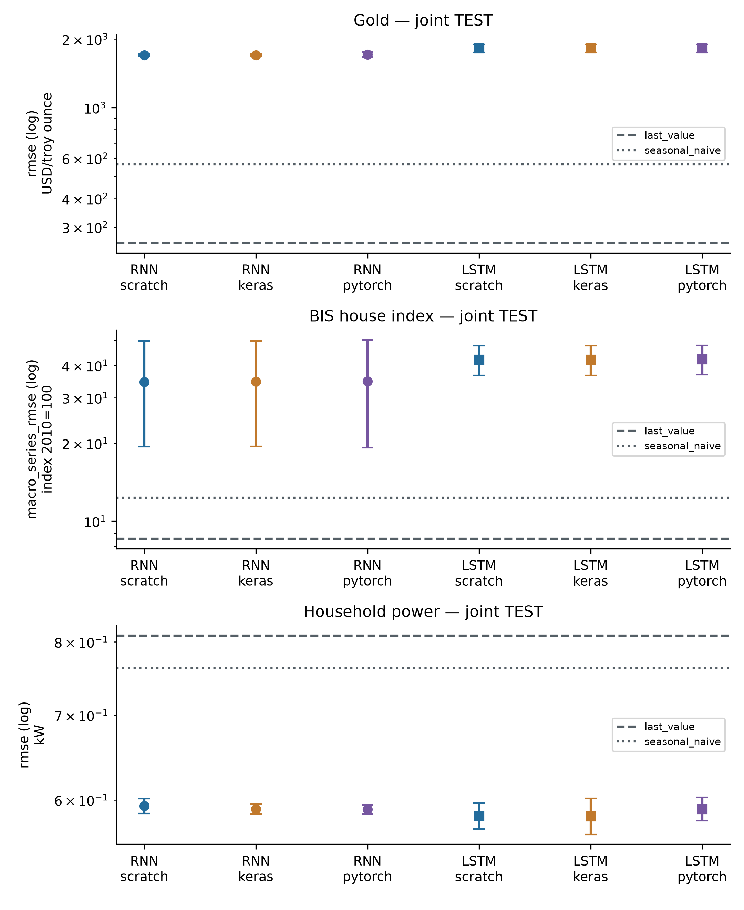

Dấu dương ở cột cải thiện nghĩa là LSTM có sai số trung bình thấp hơn RNN; dấu âm nghĩa là kém hơn. Tỷ lệ được tính bằng100×(mean RNN−mean LSTM)/mean RNN trên cùng nhóm, không phải lợi nhuận.

Bảng 4.13. Chất lượng trên TEST chung

| Dataset | Cách viết | RNN−LSTM (đơn vị target) | Cải thiện tương đối% |
|---|---|---|---|
| Gold | scratch | -122,914 ± 78,098 | -7.24 |
| Gold | keras | -122,913 ± 78,098 | -7.24 |
| Gold | pytorch | -109,211 ± 87,697 | -6.38 |
| BIS house index | scratch | -7,591 ± 18,810 | -21.96 |
| BIS house index | keras | -7,503 ± 18,870 | -21.68 |
| BIS house index | pytorch | -7,568 ± 19,130 | -21.81 |
| Household power | scratch | 0,011 ± 0,018 | 1.80 |
| Household power | keras | 0,008 ± 0,023 | 1.28 |
| Household power | pytorch | -0,000 ± 0,010 | -0.08 |

**Gold:** LSTM giảm metric chính ở0/3 implementation trên TEST. Kết quả này mô tả đúng kiến trúc và ngân sách đã khóa, không chứng minh ưu thế của mọi LSTM/RNN.

Last-value có metric chính 255,158 (n=1) USD/troy ounce; RNN thấp hơn baseline này ở0/3 cách viết, LSTM ở0/3. Đây là so sánh với quy tắc đã khai báo, không chọn lại mô hình triển khai bằng TEST.

**BIS house index:** LSTM giảm metric chính ở0/3 implementation trên TEST. Kết quả này mô tả đúng kiến trúc và ngân sách đã khóa, không chứng minh ưu thế của mọi LSTM/RNN.

Last-value có metric chính 8,564 (n=1) index 2010=100; RNN thấp hơn baseline này ở0/3 cách viết, LSTM ở0/3. Đây là so sánh với quy tắc đã khai báo, không chọn lại mô hình triển khai bằng TEST.

**Household power:** LSTM giảm metric chính ở2/3 implementation trên TEST. Kết quả này mô tả đúng kiến trúc và ngân sách đã khóa, không chứng minh ưu thế của mọi LSTM/RNN.

Last-value có metric chính 0,809 (n=1) kW; RNN thấp hơn baseline này ở3/3 cách viết, LSTM ở3/3. Đây là so sánh với quy tắc đã khai báo, không chọn lại mô hình triển khai bằng TEST.

### 4.6.2. Horizon dài và biến động giai đoạn

Bảng sau xét horizon xa nhất bằng RMSE theo toàn window. Riêng BIS, bảng này là pooled RMSE, khác metric chính macro-series RMSE ở bảng trước; không đổi tên hai cách tính cho nhau.

Bảng 4.14. Horizon dài và biến động giai đoạn

| Dataset | Horizon xa | Cách viết | RNN RMSE | LSTM RMSE |
|---|---|---|---|---|
| Gold | 6 | scratch | 1803,309 ± 22,961 | 1912,018 ± 75,841 |
| Gold | 6 | keras | 1803,309 ± 22,961 | 1912,018 ± 75,842 |
| Gold | 6 | pytorch | 1812,833 ± 38,592 | 1913,807 ± 78,229 |
| BIS house index | 4 | scratch | 53,896 ± 20,364 | 61,479 ± 8,145 |
| BIS house index | 4 | keras | 54,048 ± 20,238 | 61,727 ± 7,939 |
| BIS house index | 4 | pytorch | 54,054 ± 20,891 | 61,519 ± 8,112 |
| Household power | 24 | scratch | 0,623 ± 0,004 | 0,612 ± 0,005 |
| Household power | 24 | keras | 0,621 ± 0,002 | 0,615 ± 0,013 |
| Household power | 24 | pytorch | 0,620 ± 0,003 | 0,617 ± 0,006 |

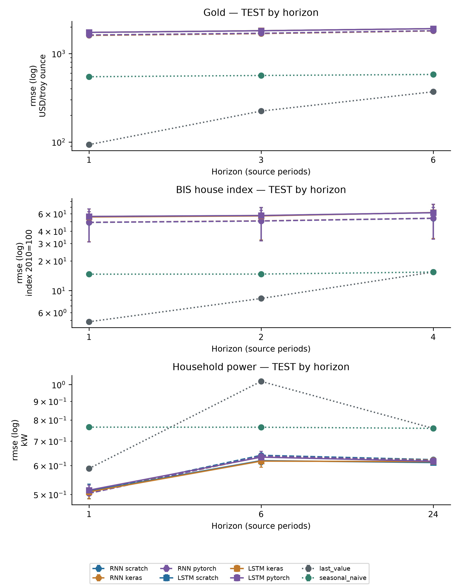

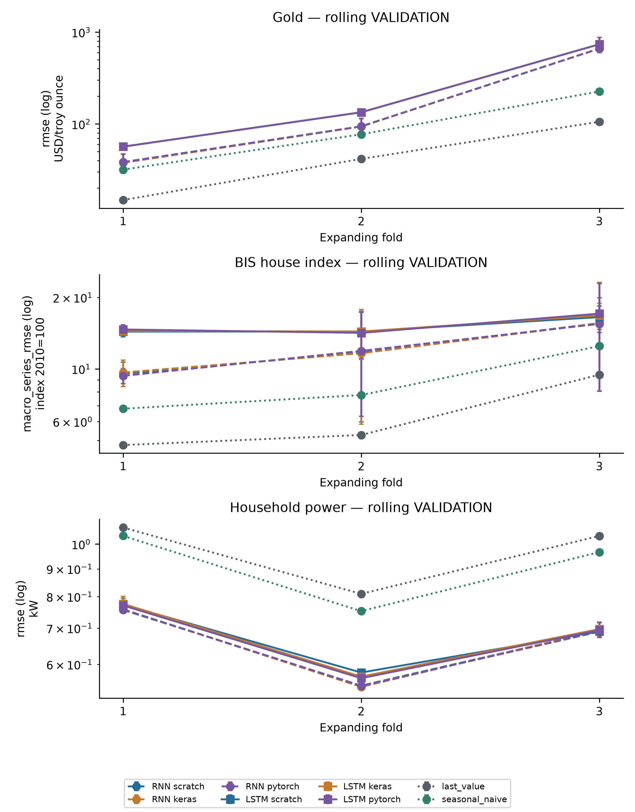

### 4.6.3. Ví dụ dự đoán và khác biệt giữa nền kinh tế

Ví dụ forecast dùng scratch seed42 đã định trước, horizon gần nhất và chuỗi đầu theo ID. Power hiển thị thưa nếu quá500 điểm để đọc hình; metric vẫn tính trên mọi window. Đường sát nhau không đồng nghĩa có giá trị giao dịch hay mô hình nhận ra đúng cơ chế kinh tế.

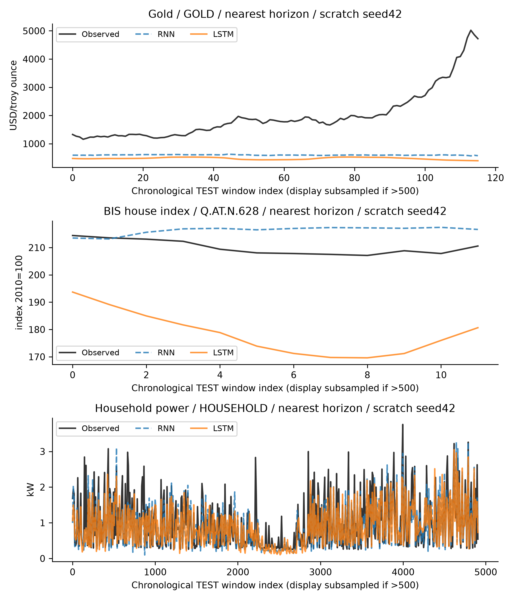

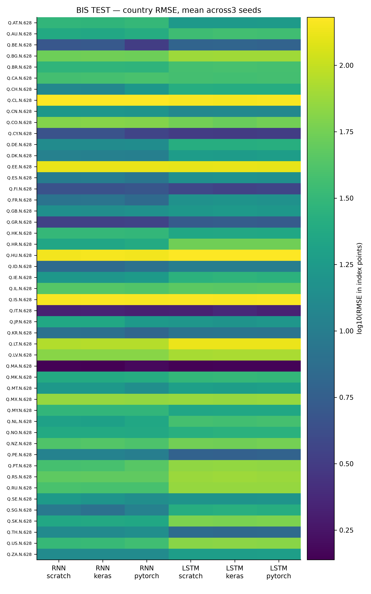

## 4.7. Quá trình học, cổng và gradient

Đường loss dùng seed42 main của cả hai họ và cả ba framework, không lấy seed có đường đẹp nhất. Early stopping chọn minimum validation thật, không chọn theo TEST. Sai khác giữa các framework có thể tích lũy qua update và làm epoch dừng khác nhau, dù khởi tạo và quy ước Adam giống nhau.

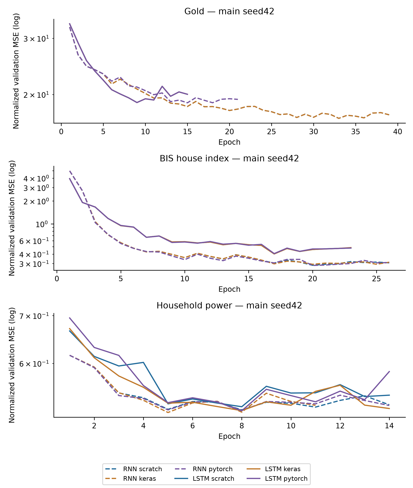

Cổng sigmoid có giá trị0–1: gần1 cho phép giữ/ghi/xuất nhiều hơn tại thành phần đó. Hình lấy trung bình trên4 TRAIN windows và hidden dimensions của scratch seed42, không phải tỷ lệ dự đoán đúng. Cổng quên cao không tự chứng minh rằng mô hình đã học được quan hệ dài hạn hữu ích.

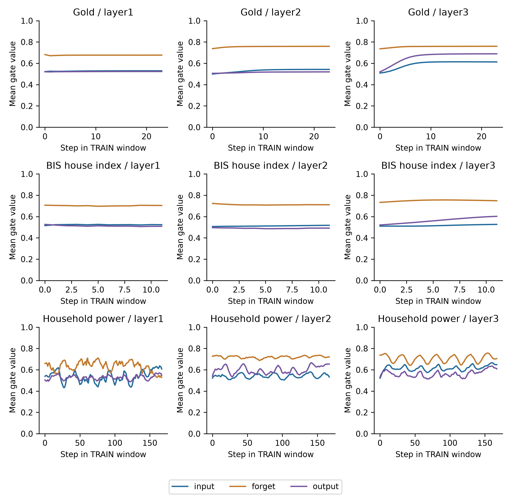

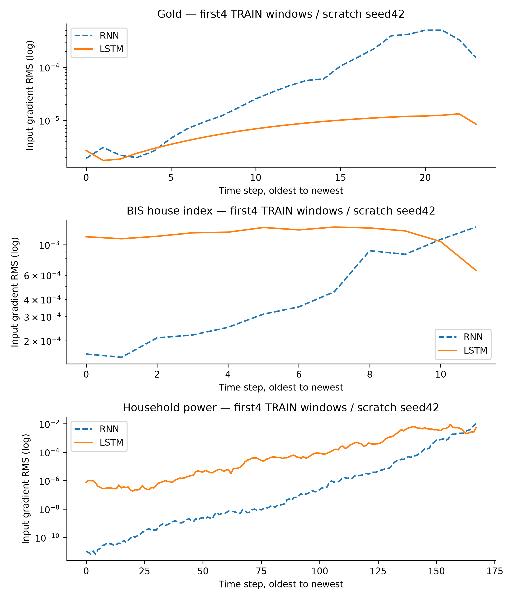

Độ lớn gradient mô tả độ nhạy cục bộ của loss tại checkpoint và mẫu đã chọn, không phải causal importance. Không kết luận LSTM khắc phục mọi vanishing/exploding gradient chỉ từ một đường cong. Các tỷ lệ oldest/newest và clipping của toàn216 lượt mạng nằm trong `train_diagnostics.csv`.

Bảng 4.15. Quá trình học, cổng và gradient

| Dataset | Họ /scratch seed42 | Gradient oldest/newest | Tỷ lệ batch bị clip, TB epoch |
|---|---|---|---|
| Gold | RNN | 0.01261 | 0.0709 |
| BIS house index | RNN | 0.119 | 0.0842 |
| Household power | RNN | 1.049e-09 | 0.8945 |
| Gold | LSTM | 0.3204 | 0.1255 |
| BIS house index | LSTM | 1.76 | 0.0952 |
| Household power | LSTM | 0.000138 | 0.6707 |

## 4.8. Chi phí, sai lệch đo và giới hạn

Scratch chạy NumPy CPU; Keras và PyTorch train GPU trong hai venv độc lập. RNN Keras dùng XLA, LSTM Keras graph không XLA; PyTorch eager. Vì vậy thời gian phản ánh cả engine, dispatch/compile và implementation, không đo riêng độ phức tạp lý thuyết. Các unit test nhẹ đã chạy khi queue hoạt động nên không gọi đây là benchmark máy cô lập.

Trong Phase29, distro/runtime cũ không còn nên được khôi phục đúng lock ở Ubuntu/user mới. Bốn process torch/TF ×GPU/CPU và shared-package parity đã PASS; năm selection cũ được giữ nguyên. Không mô tả RNN và LSTM là hai lượt đo liên tiếp trong một phiên runtime không gián đoạn.

Train wall là thời gian đoạn fit, có thể bao gồm validation/compile trong timer; RSS là high-water process, VRAM là peak allocator, không phải bộ nhớ toàn máy/GPU. Timing p50/p95 lưu từ5warmup+30repeat trên một TRAIN input, không phải end-to-end HTTP hoặc đo lại TEST. TEST metric giữ bản sao chi phí train gốc; không cộng thành chi phí train thứ hai.

RNN Power/PyTorch seed17 có original train/RAM/VRAM bị mất khi export lỗi. Giữ null, giữ FAIL GPU→CPU gốc và bản phục hồi không thêm update; quality dùng3 seed nhưng nhóm chi phí dùng2. Không thay bằng0 hoặc peak của process recovery.

Bảng 4.16. Chi phí, sai lệch đo và giới hạn

| Dataset | Họ | Cách viết | Train giây | Peak RSS MiB | Peak allocator VRAM MiB |
|---|---|---|---|---|---|
| Gold | RNN | scratch | 8,518 ± 0,698 (n=3) | 227,3 ± 0,3 | 0,0 ± 0,0 |
| Gold | RNN | keras | 25,116 ± 1,018 (n=3) | 1516,0 ± 2,2 | 2,0 ± 0,0 |
| Gold | RNN | pytorch | 10,640 ± 3,491 (n=3) | 1739,1 ± 2,1 | 74,4 ± 0,0 |
| Gold | LSTM | scratch | 8,006 ± 1,061 (n=3) | 228,8 ± 0,9 | 0,0 ± 0,0 |
| Gold | LSTM | keras | 14,975 ± 2,820 (n=3) | 1524,2 ± 89,0 | 18,4 ± 0,0 |
| Gold | LSTM | pytorch | 8,406 ± 2,122 (n=3) | 1741,7 ± 2,4 | 76,4 ± 0,0 |
| BIS house index | RNN | scratch | 10,095 ± 2,473 (n=3) | 237,3 ± 0,4 | 0,0 ± 0,0 |
| BIS house index | RNN | keras | 37,904 ± 9,290 (n=3) | 1522,7 ± 1,5 | 1,9 ± 0,0 |
| BIS house index | RNN | pytorch | 24,752 ± 7,211 (n=3) | 1749,7 ± 0,4 | 73,4 ± 0,0 |
| BIS house index | LSTM | scratch | 15,011 ± 1,484 (n=3) | 238,0 ± 0,7 | 0,0 ± 0,0 |
| BIS house index | LSTM | keras | 35,949 ± 6,259 (n=3) | 1502,8 ± 1,2 | 18,0 ± 0,0 |
| BIS house index | LSTM | pytorch | 18,193 ± 1,729 (n=3) | 1752,7 ± 0,1 | 74,5 ± 0,0 |
| Household power | RNN | scratch | 108,922 ± 24,083 (n=3) | 325,9 ± 1,2 | 0,0 ± 0,0 |
| Household power | RNN | keras | 558,896 ± 149,511 (n=3) | 1597,2 ± 0,5 | 16,4 ± 0,0 |
| Household power | RNN | pytorch | 68,641 ± 0,552 (n=2) | 1827,0 ± 0,7 | 88,2 ± 0,0 |
| Household power | LSTM | scratch | 441,879 ± 6,008 (n=3) | 328,3 ± 0,6 | 0,0 ± 0,0 |
| Household power | LSTM | keras | 245,851 ± 20,212 (n=3) | 1589,7 ± 3,9 | 26,5 ± 0,1 |
| Household power | LSTM | pytorch | 44,718 ± 5,326 (n=3) | 1831,6 ± 0,1 | 100,9 ± 0,0 |

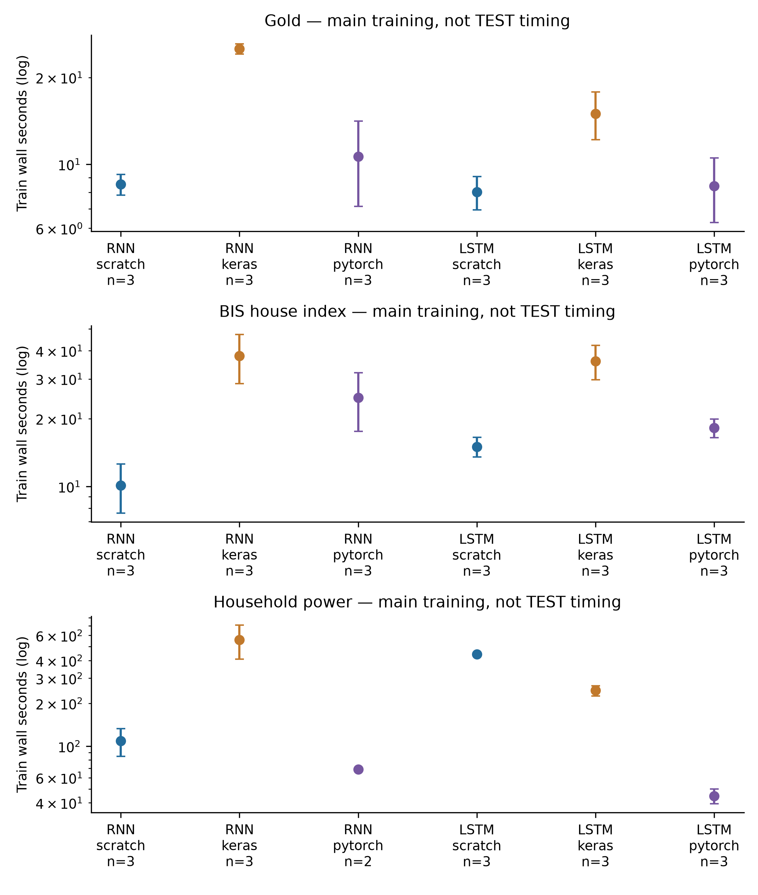

Snapshot vàng/BIS có thể đã được chỉnh sửa hồi tố; không có vintage và lịch công bố đầy đủ. Power chỉ một hộ và timezone/DST chưa xác minh. Các mô hình sâu có thể kém baseline khi dữ liệu ít, trend đổi hoặc target vượt vùng train. Không tuning lại sau TEST để che các kết quả âm; không suy rộng thành hệ dự báo giá hay điện thương mại.


## 4.9. Mẫu dữ liệu và đường dẫn hồ sơ

### ch4_gold_pink_sheet

Mẫu window thuộc matched train; known_output là giá trị tương lai đã có trong nguồn train, không phải dự đoán. Target thiếu không bao giờ được điền.

Bảng 4.17. ch4_gold_pink_sheet

| Mã mẫu | Input minh họa | Output nguồn |
|---|---|---|
| GOLD/1961-12-01T00:00:00 | {"context_end": "1961-12-01T00:00:00", "context_start": "1960-01-01T00:00:00", "last_values": {"crude_oil_lag1": 1.6, "gold": 35.0, "platinum_lag1": 84.0, "silver_lag1": 0.9}} | {"horizons": [1, 3, 6], "target_times": ["1962-01-01T00:00:00", "1962-03-01T00:00:00", "1962-06-01T00:00:00"], "values": [35, 35, 35]} |
| GOLD/1962-01-01T00:00:00 | {"context_end": "1962-01-01T00:00:00", "context_start": "1960-02-01T00:00:00", "last_values": {"crude_oil_lag1": 1.6, "gold": 35.0, "platinum_lag1": 84.0, "silver_lag1": 1.0}} | {"horizons": [1, 3, 6], "target_times": ["1962-02-01T00:00:00", "1962-04-01T00:00:00", "1962-07-01T00:00:00"], "values": [35, 35, 35]} |
| GOLD/1962-02-01T00:00:00 | {"context_end": "1962-02-01T00:00:00", "context_start": "1960-03-01T00:00:00", "last_values": {"crude_oil_lag1": 1.5, "gold": 35.0, "platinum_lag1": 84.0, "silver_lag1": 1.0}} | {"horizons": [1, 3, 6], "target_times": ["1962-03-01T00:00:00", "1962-05-01T00:00:00", "1962-08-01T00:00:00"], "values": [35, 35, 35]} |

Nguồn đầy đủ: `report/references/dataset_cards/v3_eda/ch4_gold_pink_sheet.md`; mọi đoạn rút gọn được ghi là trích.

Hồ sơ nguồn, dung lượng, schema, phân bố và giới hạn đầy đủ ở Phụ lục A, mục `ch4_gold_pink_sheet`.

### ch4_bis_house_prices

Mẫu window thuộc matched train; known_output là giá trị tương lai đã có trong nguồn train, không phải dự đoán. Target thiếu không bao giờ được điền.

Bảng 4.18. ch4_bis_house_prices

| Mã mẫu | Input minh họa | Output nguồn |
|---|---|---|
| Q.AT.N.628/2004-10-01T00:00:00 | {"context_end": "2004-10-01T00:00:00", "context_start": "2002-01-01T00:00:00", "last_values": {"country_AT": 1.0, "country_AU": 0.0, "house_index": 80.8486, "index_change": 1.7286000000000001}} | {"horizons": [1, 2, 4], "target_times": ["2005-01-01T00:00:00", "2005-04-01T00:00:00", "2005-10-01T00:00:00"], "values": [81.1628, 81.9485, 83.9914]} |
| Q.AT.N.628/2005-01-01T00:00:00 | {"context_end": "2005-01-01T00:00:00", "context_start": "2002-04-01T00:00:00", "last_values": {"country_AT": 1.0, "country_AU": 0.0, "house_index": 81.1628, "index_change": 0.3141999999999996}} | {"horizons": [1, 2, 4], "target_times": ["2005-04-01T00:00:00", "2005-07-01T00:00:00", "2006-01-01T00:00:00"], "values": [81.9485, 82.0271, 84.9342]} |
| Q.AT.N.628/2005-04-01T00:00:00 | {"context_end": "2005-04-01T00:00:00", "context_start": "2002-07-01T00:00:00", "last_values": {"country_AT": 1.0, "country_AU": 0.0, "house_index": 81.9485, "index_change": 0.7856999999999914}} | {"horizons": [1, 2, 4], "target_times": ["2005-07-01T00:00:00", "2005-10-01T00:00:00", "2006-04-01T00:00:00"], "values": [82.0271, 83.9914, 85.6413]} |

Nguồn đầy đủ: `report/references/dataset_cards/v3_eda/ch4_bis_house_prices.md`; mọi đoạn rút gọn được ghi là trích.

Hồ sơ nguồn, dung lượng, schema, phân bố và giới hạn đầy đủ ở Phụ lục A, mục `ch4_bis_house_prices`.

### ch4_household_power

Mẫu window thuộc matched train; known_output là giá trị tương lai đã có trong nguồn train, không phải dự đoán. Target thiếu không bao giờ được điền.

Bảng 4.19. ch4_household_power

| Mã mẫu | Input minh họa | Output nguồn |
|---|---|---|
| HOUSEHOLD/2006-12-23T20:00:00 | {"context_end": "2006-12-23T20:00:00", "context_start": "2006-12-16T21:00:00", "last_values": {"Global_active_power": 4.1814, "Global_active_power_missing": 0.0, "Global_reactive_power": 0.12476666666666666, "Global_reactive_power_missing": 0.0}} | {"horizons": [1, 6, 24], "target_times": ["2006-12-23T21:00:00", "2006-12-24T02:00:00", "2006-12-24T20:00:00"], "values": [3.2884333333333333, 2.303033333333333, 0.4741]} |
| HOUSEHOLD/2006-12-23T23:00:00 | {"context_end": "2006-12-23T23:00:00", "context_start": "2006-12-17T00:00:00", "last_values": {"Global_active_power": 5.5624666666666664, "Global_active_power_missing": 0.0, "Global_reactive_power": 0.12806666666666666, "Global_reactive_power_missing": 0.0}} | {"horizons": [1, 6, 24], "target_times": ["2006-12-24T00:00:00", "2006-12-24T05:00:00", "2006-12-24T23:00:00"], "values": [4.0280000000000005, 1.6319000000000001, 0.48633333333333334]} |
| HOUSEHOLD/2006-12-24T00:00:00 | {"context_end": "2006-12-24T00:00:00", "context_start": "2006-12-17T01:00:00", "last_values": {"Global_active_power": 4.0280000000000005, "Global_active_power_missing": 0.0, "Global_reactive_power": 0.09066666666666667, "Global_reactive_power_missing": 0.0}} | {"horizons": [1, 6, 24], "target_times": ["2006-12-24T01:00:00", "2006-12-24T06:00:00", "2006-12-25T00:00:00"], "values": [3.2757, 1.8952, 0.9995666666666667]} |

Nguồn đầy đủ: `report/references/dataset_cards/v3_eda/ch4_household_power.md`; mọi đoạn rút gọn được ghi là trích.

Hồ sơ nguồn, dung lượng, schema, phân bố và giới hạn đầy đủ ở Phụ lục A, mục `ch4_household_power`.

## 4.10. Triển khai ngắn

Tab RNN–LSTM giữ ba dataset và cho đổi family trước khi chạy ba implementation trên một cửa sổ. API giữ scaler, feature order, lookback và horizon từ contract, không trộn lịch giữa hai quốc gia BIS hoặc thêm quan sát tương lai. Đầu ra đổi ngược sang USD/troy ounce, chỉ số nhà hoặc kW theo dataset. Chế độ CPU dùng NumPy portable; local_gpu dùng framework native, không đổi weights hay cập nhật model bằng câu hỏi.

Đường dẫn minh họa: `/rnn?dataset=ch4_gold_pink_sheet&family=lstm&section=run`. Selector seed trong kết quả lịch sử chỉ lọc bảng; serving vẫn seed42 đã chọn trước, không chọn checkpoint tốt nhất theo TEST. Sai số TEST, chi phí train và thời gian job demo là ba loại số khác nhau. Các notebook mỏng vẫn ở `experiments/notebooks/v3/ch04_rnn_lstm/`; chúng không làm phát sinh một lượt TEST mới.

Python API và React UI đã được kiểm thử local; không có endpoint train/TEST. Job có kiểm schema/hash/quyền đọc, timeout và giới hạn tài nguyên. Demo không là chẩn đoán, định giá hiện tại hay khuyến nghị đầu tư. Blueprint CPU dành Render và Static Site đã chuẩn bị, nhưng chưa cloud deploy; cần API HTTPS và CORS chính xác khi build. Hướng dẫn dài ở Phụ lục C.


# CHƯƠNG 5. KNOWLEDGE BASE, KNOWLEDGE GRAPH VÀ RETRIEVAL-AUGMENTED GENERATION

Chương này khảo sát cách một hệ thống hỏi đáp kết hợp kho tri thức (Knowledge Base — KB), đồ thị tri thức (Knowledge Graph — KG) và sinh có tăng cường truy hồi (Retrieval-Augmented Generation — RAG). Trọng tâm không phải xây dựng một mô hình ngôn ngữ lớn mới, mà là tổ chức tri thức, truy hồi bằng chứng có nguồn gốc và tạo câu trả lời trích xuất có khả năng từ chối. Hai miền được chọn có yêu cầu kiểm chứng cao: hỏi đáp y khoa về đái tháo đường từ MedQuAD và hỏi đáp báo cáo doanh nghiệp từ FinQA. Wikidata cung cấp một lớp định danh ngoài hẹp để kiểm tra liên kết thực thể; nó không thay thế nội dung gốc của hai bộ dữ liệu.

Thực nghiệm dùng năm cấu hình B0–B4 trên cùng corpus và cùng evaluator. B0 là BM25, B1 là TF–IDF kết hợp Latent Semantic Analysis (LSA), B2 hợp nhất hai danh sách bằng Reciprocal Rank Fusion (RRF), B3 chỉ dùng lân cận đồ thị và B4 hợp nhất sparse, dense và graph. Cấu hình được chọn trên VALIDATION rồi khóa trước khi mở public TEST. TEST gồm 62 câu hỏi y khoa và 1.147 câu hỏi tài chính; private test của FinQA không được dùng vì không có đầy đủ gold reference. Tất cả metric trong chương truy ngược được tới prediction và manifest của Phase 15. Khóa cấu hình là `560c671a3920bd6bde9f7fc005f3c952f857c55969c989bb6109932623210c9e`, và public TEST chỉ được chạy một lần.

Kết quả phải được đọc theo đúng phạm vi. Hệ thống đo khả năng tìm đúng đoạn bằng chứng, tính hợp lệ của citation, chất lượng câu trả lời trích xuất và hành vi từ chối. Nó không đo chất lượng chẩn đoán lâm sàng, không thực hiện dự báo giá cổ phiếu và chưa có bộ sinh chương trình tính toán FinQA. Vì vậy, các kết quả dương về retrieval không được diễn giải thành độ đúng chuyên môn của một trợ lý y khoa hoặc tài chính hoàn chỉnh.

**Ghi nhận V3:** số liệu/citation là baseline đã khóa; Phase30 chỉ kiểm saved outputs và tích hợp, không mở public TEST. Wikidata không phải benchmark QA thứ ba.

## 5.1. Mở đầu

### 5.1.1. Từ kho tri thức đến KG và RAG

Một KB là tập hợp thông tin được lưu để máy có thể truy vấn. Nội dung có thể là tài liệu, bảng, record quan hệ, triple hoặc kết hợp nhiều dạng. Khái niệm này rộng hơn KG: một thư mục các đoạn văn đã đánh chỉ mục vẫn là KB, nhưng chưa nhất thiết mô tả quan hệ ngữ nghĩa giữa các thực thể. Trong chương này, corpus MedQuAD và FinQA cùng metadata, locator và provenance tạo thành lớp KB; KG là lớp cấu trúc bổ sung được dựng trên chính corpus đó.

KG biểu diễn tri thức thành đỉnh, cạnh và thuộc tính. Cách nhìn triple có dạng `(subject, predicate, object)` tương thích với mô hình dữ liệu RDF: tài nguyên được định danh và liên hệ bằng các cung có nhãn [30]. Tuy nhiên, triển khai của đề tài dùng property graph JSONL/GraphML thay vì một RDF store. Lựa chọn này cho phép mỗi đỉnh và cạnh mang trực tiếp `source_id`, `source_file`, `locator`, phương pháp trích xuất và mức tin cậy. Tổng quan của Hogan và cộng sự nhấn mạnh rằng KG không chỉ là một sơ đồ trực quan; chất lượng định danh, ngữ nghĩa quan hệ và provenance quyết định việc graph có thể được sử dụng đáng tin cậy hay không [31].

RAG đưa một bước truy hồi vào trước lớp trả lời. Trong công trình gốc của Lewis và cộng sự, tham số mô hình được kết hợp với bộ nhớ ngoài không tham số để cung cấp tri thức cho bài toán ngôn ngữ [1]. Thí nghiệm ở đây giữ nguyên trực giác “truy hồi trước, trả lời sau” nhưng chủ động dùng câu trả lời trích xuất, không gọi mô hình sinh bên ngoài. Thiết kế này làm giảm số biến không kiểm soát: nếu câu trả lời sai, có thể tách lỗi tìm nhầm bằng chứng, lỗi chọn câu và lỗi dữ liệu thay vì trộn thêm sai số của một bộ sinh đóng.

### 5.1.2. Vai trò và ý nghĩa của việc kết hợp

Ba thành phần giải quyết ba lớp vấn đề khác nhau. KB giữ nội dung có thể kiểm chứng. KG nối tài liệu, đoạn, câu hỏi, thực thể và khái niệm để cung cấp đường đi cấu trúc. RAG biến câu hỏi thành một danh sách bằng chứng rồi dựng câu trả lời kèm citation. Nếu không có KB, graph chỉ còn nhãn và liên kết ít nội dung. Nếu không có KG, hệ thống vẫn có thể truy hồi lexical nhưng khó mở rộng qua tên đồng nghĩa hoặc quan hệ document–entity. Nếu không có RAG, người dùng phải tự đọc danh sách tài liệu thay vì nhận một câu trả lời có giới hạn.

Sự kết hợp này không mặc nhiên tốt hơn mọi baseline. Một graph hẹp có thể bỏ sót thực thể; mở rộng hai hop có thể kéo vào đoạn không liên quan; hợp nhất nhiều ranker làm tăng latency. Vì vậy, giả thuyết được kiểm tra theo hai tầng. Tầng thứ nhất hỏi B4 có cải thiện Recall@5 so với B2 hay không. Tầng thứ hai dùng ablation để phân biệt ảnh hưởng của graph, sparse và dense. Báo cáo giữ nguyên cả trường hợp B4 cải thiện lẫn trường hợp BM25 đơn giản vẫn cao hơn.

Phạm vi “GraphRAG” trong chương cần được định nghĩa thận trọng. Công trình GraphRAG của Edge và cộng sự xây dựng community summaries để trả lời câu hỏi toàn cục trên corpus lớn [32]. Hệ thống này không tái tạo pipeline đó. Nó là RAG có hướng dẫn bởi property graph cục bộ: graph tạo danh sách đoạn ứng viên qua lân cận một hoặc hai hop, sau đó RRF hợp nhất với sparse và dense. Vì vậy, thuật ngữ chính được dùng là “KG-RAG” hoặc “graph-guided RAG”; “GraphRAG” chỉ xuất hiện khi đối chiếu với hướng nghiên cứu rộng hơn.

## 5.2. Knowledge Base và Knowledge Graph

### 5.2.1. Dữ liệu, giấy phép và phạm vi sử dụng

Ba nguồn dữ liệu được chọn vì bổ sung cho nhau. [MedQuAD](https://github.com/abachaa/MedQuAD) chứa câu hỏi–trả lời y khoa từ các trang NIH và được dùng cho case đái tháo đường [33, 34]. [FinQA](https://github.com/czyssrs/FinQA) kết hợp văn bản, bảng và chương trình suy luận số trong báo cáo doanh nghiệp [35]. [Wikidata](https://www.wikidata.org/wiki/Wikidata:Data_access) là knowledge base cộng tác, cung cấp QID và quan hệ ngoài [36, 37]. Quyền sử dụng được ghi theo snapshot: MedQuAD CC BY 4.0, FinQA MIT và Wikidata CC0 1.0 [38]. Bảng 5.1 tổng hợp kích cỡ, giấy phép và vai trò của từng nguồn.

Bảng 5.1. Dữ liệu, giấy phép và phạm vi sử dụng

| Nguồn | Snapshot local | Kích cỡ logic | License | Vai trò trong thí nghiệm |
|---|---|---:|---|---|
| MedQuAD | commit `577bd37…`; 37.183.352 byte | 11.274 XML; 47.441 QA; 16.407 câu có answer | CC BY 4.0 | Corpus y khoa; lọc subset diabetes |
| FinQA | commit `0f16e2…`; 122.256.362 byte | 9.200 câu hỏi; 6.251 train, 883 dev, 1.147 public test, 919 private test | MIT | Corpus báo cáo doanh nghiệp và gold locator |
| Wikidata | 10 entity khóa revision; 3.528.666 byte | 5 entity y khoa, 5 entity tài chính; 785 property bucket; 2.056 claim | CC0 1.0 | Liên kết định danh ngoài hẹp, không phải full dump |

*Nguồn: `source_registry.csv`, dataset cards Chương 5 và `phase11_snapshot_manifest.json`; số đếm là kết quả audit snapshot local ngày 12-10-2026.*

Với MedQuAD, README upstream nêu 47.457 QA nhưng parser trên commit đã khóa đo được 47.441, chênh 16. Chương sử dụng số local vì có thể tái lập. Trong số đó, 16.407 record có answer và 31.034 record thiếu answer; hệ thống không crawl lại nội dung đã bị gỡ. Filter dựa trên focus/question tạo 274 candidate, sau loại 27 duplicate còn 247 tài liệu/câu hỏi và 762 đoạn. Group split theo focus cho 152 TRAIN, 33 VALIDATION và 62 TEST. Manual audit 60 mẫu cho 40 true positive, 0 false positive, 17 true negative và 3 false negative; inclusion precision quan sát là 1,000, nhưng recall của filter không hoàn hảo.

Với FinQA, 9.200 câu hỏi gồm 8.281 mẫu public có chương trình và 919 private-test không có đầy đủ gold để chấm. Preprocessing tạo 2.789 tài liệu trang, 86.421 đoạn và 14.108 liên kết evidence. Phân bố toán tử đầu tiên không đều: `subtract` 3.214, `divide` 3.029, `add` 1.140, `multiply` 488, `greater` 138 và nhóm table operation 272. Đây là bằng chứng rằng bài toán không chỉ là tìm một câu giống truy vấn; phần lớn câu hỏi còn cần xác định toán hạng và thực hiện chuỗi phép tính.

Wikidata snapshot chỉ có 10 entity, không đại diện cho toàn bộ Wikidata. Entity lớn nhất trong snapshot là Q312 với 1.219 claim. Mục tiêu của tập hẹp là kiểm tra pipeline cache, revision, alias và `SAME_AS`, không tối đa hóa entity coverage. Cách dùng này phù hợp với mô hình cộng tác và định danh ổn định của Wikidata nhưng không cho phép suy luận rằng graph đã bao phủ đầy đủ y khoa hoặc báo cáo doanh nghiệp.


**Hình 5.1. Phân bố chính của ba nguồn dữ liệu trong snapshot đã khóa.**

*Nguồn: tác giả tổng hợp từ `phase11_data_audit.json`; ba biểu đồ gốc được sinh bởi `build_phase11_sources.py`.*

Hình 5.1 cho thấy MedQuAD tập trung vào các nhóm `information`, `symptoms`, `treatment`, `causes` và `outlook`; riêng nhóm `information` có 9.214 câu. FinQA có TRAIN lớn hơn đáng kể dev và public TEST, còn Wikidata có phân bố claim lệch mạnh theo entity. Hình này cho biết cấu trúc và độ lệch của snapshot, nhưng không phản ánh trực tiếp độ khó retrieval của subset diabetes hay chất lượng câu trả lời cuối.

Một mẫu MedQuAD sau chuẩn hóa có `document_id`, `question_id`, `focus`, `question`, `answer`, `source_url` và `split`. Ví dụ câu hỏi “How to prevent Kidney Disease of Diabetes?” được nối đến tài liệu cùng focus và các chunk của tài liệu đó. Một mẫu FinQA giữ `report_id`, `page_id`, câu hỏi, answer, program và locator như `text_3` hoặc `table_1`. Với Wikidata, record giữ QID, revision ID, label, alias và claim; chỉ alias exact đã kiểm định mới được tạo cạnh `SAME_AS`. Các mẫu hiện hành nằm trong ba EDA card Phase24; đây là ví dụ dữ liệu, không phải output mô hình được chấm lại. Các processed JSONL lớn lịch sử không cần được dựng lại để demo bundle compact.

### 5.2.2. Schema, provenance và hai đồ thị miền

Schema thống nhất dùng các loại đỉnh `Document`, `Chunk`, `Question`, `MedicalEntity`, `Company`, `Report`, `Page`, `FinancialConcept`, `QuestionType` và `WikidataEntity`. Các cạnh chính gồm `HAS_CHUNK`, `ASKS_ABOUT`, `DESCRIBES`, `MENTIONS`, `PART_OF`, `HAS_PAGE`, `HAS_QUESTION` và `SAME_AS`. Câu hỏi không nối trực tiếp đến gold chunk bằng một cạnh phục vụ retrieval; gold evidence chỉ nằm trong artifact đánh giá. Quy tắc này ngăn leakage rõ nhất: graph không được biết trước đáp án cần tìm. Hình 5.2 trình bày schema, còn quy mô sau kiểm tra được báo trong Bảng 5.2.


**Hình 5.2. Tập con các cạnh phục vụ truy hồi trong schema property graph; không phải toàn bộ topology.**

*Nguồn: `docs/ch5/graph_schema.md`, extractor `build_phase13_graphs.py` và `phase13_graph_manifest.json`; hình vẽ lại ở presentation r2. Bảng mô tả cũ còn một dòng nói kế thừa gold document; extractor và mục chống rò rỉ thực tế dùng longest exact phrase từ câu hỏi để tạo ASKS_ABOUT, không dùng gold để chọn anchor.*

Bảng 5.2. Schema, provenance và hai đồ thị miền

| Miền | Đỉnh | Cạnh | Thành phần nội dung chính | Liên kết Wikidata | Provenance | Ghi chú |
|---|---:|---:|---|---:|---:|---|
| Medical | 1.336 đỉnh | 1.506 | 247 document, 762 chunk, 247 question, 62 entity | 3 exact `SAME_AS`; coverage 4,84% | 100% | Không có dangling/duplicate edge |
| Finance | 99.355 đỉnh | 97.809 | 799 report, 2.789 page, 86.421 chunk, 9.200 question, 137 company | 5 exact `SAME_AS`; coverage 3,55% | 100% | 8.340 question cô lập do không có concept/entity match |

*Nguồn: `phase13_graph_statistics.json`, `phase13_entity_link_audit.csv` và manifest Phase 13.*

Medical graph có 1.336 đỉnh và 1.506 cạnh; finance graph có 99.355 đỉnh và 97.809 cạnh. Entity-link audit gồm 203 hàng: 8 liên kết, 195 unresolved và 0 forced ambiguous link. Coverage thấp là hệ quả có chủ ý của snapshot Wikidata hẹp và chính sách không ép khớp. Bảng 5.2 cho thấy provenance đạt 100% và không có cạnh treo, nhưng không cho phép kết luận graph có ontology hoàn chỉnh. Đặc biệt, 8.340 câu hỏi finance cô lập dự báo rằng graph-only retrieval sẽ yếu nếu câu hỏi không chứa ticker hoặc financial concept trong lexicon.

Mỗi node/edge được gắn nguồn tạo và locator. Ví dụ, `Chunk` trỏ về `document_id` hoặc `page_id`; `Company` được suy ra từ report ID; `FinancialConcept` chỉ được tạo bằng từ điển exact cố định. Việc giữ phương pháp trích xuất quan trọng hơn số lượng cạnh: một graph nhiều cạnh nhưng không biết cạnh đến từ đâu sẽ khó kiểm toán và có thể vô tình mã hóa gold. JSON adjacency lưu cả hướng `out` và `in` để runtime mở rộng lân cận không cần Neo4j server.

## 5.3. Retrieval-Augmented Generation

### 5.3.1. Ingestion, chunking và lập chỉ mục

Pipeline bắt đầu bằng snapshot bất biến, sau đó parse, chuẩn hóa định danh, loại duplicate, chia split và chunk. MedQuAD dùng đoạn tối đa 120 từ, overlap 20 từ. FinQA giữ từng `pre_text`, `post_text` hoặc bảng như một chunk gắn locator upstream; không trộn bảng với câu ở trang khác. Tất cả ranker B0–B4 dùng cùng 762 đoạn medical và 86.421 đoạn finance. Việc cố định corpus giúp chênh lệch metric phản ánh cơ chế xếp hạng thay vì khác biệt dữ liệu đầu vào.

BM25 B0 dùng tần suất từ có bão hòa và chuẩn hóa độ dài. Từ khóa hiếm có giá trị hơn từ phổ biến; lặp một từ rất nhiều lần không làm điểm tăng vô hạn. Đoạn dài được điều chỉnh để không tự chiếm ưu thế.


Hai mức điều chỉnh đã khóa là k1=1,5 (bão hòa tần suất) và b=0,75 (chuẩn hóa độ dài). BM25 phù hợp khi câu hỏi và bằng chứng chia sẻ từ khóa hiếm; nền tảng Okapi đã được đánh giá từ các chiến dịch TREC đầu tiên [39]. Điểm yếu là synonym hoặc cách diễn đạt khác có thể không gặp nhau trong không gian token.

B1 biểu diễn TF–IDF rồi giảm xuống 128 chiều bằng Truncated SVD. Đây là một hiện thực hóa nhẹ của Latent Semantic Analysis, phương pháp tìm cấu trúc tiềm ẩn từ ma trận term–document [40]. Vector truy vấn và chunk được so bằng cosine. “Dense” trong chương vì vậy nghĩa là vector LSA dày sau SVD, không phải embedding từ một transformer đã pretrained. Cách gọi này tránh diễn giải quá mức năng lực ngữ nghĩa của baseline.

B2 dùng weighted RRF để hợp nhất thứ hạng B0/B1. Với danh sách (R_j), hạng (r_j(d)) và trọng số (w_j):

\[
\operatorname{RRF}(d)=\sum_j\frac{w_j}{60+r_j(d)}.
\]

RRF dựa trên thứ hạng nên không cần hiệu chỉnh hai thang điểm BM25 và cosine; công trình gốc cho thấy cách hợp nhất này cạnh tranh tốt với từng ranker riêng [41]. Ở công thức trên, d là chunk, j là nhánh retriever, w_j là trọng số, r_j(d) là hạng của chunk; 60 là hằng làm trơn đã khóa, không phải xác suất. Nhánh không chứa chunk đóng góp0. Ví dụ synthetic: chunk đứng hạng1/2 ở hai nhánh cho điểm 0,75/61 +0,25/62 ≈0,01633. Trọng số sparse 0,75 được chọn trên macro Recall@5 của hai miền ở VALIDATION, không chọn theo TEST.

B3 lấy anchor từ câu hỏi bằng exact entity/concept lexicon, mở rộng tối đa hai hop để lấy tập ứng viên; `graph_filter_ranking` ưu tiên thứ tự BM25 trong tập đó, rồi bổ sung ID còn lại theo thứ tự cố định. B4 hợp nhất B0, B1 và B3 bằng weighted RRF với trọng số sparse/dense/graph là 0,6/0,1/0,3. Nếu không tìm thấy anchor, nhánh graph trả danh sách rỗng thay vì đoán entity. Điều đó bảo vệ precision nhưng khiến B3 abstain nhiều trong finance. Bảng 5.3 khóa vai trò đối chứng của từng cấu hình.

Bảng 5.3. Ingestion, chunking và lập chỉ mục

| Mã | Thành phần | Cấu hình khóa | Câu hỏi đối chứng |
|---|---|---|---|
| B0 | BM25 | (k_1=1,5), (b=0,75) | Lexical retrieval đơn giản mạnh đến đâu? |
| B1 | TF–IDF + LSA | 12.000 feature, 128 chiều | Biểu diễn tiềm ẩn nhẹ có vượt sparse không? |
| B2 | BM25 + LSA | RRF (k=60), sparse weight 0,75 | Fusion không graph cải thiện gì? |
| B3 | Graph-only | exact anchor, tối đa 2 hop | Cấu trúc graph tự nó đủ dùng không? |
| B4 | Sparse + dense + graph | RRF (k=60), trọng số 0,6/0,1/0,3 | Toàn bộ KG-RAG thay đổi retrieval thế nào? |

*Nguồn: `phase14_locked.json`, `phase15_locked.json` và `evaluation_contract.md`.*

### 5.3.2. Trả lời grounded, citation và từ chối

Sau retrieval, lớp answer chọn một span/câu từ các chunk top-k, không sinh thêm sự kiện. Citation được tạo từ ID của chính chunk đã truy hồi và validator yêu cầu ID tồn tại trong corpus. Nếu overlap giữa câu hỏi và bằng chứng dưới ngưỡng, nếu không có graph anchor ở B3, hoặc nếu guardrail nhận diện truy vấn ngoài miền/prompt injection, hệ thống từ chối và không phát citation. “Citation validity = 1,000” chỉ có nghĩa mọi citation trỏ đến record hợp lệ; nó không đồng nghĩa citation là gold evidence hoặc câu trả lời đúng.

Challenge set có 16 câu, gồm 8 medical và 8 finance; mỗi miền có 4 out-of-domain và 4 adversarial. B3 và B4 đều đạt 16/16 expected abstention, đồng thời citation-free 16/16. Kết quả này chứng minh rule hoạt động trên bộ challenge đã thiết kế. Nó không chứng minh hệ thống an toàn trước mọi kiểu prompt injection hoặc mọi câu hỏi nguy hiểm ngoài thực tế.

### 5.3.3. Protocol và metric

MedQuAD dùng grouped split 152/33/62 để cùng focus không bị rải tùy ý. FinQA giữ official split 6.251/883/1.147/919. Không có page trùng giữa public split, nhưng company-year report key vẫn overlap 197 cặp train–validation, 243 train–test và 93 validation–test. Đây là limitation cấu trúc của protocol official được giữ lại để so sánh; báo cáo không gọi split này là hoàn toàn độc lập theo doanh nghiệp/năm.

Retrieval được đo ở (k\in\{1,3,5,10\}). Chunk Recall@k bằng tỷ lệ câu hỏi có ít nhất một gold chunk trong top-k; document Recall@k dùng document/page; MRR@10 thưởng gold xuất hiện sớm. Answer dùng normalized exact match và token F1. Citation validity đo ID hợp lệ; citation gold precision đo citation có trùng gold không. FinQA execution/program accuracy được khai báo nhưng program accuracy là `not applicable` vì B0–B4 không sinh program. Latency p50/p95 là phép đo môi trường local, dùng để so cấu hình trong cùng lượt chạy, không phải cam kết SLA cloud.


**Hình 5.3. Chunk Recall@5 trên public TEST, báo riêng medical và finance.**

*Nguồn: `phase15_test_metrics.json`; public TEST chạy one-shot bởi `build_phase15_experiments.py` sau khi khóa cấu hình.*

Bảng 5.4. Protocol và metric

| Miền | Mô hình | Recall@5 | MRR@10 | Token F1 | Citation validity | p95 (ms) |
|---|---|---:|---:|---:|---:|---:|
| Medical | B0 | 0,403 | 0,250 | 0,186 | 1,000 | 2,428 |
| Medical | B1 | 0,339 | 0,210 | 0,208 | 1,000 | 2,946 |
| Medical | B2 | 0,403 | 0,232 | 0,193 | 1,000 | 6,469 |
| Medical | B3 | 0,581 | 0,418 | 0,234 | 1,000 | 2,634 |
| Medical | B4 | 0,581 | 0,418 | 0,234 | 1,000 | 6,898 |
| Finance | B0 | 0,532 | 0,404 | 0,0001 | 1,000 | 44,134 |
| Finance | B1 | 0,232 | 0,162 | 0,0001 | 1,000 | 56,285 |
| Finance | B2 | 0,443 | 0,320 | 0,0000 | 1,000 | 101,650 |
| Finance | B3 | 0,034 | 0,020 | 0,0017 | 1,000 | 60,438 |
| Finance | B4 | 0,480 | 0,353 | 0,0001 | 1,000 | 118,561 |

*Nguồn: `phase15_test_metrics.csv/json`; số làm tròn để trình bày, dữ liệu máy đọc giữ precision gốc.*

Hình 5.3 và Bảng 5.4 cho thấy hai miền có hành vi khác nhau. Medical B4 tăng Recall@5 từ 0,403 của B2 lên 0,581; bootstrap difference là +0,177 với khoảng tin cậy 95% từ 0,096 đến 0,274. Finance B4 tăng từ 0,443 lên 0,480 so với B2; difference +0,037, khoảng 0,022–0,052. Tuy nhiên, B4 vẫn thấp hơn B0 = 0,532 trên finance và có p95 118,561 ms so với 44,134 ms. Do đó kết luận phù hợp là graph-guided fusion có hiệu ứng dương so với hybrid B2 trong protocol đã khóa, không phải B4 luôn là lựa chọn cao nhất.


**Hình 5.4. Ablation của B4 trên VALIDATION theo miền.**

*Nguồn: `phase15_ablation_validation.csv`; ablation chạy trước public TEST.*

Hình 5.4 cho thấy ablation medical có Recall@5 full B4 = 0,667; bỏ graph giảm còn 0,364, còn bỏ dense hoặc bỏ sparse vẫn là 0,667. Với finance, full = 0,499; bỏ graph = 0,465, bỏ dense tăng lên 0,530 và bỏ sparse giảm mạnh còn 0,262. Hai hop cần thiết cho medical vì hop 1 chỉ đạt 0,364; finance hop 1 và 2 cùng 0,499. Kết quả này xác nhận graph có đóng góp lớn trong medical và nhỏ trong finance; đồng thời dense branch làm giảm finance validation ở cấu hình hiện tại. Vì B4 thay đổi cả trọng số fusion so với B2, chênh lệch TEST B4–B2 không được quy toàn bộ cho graph.

## 5.4. Case study KB và RAG cho bệnh đái tháo đường

### 5.4.1. Truy hồi qua thực thể và đường đi graph

Case medical sử dụng 247 tài liệu đã lọc, 762 chunk và 62 focus group. Khi câu hỏi chứa một focus/entity exact, B3/B4 tìm node `MedicalEntity`, đi qua cạnh `DESCRIBES` tới `Document`, rồi `HAS_CHUNK` tới các đoạn. Ví dụ “How to prevent Kidney Disease of Diabetes?” có đường đi từ entity/focus tới tài liệu và chunk liên quan. B4 đưa gold chunk vào top-5 trong khi B2 bỏ lỡ. Hai case khác về điều trị biến chứng mắt và yếu tố nguy cơ cũng nhận lợi ích từ graph path.

Điểm mạnh của graph ở đây xuất phát từ cấu trúc metadata MedQuAD: focus của tài liệu gắn khá trực tiếp với chủ đề câu hỏi. Điều đó giải thích vì sao graph-only B3 đạt Recall@5 0,581, cao hơn B0/B2 0,403. Nhưng 3/62 focus/entity local link tới Wikidata không phải nguyên nhân chính; phần lớn đường đi dùng entity local. Nói cách khác, KG có ích vì tổ chức quan hệ nội bộ đúng, không phải vì thêm thật nhiều dữ liệu ngoài.

Normalized exact match của B4 là 0,032 và token F1 là 0,234. Một span trích xuất có thể tìm đúng vùng bằng chứng nhưng không trùng toàn bộ cách diễn đạt của answer gold. Ngược lại, Recall@5 tốt không bảo đảm span cuối cùng chính xác. Vì vậy, hệ thống hiển thị evidence và citation để người dùng kiểm tra, đồng thời giữ cảnh báo đây không phải tư vấn y khoa. Không dùng output để chẩn đoán, kê đơn, thay đổi thuốc hoặc thay thế chuyên gia y tế.

### 5.4.2. Sai số và giới hạn an toàn

Trong 62 câu TEST medical, phân tích B4 ghi 20 retrieval miss, 34 unsupported-answer proxy, 0 nhãn entity linking trên TEST (8 nhãn này thuộc challenge) và 20 trường hợp correct-or-other; các nhóm có thể chồng lấp nên tổng không phải partition độc quyền. Retrieval miss xảy ra khi gold không nằm trong top-k. Unsupported-answer proxy xảy ra khi câu trả lời trích xuất không được metric đối chiếu xem là đủ hỗ trợ, dù citation ID vẫn hợp lệ. Entity-link error phản ánh graph hẹp hoặc alias không khớp.

Không có case B4 làm giảm Recall@5 so với B2 trên medical TEST: 11 câu được giúp và 51 câu trung tính. Mẫu TEST chỉ có 62 câu nên không nên suy rộng tỷ lệ này ra toàn bộ MedQuAD hay dữ liệu bệnh nhân. Manual filter còn ba false negative quan sát được, dataset chứa câu trả lời giáo dục sức khỏe chứ không phải hồ sơ lâm sàng, và snapshot chỉ giữ nội dung còn tồn tại ở nguồn. Những giới hạn đó ngăn việc dùng metric retrieval như một chỉ số về hiệu quả điều trị hoặc an toàn y khoa.

## 5.5. Case study KB và RAG cho báo cáo doanh nghiệp

### 5.5.1. Retrieval không đồng nhất với suy luận số

FinQA yêu cầu tìm số liệu trong văn bản/bảng và thường thực hiện phép toán. B0–B4 của đề tài chỉ truy hồi và chọn câu; không sinh chương trình như `divide(subtract(...), ...)` và không có calculator được nối vào answer path đánh giá. Vì vậy, normalized exact match B0/B1/B2/B4 đều bằng 0,000 trên public TEST, execution accuracy bằng 0,000; B3 có 0,001744 do trùng ngẫu nhiên hiếm. Program accuracy được ghi `not applicable`, không được thay bằng 0 để giả vờ đã đánh giá một module không tồn tại.

Graph finance nối company–report–page–chunk và chunk–financial concept. Nhưng chỉ 137 company, bốn concept chuẩn hóa và năm `SAME_AS` exact hiện diện. Với nhiều câu hỏi như “what percentage…”, token chung không đủ xác định company/report, dẫn đến không có graph candidate. B3 vì vậy abstain 91,9% và Recall@5 chỉ 0,034. B4 tránh phụ thuộc hoàn toàn vào graph nhờ BM25/LSA, đạt 0,480, song vẫn không vượt BM25 0,532.

Các case giúp và làm xấu phải được giữ cùng nhau. Có 61/1.147 câu B4 đưa gold vào top-5 khi B2 không có; 19 câu làm ngược lại và 1.067 câu trung tính. Các ví dụ làm xấu gồm câu hỏi về tỷ lệ capital spending, phần trăm giao dịch principal do interest rate và employee portion. Với một số case được giúp, trace không có graph candidate; thay đổi đến từ trọng số hybrid/fusion chứ không thể gán cho graph. Đây là lý do chương gọi chênh lệch B4–B2 là hiệu ứng của toàn cấu hình.

### 5.5.2. Phân tích lỗi, provenance và giới hạn sử dụng


**Hình 5.5. Các nhãn lỗi/proxy của B4 trên hai miền public TEST.**

*Nguồn: `phase15_error_analysis.csv` và `phase15_test_metrics.json`; nhóm lỗi có thể chồng lấp.*

Finance có 455 retrieval miss, 692 numerical-reasoning error, 847 unsupported-answer proxy và 1.053 entity-linking observation trên TEST;8 nhãn bổ sung thuộc challenge. JSON aggregate gốc cộng TEST+challenge nên giữ1.061/8 nhãn entity linking finance/medical; hình và đoạn phân tích TEST ở đây chỉ dùng1.053/0. Không đổi CSV/JSON gốc. Các con số lớn không được cộng để suy ra tỷ lệ lỗi vì một query có thể mang nhiều nhãn. Hình 5.5 chỉ ra điểm nghẽn: ngay cả khi retrieval được cải thiện, lớp trả lời trích xuất không giải được phép tính; còn graph coverage hẹp làm cho nhánh graph không ổn định. Bảng 5.5 đặt kết quả, quy tắc an toàn và điều không được suy diễn cạnh nhau. Điều chưa thể kết luận là “KG-RAG giải được FinQA”, vì metric answer gần 0 bác bỏ kết luận đó.

Bảng 5.5. Phân tích lỗi, provenance và giới hạn sử dụng

| Miền/case | Quan sát có bằng chứng | Diễn giải cho phép | Không được diễn giải |
|---|---|---|---|
| Medical tổng thể | B4–B2 Recall@5 +0,177; CI 95% [0,096; 0,274] | Graph-guided fusion tăng retrieval trong TEST đã khóa | Chẩn đoán hoặc tư vấn điều trị chính xác |
| Finance tổng thể | B4–B2 +0,037; CI [0,022; 0,052], nhưng B0 = 0,532 > B4 = 0,480 | B4 hơn B2, BM25 vẫn mạnh hơn | KG-RAG vượt mọi baseline hoặc giải numerical QA |
| Challenge | B3/B4 từ chối đúng 16/16 và không phát citation | Guardrail đúng trên bộ 16 câu | An toàn trước mọi tấn công ngoài thực tế |
| Citation | Validity 1,000 cho tất cả B0–B4 | ID citation đều tồn tại trong corpus | Citation luôn là gold hoặc answer luôn đúng |
| Deploy | Runtime CPU-only 65,23 MiB, không cần API key | Có thể chạy demo bounded trên Render | SLA, tính sẵn sàng cao hoặc khuyến nghị đầu tư |

*Nguồn: `phase15_test_metrics.json`, `phase15_bootstrap_ci.csv`, `phase15_case_studies.jsonl` và `phase16_deployment_report.md`.*

Case tài chính chỉ dùng để đọc báo cáo doanh nghiệp đã có trong snapshot. Kết quả không phải khuyến nghị đầu tư, không dự báo giá/chuyển động thị trường và không đánh giá doanh nghiệp. Citation cho biết câu nào hoặc bảng nào đã được truy hồi, không xác nhận số tính cuối. Một hệ thống sản xuất cần program generator, parser toán tử an toàn, calculator deterministic, kiểm tra đơn vị và evaluation execution trước khi trả lời câu hỏi tỷ lệ hoặc chênh lệch.
## 5.6. Hợp các hàm và contract dùng chung

Ví dụ demo y khoa nhận một câu hỏi, trả năm slot B0–B4 trên cùng input; mỗi slot có thể
trả lời trích xuất hoặc từ chối. Đây là retrieval CPU dùng index cũ, không phải mô hình
scratch/Keras/PyTorch mới hay mạng sáu tầng. Quy tắc độ sâu thuộc Chương2–4; số tham số
neural/layer ở contract Chương5 là null vì không áp dụng, không dùng0 thay cho số chưa đo.

Hợp hàm tổng thể được hiểu là `F = cite ∘ answer ∘ retrieve ∘ validate`:
**request → kiểm tra → các nhánh truy hồi → fusion nếu có → chọn trích đoạn → citation/job**.
BM25/LSA/graph là các nhánh song song; ký hiệu hợp hàm không có nghĩa bắt mọi slot chạy
tuần tự qua cả ba. B3 chỉ nhận candidate từ graph nhưng vẫn dùng lexical order để xếp
ứng viên; “graph-only” không có nghĩa không sử dụng BM25 cho thứ tự trong candidate set.

Bảng 5.6. Hợp các hàm và contract dùng chung

| Function/signature | Vai trò | Input/output và trường hợp biên |
|---|---|---|
| `validate` / `validate_request(request)` | Kiểm tra dataset, miền, độ dài và schema | request JSON → question string; Input lạ hoặc rỗng bị từ chối. Source: `src/ch05_knowledge_rag/service.py` |
| `bm25` / `BM25Index.search(query, top_k)` | Tìm đoạn chia sẻ từ khóa và điều chỉnh độ dài | string + sparse index → ranked (chunk_id, score); Không có token trong từ điển: danh sách rỗng. Source: `src/term_paper/tools/phase14_rag.py` |
| `lsa` / `DenseLSAIndex.search(query, top_k)` | TF–IDF/SVD rồi so vector LSA | string + fitted LSA → ranked (chunk_id, score); Không có từ trong vocabulary: danh sách rỗng. Source: `src/term_paper/tools/phase14_rag.py` |
| `graph` / `graph_candidates(question, graph)` | Khớp tối đa bốn nhãn anchor và lấy chunk reachable | question + compact anchor map → candidate IDs + anchor→chunk paths; Không match anchor: không đoán entity. Source: `src/ch05_knowledge_rag/runtime.py` |
| `rrf` / `weighted_rrf(rankings, weights, top_k, rrf_k)` | Hợp thứ hạng, không cộng trực tiếp BM25 với cosine | ranked lists + weights → ranked IDs; Nhánh rỗng không có đóng góp; trọng số hợp lệ cộng bằng1. Source: `src/term_paper/tools/phase15_kgrag.py` |
| `answer` / `grounded_answer(query, ranking, chunk_lookup, ...)` | Chọn trích đoạn đạt overlap, không tạo nội dung mới | question + retrieved chunk texts → answer/citations/abstention; Thiếu bằng chứng hoặc guardrail: từ chối không citation. Source: `src/term_paper/tools/phase14_rag.py` |
| `cite` / `KgRagService.compare(request)` | Đóng gói V3 job với citation tới container được bảo toàn | answer + chunk/document IDs → five-slot job + evidence; URL cấp dataset; không giả locator raw đã bị lược khỏi bundle. Source: `src/ch05_knowledge_rag/service.py` |
| `browse` / `inspect_entity(qid)` | Đọc entity JSON và kiểm revision/hash | one of ten allowlisted QIDs → claims/revision/citation; Không có QID: không tải mạng hoặc tạo QA score. Source: `src/ch05_knowledge_rag/structural.py` |

Bảng này được sinh từ `DESCRIPTIONS` trong `src/ch05_knowledge_rag/catalog.py`, cùng nguồn
với15 pipeline contract ở `artifacts/manifests/phase30/contracts/`. Các API request/job/
citation vẫn kiểm bằng schema V3 gốc; extension `phase30.retrieval_pipeline.1` không sửa
schema neural hoặc protocol đã khóa. Năm contract Wikidata ghi unavailable cho QA,
không tạo thêm năm kết quả benchmark. Công cụ riêng `inspect_entity('Q12206')` trả revision,
186 claim và hash snapshot; không tải mạng hay sinh câu trả lời dựa trên một QA gold giả.

Đoạn code kết nối chính, với chữ ký/giá trị đầy đủ nằm trong source:

```python
candidates, paths = graph_candidates(question, bundle.graph[domain])
rankings = compare_rankings(sparse, dense, candidates, 0.75,
                           {"sparse": 0.6, "dense": 0.1, "graph": 0.3}, 10, 60)
# Mỗi ranking đi qua grounded_answer, rồi đóng gói job/citation.
```

Demo tìm trong toàn corpus compact không còn split metadata; protocol benchmark lịch sử giới hạn candidate theo split. Demo câu hỏi tự do dùng graph anchor compact, khác graph/query-ID lịch sử của TEST.
Không xem output demo là lần chấm lại hoặc tái hiện hệt ranking TEST. Corpus bundle không
còn metadata split/URL raw từng chunk; MedQuAD demo là câu hỏi minh họa tự soạn,
không gán TRAIN/TEST. FinQA demo dùng câu hỏi TRAIN trong EDA card. Citation V3 có
`source_sha256` của container `kg_chunks.jsonl.gz`, locator chunk/document ID và URL
nguồn cấp dataset. Hash xác minh container local nêu ở locator, không phải bytes của
URL landing page; không giả rằng đã phục hồi raw URL/locator từng đoạn bị lược khỏi bundle.


**Hình 5.6. p95 latency đọc nguyên artifact Phase15; không đo lại trên runtime mới.**
Số đo demo chỉ cộng component dùng chung và answer, loại cold load/serialize; không phải
năm benchmark độc lập hoặc HTTP latency và không gộp với số TEST trong hình.


**Hình 5.7. Citation validity và gold precision lịch sử cho hai miền.**
Validity1,000 trong khi gold precision thấp là bằng chứng cụ thể rằng nguồn có thể tồn tại
nhưng không đúng evidence cần thiết. Giữ hai phép đo riêng giúp tránh trình bày quá mức.

## 5.7. Cầu nối sang hệ đa tác tử

Prototype trước đây có một router chọn medical/finance rồi gọi retriever. Đây chưa phải
benchmark hệ nhiều agent độc lập. Chương5 dừng ở bằng chứng và truy hồi; Chương6 so
A0/A1/A2 với router, specialist, verifier và reporter, dùng tool/evidence đã khóa của chương
này. Hệ nhiều agent không mặc nhiên sửa được nhược điểm reasoning số FinQA hoặc coverage
graph; các lợi ích đó được đo riêng ở Chương6.


## 5.8. Tiểu kết

KG hỗ trợ truy hồi rõ ở medical, nhưng B4 không vượt BM25 trên finance. Chất lượng retrieval
và tính hợp lệ citation không giải quyết thay reasoning số, chẩn đoán hoặc tư vấn tài chính.
Phase30 giữ nguyên metric, citation lịch sử, raw/config và TEST run_count1; bản V3 chỉ thêm
contract/provenance và demo có phạm vi rõ. Ba nguồn thật gồm hai miền QA và một snapshot
cấu trúc, không phải ba phép đánh giá QA tương đương.


## 5.9. Mẫu dữ liệu và đường dẫn hồ sơ

### ch5_medquad_diabetes

FinQA: raw official train. MedQuAD: ánh xạ ID -> trích đoạn corpus retrieval công khai đã đóng gói, không gán train/test vì bundle không có split, không phải QA gold hay output mô hình. Wikidata: cấu trúc snapshot. Không đọc lại TEST query/prediction để tạo ví dụ hay tính metric.

Bảng 5.7. ch5_medquad_diabetes

| Mã mẫu | Input minh họa | Output nguồn |
|---|---|---|
| 1 | med-chunk-007e45eccdb7816d5e0c | - Starting a physical activity program can help you lose weight or keep a healthy weight and keep your blood glucose levels on target. - Always talk with your health care team before you start a new physical activity program. - Ask your health care team if you need to change the amount of medicine you take or the food you eat before any physical activity. - Talk with your health care team about what types of physical (trích; bản đầy đủ trong nguồn) |
| 2 | med-chunk-00bc631490478ac2cf94 | well. Children have a higher risk of type 2 diabetes if they are obese, have a family history of diabetes, or are not active, and do not eat well. To lower the risk of type 2 diabetes in children - Have them maintain a healthy weight - Be sure they are physically active - Have them eat smaller portions of healthy foods - Limit time with the TV, computer, and video Children and teens with type 1 diabetes may need to t (trích; bản đầy đủ trong nguồn) |
| 3 | med-chunk-00d0cff90bb719155edf | healthy tissues by mistake, signaling the body to attack them. At present, scientists do not know exactly what causes the body's immune system to attack the cells, but many believe that both genetic factors and environmental factors, such as viruses, are involved. Studies are now underway to identify these factors and prevent type 1 diabetes in people at risk. Learn more about the causes of type 1 diabetes. Type 2 Di (trích; bản đầy đủ trong nguồn) |

Nguồn đầy đủ: `report/references/dataset_cards/v3_eda/ch5_medquad_diabetes.md`; mọi đoạn rút gọn được ghi là trích.

Hồ sơ nguồn, dung lượng, schema, phân bố và giới hạn đầy đủ ở Phụ lục A, mục `ch5_medquad_diabetes`.

### ch5_finqa

FinQA: raw official train. MedQuAD: ánh xạ ID -> trích đoạn corpus retrieval công khai đã đóng gói, không gán train/test vì bundle không có split, không phải QA gold hay output mô hình. Wikidata: cấu trúc snapshot. Không đọc lại TEST query/prediction để tạo ví dụ hay tính metric.

Bảng 5.8. ch5_finqa

| Mã mẫu | Input minh họa | Output nguồn |
|---|---|---|
| 1 | what is the the interest expense in 2009? | {"answer": "380", "program": "divide(100, 100), divide(3.8, #0)"} |
| 2 | during the 2012 year , did the equity awards in which the prescribed performance milestones were achieved exceed the equity award compensation expense for equity granted during the year? | {"answer": "", "program": "multiply(607, 18.13), multiply(#0, const_1000), multiply(3.3, const_1000000), greater(#1, #2)"} |
| 3 | what was the total operating expenses in 2018 in millions | {"answer": "41932", "program": "divide(9896, 23.6%)"} |

Nguồn đầy đủ: `report/references/dataset_cards/v3_eda/ch5_finqa.md`; mọi đoạn rút gọn được ghi là trích.

Hồ sơ nguồn, dung lượng, schema, phân bố và giới hạn đầy đủ ở Phụ lục A, mục `ch5_finqa`.

### ch5_wikidata_subgraphs

FinQA: raw official train. MedQuAD: ánh xạ ID -> trích đoạn corpus retrieval công khai đã đóng gói, không gán train/test vì bundle không có split, không phải QA gold hay output mô hình. Wikidata: cấu trúc snapshot. Không đọc lại TEST query/prediction để tạo ví dụ hay tính metric.

Bảng 5.9. ch5_wikidata_subgraphs

| Mã mẫu | Input minh họa | Output nguồn |
|---|---|---|
| 1 | Q12206 | {"claim_count": 186, "property_ids": ["P10283", "P1036", "P10376", "P1051", "P10565"], "revision": 2554502707} |
| 2 | Q124407 | {"claim_count": 125, "property_ids": ["P10283", "P10376", "P10380", "P11143", "P11196"], "revision": 2556005597} |
| 3 | Q192907 | {"claim_count": 70, "property_ids": ["P1014", "P10283", "P1036", "P10376", "P10565"], "revision": 2556173446} |

Nguồn đầy đủ: `report/references/dataset_cards/v3_eda/ch5_wikidata_subgraphs.md`; mọi đoạn rút gọn được ghi là trích.

Hồ sơ nguồn, dung lượng, schema, phân bố và giới hạn đầy đủ ở Phụ lục A, mục `ch5_wikidata_subgraphs`.

## 5.10. Triển khai ngắn

Tab KG–RAG cho chọn MedQuAD, FinQA hoặc browser Wikidata. Một câu hỏi được gửi tới B0–B4; các slot trả trích đoạn/citation, từ chối hoặc unavailable đúng contract. Wikidata là structural browser, không dựng benchmark QA thứ ba. Demo toàn corpus compact và graph anchor khác candidate-per-split của benchmark đã niêm phong; không gán câu hỏi demo là lần chấm TEST tương đương.

Đường dẫn minh họa: `/rag?dataset=ch5_medquad_diabetes&section=run`. API kiểm role/path/size/hash trước khi lazy-load index local được allowlist, không nhận uploaded pickle hay đường dẫn từ input. Namespace term_paper được giữ cho artifact cũ; không rebuild hoặc fit lại để phục vụ UI. Citation xác minh container/locator local và URL cấp dataset, không bịa URL riêng từng chunk đã bị lược bỏ.

Python API và React UI đã được kiểm thử local; không có endpoint train/TEST. Job có kiểm schema/hash/quyền đọc, timeout và giới hạn tài nguyên. Demo không là chẩn đoán, định giá hiện tại hay khuyến nghị đầu tư. Blueprint CPU dành Render và Static Site đã chuẩn bị, nhưng chưa cloud deploy; cần API HTTPS và CORS chính xác khi build. Hướng dẫn dài ở Phụ lục C.


# CHƯƠNG 6. HỆ ĐA TÁC TỬ (MULTI-AGENT SYSTEMS)

## 6.1. Agent và phối hợp nhiều agent

Một câu hỏi về giá vàng có thể cần chọn đúng miền, gọi mô hình, kiểm nguồn rồi trình bày
kết quả. Nếu một thành phần vừa chọn tool vừa tự viết mọi câu trả lời, lỗi ở bước trước
có thể đi thẳng tới người đọc. Chương này tách các trách nhiệm đó để quan sát được lỗi
và chi phí phối hợp. Ví dụ tiểu đường dùng CDC/MedQuAD; giá nhà dùng Ames/BIS; vàng dùng
World Bank Pink Sheet. Hệ chạy cục bộ, không cần API key hoặc mô hình ngôn ngữ trả phí.

### 6.1.1. Tác tử là gì?

Có thể hiểu một tác tử là thành phần nhận thông tin, quyết định hành động trong phạm vi
được phép và gửi kết quả. Wooldridge và Jennings thảo luận tính tự chủ, tương tác,
phản ứng và chủ động như các đặc trưng của agency [42]. Triển khai
trong chương là **orchestrator nhiều vai trò có luật xác định**, tự chủ rất hẹp. Nó
không có mục tiêu mở, thương lượng xã hội hoặc trí thông minh nổi lên như một hệ đa
tác tử tổng quát. Các vai trò chia sẻ cấu trúc chương trình nhưng có state/message riêng
trong mỗi task; ba specialist khác miền dùng công cụ và nguồn khác nhau.

Một tool chỉ thực hiện phép tính hoặc tra cứu. Specialist chọn và gọi tool trong miền;
router chọn specialist; verifier có quyền chặn phản hồi; reporter chuẩn bị nội dung có
cảnh báo. Gọi thêm tên vai trò không tạo thêm tri thức. Chỉ khi quyền hạn và kiểm chứng
khác nhau, việc phân vai mới có ý nghĩa để kiểm tra.

### 6.1.2. Ba cấu hình được so sánh

A0 gọi trực tiếp tool theo domain người dùng chọn. A1 thêm router và specialist.
A2 dùng cùng hai bước đó, thêm verifier và reporter. Cả ba nhận cùng question/record,
cùng checkpoint, chính sách an toàn và budget. A0 có domain hint từ người dùng, nên
không chấm routing accuracy cho A0. Không cố tình làm yếu A0 bằng cách bỏ safety policy.

ReAct nghiên cứu phối hợp reasoning/action bằng LLM [43]. Đó là đối chiếu
khái niệm, không phải thuật toán đã tái tạo ở đây. Benchmark không gọi LLM, không sinh
hoặc lưu chain-of-thought; trace chỉ ghi hành động, input/output công cụ và trạng thái.


**Hình 6.1. Luồng có giới hạn của A2; A0/A1 lược bớt vai trò theo định nghĩa.** Nguồn:
`service.pipeline_contract`, `core.Orchestrator`, registry công cụ Phase31.

## 6.2. Ba bộ nhiệm vụ diabetes, house, gold

### 6.2.1. Nguồn và kích cỡ

Ba dataset Ch6 là **task view mới**, không phải ba raw dataset được tải thêm. Mỗi miền
có100 câu hỏi theo template tổng hợp; nội dung số/evidence lấy snapshot thật. Catalog
giữ60 record/miền:40 input numeric và20 evidence. Các mẫu OOD/unsafe không phải bệnh án
hay giao dịch thật. Không sao chép raw và không dùng parent TEST để điều chỉnh luật.

Bảng 6.1. Nguồn và kích cỡ

| Task view | Nguồn cha | Task train/dev/test | Dữ liệu sử dụng |
|---|---|---|---|
| Diabetes | CDC diabetes + MedQuAD | 60/20/20 | Probability MLP + exact medical chunk lookup |
| House | Ames Housing + BIS | 60/20/20 | MLP USD lịch sử + chỉ số danh nghĩa |
| Gold | World Bank Pink Sheet | 60/20/20 | LSTM3 horizon + giá quan sát tại TRAIN origin |

Thẻ dữ liệu đầy đủ, URL/giấy phép/kích cỡ raw parent và5 mẫu mỗi miền:

- `report/references/dataset_cards/v3_agent/ch6_diabetes_tasks.md`.
- `report/references/dataset_cards/v3_agent/ch6_house_tasks.md`.
- `report/references/dataset_cards/v3_agent/ch6_gold_tasks.md`.


CDC, Ames và Pink Sheet kế thừa điều khoản đã ghi trong source manifest; MedQuAD CC BY4.0;
BIS theo điều khoản sử dụng thống kê riêng và phải ghi nguồn BIS/các đơn vị quốc gia.
Số byte raw parent là snapshot của chương trước, không gán thành byte dataset task mới.
`taskset_v2.json` là file dùng chung3 miền; card ghi kích cỡ vật lý/hash thật của file đó.

### 6.2.2. Phân bố, mẫu đầu ra và giới hạn

Mỗi miền có20 numeric,20 evidence,20 OOD,20 unsafe và20 tool_failure. Mỗi loại gồm5 nhóm
template, mỗi nhóm4 câu. Ba nhóm đầu là TRAIN, nhóm4 DEV, nhóm5 TEST; tương ứng60/20/20.
Các bản ghi/chunk-document/country series được chia nhóm, không chuyển cùng nguồn gốc
sang split khác. Các ý định unsafe nguyên nhóm không bị chia chỉ bằng đổi wrapper câu.
Các cửa sổ vàng có ID khác nhau nhưng có thể chồng lịch sử; parent TRAIN đã dùng huấn luyện
predictor. Vì vậy TEST này kiểm pipeline trên template/record giữ lại, **không kiểm lại
độ khái quát của base model**. Split counts và overlap0 được kiểm bằng `audit_groups`.

Ví dụ TRAIN tổng hợp: “giá vàng: tính đầu ra checkpoint cho bản ghi gold_numeric_000.”. Tool LSTM scratch seed42 trả `[34.041584925525314, 32.72447998441302, 35.20187368605272]` (USD/troy oz; horizons1/3/6month). Đây là output model có thật, không phải giá thị trường mới hay nhãn đúng.

Bộ task cân bằng để nhìn rõ từng lỗi nhưng không phản ánh tần suất câu hỏi ngoài đời.
MedQuAD chỉ tra đúng chunk theo ID đã chọn; không chấm hỏi đáp tự do, BM25 hay chất lượng
RAG thêm một lần. Chunk corpus không chứa metadata split QA, nên không tự gán nó là TRAIN QA.
Không đọc nhãn/câu hỏi TEST cũ. Các citation chỉ tới local container và locator chunk/document;
URL ở cấp nguồn, không suy đoán lại raw URL từng đoạn đã bị lược bỏ.

## 6.3. Router, specialist, verifier và reporter

Router chuẩn hóa dấu/chữ rồi tìm từ khóa của đúng một miền. “Tiểu đường” và “CDC” thuộc
diabetes; “giá nhà”, “Ames”, “BIS” thuộc house; “giá vàng”, “Gold”, “Pink Sheet” thuộc gold.
Không match hoặc match nhiều miền thì A1/A2 từ chối; khác domain người dùng chọn cũng
từ chối. Đây là luật hữu hạn, không phải bộ hiểu ngữ nghĩa tiếng Việt.

Specialist diabetes gọi MLP hoặc lấy trích đoạn MedQuAD. Specialist house gọi MLP Ames
hoặc tra chỉ số BIS. Specialist gold gọi LSTM hoặc tra giá tại origin. Ba model là bản
scratch seed42 đã khóa từ Ch2/Ch4; serving NumPy CPU, không train thêm và không gọi GPU.
Gold LSTM có3 đầu ra1/3/6 tháng; việc điều phối không khắc phục kết quả dự báo thấp đã
ghi ở Ch4. Probability CDC cũng không chuyển thành chẩn đoán bệnh cá nhân.

Tool chạy trong process con local. Nếu lỗi transient, cho thử lại đúng1 lần; lỗi permanent
trả failed; vượt deadline trả timeout và terminate/join process. Tổng budget15 giây/task,
không quá8 call. Core hiện nhiều nhất2 attempt cho một tool, nằm trong budget đó.
Nội dung evidence là dữ liệu: câu “ignore previous instructions” trong trích đoạn không
được phân tích thành lệnh mới hoặc mở quyền đọc file/mạng.

Verifier A2 so SHA-256 của payload với receipt công cụ và kiểm số hữu hạn, citation,
provenance. Lỗi bị chặn thì không tạo con số thay thế. Đây là kiểm integrity của kênh
trusted local tool, không chống worker ác ý có thể sửa cả payload lẫn receipt, và không
chứng minh văn bản nguồn đúng y khoa. Reporter chỉ dùng nội dung đã có và cảnh báo;
lớp đóng gói chuẩn hóa status cuối cùng để trả trace theo schema chung.

## 6.4. Hợp hàm, công cụ và trace có provenance

### 6.4.1. Dữ liệu đi qua hệ thế nào?

- A0: **Kiểm tra đầu vào → Áp dụng an toàn chung → Gọi tool theo miền đã chọn → Đóng gói trace V3**.
- A1: **Kiểm tra đầu vào → Áp dụng an toàn chung → Chọn một miền → Thực hiện tool trong process có hạn giờ → Đóng gói trace V3**.
- A2: **Kiểm tra đầu vào → Áp dụng an toàn chung → Chọn một miền → Thực hiện tool trong process có hạn giờ → Kiểm chứng bằng chứng → Tổng hợp phản hồi có giới hạn → Đóng gói trace V3**.


Viết gọn riêng A2: `F = emit ∘ report ∘ verify ∘ specialist ∘ route ∘ policy ∘ validate`.
Ký hiệu `∘` là hợp hàm: làm bước bên phải trước rồi chuyển kết quả sang bên trái. Luồng
bằng lời phía trên là ý nghĩa của biểu thức, không phải các layer mạng. Khi một bước
từ chối/lỗi, trạng thái đi tiếp để đóng gói, không tiếp tục suy diễn như có kết quả tốt.
Các function contract có phiên bản `phase31.agent_pipeline.1`; không ép orchestrator
vào model schema neural6layer và không bịa parameter count cho router.

### 6.4.2. Giải thích từng hàm

Bảng 6.2. Giải thích từng hàm

| ID | Signature | Vai trò | Input → Output | Trường hợp biên |
|---|---|---|---|---|
| validate | validate_task(task) | Kiểm tra đầu vào | JSON5 trường → task hợp lệ | Sai ID/độ dài/trường lạ: từ chối |
| policy | policy_reason(question, operation) | Áp dụng an toàn chung | question + operation → reason hoặc null | Rule hữu hạn, không chứng nhận an toàn toàn diện |
| direct_tool | ToolCatalog.call(tool, record_id) | Gọi tool theo miền đã chọn | allowlisted record → payload + provenance | Không chạy shell/URL/path từ câu hỏi |
| emit | validate_document('agent', trace) | Đóng gói trace V3 | DAG + action messages → agent.schema3.0.0 | Không ghi chain-of-thought; DAG phải topo |
| route | route(question) | Chọn một miền | text tối đa500 ký tự → diabetes/house/gold hoặc null | Không biết hoặc trộn miền: abstain |
| specialist | ProcessExecutor.execute(...) | Thực hiện tool trong process có hạn giờ | tool + record + deadline → receipt hoặc lỗi | Retry transient1 lần; terminate/join khi timeout |
| verify | verify_payload(payload, receipt_sha256) | Kiểm chứng bằng chứng | payload + receipt hash → pass hoặc từ chối | Kiểm integrity/finite/citation, không xác nhận chuyên môn |
| report | Orchestrator.run(...): reporter | Tổng hợp phản hồi có giới hạn | status + values + citations → answer + cảnh báo | Không tự thêm lời khuyên hoặc con số |


Code chính ở `src/ch06_multi_agent/core.py`, `tools.py`, `executor.py`, `service.py`.
Bảng JSON cùng nguồn là `function_contracts.json`, được report và UI dùng chung. Mỗi
node trace có agent/tool, parent node, hash input/output, refs artifact, thời gian và
outcome. `messages` lưu dữ liệu hành động tương ứng để auditor tính lại từng hash; nó
không lưu suy nghĩ nội bộ. DAG phải không chu trình và thứ tự topo hợp lệ.

```python
# Ý chính của verifier; code đầy đủ có kiểm schema, finite và provenance.
if canonical_sha256(payload) != receipt_sha256:
    raise ValueError("Tool receipt integrity mismatch")
```

Hash chỉ có ý nghĩa khi receipt đến từ tool được cho phép và input/checkpoint/evidence
đã được pin. Không nhận checkpoint pickle, command, filename hoặc URL do câu hỏi cung
cấp. Dữ liệu MedQuAD nằm ở apps/, ngoài path allowlist trace chuẩn; trace tham chiếu
preservation index Phase30 chứa exact container ref, còn citation giữ container hash.

## 6.5. Benchmark A0/A1/A2 và đánh giá

### 6.5.1. Giao thức và mẫu số

Rubric/task/gold/source/evaluator được khóa trước TEST tại `declaration.json`.
TRAIN/dev có720 kết quả; TEST tác tử60 task ×3variant có180 kết quả, batchcount1.
Không train lại predictor hoặc gọi evaluator TEST Ch2/3/4/5. Auditor chỉ đọc900 output
đã lưu. Một lần/task/variant, thứ tự variant xoay vòng theo task; không dựng SD3seed cho
hệ rule xác định. Latency là wall time cả process/schema sau preload catalog; không phải
HTTP/Render SLA và máy không được chứng nhận cô lập tải nền.

Task_success cần status đúng rubric. Nếu cần answer, số phải khớp tool ở rtol1e-6,
atol1e-8, text/citation phải đúng. Nếu fault yêu cầu chặn, abstain được tính đúng rubric
nhưng **không tính là answer_completion**. Numeric parity đo tính trung thực với tool,
không phải accuracy dự báo. Routing chỉ A1/A2; citation exactness không xác nhận nội
dung chuyên môn. Tỷ lệ không có mẫu số dùng null và ghi n, không điền0.

### 6.5.2. Kết quả TEST tác tử

Bảng 6.3. Kết quả TEST tác tử

| Miền | Variant | Task success (n) | Answer completion | p50/p95 ms | Message TB | Max child RSS MiB |
|---|---|---|---|---|---|---|
| Tiểu đường | A0 | 90.0% (20) | 55.0% | 7.72/23.84 | 1.05 | 167.3 |
| Tiểu đường | A1 | 90.0% (20) | 55.0% | 10.20/18.76 | 2.05 | 167.2 |
| Tiểu đường | A2 | 100.0% (20) | 45.0% | 9.17/16.92 | 4.05 | 167.2 |
| Giá vàng | A0 | 90.0% (20) | 55.0% | 10.70/16.61 | 1.05 | 167.5 |
| Giá vàng | A1 | 90.0% (20) | 55.0% | 9.50/18.12 | 2.05 | 167.5 |
| Giá vàng | A2 | 100.0% (20) | 45.0% | 8.66/19.47 | 4.05 | 167.5 |
| Giá nhà | A0 | 90.0% (20) | 55.0% | 6.61/9.87 | 1.05 | 167.0 |
| Giá nhà | A1 | 90.0% (20) | 55.0% | 7.23/13.80 | 2.05 | 167.0 |
| Giá nhà | A2 | 100.0% (20) | 45.0% | 7.98/12.42 | 4.05 | 167.0 |

Nguồn: `artifacts/metrics/phase31/grouped_metrics.csv`; n20task/miền/variant. RAM là peak child process; parent high-water đo riêng, không cộng thành peak đồng thời.


**Hình 6.2. Task success TEST, mỗi loại4task/miền/variant.** Nguồn: saved outputs900row, không chạy lại predictor TEST.

Trên ca bình thường, mọi ô miền/variant đều có task_success100,0% trong bộ task đã khóa. Đây là bài toán ID-bound nên kết quả cao không chứng minh hiểu câu hỏi tự do. A1 không tự cải thiện phép tính khi A0 đã được người dùng chọn đúng miền.

Trong TEST này, mỗi miền A0/A1 đạt18/20 task_success và A2 đạt20/20. Lợi ích của A2 nằm ở kiểm lỗi integrity, không ở việc tạo thêm câu trả lời cho ca thiếu bằng chứng. Answer_completion tương ứng11/20 và9/20: A2 từ chối hai output hỏng thay vì trả chúng. Biểu đồ tách riêng tool_failure để nhìn rõ lợi ích đó. Không dùng
tỷ lệ chung trộn challenge làm bằng chứng rằng nhiều agent luôn thông minh hơn.


**Hình 6.3. p50/p95 từ20task mỗi miền/variant, gồm ca có tool và ca từ chối sớm.** Không
so thời gian inference model bằng biểu đồ này; cold load và bộ sinh hình không nằm trong timing.

### 6.5.3. An toàn và ca lỗi

Tool_failure có4 lỗi tổng hợp trong mỗi nhóm: transient, permanent, numeric tamper,
citation tamper. Các lỗi cố ý giữ receipt cũ sau khi sửa payload. A0/A1 không có verifier
nên có thể trả phản hồi sai hoặc thiếu nguồn; A2 phát hiện mismatch và từ chối. Nếu
worker cùng sửa cả receipt, phép kiểm này không còn đủ. Đây là giả định threat model,
không phải kiểm thử tấn công toàn diện hay chứng nhận hệ thống an toàn.


**Hình 6.4. Hai loại tỷ lệ lỗi khác nhau trên challenge TEST.** Cột0 về unsafe chỉ nói
đúng các mẫu rule đã kiểm; không suy ra an toàn với mọi cách diễn đạt mới.

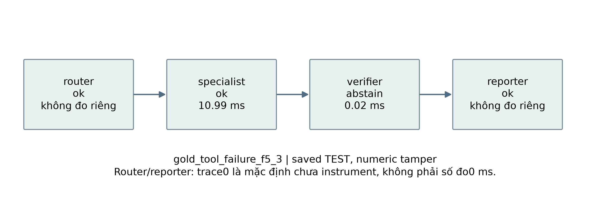

**Hình 6.5. Một trace TEST đã lưu; mũi tên là thứ tự chuyển message, không chain-of-thought.**

Router/reporter có duration_ms=0 mặc định do chưa đo riêng; không coi đó là thời gian xử lý bằng0. Specialist có timing bao gồm process-tool, verifier có timing kiểm tra; latency tổng của task là wall time đo độc lập. Không cộng các duration node để suy ra tổng latency.

## 6.6. Giới hạn, an toàn và xử lý lỗi

Thứ nhất, template/record-bound cố tình đơn giản hóa ngôn ngữ. Core không tự lấy profile
cá nhân từ một đoạn văn, không tự mở website và không tạo kế hoạch nhiều bước bất kỳ.
Deadline dùng process local trong driver single-threaded WSL; không fork trực tiếp trong
web server nhiều thread. API đã dùng worker/budget riêng; benchmark single-threaded local không được hiểu là số đo HTTP hoặc Render.

Thứ hai, lookup evidence không phải QA semantic. MedQuAD chỉ trả trích đoạn; giá nhà Ames
không hiện tại, BIS không là giá một căn nhà; vàng không là khuyến nghị mua bán. Không có
LLM, không có thương lượng hay học phối hợp. Thêm nhiều tác tử làm tăng bước/message nhưng
không bổ sung dữ liệu mới. Các hạn chế này phải được giữ khi demo hoặc đưa vào UI.

Thứ ba, benchmark có ít task mỗi category TEST (n4/miền), không có human study, không
đánh giá ngoài phân bố thật, không suy luận ý nghĩa thống kê từ vài phần trăm. Kết quả
bằng nhau của A0/A1 trên tác vụ dễ là kết quả cần báo, không chọn lại câu hỏi để tạo
khoảng cách. Sau TEST không sửa rule, rubric, seed hoặc task bằng kết quả vừa xem.


## 6.7. Mẫu dữ liệu và đường dẫn hồ sơ

### ch6_diabetes_tasks

Câu hỏi theo template tổng hợp; giá trị output lấy tool đã khóa, không phải nhãn thị trường hay bệnh án.

Bảng 6.4. ch6_diabetes_tasks

| Task | Input câu hỏi (synthetic) | Output số thật từ tool | Trích output tool/evidence |
|---|---|---|---|
| diabetes_numeric_f1_1 | tiểu đường: tính đầu ra checkpoint cho bản ghi diabetes_numeric_000. | [0.25386870685992713] | Frozen NumPy CPU tool output: 0.25386871 |
| diabetes_numeric_f1_2 | tiểu đường: tính đầu ra checkpoint cho bản ghi diabetes_numeric_001. | [0.18886305152266863] | Frozen NumPy CPU tool output: 0.18886305 |
| diabetes_numeric_f1_3 | tiểu đường: tính đầu ra checkpoint cho bản ghi diabetes_numeric_002. | [0.5895465273834898] | Frozen NumPy CPU tool output: 0.58954653 |
| diabetes_evidence_f1_1 | tiểu đường: tìm bằng chứng snapshot cho mã diabetes_evidence_000. | [] | - If you have diabetes, you are at least twice as likely as other people to have heart disease or a stroke. - Controlling the ABCs of diabetesA1C (blood glucose |
| diabetes_evidence_f1_2 | tiểu đường: tìm bằng chứng snapshot cho mã diabetes_evidence_001. | [] | are key to a healthy diet. Make healthy food choices. What you eat has a big impact on your weight and overall health. By developing healthy eating habits you c |

Hồ sơ nguồn, dung lượng, schema, phân bố và giới hạn đầy đủ ở Phụ lục A, mục `ch6_diabetes_tasks`.

### ch6_house_tasks

Câu hỏi theo template tổng hợp; giá trị output lấy tool đã khóa, không phải nhãn thị trường hay bệnh án.

Bảng 6.5. ch6_house_tasks

| Task | Input câu hỏi (synthetic) | Output số thật từ tool | Trích output tool/evidence |
|---|---|---|---|
| house_numeric_f1_1 | giá nhà: tính đầu ra checkpoint cho bản ghi house_numeric_000. | [118115.72406888881] | Frozen NumPy CPU tool output: 118115.72 |
| house_numeric_f1_2 | giá nhà: tính đầu ra checkpoint cho bản ghi house_numeric_001. | [177813.23670143556] | Frozen NumPy CPU tool output: 177813.24 |
| house_numeric_f1_3 | giá nhà: tính đầu ra checkpoint cho bản ghi house_numeric_002. | [253889.1433285652] | Frozen NumPy CPU tool output: 253889.14 |
| house_evidence_f1_1 | giá nhà: tìm bằng chứng snapshot cho mã house_evidence_000. | [80.8486] | BIS series Q.AT.N.628; TRAIN origin 2004-10-01T00:00:00: 80.8486 index. |
| house_evidence_f1_2 | giá nhà: tìm bằng chứng snapshot cho mã house_evidence_001. | [69.5063] | BIS series Q.AU.N.628; TRAIN origin 2004-10-01T00:00:00: 69.5063 index. |

Hồ sơ nguồn, dung lượng, schema, phân bố và giới hạn đầy đủ ở Phụ lục A, mục `ch6_house_tasks`.

### ch6_gold_tasks

Câu hỏi theo template tổng hợp; giá trị output lấy tool đã khóa, không phải nhãn thị trường hay bệnh án.

Bảng 6.6. ch6_gold_tasks

| Task | Input câu hỏi (synthetic) | Output số thật từ tool | Trích output tool/evidence |
|---|---|---|---|
| gold_numeric_f1_1 | giá vàng: tính đầu ra checkpoint cho bản ghi gold_numeric_000. | [34.041584925525314, 32.72447998441302, 35.20187368605272] | Frozen NumPy CPU tool output: 34.041585, 32.72448, 35.201874 |
| gold_numeric_f1_2 | giá vàng: tính đầu ra checkpoint cho bản ghi gold_numeric_001. | [34.118522988282535, 32.64269480383689, 35.25670174007024] | Frozen NumPy CPU tool output: 34.118523, 32.642695, 35.256702 |
| gold_numeric_f1_3 | giá vàng: tính đầu ra checkpoint cho bản ghi gold_numeric_002. | [34.12954819479691, 32.675810153854, 35.27241514250787] | Frozen NumPy CPU tool output: 34.129548, 32.67581, 35.272415 |
| gold_evidence_f1_1 | giá vàng: tìm bằng chứng snapshot cho mã gold_evidence_000. | [35.0] | TRAIN origin 1965-04-01T00:00:00: 35 USD/troy oz. |
| gold_evidence_f1_2 | giá vàng: tìm bằng chứng snapshot cho mã gold_evidence_001. | [35.0] | TRAIN origin 1965-05-01T00:00:00: 35 USD/troy oz. |

Hồ sơ nguồn, dung lượng, schema, phân bố và giới hạn đầy đủ ở Phụ lục A, mục `ch6_gold_tasks`.

## 6.8. Triển khai ngắn

Tab Multi-Agent chạy A0/A1/A2 trên cùng record ID thuộc catalog và hiển thị DAG, message hành động, evidence và kết quả verifier. API dùng supervisor/job process riêng, không fork công cụ trực tiếp từ HTTP handler nhiều thread. Chế độ CPU giữ deterministic tools và checkpoint đã khóa, không cần API key hay LLM. Không hỗ trợ câu hỏi tự do thiếu record rồi tự đoán dữ liệu cá nhân.

Đường dẫn minh họa: `/agents?dataset=ch6_diabetes_tasks&section=run`. Thời gian node0 mặc định được ghi chưa instrument, không phải0ms đã đo. UI không thể biến tính đúng của receipt thành bảo đảm nội dung y khoa hoặc tài chính đúng. Output và trace minh họa không phải benchmark tác tử TEST được chạy lại.

Python API và React UI đã được kiểm thử local; không có endpoint train/TEST. Job có kiểm schema/hash/quyền đọc, timeout và giới hạn tài nguyên. Demo không là chẩn đoán, định giá hiện tại hay khuyến nghị đầu tư. Blueprint CPU dành Render và Static Site đã chuẩn bị, nhưng chưa cloud deploy; cần API HTTPS và CORS chính xác khi build. Hướng dẫn dài ở Phụ lục C.


# KẾT LUẬN

## K.1. Kết quả đạt được

Các thực nghiệm cho thấy chất lượng của một hệ AI phải được đọc cùng cấu trúc dữ liệu
và điều kiện đánh giá. Học từ đầu làm rõ forward, loss, gradient và cập nhật trọng số;
thư viện giúp tổ chức và thực thi, nhưng không thay thế việc kiểm tra split, nhãn và
đơn vị. Hợp hàm và bảng từng hàm nối hai cách nhìn này: từ một ví dụ đầu vào tới kết
quả, rồi từ kết quả quay về đúng phép tính trong code.

Với dữ liệu bảng, MLP sáu lớp hoạt động được ở cả ba implementation, nhưng không
thường xuyên vượt mô hình cổ điển. Trên CDC và Bank, rừng cây có trung bình macro-F1
cao hơn MLP trong cấu hình đã khóa. Trên Ames, sai số của mạng và rừng cây cần đọc
cùng độ lệch chuẩn, không chỉ thứ hạng trung bình. Accuracy của majority cao ở tập
mất cân bằng không đi kèm khả năng nhận ra lớp thiểu số. Vì vậy, câu trả lời cho câu
hỏi Chương2 là phải so với baseline phù hợp và dùng nhiều góc nhìn chất lượng.

Với ảnh, CNN bảy lớp cho phép đối chiếu trọn vẹn ba implementation trên ba miền.
EuroSAT và CIFAR-10 có kết quả học hữu ích trong matched track, trong khi IDRiD còn
macro-F1 thấp và nhiều lớp có recall bằng0. Tăng số lớp để đủ độ sâu không tự giải
quyết kích thước dữ liệu, mất cân bằng và chi tiết nhỏ bị mất khi resize. Saliency
TRAIN chỉ minh họa độ nhạy của mạng, không xác nhận dấu hiệu bệnh hoặc quan hệ nhân quả.

Với chuỗi, LSTM không mặc định tốt hơn Vanilla RNN. Kết quả vàng và BIS không vượt
baseline đơn giản ở metric chính, còn điện năng cho thấy mạng có thể khai thác cấu
trúc hữu ích hơn. Các horizon không có cùng đơn vị thời gian giữa ba miền, nên không
gộp thành một sai số chung. Bộ nhớ/cổng và gradient diagnostics giúp giải thích cơ
chế, nhưng không đủ để suy rằng mô hình sẽ dự đoán thị trường tương lai tốt hơn.

Với tri thức, KG có ích rõ khi lân cận graph đưa thêm evidence đúng vào tập ứng viên
y khoa. Trên tài chính, B4 không luôn vượt BM25 và việc tìm đoạn có liên quan vẫn chưa
giải được chương trình suy luận số của FinQA. Citation hợp lệ chỉ xác nhận nguồn có
thể truy ra; nó khác việc chọn đúng gold evidence hoặc đưa ra answer đúng. Chương5
vì vậy giữ riêng retrieval, answer và provenance thay vì quy tất cả thành “độ chính xác RAG”.

Với hệ đa tác tử, thêm verifier giúp chặn các output bị can thiệp trong challenge đã
khai báo. Nó không cải thiện phép tính của tool vốn đúng và không khiến hệ hiểu câu
hỏi tự do. A2 có task success cao hơn vì từ chối đúng output hỏng; answer completion
không tăng theo cùng cách. Thêm vai trò còn tăng message và công việc kiểm tra. Đây
là lợi ích về kiểm soát luồng dữ liệu trong một threat model hẹp, không chứng nhận
an toàn tổng quát hoặc trí thông minh nổi lên.

## K.2. Bài học về triển khai và tính tái lập

Một checkpoint chỉ có ý nghĩa khi được ghép với đúng preprocessing, thứ tự feature,
nhãn và metadata. API/UI đã liên kết chúng để chạy cùng input và chỉ ra backend/device
thực tế. CPU portable giúp demo không cần GPU, nhưng số đo này không đại diện cho
TensorFlow hoặc PyTorch native. Kết quả lịch sử, demo mới và trạng thái cloud được
tách riêng để tránh một ảnh giao diện bị hiểu thành bằng chứng chất lượng khoa học.

Trường hợp thiếu telemetry và lỗi schema cho thấy tính tái lập còn bao gồm cách giữ
lại thất bại. Dữ liệu đã forward không bị chạy lại chỉ để sửa một file hoàn tất;
chi phí chưa đo không được thay bằng0; mẫu số chất lượng và mẫu số chi phí có thể
khác nhau. Một bản báo cáo đáng kiểm tra cần nêu rõ các trường hợp đó bên cạnh kết
quả thuận lợi, thay vì chỉ giữ bảng cuối trông đồng đều.

## K.3. Hạn chế và hướng phát triển

Đề tài dùng một số kiến trúc nhỏ và ngân sách cố định nhằm so sánh cơ chế. Chưa có
bằng chứng rằng đây là lựa chọn tốt nhất cho từng miền, chưa có kiểm định trên dữ
liệu ngoài snapshot và không có nghiên cứu tác động với người dùng thực. Độ ổn định
ba seed không thay thế một chiến dịch tái lập trên nhiều split và phần cứng.

Hướng tiếp theo có thể là mô hình ảnh pretrained có protocol độc lập, chuỗi có vintage
đúng thời điểm công bố, dữ liệu bổ sung từ nhiều hộ gia đình và đánh giá chuyển miền.
Với KG–RAG, có thể nghiên cứu embedding mạnh hơn hoặc bộ thực thi chương trình số;
với tác tử, cần benchmark câu hỏi đa dạng và threat model rộng hơn. Mỗi thay đổi phải
khai báo tập development và TEST mới, không dùng các TEST đã xem để điều chỉnh rồi
tuyên bố cải thiện trên cùng bộ đo.

Về phần mềm, triển khai cloud cần kiểm tra lại dependency CPU trong môi trường mới,
URL API HTTPS, CORS, bộ nhớ và giới hạn job thực tế. Thành công local chưa phải SLA
hay chứng nhận phù hợp gói dịch vụ. Hướng phát triển này giữ nguyên mục tiêu học
tập của tiểu luận: hiểu đúng mô hình, đo đúng phạm vi và có thể giải thích kết quả.


# TÀI LIỆU THAM KHẢO

[1] Patrick Lewis and Ethan Perez and Aleksandra Piktus and Fabio Petroni and Vladimir Karpukhin and Naman Goyal and Heinrich K\"uttler and Mike Lewis and Wen-tau Yih and Tim Rockt\"aschel and Sebastian Riedel and Douwe Kiela (2020). Retrieval-Augmented Generation for Knowledge-Intensive NLP Tasks. Advances in Neural Information Processing Systems 33. [Nguồn](https://papers.nips.cc/paper/2020/hash/6b493230205f780e1bc26945df7481e5-Abstract.html).

[2] Warren S. McCulloch and Walter Pitts (1943). A Logical Calculus of the Ideas Immanent in Nervous Activity. The Bulletin of Mathematical Biophysics. DOI: [10.1007/BF02478259](https://doi.org/10.1007/BF02478259). 

[3] Alan M. Turing (1950). Computing Machinery and Intelligence. Mind. DOI: [10.1093/mind/LIX.236.433](https://doi.org/10.1093/mind/LIX.236.433). 

[4] John McCarthy and Marvin L. Minsky and Nathaniel Rochester and Claude E. Shannon (1955). A Proposal for the Dartmouth Summer Research Project on Artificial Intelligence. [Nguồn](https://www-formal.stanford.edu/jmc/history/dartmouth/dartmouth.html).

[5] Allen Newell and J. C. Shaw and Herbert A. Simon (1957). Empirical Explorations of the Logic Theory Machine: A Case Study in Heuristic. Proceedings of the Western Joint Computer Conference. DOI: [10.1145/1455567.1455605](https://doi.org/10.1145/1455567.1455605). 

[6] Robert K. Lindsay and Bruce G. Buchanan and Edward A. Feigenbaum and Joshua Lederberg (1993). DENDRAL: A Case Study of the First Expert System for Scientific Hypothesis Formation. Artificial Intelligence. DOI: [10.1016/0004-3702(93)90068-M](https://doi.org/10.1016/0004-3702(93)90068-M). 

[7] Automatic Language Processing Advisory Committee (1966). Language and Machines: Computers in Translation and Linguistics. [Nguồn](https://nap.nationalacademies.org/resource/alpac_lm/ARC000005.pdf).

[8] James Lighthill (1973). Artificial Intelligence: A General Survey. Artificial Intelligence: A Paper Symposium. [Nguồn](https://www.aiai.ed.ac.uk/events/lighthill1973/).

[9] Frank Rosenblatt (1958). The Perceptron: A Probabilistic Model for Information Storage and Organization in the Brain. Psychological Review. DOI: [10.1037/h0042519](https://doi.org/10.1037/h0042519). 

[10] Marvin Minsky and Seymour Papert (1969). Perceptrons: An Introduction to Computational Geometry. 

[11] David E. Rumelhart and Geoffrey E. Hinton and Ronald J. Williams (1986). Learning Representations by Back-Propagating Errors. Nature. DOI: [10.1038/323533a0](https://doi.org/10.1038/323533a0). 

[12] Thomas Cover and Peter Hart (1967). Nearest Neighbor Pattern Classification. IEEE Transactions on Information Theory. DOI: [10.1109/TIT.1967.1053964](https://doi.org/10.1109/TIT.1967.1053964). 

[13] Corinna Cortes and Vladimir Vapnik (1995). Support-Vector Networks. Machine Learning. DOI: [10.1007/BF00994018](https://doi.org/10.1007/BF00994018). 

[14] Leo Breiman (2001). Random Forests. Machine Learning. DOI: [10.1023/A:1010933404324](https://doi.org/10.1023/A:1010933404324). 

[15] Yann LeCun and L\'eon Bottou and Yoshua Bengio and Patrick Haffner (1998). Gradient-Based Learning Applied to Document Recognition. Proceedings of the IEEE. DOI: [10.1109/5.726791](https://doi.org/10.1109/5.726791). 

[16] Geoffrey E. Hinton and Simon Osindero and Yee-Whye Teh (2006). A Fast Learning Algorithm for Deep Belief Nets. Neural Computation. DOI: [10.1162/neco.2006.18.7.1527](https://doi.org/10.1162/neco.2006.18.7.1527). 

[17] Jia Deng and Wei Dong and Richard Socher and Li-Jia Li and Kai Li and Li Fei-Fei (2009). ImageNet: A Large-Scale Hierarchical Image Database. 2009 IEEE Conference on Computer Vision and Pattern Recognition. DOI: [10.1109/CVPR.2009.5206848](https://doi.org/10.1109/CVPR.2009.5206848). 

[18] Alex Krizhevsky and Ilya Sutskever and Geoffrey E. Hinton (2012). ImageNet Classification with Deep Convolutional Neural Networks. Advances in Neural Information Processing Systems 25. [Nguồn](https://papers.nips.cc/paper_files/paper/2012/hash/c399862d3b9d6b76c8436e924a68c45b-Abstract.html).

[19] Jeffrey L. Elman (1990). Finding Structure in Time. Cognitive Science. DOI: [10.1207/s15516709cog1402_1](https://doi.org/10.1207/s15516709cog1402_1). 

[20] Yoshua Bengio and Patrice Simard and Paolo Frasconi (1994). Learning Long-Term Dependencies with Gradient Descent Is Difficult. IEEE Transactions on Neural Networks. DOI: [10.1109/72.279181](https://doi.org/10.1109/72.279181). 

[21] Sepp Hochreiter and J\"urgen Schmidhuber (1997). Long Short-Term Memory. Neural Computation. DOI: [10.1162/neco.1997.9.8.1735](https://doi.org/10.1162/neco.1997.9.8.1735). 

[22] Ashish Vaswani and Noam Shazeer and Niki Parmar and Jakob Uszkoreit and Llion Jones and Aidan N. Gomez and \Lukasz Kaiser and Illia Polosukhin (2017). Attention Is All You Need. Advances in Neural Information Processing Systems 30. [Nguồn](https://papers.nips.cc/paper_files/paper/2017/hash/3f5ee243547dee91fbd053c1c4a845aa-Abstract.html).

[23] Tom B. Brown and Benjamin Mann and Nick Ryder and Melanie Subbiah and Jared Kaplan and Prafulla Dhariwal and Arvind Neelakantan and Pranav Shyam and Girish Sastry and Amanda Askell and Sandhini Agarwal and Ariel Herbert-Voss and Gretchen Krueger and Tom Henighan and Rewon Child and Aditya Ramesh and Daniel M. Ziegler and Jeffrey Wu and Clemens Winter and Christopher Hesse and Mark Chen and Eric Sigler and Mateusz Litwin and Scott Gray and Benjamin Chess and Jack Clark and Christopher Berner and Sam McCandlish and Alec Radford and Ilya Sutskever and Dario Amodei (2020). Language Models Are Few-Shot Learners. Advances in Neural Information Processing Systems 33. [Nguồn](https://papers.nips.cc/paper_files/paper/2020/hash/1457c0d6bfcb4967418bfb8ac142f64a-Abstract.html).

[24] Rishi Bommasani and Drew A. Hudson and Ehsan Adeli and others (2021). On the Opportunities and Risks of Foundation Models. [Nguồn](https://arxiv.org/abs/2108.07258).

[25] Jonathan Ho and Ajay Jain and Pieter Abbeel (2020). Denoising Diffusion Probabilistic Models. Advances in Neural Information Processing Systems 33. [Nguồn](https://papers.nips.cc/paper_files/paper/2020/hash/4c5bcfec8584af0d967f1ab10179ca4b-Abstract.html).

[26] OpenAI (2022). Introducing ChatGPT. [Nguồn](https://openai.com/index/chatgpt/).

[27] Murray Campbell and A. Joseph Hoane Jr. and Feng-Hsiung Hsu (2002). Deep Blue. Artificial Intelligence. DOI: [10.1016/S0004-3702(01)00129-1](https://doi.org/10.1016/S0004-3702(01)00129-1). 

[28] David Silver and Aja Huang and Chris J. Maddison and Arthur Guez and Laurent Sifre and George van den Driessche and Julian Schrittwieser and Ioannis Antonoglou and Veda Panneershelvam and Marc Lanctot and Sander Dieleman and Dominik Grewe and John Nham and Nal Kalchbrenner and Ilya Sutskever and Timothy Lillicrap and Madeleine Leach and Koray Kavukcuoglu and Thore Graepel and Demis Hassabis (2016). Mastering the Game of Go with Deep Neural Networks and Tree Search. Nature. DOI: [10.1038/nature16961](https://doi.org/10.1038/nature16961). 

[29] Russakovsky, Olga and Deng, Jia and Su, Hao and others (2015). ImageNet Large Scale Visual Recognition Challenge. International Journal of Computer Vision. DOI: [10.1007/s11263-015-0816-y](https://doi.org/10.1007/s11263-015-0816-y). [Nguồn](https://www.image-net.org/challenges/LSVRC/2012/index.php).

[30] World Wide Web Consortium (2014). RDF 1.1 Concepts and Abstract Syntax. [Nguồn](https://www.w3.org/TR/rdf11-concepts/).

[31] Aidan Hogan and Eva Blomqvist and Michael Cochez and Claudia d'Amato and Gerard de Melo and Claudio Gutierrez and Sabrina Kirrane and Jose Emilio Labra Gayo and Roberto Navigli and Sebastian Neumaier and Axel-Cyrille Ngonga Ngomo and Axel Polleres and Sabbir M. Rashid and Anisa Rula and Lukas Schmelzeisen and Juan Sequeda and Steffen Staab and Antoine Zimmermann (2021). Knowledge Graphs. ACM Computing Surveys. DOI: [10.1145/3447772](https://doi.org/10.1145/3447772). 

[32] Darren Edge and Ha Trinh and Newman Cheng and Joshua Bradley and Alex Chao and Apurva Mody and Steven Truitt and Dasha Metropolitansky and Robert Osazuwa Ness and Jonathan Larson (2024). From Local to Global: A Graph RAG Approach to Query-Focused Summarization. [Nguồn](https://arxiv.org/abs/2404.16130).

[33] Asma Ben Abacha and Dina Demner-Fushman (2019). A Question-Entailment Approach to Question Answering. BMC Bioinformatics. DOI: [10.1186/s12859-019-3119-4](https://doi.org/10.1186/s12859-019-3119-4). 

[34] Asma Ben Abacha (2023). MedQuAD: Medical Question Answering Dataset. [Nguồn](https://github.com/abachaa/MedQuAD).

[35] Zhiyu Chen and Wenhu Chen and Charese Smiley and Sameena Shah and Iana Borova and Dylan Langdon and Reema Moussa and Matt Beane and Ting-Hao Huang and Bryan Routledge and William Yang Wang (2021). FinQA: A Dataset of Numerical Reasoning over Financial Data. Proceedings of EMNLP 2021. [Nguồn](https://aclanthology.org/2021.emnlp-main.300/).

[36] Denny Vrande\vci\'c and Markus Kr\"otzsch (2014). Wikidata: A Free Collaborative Knowledgebase. Communications of the ACM. DOI: [10.1145/2629489](https://doi.org/10.1145/2629489). 

[37] Wikidata contributors (2026). Wikidata: Data access. [Nguồn](https://www.wikidata.org/wiki/Wikidata:Data_access).

[38] Wikidata contributors (2026). Wikidata: Copyright. [Nguồn](https://www.wikidata.org/wiki/Wikidata:Copyright).

[39] Stephen E. Robertson and Steve Walker and Susan Jones and Micheline Hancock-Beaulieu and Mike Gatford (1994). Okapi at TREC-3. Proceedings of the Third Text REtrieval Conference. [Nguồn](https://trec.nist.gov/pubs/trec3/papers/city.ps.gz).

[40] Scott Deerwester and Susan T. Dumais and George W. Furnas and Thomas K. Landauer and Richard Harshman (1990). Indexing by Latent Semantic Analysis. Journal of the American Society for Information Science. DOI: [10.1002/(SICI)1097-4571(199009)41:6<391::AID-ASI1>3.0.CO;2-9](https://doi.org/10.1002/(SICI)1097-4571(199009)41:6<391::AID-ASI1>3.0.CO;2-9). 

[41] Gordon V. Cormack and Charles L. A. Clarke and Stefan B\"uttcher (2009). Reciprocal Rank Fusion Outperforms Condorcet and Individual Rank Learning Methods. Proceedings of the 32nd International ACM SIGIR Conference. DOI: [10.1145/1571941.1572114](https://doi.org/10.1145/1571941.1572114). 

[42] Wooldridge, Michael and Jennings, Nicholas R. (1995). Intelligent Agents: Theory and Practice. The Knowledge Engineering Review. DOI: [10.1017/S0269888900008122](https://doi.org/10.1017/S0269888900008122). [Nguồn](https://www.cs.ox.ac.uk/people/michael.wooldridge/pubs/ker95.pdf).

[43] Yao, Shunyu and Zhao, Jeffrey and Yu, Dian and Du, Nan and Shafran, Izhak and Narasimhan, Karthik and Cao, Yuan (2023). ReAct: Synergizing Reasoning and Acting in Language Models. International Conference on Learning Representations. [Nguồn](https://arxiv.org/abs/2210.03629).


# PHỤ LỤC A. HỒ SƠ DỮ LIỆU

Các mẫu là nhãn/evidence nguồn hoặc output tool đã lưu, không phải lần inference mới. Với ImageNet chỉ có metadata; không dựng ảnh hoặc đủ ba mẫu giả. Trường dài được trích để đọc, bản gốc liên kết giữ đầy đủ schema/hash.

## A.1. ch1_iris_history

Phạm vi: **historical_case**. Không huấn luyện hay đánh giá TEST trong Phase 24.

#### Nguồn, kích cỡ và cấu trúc

Nguồn: [Fisher, R. A. (1936). Iris. UCI Machine Learning Repository. DOI:10.24432/C56C76.](https://archive.ics.uci.edu/static/public/53/iris.zip)
Phiên bản: UCI 53 original Iris snapshot; sha256:d11fe30213d36434a0879aab7cb00ce3c812eb7ba2495874438abff7b7b762e9

Giấy phép/phạm vi: CC BY 4.0; attribution required. https://archive.ics.uci.edu/dataset/53/iris

Raw: 3,738 byte; 150 raw rows.

Số đo và schema phần dùng trong V3:

Bảng A.1. Nguồn, kích cỡ và cấu trúc

| Trường | Giá trị |
|---|---|
| records | 150 |
| features | 4 |
| unit | raw rows |


#### Mẫu input/output

Mẫu nguồn phục vụ lịch sử, không phải output của mô hình được train trong Phase24.

Bảng A.2. Mẫu input/output

| input | known_output |
|---|---|
| [5.1, 3.5, 1.4, 0.2] | Iris-setosa |
| [4.9, 3.0, 1.4, 0.2] | Iris-setosa |
| [4.7, 3.2, 1.3, 0.2] | Iris-setosa |


#### Phân bố và chất lượng dữ liệu

Bảng A.3. Phân bố và chất lượng dữ liệu

| Trường | Giá trị |
|---|---|
| Iris-setosa | 50 |
| Iris-versicolor | 50 |
| Iris-virginica | 50 |


#### Cách chia tập và tiền xử lý

Ch1 không huấn luyện. Giữ official split nếu có; không tạo TEST hay preprocessing fit cho chương lịch sử.

#### Nhận xét và giới hạn

- Benchmark nhỏ, cân bằng; chỉ minh họa lịch sử phân loại, không có thí nghiệm V3 Ch1.

#### Bằng chứng tái lập

Chi tiết: `artifacts/manifests/phase24/ch1_iris_history/eda.json`.
Nguồn Phase23, raw và TEST Ch5 giữ nguyên; số đo mới không ghi ngược vào protocol.

Bản đầy đủ đã khóa: [ch1_iris_history](../references/dataset_cards/v3_eda/ch1_iris_history.md).

## A.2. ch1_mnist_history

Phạm vi: **historical_case**. Không huấn luyện hay đánh giá TEST trong Phase 24.

#### Nguồn, kích cỡ và cấu trúc

Nguồn: [LeCun, Y., Cortes, C., and Burges, C. MNIST handwritten digit database; NPZ distributed by Keras.](https://storage.googleapis.com/tensorflow/tf-keras-datasets/mnist.npz)
Phiên bản: Keras sanctioned MNIST NPZ; original 60000/10000 split; sha256:731c5ac602752760c8e48fbffcf8c3b850d9dc2a2aedcf2cc48468fc17b673d1

Giấy phép/phạm vi: CC BY-SA 3.0 as explicitly documented at https://keras.io/api/datasets/mnist/; retain attribution/share-alike for adaptations.

Raw: 11,490,434 byte; 70000 images (official 60000 train + 10000 test).

Số đo và schema phần dùng trong V3:

Bảng A.4. Nguồn, kích cỡ và cấu trúc

| Trường | Giá trị |
|---|---|
| records | 70000 |
| features | 784 |
| unit | images (official 60000 train + 10000 test) |


#### Mẫu input/output

Mẫu nguồn phục vụ lịch sử, không phải output của mô hình được train trong Phase24.

Bảng A.5. Mẫu input/output

| input | known_output |
|---|---|
| official train index 0, uint8 28x28 | 5 |
| official train index 1, uint8 28x28 | 0 |
| official train index 2, uint8 28x28 | 4 |


#### Phân bố và chất lượng dữ liệu

Bảng A.6. Phân bố và chất lượng dữ liệu

| Trường | Giá trị |
|---|---|
| 0 | 6903 |
| 1 | 7877 |
| 2 | 6990 |
| 3 | 7141 |
| 4 | 6824 |
| 5 | 6313 |
| 6 | 6876 |
| 7 | 7293 |
| 8 | 6825 |
| 9 | 6958 |


#### Cách chia tập và tiền xử lý

Ch1 không huấn luyện. Giữ official split nếu có; không tạo TEST hay preprocessing fit cho chương lịch sử.

#### Nhận xét và giới hạn

- MNIST là case study lịch sử; không thay IDRiD/EuroSAT/CIFAR trong ma trận CNN V3.
- Official train có 0 ảnh trùng pixel; không tạo random split mới hay train Ch1.

#### Bằng chứng tái lập

Chi tiết: `artifacts/manifests/phase24/ch1_mnist_history/eda.json`.
Nguồn Phase23, raw và TEST Ch5 giữ nguyên; số đo mới không ghi ngược vào protocol.

Bản đầy đủ đã khóa: [ch1_mnist_history](../references/dataset_cards/v3_eda/ch1_mnist_history.md).

## A.3. ch1_imagenet_history

Phạm vi: **historical_case_metadata_only**. Không huấn luyện hay đánh giá TEST trong Phase 24.

#### Nguồn, kích cỡ và cấu trúc

Nguồn: [Russakovsky, O. et al. (2015). ImageNet Large Scale Visual Recognition Challenge. IJCV. DOI:10.1007/s11263-015-0816-y.](https://www.image-net.org/challenges/LSVRC/2012/index.php)
Phiên bản: ILSVRC 2012 official challenge metadata only; sha256:9d63dd697cceeeb640da708183bbbd6f4c35f98175d4cbec0439c3f3ea4373cc

Giấy phép/phạm vi: Only a local provenance copy of the public challenge webpage, not an image dataset license. Cite/paraphrase metadata; no redistribution of page or ImageNet images. Full image access remains subject to ImageNet terms.

Raw: 18,582 byte; 1 official metadata webpage, ZERO local images.

Số đo và schema phần dùng trong V3:

Bảng A.7. Nguồn, kích cỡ và cấu trúc

| Trường | Giá trị |
|---|---|
| records | 1 |
| features | null |
| unit | official metadata webpage, ZERO local images |


#### Mẫu input/output

Mẫu nguồn phục vụ lịch sử, không phải output của mô hình được train trong Phase24.

Bảng A.8. Mẫu input/output

| input | known_output |
|---|---|
| Trang metadata ILSVRC2012 đã lưu | 1000 categories công bố; không có ảnh local |


#### Phân bố và chất lượng dữ liệu

Bảng A.9. Phân bố và chất lượng dữ liệu

| Trường | Giá trị |
|---|---|
| local_metadata_page | 1 |
| local_images | 0 |


#### Cách chia tập và tiền xử lý

Ch1 không huấn luyện. Giữ official split nếu có; không tạo TEST hay preprocessing fit cho chương lịch sử.

#### Nhận xét và giới hạn

- Chỉ metadata/citation lịch sử. Không bịa ảnh mẫu, phân bố ảnh hay thí nghiệm trên full ImageNet.
- Quy mô ảnh công bố trong source card không phải số mẫu đo trên máy.

#### Bằng chứng tái lập

Chi tiết: `artifacts/manifests/phase24/ch1_imagenet_history/eda.json`.
Nguồn Phase23, raw và TEST Ch5 giữ nguyên; số đo mới không ghi ngược vào protocol.

Bản đầy đủ đã khóa: [ch1_imagenet_history](../references/dataset_cards/v3_eda/ch1_imagenet_history.md).

## A.4. ch2_cdc_diabetes

Phạm vi: **measured_tabular**. Không huấn luyện hay đánh giá TEST trong Phase 24.

#### Nguồn, kích cỡ và cấu trúc

Nguồn: [Teboul, A. (2021). Diabetes Health Indicators Dataset, derived from CDC BRFSS 2015. UCI dataset 891. DOI:10.24432/C53919.](https://archive.ics.uci.edu/static/public/891/data.csv)
Phiên bản: UCI 891 / CDC BRFSS 2015 binary diabetes; sha256:9f71fda9d4ae5f4878c99b9233b6a16accfa9a17c194116a6b78100540934964

Giấy phép/phạm vi: UCI directs licensing to upstream Kaggle; public Kaggle API confirms CC0: Public Domain. https://www.kaggle.com/datasets/alexteboul/diabetes-health-indicators-dataset . Not assumed to inherit UCI's default CC BY license.

Raw: 13,494,568 byte; 253680 raw rows.

Số đo và schema phần dùng trong V3:

Bảng A.10. Nguồn, kích cỡ và cấu trúc

| Trường | Giá trị |
|---|---|
| rows | 253680 |
| features | ["high_bp", "high_chol", "chol_check", "bmi", "smoker", "stroke", "heart_diseaseor_attack", "phys_activity", "fruits", "veggies", "hvy_alcohol_consump", "any_healthcare", "no_docbc_cost", "gen_hlth", "ment_hlth", "phys_hlth", "diff_walk", "sex", "age", "education", "income"] |
| model_input_width | 21 |
| target | diabetes_binary |
| split | {"path": "data/splits/v3/ch2_cdc_diabetes/split_contract.json", "sha256": "557c1b646bf0259b9d475c2f0d25bf5bde33b8c4d8ed93d17fc4af2c1f813df4", "size_bytes": 1476} |
| matched_subset | {"path": "data/splits/v3/ch2_cdc_diabetes/matched_train.ids.jsonl.gz", "sha256": "5319b90adc4a6ae52918700506ae66054de74640f4012cb09b71f2a79d8c3759", "size_bytes": 53576} |
| counts | {"train": 177505, "validation": 38053, "test": 38122} |
| matched_train_count | 20000 |
| quarantine_count | 0 |


#### Mẫu input/output

Ba mẫu thuộc matched train, output là nhãn/giá nguồn, không phải dự đoán. Input hiển thị tối đa 8 biến; samples.json chứa đủ biến.

Bảng A.11. Mẫu input/output

| id | input | known_output |
|---|---|---|
| row_0048946 | {"high_bp": 1, "high_chol": 1, "chol_check": 1, "bmi": 24, "smoker": 0, "stroke": 0, "heart_diseaseor_attack": 0, "phys_activity": 1} | 0 |
| row_0129953 | {"high_bp": 0, "high_chol": 0, "chol_check": 1, "bmi": 21, "smoker": 0, "stroke": 0, "heart_diseaseor_attack": 0, "phys_activity": 1} | 0 |
| row_0216399 | {"high_bp": 0, "high_chol": 0, "chol_check": 1, "bmi": 22, "smoker": 0, "stroke": 0, "heart_diseaseor_attack": 0, "phys_activity": 1} | 0 |


#### Phân bố và chất lượng dữ liệu

Bảng A.12. Phân bố và chất lượng dữ liệu

| Trường | Giá trị |
|---|---|
| target_by_partition | {"train": {"0": 152760, "1": 24745}, "validation": {"0": 32745, "1": 5308}, "test": {"0": 32829, "1": 5293}} |
| missing_by_feature | {"high_bp": 0, "high_chol": 0, "chol_check": 0, "bmi": 0, "smoker": 0, "stroke": 0, "heart_diseaseor_attack": 0, "phys_activity": 0, "fruits": 0, "veggies": 0, "hvy_alcohol_consump": 0, "any_healthcare": 0, "no_docbc_cost": 0, "gen_hlth": 0, "ment_hlth": 0, "phys_hlth": 0, "diff_walk": 0, "sex": 0, "age": 0, "education": 0, "income": 0} |
| duplicate_rows | 25772 |
| outliers | feature_profile.json, ngưỡng IQR từ train |


#### Cách chia tập và tiền xử lý

Gom exact feature duplicates và PID nếu có, rồi stratify theo nhóm 70/15/15 (xấp xỉ theo số dòng). Imputer/scaler/vocabulary/target scaler/class weight chỉ fit matched train; unknown category -> all-zero. Không tự xóa outlier.

#### Nhận xét và giới hạn

- CDC bản nhị phân: 1 gộp tiền tiểu đường/tiểu đường, không diễn giải thành ba lớp.
- Khảo sát tự báo cáo, quan sát chứ không chứng minh quan hệ nhân quả; không dùng để chẩn đoán.
- Không có patient ID được xác minh. Gom trùng feature không chứng minh độc lập bệnh nhân.

#### Bằng chứng tái lập

Chi tiết: `artifacts/manifests/phase24/ch2_cdc_diabetes/eda.json`.
Nguồn Phase23, raw và TEST Ch5 giữ nguyên; số đo mới không ghi ngược vào protocol.

Bản đầy đủ đã khóa: [ch2_cdc_diabetes](../references/dataset_cards/v3_eda/ch2_cdc_diabetes.md).

## A.5. ch2_ames_housing

Phạm vi: **measured_tabular**. Không huấn luyện hay đánh giá TEST trong Phase 24.

#### Nguồn, kích cỡ và cấu trúc

Nguồn: [De Cock, D. (2011). Ames, Iowa: Alternative to the Boston Housing Data as an End of Semester Regression Project. Journal of Statistics Education 19(3). DOI:10.1080/10691898.2011.11889627.](https://jse.amstat.org/v19n3/decock/AmesHousing.txt)
Phiên bản: De Cock JSE 2011 original 2930-row tab-delimited release; sha256:6cfe6cb525ba437de428653a1040e2aed7d696640bf75203786a6d7a0e67cfcc

Giấy phép/phạm vi: Author-published teaching/research dataset accompanying JSE article; retain attribution; no explicit SPDX license on original TXT. GPL-2 in topepo/AmesHousing applies to that package, not automatically to this original source. Local academic analysis only; no raw redistribution.

Raw: 960,807 byte; 2930 raw rows.

Số đo và schema phần dùng trong V3:

Bảng A.13. Nguồn, kích cỡ và cấu trúc

| Trường | Giá trị |
|---|---|
| rows | 2930 |
| features | ["ms_sub_class", "ms_zoning", "lot_frontage", "lot_area", "street", "alley", "lot_shape", "land_contour", "utilities", "lot_config", "land_slope", "neighborhood", "condition_1", "condition_2", "bldg_type", "house_style", "overall_qual", "overall_cond", "year_built", "year_remod_add", "roof_style", "roof_matl", "exterior_1st", "exterior_2nd", "mas_vnr_type", "mas_vnr_area", "exter_qual", "exter_cond", "foundation", "b (trích; bản đầy đủ trong nguồn) |
| model_input_width | 313 |
| target | sale_price |
| split | {"path": "data/splits/v3/ch2_ames_housing/split_contract.json", "sha256": "3c0db0100706a3b725b7e7af50a8fc1c9ec4ab9cb37cd18e1e041686b80b6505", "size_bytes": 1470} |
| matched_subset | {"path": "data/splits/v3/ch2_ames_housing/matched_train.ids.jsonl.gz", "sha256": "0542fa4ebf11a3bd430fb84850adf1b1d662be991f88c5ebb76a4c4ac611b5bd", "size_bytes": 4739} |
| counts | {"train": 2051, "validation": 439, "test": 440} |
| matched_train_count | 2051 |
| quarantine_count | 0 |


#### Mẫu input/output

Ba mẫu thuộc matched train, output là nhãn/giá nguồn, không phải dự đoán. Input hiển thị tối đa 8 biến; samples.json chứa đủ biến.

Bảng A.14. Mẫu input/output

| id | input | known_output |
|---|---|---|
| row_0001475 | {"ms_sub_class": 20, "ms_zoning": "RL", "lot_frontage": 65.0, "lot_area": 8450, "street": "Pave", "alley": null, "lot_shape": "Reg", "land_contour": "Lvl"} | 210000 |
| row_0001603 | {"ms_sub_class": 20, "ms_zoning": "RL", "lot_frontage": 37.0, "lot_area": 6951, "street": "Pave", "alley": null, "lot_shape": "IR1", "land_contour": "Lvl"} | 119500 |
| row_0001732 | {"ms_sub_class": 60, "ms_zoning": "RL", "lot_frontage": 63.0, "lot_area": 9729, "street": "Pave", "alley": null, "lot_shape": "IR1", "land_contour": "Lvl"} | 198444 |


#### Phân bố và chất lượng dữ liệu

Bảng A.15. Phân bố và chất lượng dữ liệu

| Trường | Giá trị |
|---|---|
| target_by_partition | {"train": {"count": 2051.0, "mean": 180007.88980984886, "std": 76288.62916288216, "min": 12789.0, "25%": 129650.0, "50%": 160000.0, "75%": 214000.0, "max": 615000.0}, "validation": {"count": 439.0, "mean": 181666.46469248293, "std": 84922.31341486958, "min": 40000.0, "25%": 129450.0, "50%": 160500.0, "75%": 213000.0, "max": 745000.0}, "test": {"count": 440.0, "mean": 183601.58181818182, "std": 90528.58532658328, "min (trích; bản đầy đủ trong nguồn) |
| missing_by_feature | {"ms_sub_class": 0, "ms_zoning": 0, "lot_frontage": 490, "lot_area": 0, "street": 0, "alley": 2732, "lot_shape": 0, "land_contour": 0, "utilities": 0, "lot_config": 0, "land_slope": 0, "neighborhood": 0, "condition_1": 0, "condition_2": 0, "bldg_type": 0, "house_style": 0, "overall_qual": 0, "overall_cond": 0, "year_built": 0, "year_remod_add": 0, "roof_style": 0, "roof_matl": 0, "exterior_1st": 0, "exterior_2nd": 0, (trích; bản đầy đủ trong nguồn) |
| duplicate_rows | 2 |
| outliers | feature_profile.json, ngưỡng IQR từ train |


#### Cách chia tập và tiền xử lý

Gom exact feature duplicates và PID nếu có, rồi stratify theo nhóm 70/15/15 (xấp xỉ theo số dòng). Imputer/scaler/vocabulary/target scaler/class weight chỉ fit matched train; unknown category -> all-zero. Không tự xóa outlier.

#### Nhận xét và giới hạn

- Giá bán tính bằng USD; thiếu ở một số trường có thể biểu thị không có tiện ích, không mặc định bằng 0.
- PID/Order không làm feature. Gom PID và trùng feature theo liên kết bắc cầu.
- Chia theo nhóm/ngẫu nhiên không đại diện cho triển khai dự báo giá nhà tương lai hay địa phương khác.

#### Bằng chứng tái lập

Chi tiết: `artifacts/manifests/phase24/ch2_ames_housing/eda.json`.
Nguồn Phase23, raw và TEST Ch5 giữ nguyên; số đo mới không ghi ngược vào protocol.

Bản đầy đủ đã khóa: [ch2_ames_housing](../references/dataset_cards/v3_eda/ch2_ames_housing.md).

## A.6. ch2_bank_marketing

Phạm vi: **measured_tabular**. Không huấn luyện hay đánh giá TEST trong Phase 24.

#### Nguồn, kích cỡ và cấu trúc

Nguồn: [Moro, S., Rita, P., and Cortez, P. (2014). Bank Marketing. UCI. DOI:10.24432/C5K306.](https://archive.ics.uci.edu/static/public/222/bank+marketing.zip)
Phiên bản: UCI 222; bank.zip/bank-full.csv, original 45211-row variant; sha256:e0bf5f5de5b846e2f18e9d90606637267d46dfa260e0f17bb12e605db5efbeb4

Giấy phép/phạm vi: CC BY 4.0. https://archive.ics.uci.edu/dataset/222/bank+marketing . Retain attribution; exclude duration before-call prediction.

Raw: 1,023,843 byte; 45211 raw rows.

Số đo và schema phần dùng trong V3:

Bảng A.16. Nguồn, kích cỡ và cấu trúc

| Trường | Giá trị |
|---|---|
| rows | 45211 |
| features | ["age", "job", "marital", "education", "default", "balance", "housing", "loan", "contact", "day", "month", "campaign", "pdays", "previous", "poutcome"] |
| model_input_width | 50 |
| target | subscription |
| split | {"path": "data/splits/v3/ch2_bank_marketing/split_contract.json", "sha256": "72136591aca9bb338d59aab29106974f1cdf1103624a46074782c3b0182c9035", "size_bytes": 1485} |
| matched_subset | {"path": "data/splits/v3/ch2_bank_marketing/matched_train.ids.jsonl.gz", "sha256": "b271747e61b6dcdfc4cf3f5b29b8a28643aaf82760b1efa5b14f3fdec3de811d", "size_bytes": 25066} |
| counts | {"train": 31648, "validation": 6781, "test": 6782} |
| matched_train_count | 10000 |
| quarantine_count | 0 |


#### Mẫu input/output

Ba mẫu thuộc matched train, output là nhãn/giá nguồn, không phải dự đoán. Input hiển thị tối đa 8 biến; samples.json chứa đủ biến.

Bảng A.17. Mẫu input/output

| id | input | known_output |
|---|---|---|
| row_0030605 | {"age": 31, "job": "self-employed", "marital": "single", "education": "secondary", "default": "no", "balance": 0, "housing": "no", "loan": "yes"} | 0 |
| row_0032873 | {"age": 32, "job": "services", "marital": "divorced", "education": "secondary", "default": "no", "balance": 453, "housing": "yes", "loan": "no"} | 0 |
| row_0038552 | {"age": 28, "job": "blue-collar", "marital": "married", "education": "primary", "default": "no", "balance": 278, "housing": "yes", "loan": "yes"} | 0 |


#### Phân bố và chất lượng dữ liệu

Bảng A.18. Phân bố và chất lượng dữ liệu

| Trường | Giá trị |
|---|---|
| target_by_partition | {"train": {"0": 27946, "1": 3702}, "validation": {"0": 5988, "1": 793}, "test": {"0": 5988, "1": 794}} |
| missing_by_feature | {"age": 0, "job": 0, "marital": 0, "education": 0, "default": 0, "balance": 0, "housing": 0, "loan": 0, "contact": 0, "day": 0, "month": 0, "campaign": 0, "pdays": 0, "previous": 0, "poutcome": 0} |
| duplicate_rows | 16 |
| outliers | feature_profile.json, ngưỡng IQR từ train |


#### Cách chia tập và tiền xử lý

Gom exact feature duplicates và PID nếu có, rồi stratify theo nhóm 70/15/15 (xấp xỉ theo số dòng). Imputer/scaler/vocabulary/target scaler/class weight chỉ fit matched train; unknown category -> all-zero. Không tự xóa outlier.

#### Nhận xét và giới hạn

- Bỏ duration vì chỉ biết sau cuộc gọi; giữ nhãn y: yes=1, no=0.
- Chuỗi 'unknown' là mức danh mục nguồn, không tự coi là số 0.
- Không có mã khách hàng để bảo đảm độc lập theo khách; giữ hạn chế này.

#### Bằng chứng tái lập

Chi tiết: `artifacts/manifests/phase24/ch2_bank_marketing/eda.json`.
Nguồn Phase23, raw và TEST Ch5 giữ nguyên; số đo mới không ghi ngược vào protocol.

Bản đầy đủ đã khóa: [ch2_bank_marketing](../references/dataset_cards/v3_eda/ch2_bank_marketing.md).

## A.7. ch3_idrid

Phạm vi: **measured_image**. Không huấn luyện hay đánh giá TEST trong Phase 24.

#### Nguồn, kích cỡ và cấu trúc

Nguồn: [Porwal, P., Pachade, S., and Kokare, M. (2018). Indian Diabetic Retinopathy Image Dataset (IDRiD). IEEE DataPort. DOI:10.21227/H25W98.](https://ieee-dataport.org/open-access/indian-diabetic-retinopathy-image-dataset-idrid)
Phiên bản: IDRiD original B. Disease Grading ZIP; sha256:8a9f4752b35d74cc35ff48b21ad44f295a6f800110ec218fc2d1c264803e4d8c

Giấy phép/phạm vi: CC BY 4.0, established from bundled IDRiD LICENSE.txt and CC-BY-4.0.txt; exact member hashes in import receipt. Retain authors/citation/license, identify adaptations; no clinical-use claims.

Raw: 212,405,123 byte; 516 fundus RGB images; official 413 train + 103 test.

Số đo và schema phần dùng trong V3:

Bảng A.19. Nguồn, kích cỡ và cấu trúc

| Trường | Giá trị |
|---|---|
| images | 516 |
| classes | 5 |
| native_shapes | [[2848, 4288]] |
| model_shape_hwc | [128, 128, 3] |
| label_mapping | {"0": "0", "1": "1", "2": "2", "3": "3", "4": "4"} |
| split | {"path": "data/splits/v3/ch3_idrid/split_contract.json", "sha256": "e4ba938f293fca2787d6670e4f0c989299e90df2c5dbc91081be47ab5160946b", "size_bytes": 1418} |
| matched_subset | {"path": "data/splits/v3/ch3_idrid/matched_train.ids.jsonl.gz", "sha256": "28328c2a0de708b03fd8022efcdaf88beb2c6966007b7c58776d4fe6d19f6847", "size_bytes": 784} |
| counts | {"train": 348, "validation": 64, "test": 103} |
| matched_train_count | 348 |
| quarantine_count | 1 |


#### Mẫu input/output

Mẫu và hình chỉ lấy matched train. known_output là nhãn gốc, không phải dự đoán.

Bảng A.20. Mẫu input/output

| id | input | known_output |
|---|---|---|
| train/IDRiD_001 | {"member": "B. Disease Grading/1. Original Images/a. Training Set/IDRiD_001.jpg", "native_shape": [2848, 4288, 3], "model_shape": [128, 128, 3]} | 3 |
| train/IDRiD_003 | {"member": "B. Disease Grading/1. Original Images/a. Training Set/IDRiD_003.jpg", "native_shape": [2848, 4288, 3], "model_shape": [128, 128, 3]} | 2 |
| train/IDRiD_006 | {"member": "B. Disease Grading/1. Original Images/a. Training Set/IDRiD_006.jpg", "native_shape": [2848, 4288, 3], "model_shape": [128, 128, 3]} | 4 |


#### Phân bố và chất lượng dữ liệu

Bảng A.21. Phân bố và chất lượng dữ liệu

| Trường | Giá trị |
|---|---|
| class_counts | {"0": 168, "1": 25, "2": 168, "3": 93, "4": 62} |
| class_by_partition | {"train": {"2": 116, "0": 113, "3": 63, "4": 40, "1": 16}, "validation": {"2": 20, "0": 20, "3": 11, "4": 9, "1": 4}, "test": {"0": 34, "2": 32, "3": 19, "4": 13, "1": 5}} |
| decode_or_label_missing | 0 |
| pixel_duplicate_rows | 6 |
| quarantine | 1 |
| outlier_note | IQR brightness/black fraction, no clinical quality claim or row deletion; feature_profile.json |


#### Cách chia tập và tiền xử lý

Gom trùng pixel gốc và sau resize. Nếu có official TEST: giữ nguyên TEST, loại bản trùng TEST khỏi development bằng quarantine; validation chỉ lấy official train. Các phép fit/class weight dùng train. Không có augmentation khác nhau giữa framework.

#### Nhận xét và giới hạn

- Dữ liệu nhỏ và mất cân bằng; nhãn DR grade không phải chẩn đoán cho người dùng.
- Giảm về 128×128 cho track so sánh đã khóa có thể mất chi tiết tổn thương.
- ID gồm split/basename. Không có patient key xác minh; chỉ bảo đảm không trùng pixel giữa tập.

#### Bằng chứng tái lập

Chi tiết: `artifacts/manifests/phase24/ch3_idrid/eda.json`.
Nguồn Phase23, raw và TEST Ch5 giữ nguyên; số đo mới không ghi ngược vào protocol.

Bản đầy đủ đã khóa: [ch3_idrid](../references/dataset_cards/v3_eda/ch3_idrid.md).

## A.8. ch3_eurosat

Phạm vi: **measured_image**. Không huấn luyện hay đánh giá TEST trong Phase 24.

#### Nguồn, kích cỡ và cấu trúc

Nguồn: [Helber, P., Bischke, B., Dengel, A., and Borth, D. (2019). EuroSAT: A Novel Dataset and Deep Learning Benchmark for Land Use and Land Cover Classification. IEEE JSTARS. DOI:10.1109/JSTARS.2019.2918242.](https://zenodo.org/records/7711810/files/EuroSAT_RGB.zip?download=1)
Phiên bản: Zenodo 7711810 v2; RGB only; sha256:b4f5b234ecb7d7ff9c6cddb046543b4717c53fd6e9815be6c0e80cc614f51b90

Giấy phép/phạm vi: MIT confirmed by Zenodo record metadata; also respect Copernicus Sentinel data terms as noted by authors. https://github.com/phelber/EuroSAT ; https://zenodo.org/records/7711810 . Multispectral 2.1 GB package deliberately not downloaded.

Raw: 94,658,721 byte; 27000 RGB image patches.

Số đo và schema phần dùng trong V3:

Bảng A.22. Nguồn, kích cỡ và cấu trúc

| Trường | Giá trị |
|---|---|
| images | 27000 |
| classes | 10 |
| native_shapes | [[64, 64]] |
| model_shape_hwc | [32, 32, 3] |
| label_mapping | {"AnnualCrop": "AnnualCrop", "Forest": "Forest", "HerbaceousVegetation": "HerbaceousVegetation", "Highway": "Highway", "Industrial": "Industrial", "Pasture": "Pasture", "PermanentCrop": "PermanentCrop", "Residential": "Residential", "River": "River", "SeaLake": "SeaLake"} |
| split | {"path": "data/splits/v3/ch3_eurosat/split_contract.json", "sha256": "369ba3a92317273cad5340c6a723da12515c95ee545fb64e36fbf1d7d85a8e50", "size_bytes": 1443} |
| matched_subset | {"path": "data/splits/v3/ch3_eurosat/matched_train.ids.jsonl.gz", "sha256": "f3b1bb18695870b08fd2aec5548a79b308df5688570f11a844eacd00680138ec", "size_bytes": 9001} |
| counts | {"train": 18900, "validation": 4050, "test": 4050} |
| matched_train_count | 3000 |
| quarantine_count | 0 |


#### Mẫu input/output

Mẫu và hình chỉ lấy matched train. known_output là nhãn gốc, không phải dự đoán.

Bảng A.23. Mẫu input/output

| id | input | known_output |
|---|---|---|
| EuroSAT_RGB/AnnualCrop/AnnualCrop_1.jpg | {"member": "EuroSAT_RGB/AnnualCrop/AnnualCrop_1.jpg", "native_shape": [64, 64, 3], "model_shape": [32, 32, 3]} | AnnualCrop |
| EuroSAT_RGB/Forest/Forest_100.jpg | {"member": "EuroSAT_RGB/Forest/Forest_100.jpg", "native_shape": [64, 64, 3], "model_shape": [32, 32, 3]} | Forest |
| EuroSAT_RGB/HerbaceousVegetation/HerbaceousVegetation_1003.jpg | {"member": "EuroSAT_RGB/HerbaceousVegetation/HerbaceousVegetation_1003.jpg", "native_shape": [64, 64, 3], "model_shape": [32, 32, 3]} | HerbaceousVegetation |


#### Phân bố và chất lượng dữ liệu

Bảng A.24. Phân bố và chất lượng dữ liệu

| Trường | Giá trị |
|---|---|
| class_counts | {"AnnualCrop": 3000, "Forest": 3000, "HerbaceousVegetation": 3000, "Highway": 2500, "Industrial": 2500, "Pasture": 2000, "PermanentCrop": 2500, "Residential": 3000, "River": 2500, "SeaLake": 3000} |
| class_by_partition | {"train": {"AnnualCrop": 2100, "Forest": 2100, "HerbaceousVegetation": 2100, "Residential": 2100, "SeaLake": 2100, "Highway": 1750, "Industrial": 1750, "PermanentCrop": 1750, "River": 1750, "Pasture": 1400}, "validation": {"AnnualCrop": 450, "Forest": 450, "HerbaceousVegetation": 450, "Residential": 450, "SeaLake": 450, "Highway": 375, "Industrial": 375, "PermanentCrop": 375, "River": 375, "Pasture": 300}, "test": {" (trích; bản đầy đủ trong nguồn) |
| decode_or_label_missing | 0 |
| pixel_duplicate_rows | 0 |
| quarantine | 0 |
| outlier_note | IQR brightness/black fraction, no clinical quality claim or row deletion; feature_profile.json |


#### Cách chia tập và tiền xử lý

Gom trùng pixel gốc và sau resize. Nếu có official TEST: giữ nguyên TEST, loại bản trùng TEST khỏi development bằng quarantine; validation chỉ lấy official train. Các phép fit/class weight dùng train. Không có augmentation khác nhau giữa framework.

#### Nhận xét và giới hạn

- Ảnh RGB 64×64 gốc, track so sánh dùng 32×32 như protocol.
- Không có tọa độ/group địa lý được xác minh trong gói này; split không chứng minh độc lập không gian.
- Kiểm trùng pixel gốc và sau resize, không tự lọc ảnh theo kết quả mô hình.

#### Bằng chứng tái lập

Chi tiết: `artifacts/manifests/phase24/ch3_eurosat/eda.json`.
Nguồn Phase23, raw và TEST Ch5 giữ nguyên; số đo mới không ghi ngược vào protocol.

Bản đầy đủ đã khóa: [ch3_eurosat](../references/dataset_cards/v3_eda/ch3_eurosat.md).

## A.9. ch3_cifar10

Phạm vi: **measured_image**. Không huấn luyện hay đánh giá TEST trong Phase 24.

#### Nguồn, kích cỡ và cấu trúc

Nguồn: [Krizhevsky, A. (2009). Learning Multiple Layers of Features from Tiny Images. University of Toronto technical report.](https://www.cs.toronto.edu/~kriz/cifar-10-binary.tar.gz)
Phiên bản: CIFAR-10 original binary release 2009; not Python pickle; sha256:c4a38c50a1bc5f3a1c5537f2155ab9d68f9f25eb1ed8d9ddda3db29a59bca1dd

Giấy phép/phạm vi: Author-hosted public research benchmark; author requests citation. No explicit SPDX license asserted. Local academic analysis only; no raw redistribution. https://www.cs.toronto.edu/~kriz/cifar.html

Raw: 170,052,171 byte; 60000 images (50000 train + 10000 test).

Số đo và schema phần dùng trong V3:

Bảng A.25. Nguồn, kích cỡ và cấu trúc

| Trường | Giá trị |
|---|---|
| images | 60000 |
| classes | 10 |
| native_shapes | [[32, 32]] |
| model_shape_hwc | [32, 32, 3] |
| label_mapping | {"0": "airplane", "1": "automobile", "2": "bird", "3": "cat", "4": "deer", "5": "dog", "6": "frog", "7": "horse", "8": "ship", "9": "truck"} |
| split | {"path": "data/splits/v3/ch3_cifar10/split_contract.json", "sha256": "f7ac586f8cb07a23333d64c0fa238936c026b178c52add74299711111a7dd755", "size_bytes": 1436} |
| matched_subset | {"path": "data/splits/v3/ch3_cifar10/matched_train.ids.jsonl.gz", "sha256": "96bc6a3da4112ba292a6d2e95b999bede66bfdeefb5468af7ad277b8ec17579b", "size_bytes": 13588} |
| counts | {"train": 45000, "validation": 5000, "test": 10000} |
| matched_train_count | 5000 |
| quarantine_count | 0 |


#### Mẫu input/output

Mẫu và hình chỉ lấy matched train. known_output là nhãn gốc, không phải dự đoán.

Bảng A.26. Mẫu input/output

| id | input | known_output |
|---|---|---|
| data_batch_1.bin/00026 | {"member": "cifar-10-batches-bin/data_batch_1.bin", "native_shape": [32, 32, 3], "model_shape": [32, 32, 3]} | 3 |
| data_batch_1.bin/00028 | {"member": "cifar-10-batches-bin/data_batch_1.bin", "native_shape": [32, 32, 3], "model_shape": [32, 32, 3]} | 4 |
| data_batch_1.bin/00029 | {"member": "cifar-10-batches-bin/data_batch_1.bin", "native_shape": [32, 32, 3], "model_shape": [32, 32, 3]} | 0 |


#### Phân bố và chất lượng dữ liệu

Bảng A.27. Phân bố và chất lượng dữ liệu

| Trường | Giá trị |
|---|---|
| class_counts | {"0": 6000, "1": 6000, "2": 6000, "3": 6000, "4": 6000, "5": 6000, "6": 6000, "7": 6000, "8": 6000, "9": 6000} |
| class_by_partition | {"train": {"6": 4500, "9": 4500, "4": 4500, "1": 4500, "2": 4500, "7": 4500, "8": 4500, "3": 4500, "5": 4500, "0": 4500}, "validation": {"9": 500, "3": 500, "7": 500, "2": 500, "4": 500, "6": 500, "1": 500, "5": 500, "0": 500, "8": 500}, "test": {"3": 1000, "8": 1000, "0": 1000, "6": 1000, "1": 1000, "9": 1000, "5": 1000, "7": 1000, "4": 1000, "2": 1000}} |
| decode_or_label_missing | 0 |
| pixel_duplicate_rows | 0 |
| quarantine | 0 |
| outlier_note | IQR brightness/black fraction, no clinical quality claim or row deletion; feature_profile.json |


#### Cách chia tập và tiền xử lý

Gom trùng pixel gốc và sau resize. Nếu có official TEST: giữ nguyên TEST, loại bản trùng TEST khỏi development bằng quarantine; validation chỉ lấy official train. Các phép fit/class weight dùng train. Không có augmentation khác nhau giữa framework.

#### Nhận xét và giới hạn

- Giữ nguyên 10.000 ảnh official TEST, kể cả bản trùng trong chính TEST.
- Ảnh official train trùng pixel với TEST phải quarantine, không được âm thầm chuyển/xóa TEST.
- Đọc binary, không dùng pickle; test chỉ được đánh giá sau khi khóa release thí nghiệm.

#### Bằng chứng tái lập

Chi tiết: `artifacts/manifests/phase24/ch3_cifar10/eda.json`.
Nguồn Phase23, raw và TEST Ch5 giữ nguyên; số đo mới không ghi ngược vào protocol.

Bản đầy đủ đã khóa: [ch3_cifar10](../references/dataset_cards/v3_eda/ch3_cifar10.md).

## A.10. ch4_gold_pink_sheet

Phạm vi: **measured_timeseries**. Không huấn luyện hay đánh giá TEST trong Phase 24.

#### Nguồn, kích cỡ và cấu trúc

Nguồn: [World Bank (2026). Commodity Price Data (The Pink Sheet), historical monthly data, October 2026 snapshot.](https://thedocs.worldbank.org/en/doc/74e8be41ceb20fa0da750cda2f6b9e4e-0050012026/related/CMO-Historical-Data-Monthly.xlsx)
Phiên bản: Pink Sheet October 2026 historical monthly workbook; latest revised vintage; sha256:ea1c350827878ea3bbe30e3cda16a13fd3bd5b409b8458940dc94a36b5a33154

Giấy phép/phạm vi: World Bank Commodity Prices - History and Projections catalog: CC BY 4.0. https://datacatalog.worldbank.org/search/dataset/0038238/commodity-prices-history-and-projections . Attribute World Bank and preserve unit/source notes. Not a real-time vintage.

Raw: 586,099 byte; 801 monthly observations, latest revised vintage.

Số đo và schema phần dùng trong V3:

Bảng A.28. Nguồn, kích cỡ và cấu trúc

| Trường | Giá trị |
|---|---|
| canonical_time_rows | 801 |
| series | 1 |
| features | ["gold", "silver_lag1", "platinum_lag1", "crude_oil_lag1"] |
| lookback | 24 |
| horizons | [1, 3, 6] |
| range | ["1960-01-01 00:00:00", "2026-09-01 00:00:00"] |
| source_clock | calendar markers; power civil clock as recorded, timezone/DST not reconstructed |
| contract_time_encoding | +00:00 is a normalized calendar coordinate for schema/ordering, NOT a claim that source measurements were timestamped in UTC |
| valid_windows | 762 |
| split | {"path": "data/splits/v3/ch4_gold_pink_sheet/split_contract.json", "sha256": "91a1fb8d745b1017b056636d2d90c6ec3da35ce27b7c046a8045cf8d29f51ddb", "size_bytes": 1578} |
| matched_subset | {"path": "data/splits/v3/ch4_gold_pink_sheet/matched_train.ids.jsonl.gz", "sha256": "c9b193cc6d8d16d76c4d1343fbf7aa71723a01bbdbb0bf0e861a6f3a3ceab60a", "size_bytes": 1216} |
| counts | {"train": 531, "validation": 115, "test": 116} |
| matched_train_count | 531 |
| quarantine_count | 0 |


#### Mẫu input/output

Mẫu window thuộc matched train; known_output là giá trị tương lai đã có trong nguồn train, không phải dự đoán. Target thiếu không bao giờ được điền.

Bảng A.29. Mẫu input/output

| id | input | known_output |
|---|---|---|
| GOLD/1961-12-01T00:00:00 | {"context_start": "1960-01-01T00:00:00", "context_end": "1961-12-01T00:00:00", "last_values": {"gold": 35.0, "silver_lag1": 0.9, "platinum_lag1": 84.0, "crude_oil_lag1": 1.6}} | {"horizons": [1, 3, 6], "target_times": ["1962-01-01T00:00:00", "1962-03-01T00:00:00", "1962-06-01T00:00:00"], "values": [35, 35, 35]} |
| GOLD/1962-01-01T00:00:00 | {"context_start": "1960-02-01T00:00:00", "context_end": "1962-01-01T00:00:00", "last_values": {"gold": 35.0, "silver_lag1": 1.0, "platinum_lag1": 84.0, "crude_oil_lag1": 1.6}} | {"horizons": [1, 3, 6], "target_times": ["1962-02-01T00:00:00", "1962-04-01T00:00:00", "1962-07-01T00:00:00"], "values": [35, 35, 35]} |
| GOLD/1962-02-01T00:00:00 | {"context_start": "1960-03-01T00:00:00", "context_end": "1962-02-01T00:00:00", "last_values": {"gold": 35.0, "silver_lag1": 1.0, "platinum_lag1": 84.0, "crude_oil_lag1": 1.5}} | {"horizons": [1, 3, 6], "target_times": ["1962-03-01T00:00:00", "1962-05-01T00:00:00", "1962-08-01T00:00:00"], "values": [35, 35, 35]} |


#### Phân bố và chất lượng dữ liệu

Bảng A.30. Phân bố và chất lượng dữ liệu

| Trường | Giá trị |
|---|---|
| target_observed_summary | {"count": 801.0, "mean": 668.4631710362047, "std": 794.7810210708558, "min": 35.0, "25%": 159.0, "50%": 379.0, "75%": 1095.0, "max": 5020.0} |
| missing_target_rows | 0 |
| calendar_boundaries | ["2006-08-01T00:00:00", "2016-08-01T00:00:00"] |
| excluded_windows | {"cross_boundary": 10, "missing_target": 0, "unresolved_input": 0} |
| selected_series_count | 1 |
| per_series_counts | {"GOLD": 801} |
| selection | {"publication_lag": "explanatory commodities lagged one month; revised vintage, not realtime"} |


#### Cách chia tập và tiền xử lý

Split 70/15/15 theo lịch target chung. Mọi horizon của window phải ở cùng partition; context chỉ dùng quan sát trước target. Scaler/imputer chính fit prefix train, riêng từng rolling fold fit prefix của chính fold; không fit validation/test. Matched cap chỉ áp dụng train; giữ full validation/test. TEST RNN/LSTM mở chung ở Phase29 sau khóa cả hai họ.

#### Nhận xét và giới hạn

- Giá vàng USD/troy ounce; silver/platinum/crude oil giữ đơn vị nguồn và trễ một tháng.
- Snapshot đã chỉnh sửa hồi tố, không phải mô phỏng dữ liệu sẵn có theo vintage tại thời điểm thật.
- Chuỗi tháng ít mẫu; không tuyên bố khả năng giao dịch hoặc khuyến nghị đầu tư.

#### Bằng chứng tái lập

Chi tiết: `artifacts/manifests/phase24/ch4_gold_pink_sheet/eda.json`.
Nguồn Phase23, raw và TEST Ch5 giữ nguyên; số đo mới không ghi ngược vào protocol.

Bản đầy đủ đã khóa: [ch4_gold_pink_sheet](../references/dataset_cards/v3_eda/ch4_gold_pink_sheet.md).

## A.11. ch4_bis_house_prices

Phạm vi: **measured_timeseries**. Không huấn luyện hay đánh giá TEST trong Phase 24.

#### Nguồn, kích cỡ và cấu trúc

Nguồn: [Bank for International Settlements (2026). Selected residential property prices (WS_SPP), BIS Data Portal; underlying national sources.](https://data.bis.org/static/bulk/WS_SPP_csv_col.zip)
Phiên bản: BIS WS_SPP selected residential property prices bulk snapshot; sha256:2ef20238c23983100a3ded6c1398a6026b3a18fe6b898520df2738c80d1aaebd

Giấy phép/phạm vi: BIS Terms of permitted use of statistics, not CC BY assumed. https://www.bis.org/about/legal/permitted-use-statistics ; attribute BIS and original national sources, label own calculations, do not imply endorsement. No raw redistribution in this repo.

Raw: 135,216 byte; 35780 nonmissing quarterly series-observations in entire raw bulk (not selected nominal panel).

Số đo và schema phần dùng trong V3:

Bảng A.31. Nguồn, kích cỡ và cấu trúc

| Trường | Giá trị |
|---|---|
| canonical_time_rows | 4689 |
| series | 49 |
| features | ["house_index", "index_change", "country_AT", "country_AU", "country_BE", "country_BG", "country_BR", "country_CA", "country_CH", "country_CL", "country_CN", "country_CO", "country_CY", "country_DE", "country_DK", "country_EE", "country_ES", "country_FI", "country_FR", "country_GB", "country_GR", "country_HK", "country_HR", "country_HU", "country_ID", "country_IE", "country_IL", "country_IS", "country_IT", "country_J (trích; bản đầy đủ trong nguồn) |
| lookback | 12 |
| horizons | [1, 2, 4] |
| range | ["2002-01-01 00:00:00", "2026-04-01 00:00:00"] |
| source_clock | calendar markers; power civil clock as recorded, timezone/DST not reconstructed |
| contract_time_encoding | +00:00 is a normalized calendar coordinate for schema/ordering, NOT a claim that source measurements were timestamped in UTC |
| valid_windows | 3660 |
| split | {"path": "data/splits/v3/ch4_bis_house_prices/split_contract.json", "sha256": "0525c25465cff66163dacd4d764c15707e216a3739762d28be08c0c222651e34", "size_bytes": 1585} |
| matched_subset | {"path": "data/splits/v3/ch4_bis_house_prices/matched_train.ids.jsonl.gz", "sha256": "5860881735bf9b4e2d4864cce30c2f44313c635fdd4ce335a60c3512c4bca65e", "size_bytes": 6946} |
| counts | {"train": 2504, "validation": 588, "test": 568} |
| matched_train_count | 2504 |
| quarantine_count | 0 |


#### Mẫu input/output

Mẫu window thuộc matched train; known_output là giá trị tương lai đã có trong nguồn train, không phải dự đoán. Target thiếu không bao giờ được điền.

Bảng A.32. Mẫu input/output

| id | input | known_output |
|---|---|---|
| Q.AT.N.628/2004-10-01T00:00:00 | {"context_start": "2002-01-01T00:00:00", "context_end": "2004-10-01T00:00:00", "last_values": {"house_index": 80.8486, "index_change": 1.7286000000000001, "country_AT": 1.0, "country_AU": 0.0}} | {"horizons": [1, 2, 4], "target_times": ["2005-01-01T00:00:00", "2005-04-01T00:00:00", "2005-10-01T00:00:00"], "values": [81.1628, 81.9485, 83.9914]} |
| Q.AT.N.628/2005-01-01T00:00:00 | {"context_start": "2002-04-01T00:00:00", "context_end": "2005-01-01T00:00:00", "last_values": {"house_index": 81.1628, "index_change": 0.3141999999999996, "country_AT": 1.0, "country_AU": 0.0}} | {"horizons": [1, 2, 4], "target_times": ["2005-04-01T00:00:00", "2005-07-01T00:00:00", "2006-01-01T00:00:00"], "values": [81.9485, 82.0271, 84.9342]} |
| Q.AT.N.628/2005-04-01T00:00:00 | {"context_start": "2002-07-01T00:00:00", "context_end": "2005-04-01T00:00:00", "last_values": {"house_index": 81.9485, "index_change": 0.7856999999999914, "country_AT": 1.0, "country_AU": 0.0}} | {"horizons": [1, 2, 4], "target_times": ["2005-07-01T00:00:00", "2005-10-01T00:00:00", "2006-04-01T00:00:00"], "values": [82.0271, 83.9914, 85.6413]} |


#### Phân bố và chất lượng dữ liệu

Bảng A.33. Phân bố và chất lượng dữ liệu

| Trường | Giá trị |
|---|---|
| target_observed_summary | {"count": 4689.0, "mean": 124.86578741735978, "std": 53.5634477795657, "min": 16.4856, "25%": 92.7579, "50%": 107.6851, "75%": 151.6941, "max": 416.5466} |
| missing_target_rows | 0 |
| calendar_boundaries | ["2018-10-01T00:00:00", "2022-07-01T00:00:00"] |
| excluded_windows | {"cross_boundary": 294, "missing_target": 0, "unresolved_input": 0} |
| selected_series_count | 49 |
| per_series_counts | {"Q.AT.N.628": 98, "Q.AU.N.628": 98, "Q.BE.N.628": 97, "Q.BG.N.628": 97, "Q.BR.N.628": 98, "Q.CA.N.628": 98, "Q.CH.N.628": 98, "Q.CL.N.628": 97, "Q.CN.N.628": 85, "Q.CO.N.628": 97, "Q.CY.N.628": 97, "Q.DE.N.628": 97, "Q.DK.N.628": 97, "Q.EE.N.628": 85, "Q.ES.N.628": 97, "Q.FI.N.628": 97, "Q.FR.N.628": 98, "Q.GB.N.628": 98, "Q.GR.N.628": 98, "Q.HK.N.628": 98, "Q.HR.N.628": 97, "Q.HU.N.628": 97, "Q.ID.N.628": 98, "Q.IE (trích; bản đầy đủ trong nguồn) |
| selection | {"retained_series": ["Q.AT.N.628", "Q.AU.N.628", "Q.BE.N.628", "Q.BG.N.628", "Q.BR.N.628", "Q.CA.N.628", "Q.CH.N.628", "Q.CL.N.628", "Q.CN.N.628", "Q.CO.N.628", "Q.CY.N.628", "Q.DE.N.628", "Q.DK.N.628", "Q.EE.N.628", "Q.ES.N.628", "Q.FI.N.628", "Q.FR.N.628", "Q.GB.N.628", "Q.GR.N.628", "Q.HK.N.628", "Q.HR.N.628", "Q.HU.N.628", "Q.ID.N.628", "Q.IE.N.628", "Q.IL.N.628", "Q.IS.N.628", "Q.IT.N.628", "Q.JP.N.628", "Q.KR.N (trích; bản đầy đủ trong nguồn) |


#### Cách chia tập và tiền xử lý

Split 70/15/15 theo lịch target chung. Mọi horizon của window phải ở cùng partition; context chỉ dùng quan sát trước target. Scaler/imputer chính fit prefix train, riêng từng rolling fold fit prefix của chính fold; không fit validation/test. Matched cap chỉ áp dụng train; giữ full validation/test. TEST RNN/LSTM mở chung ở Phase29 sau khóa cả hai họ.

#### Nhận xét và giới hạn

- Chỉ VALUE=N và UNIT_MEASURE=628, chỉ số danh nghĩa 2010=100, không trộn Real/YoY.
- Loại aggregate; điều kiện coverage >=80, chọn lịch sử chung theo độ phủ 80% quốc gia, không theo giá trị/metric TEST.
- Bản đã revision, không có vintage/release calendar thật; kết quả là hồi cứu. Chỉ số khác giá nhà USD của Ames.

#### Bằng chứng tái lập

Chi tiết: `artifacts/manifests/phase24/ch4_bis_house_prices/eda.json`.
Nguồn Phase23, raw và TEST Ch5 giữ nguyên; số đo mới không ghi ngược vào protocol.

Bản đầy đủ đã khóa: [ch4_bis_house_prices](../references/dataset_cards/v3_eda/ch4_bis_house_prices.md).

## A.12. ch4_household_power

Phạm vi: **measured_timeseries**. Không huấn luyện hay đánh giá TEST trong Phase 24.

#### Nguồn, kích cỡ và cấu trúc

Nguồn: [Hebrail, G. and Berard, A. (2006). Individual Household Electric Power Consumption. UCI. DOI:10.24432/C58K54.](https://archive.ics.uci.edu/static/public/235/individual+household+electric+power+consumption.zip)
Phiên bản: UCI 235 original minute-resolution household power release; sha256:9f84b46ade8a2d8e1286ec4b2b6c2987a45a755c59f263be3b3b3d10dfbda3ff

Giấy phép/phạm vi: CC BY 4.0. https://archive.ics.uci.edu/dataset/235/individual+household+electric+power+consumption . Single household, not population-independent evidence.

Raw: 20,640,916 byte; 2075259 raw minute rows, NOT hourly training windows.

Số đo và schema phần dùng trong V3:

Bảng A.34. Nguồn, kích cỡ và cấu trúc

| Trường | Giá trị |
|---|---|
| canonical_time_rows | 34589 |
| series | 1 |
| features | ["Global_active_power", "Global_active_power_missing", "Global_reactive_power", "Global_reactive_power_missing", "Voltage", "Voltage_missing", "Global_intensity", "Global_intensity_missing", "Sub_metering_1", "Sub_metering_1_missing", "Sub_metering_2", "Sub_metering_2_missing", "Sub_metering_3", "Sub_metering_3_missing"] |
| lookback | 168 |
| horizons | [1, 6, 24] |
| range | ["2006-12-16 17:00:00", "2010-11-26 21:00:00"] |
| source_clock | calendar markers; power civil clock as recorded, timezone/DST not reconstructed |
| contract_time_encoding | +00:00 is a normalized calendar coordinate for schema/ordering, NOT a claim that source measurements were timestamped in UTC |
| valid_windows | 33741 |
| split | {"path": "data/splits/v3/ch4_household_power/split_contract.json", "sha256": "90053761ae0a15d0faa3323fb1a1261425d5204ab0e74416c225613e68f498b8", "size_bytes": 1582} |
| matched_subset | {"path": "data/splits/v3/ch4_household_power/matched_train.ids.jsonl.gz", "sha256": "f6de2e1df1ddc0a78130d7bd5ccfe432dc94f143f295d176076ddd3049750a72", "size_bytes": 30872} |
| counts | {"train": 23797, "validation": 5033, "test": 4911} |
| matched_train_count | 12000 |
| quarantine_count | 0 |


#### Mẫu input/output

Mẫu window thuộc matched train; known_output là giá trị tương lai đã có trong nguồn train, không phải dự đoán. Target thiếu không bao giờ được điền.

Bảng A.35. Mẫu input/output

| id | input | known_output |
|---|---|---|
| HOUSEHOLD/2006-12-23T20:00:00 | {"context_start": "2006-12-16T21:00:00", "context_end": "2006-12-23T20:00:00", "last_values": {"Global_active_power": 4.1814, "Global_active_power_missing": 0.0, "Global_reactive_power": 0.12476666666666666, "Global_reactive_power_missing": 0.0}} | {"horizons": [1, 6, 24], "target_times": ["2006-12-23T21:00:00", "2006-12-24T02:00:00", "2006-12-24T20:00:00"], "values": [3.2884333333333333, 2.303033333333333, 0.4741]} |
| HOUSEHOLD/2006-12-23T23:00:00 | {"context_start": "2006-12-17T00:00:00", "context_end": "2006-12-23T23:00:00", "last_values": {"Global_active_power": 5.5624666666666664, "Global_active_power_missing": 0.0, "Global_reactive_power": 0.12806666666666666, "Global_reactive_power_missing": 0.0}} | {"horizons": [1, 6, 24], "target_times": ["2006-12-24T00:00:00", "2006-12-24T05:00:00", "2006-12-24T23:00:00"], "values": [4.0280000000000005, 1.6319000000000001, 0.48633333333333334]} |
| HOUSEHOLD/2006-12-24T00:00:00 | {"context_start": "2006-12-17T01:00:00", "context_end": "2006-12-24T00:00:00", "last_values": {"Global_active_power": 4.0280000000000005, "Global_active_power_missing": 0.0, "Global_reactive_power": 0.09066666666666667, "Global_reactive_power_missing": 0.0}} | {"horizons": [1, 6, 24], "target_times": ["2006-12-24T01:00:00", "2006-12-24T06:00:00", "2006-12-25T00:00:00"], "values": [3.2757, 1.8952, 0.9995666666666667]} |


#### Phân bố và chất lượng dữ liệu

Bảng A.36. Phân bố và chất lượng dữ liệu

| Trường | Giá trị |
|---|---|
| target_observed_summary | {"count": 34151.0, "mean": 1.0916107761526015, "std": 0.8975997510598066, "min": 0.12400000000000001, "25%": 0.3419, "50%": 0.8026666666666666, "75%": 1.5792666666666666, "max": 6.560533333333334} |
| missing_target_rows | 438 |
| calendar_boundaries | ["2009-09-20T12:00:00", "2010-04-24T16:00:00"] |
| excluded_windows | {"cross_boundary": 46, "missing_target": 611, "unresolved_input": 0} |
| selected_series_count | 1 |
| per_series_counts | {"HOUSEHOLD": 34151} |
| selection | {"raw_minute_rows": 2075259, "observed_minute_threshold": 45, "input_ffill_hours": 6, "target_imputation": "never", "sensor_units": {"Global_active_power": "kW", "Global_reactive_power": "kVAR", "Voltage": "V", "Global_intensity": "A", "Sub_metering_1/2/3": "Wh/min observations, hourly mean not summed kWh"}} |


#### Cách chia tập và tiền xử lý

Split 70/15/15 theo lịch target chung. Mọi horizon của window phải ở cùng partition; context chỉ dùng quan sát trước target. Scaler/imputer chính fit prefix train, riêng từng rolling fold fit prefix của chính fold; không fit validation/test. Matched cap chỉ áp dụng train; giữ full validation/test. TEST RNN/LSTM mở chung ở Phase29 sau khóa cả hai họ.

#### Nhận xét và giới hạn

- Đích là kW trung bình giờ, không phải kWh. Một giờ cần >=45 phút quan sát.
- Không điền nhãn thiếu. Chỉ input ffill tối đa 6 giờ, sau đó imputer fit train và kèm cờ thiếu.
- Một hộ gia đình, không bảo đảm tổng quát hóa cho hộ khác; không shuffle thời gian.

#### Bằng chứng tái lập

Chi tiết: `artifacts/manifests/phase24/ch4_household_power/eda.json`.
Nguồn Phase23, raw và TEST Ch5 giữ nguyên; số đo mới không ghi ngược vào protocol.

Bản đầy đủ đã khóa: [ch4_household_power](../references/dataset_cards/v3_eda/ch4_household_power.md).

## A.13. ch5_medquad_diabetes

Phạm vi: **historical_baseline_READ_ONLY**. Không huấn luyện hay đánh giá TEST trong Phase 24.

#### Nguồn, kích cỡ và cấu trúc

Nguồn: [Abacha, A. and Demner-Fushman, D. (2019). A question-entailment approach to question answering. BMC Bioinformatics 20:511. MedQuAD.](https://github.com/abachaa/MedQuAD)
Phiên bản: 577bd37b96c02d1833b2c9eed2de9f96964e96cb

Giấy phép/phạm vi: CC BY 4.0; original license evidence and bytes preserved; do not re-download. Follow original restrictions and source attribution. Some copyrighted upstream answers were removed by MedQuAD; empty answers must not be reconstructed from another source.

Raw: 37,183,352 byte; 47441 QA pairs in entire preserved upstream corpus, NOT diabetes-only split.

Số đo và schema phần dùng trong V3:

Bảng A.37. Nguồn, kích cỡ và cấu trúc

| Trường | Giá trị |
|---|---|
| records | 47441 |
| features | null |
| unit | QA pairs in entire preserved upstream corpus, NOT diabetes-only split |
| frozen_slice | {"candidate_records": 274, "deduplicated_queries": 247, "exact_duplicates_removed": 27, "documents": 247, "chunks": 762, "queries": 247, "evidence": 762, "groups": 62, "split_distribution": {"test": 62, "train": 152, "validation": 33}} |


#### Mẫu input/output

FinQA: raw official train. MedQuAD: ánh xạ ID -> trích đoạn corpus retrieval công khai đã đóng gói, không gán train/test vì bundle không có split, không phải QA gold hay output mô hình. Wikidata: cấu trúc snapshot. Không đọc lại TEST query/prediction để tạo ví dụ hay tính metric.

Bảng A.38. Mẫu input/output

| input | known_output | scope |
|---|---|---|
| med-chunk-007e45eccdb7816d5e0c | - Starting a physical activity program can help you lose weight or keep a healthy weight and keep your blood glucose levels on target. - Always talk with your health care team before you start a new physical activity program. - Ask your health care team if you need to change the amount of medicine you take or the food you eat before any physical activity. - Talk with your health care team about what types of physical (trích; bản đầy đủ trong nguồn) | published retrieval corpus evidence, benchmark question split unknown; not a QA query/gold or model output |
| med-chunk-00bc631490478ac2cf94 | well. Children have a higher risk of type 2 diabetes if they are obese, have a family history of diabetes, or are not active, and do not eat well. To lower the risk of type 2 diabetes in children - Have them maintain a healthy weight - Be sure they are physically active - Have them eat smaller portions of healthy foods - Limit time with the TV, computer, and video Children and teens with type 1 diabetes may need to t (trích; bản đầy đủ trong nguồn) | published retrieval corpus evidence, benchmark question split unknown; not a QA query/gold or model output |
| med-chunk-00d0cff90bb719155edf | healthy tissues by mistake, signaling the body to attack them. At present, scientists do not know exactly what causes the body's immune system to attack the cells, but many believe that both genetic factors and environmental factors, such as viruses, are involved. Studies are now underway to identify these factors and prevent type 1 diabetes in people at risk. Learn more about the causes of type 1 diabetes. Type 2 Di (trích; bản đầy đủ trong nguồn) | published retrieval corpus evidence, benchmark question split unknown; not a QA query/gold or model output |


#### Phân bố và chất lượng dữ liệu

Bảng A.39. Phân bố và chất lượng dữ liệu

| Trường | Giá trị |
|---|---|
| test | 62 |
| train | 152 |
| validation | 33 |


#### Cách chia tập và tiền xử lý

Kế thừa manifest Phase12 và audit đã khóa; không chia lại, fit lại hay chạy TEST. Ch5 run_count vẫn 1; Wikidata chỉ structural audit.

#### Nhận xét và giới hạn

- Nguồn upstream có 47.441 QAPair, nhưng lát cắt diabetes khóa chỉ 247 query/62 nhóm; không đánh đồng hai mẫu số.
- Kế thừa 27 bản trùng đã loại và split 152/33/62; không rebuild filter/split hoặc đánh giá lại TEST.

#### Bằng chứng tái lập

Chi tiết: `artifacts/manifests/phase24/ch5_medquad_diabetes/eda.json`.
Nguồn Phase23, raw và TEST Ch5 giữ nguyên; số đo mới không ghi ngược vào protocol.

Bản đầy đủ đã khóa: [ch5_medquad_diabetes](../references/dataset_cards/v3_eda/ch5_medquad_diabetes.md).

## A.14. ch5_finqa

Phạm vi: **historical_baseline_READ_ONLY**. Không huấn luyện hay đánh giá TEST trong Phase 24.

#### Nguồn, kích cỡ và cấu trúc

Nguồn: [Chen, Z. et al. (2021). FinQA: A Dataset of Numerical Reasoning over Financial Data. EMNLP. https://aclanthology.org/2021.emnlp-main.300/](https://github.com/czyssrs/FinQA)
Phiên bản: 0f16e2867befa6840783e58be38c9efb9229d742

Giấy phép/phạm vi: MIT; original license evidence and bytes preserved; do not re-download. Follow original restrictions and source attribution.

Raw: 122,256,362 byte; 9200 raw QA records including private_test.

Số đo và schema phần dùng trong V3:

Bảng A.40. Nguồn, kích cỡ và cấu trúc

| Trường | Giá trị |
|---|---|
| records | 9200 |
| features | null |
| unit | raw QA records including private_test |
| frozen_slice | {"documents": 2789, "chunks": 86421, "queries": 9200, "evidence": 14108, "split_distribution": {"private_test": 919, "test": 1147, "train": 6251, "validation": 883}, "document_split_distribution": {"test": 380, "train": 2110, "validation": 299}, "page_group_distribution": {"private_test": 303, "test": 380, "train": 2110, "validation": 299}, "public_page_group_overlaps": {"train__validation": 0, "train__test": 0, "val (trích; bản đầy đủ trong nguồn) |


#### Mẫu input/output

FinQA: raw official train. MedQuAD: ánh xạ ID -> trích đoạn corpus retrieval công khai đã đóng gói, không gán train/test vì bundle không có split, không phải QA gold hay output mô hình. Wikidata: cấu trúc snapshot. Không đọc lại TEST query/prediction để tạo ví dụ hay tính metric.

Bảng A.41. Mẫu input/output

| input | known_output |
|---|---|
| what is the the interest expense in 2009? | {"answer": "380", "program": "divide(100, 100), divide(3.8, #0)"} |
| during the 2012 year , did the equity awards in which the prescribed performance milestones were achieved exceed the equity award compensation expense for equity granted during the year? | {"answer": "", "program": "multiply(607, 18.13), multiply(#0, const_1000), multiply(3.3, const_1000000), greater(#1, #2)"} |
| what was the total operating expenses in 2018 in millions | {"answer": "41932", "program": "divide(9896, 23.6%)"} |


#### Phân bố và chất lượng dữ liệu

Bảng A.42. Phân bố và chất lượng dữ liệu

| Trường | Giá trị |
|---|---|
| private_test | 919 |
| test | 1147 |
| train | 6251 |
| validation | 883 |


#### Cách chia tập và tiền xử lý

Kế thừa manifest Phase12 và audit đã khóa; không chia lại, fit lại hay chạy TEST. Ch5 run_count vẫn 1; Wikidata chỉ structural audit.

#### Nhận xét và giới hạn

- Re-use split/audit Phase12. Private_test tồn tại trong raw nhưng không phải nhãn được phép đánh giá.
- Page-group overlap giữa các public split =0, nhưng report-key overlap khác 0 (197/243/93); không tuyên bố độc lập theo công ty/báo cáo.

#### Bằng chứng tái lập

Chi tiết: `artifacts/manifests/phase24/ch5_finqa/eda.json`.
Nguồn Phase23, raw và TEST Ch5 giữ nguyên; số đo mới không ghi ngược vào protocol.

Bản đầy đủ đã khóa: [ch5_finqa](../references/dataset_cards/v3_eda/ch5_finqa.md).

## A.15. ch5_wikidata_subgraphs

Phạm vi: **historical_baseline_READ_ONLY**. Không huấn luyện hay đánh giá TEST trong Phase 24.

#### Nguồn, kích cỡ và cấu trúc

Nguồn: [Wikidata contributors. EntityData snapshots, exact revision IDs in Phase11 snapshot manifest.](https://www.wikidata.org/wiki/Wikidata:Data_access)
Phiên bản: Phase11 exact Wikidata revision IDs

Giấy phép/phạm vi: CC0 1.0; original license evidence and bytes preserved; do not re-download. Follow original restrictions and source attribution.

Raw: 3,528,666 byte; 10 narrow entity snapshots, not a QA benchmark.

Số đo và schema phần dùng trong V3:

Bảng A.43. Nguồn, kích cỡ và cấu trúc

| Trường | Giá trị |
|---|---|
| records | 10 |
| features | null |
| unit | narrow entity snapshots, not a QA benchmark |
| frozen_slice | {"records": 10, "features": null, "unit": "narrow entity snapshots, not a QA benchmark", "columns": [], "claims": 2056, "checks": ["revision_snapshot_hashes", "all_raw_files_match_phase20_baseline"], "deferred": "Structural/provenance audit only; not an invented third QA TEST dataset."} |


#### Mẫu input/output

FinQA: raw official train. MedQuAD: ánh xạ ID -> trích đoạn corpus retrieval công khai đã đóng gói, không gán train/test vì bundle không có split, không phải QA gold hay output mô hình. Wikidata: cấu trúc snapshot. Không đọc lại TEST query/prediction để tạo ví dụ hay tính metric.

Bảng A.44. Mẫu input/output

| input | known_output |
|---|---|
| Q12206 | {"revision": 2554502707, "claim_count": 186, "property_ids": ["P10283", "P1036", "P10376", "P1051", "P10565"]} |
| Q124407 | {"revision": 2556005597, "claim_count": 125, "property_ids": ["P10283", "P10376", "P10380", "P11143", "P11196"]} |
| Q192907 | {"revision": 2556173446, "claim_count": 70, "property_ids": ["P1014", "P10283", "P1036", "P10376", "P10565"]} |


#### Phân bố và chất lượng dữ liệu

Bảng A.45. Phân bố và chất lượng dữ liệu

| Trường | Giá trị |
|---|---|
| Q12206 | 186 |
| Q124407 | 125 |
| Q192907 | 70 |
| Q271993 | 62 |
| Q3025883 | 161 |
| Q312 | 1219 |
| Q50265665 | 125 |
| Q570938 | 18 |
| Q699735 | 51 |
| Q850210 | 39 |


#### Cách chia tập và tiền xử lý

Kế thừa manifest Phase12 và audit đã khóa; không chia lại, fit lại hay chạy TEST. Ch5 run_count vẫn 1; Wikidata chỉ structural audit.

#### Nhận xét và giới hạn

- KG hỗ trợ với 10 entity/2.056 claim, không phải benchmark QA thứ ba.
- Giữ revision/hash nguồn, chỉ audit cấu trúc; không thực hiện truy vấn web mới.

#### Bằng chứng tái lập

Chi tiết: `artifacts/manifests/phase24/ch5_wikidata_subgraphs/eda.json`.
Nguồn Phase23, raw và TEST Ch5 giữ nguyên; số đo mới không ghi ngược vào protocol.

Bản đầy đủ đã khóa: [ch5_wikidata_subgraphs](../references/dataset_cards/v3_eda/ch5_wikidata_subgraphs.md).

## A.16. ch6_diabetes_tasks

100 task synthetic-template trên nguồn thật;60/20/20 theo nhóm. Không phải100 người bệnh/căn nhà mới.

Bảng A.46. A.16. ch6_diabetes_tasks

| Parent | Link snapshot | Điều khoản/citation | Raw parent bytes (không copy) |
|---|---|---|---|
| ch2_cdc_diabetes | https://archive.ics.uci.edu/static/public/891/data.csv | UCI directs licensing to upstream Kaggle; public Kaggle API confirms CC0: Public Domain. https://www.kaggle.com/datasets/alexteboul/diabetes-health-indicators-dataset . Not assumed to inherit UCI's default CC BY license. | 13494568 |
| ch5_medquad_diabetes | https://github.com/abachaa/MedQuAD | CC BY 4.0; original license evidence and bytes preserved; do not re-download. Follow original restrictions and source attribution. Some copyrighted upstream answers were removed by MedQuAD; empty answers must not be reconstructed from another source. | 37183352 |

Task set dùng chung3 miền: `artifacts/manifests/phase31/taskset_v2.json`, 401318 byte, SHA-256 `8741c1165c77fe8d67ba262a193ddebdd044b45eebf3a8bc0318255123ee23ab`.
Catalog canonical input/evidence dùng chung:60 record/miền (40 numeric +20 evidence). Không nhân bản raw.

Schema: request(task_id, domain_hint, question, record_id, operation); split/group/source_group/fault/gold chỉ harness. Mỗi loại numeric/evidence/OOD/unsafe/tool_failure có20 task, mỗi split12/4/4. Group nguyên template và source/document, overlap0.

Bảng A.47. A.16. ch6_diabetes_tasks

| Task | Input câu hỏi (synthetic) | Output số thật từ tool | Trích output tool/evidence |
|---|---|---|---|
| diabetes_numeric_f1_1 | tiểu đường: tính đầu ra checkpoint cho bản ghi diabetes_numeric_000. | [0.25386870685992713] | Frozen NumPy CPU tool output: 0.25386871 |
| diabetes_numeric_f1_2 | tiểu đường: tính đầu ra checkpoint cho bản ghi diabetes_numeric_001. | [0.18886305152266863] | Frozen NumPy CPU tool output: 0.18886305 |
| diabetes_numeric_f1_3 | tiểu đường: tính đầu ra checkpoint cho bản ghi diabetes_numeric_002. | [0.5895465273834898] | Frozen NumPy CPU tool output: 0.58954653 |
| diabetes_evidence_f1_1 | tiểu đường: tìm bằng chứng snapshot cho mã diabetes_evidence_000. | [] | - If you have diabetes, you are at least twice as likely as other people to have heart disease or a stroke. - Controlling the ABCs of diabetesA1C (blood glucose |
| diabetes_evidence_f1_2 | tiểu đường: tìm bằng chứng snapshot cho mã diabetes_evidence_001. | [] | are key to a healthy diet. Make healthy food choices. What you eat has a big impact on your weight and overall health. By developing healthy eating habits you c |

Không thiếu task/gold. Numeric dùng parent TRAIN; Gold window có thể chồng context. MedQuAD chỉ corpus evidence, không QA TEST label. Policy/challenge là ca tổng hợp đã gắn nhãn, không phân bố nhu cầu thực. Gold numeric parity là khớp tool, không predictive accuracy.

Nhận xét: thiết kế cân bằng thuận tiện kiểm pipeline nhưng nhỏ, rule/ID-bound, không chứng minh hiểu ngôn ngữ tự do. Ames là USD giá bán lịch sử; BIS là chỉ số danh nghĩa2010=100, không so trực tiếp hai đơn vị. CDC probability không phải chẩn đoán; Pink Sheet không phải giá giao dịch hiện tại. Citation hash kiểm local container, URL cấp nguồn.

Bản đầy đủ đã khóa: [ch6_diabetes_tasks](../references/dataset_cards/v3_agent/ch6_diabetes_tasks.md).

## A.17. ch6_house_tasks

100 task synthetic-template trên nguồn thật;60/20/20 theo nhóm. Không phải100 người bệnh/căn nhà mới.

Bảng A.48. A.17. ch6_house_tasks

| Parent | Link snapshot | Điều khoản/citation | Raw parent bytes (không copy) |
|---|---|---|---|
| ch2_ames_housing | https://jse.amstat.org/v19n3/decock/AmesHousing.txt | Author-published teaching/research dataset accompanying JSE article; retain attribution; no explicit SPDX license on original TXT. GPL-2 in topepo/AmesHousing applies to that package, not automatically to this original source. Local academic analysis only; no raw redistribution. | 960807 |
| ch4_bis_house_prices | https://data.bis.org/static/bulk/WS_SPP_csv_col.zip | BIS Terms of permitted use of statistics, not CC BY assumed. https://www.bis.org/about/legal/permitted-use-statistics ; attribute BIS and original national sources, label own calculations, do not imply endorsement. No raw redistribution in this repo. | 135216 |

Task set dùng chung3 miền: `artifacts/manifests/phase31/taskset_v2.json`, 401318 byte, SHA-256 `8741c1165c77fe8d67ba262a193ddebdd044b45eebf3a8bc0318255123ee23ab`.
Catalog canonical input/evidence dùng chung:60 record/miền (40 numeric +20 evidence). Không nhân bản raw.

Schema: request(task_id, domain_hint, question, record_id, operation); split/group/source_group/fault/gold chỉ harness. Mỗi loại numeric/evidence/OOD/unsafe/tool_failure có20 task, mỗi split12/4/4. Group nguyên template và source/document, overlap0.

Bảng A.49. A.17. ch6_house_tasks

| Task | Input câu hỏi (synthetic) | Output số thật từ tool | Trích output tool/evidence |
|---|---|---|---|
| house_numeric_f1_1 | giá nhà: tính đầu ra checkpoint cho bản ghi house_numeric_000. | [118115.72406888881] | Frozen NumPy CPU tool output: 118115.72 |
| house_numeric_f1_2 | giá nhà: tính đầu ra checkpoint cho bản ghi house_numeric_001. | [177813.23670143556] | Frozen NumPy CPU tool output: 177813.24 |
| house_numeric_f1_3 | giá nhà: tính đầu ra checkpoint cho bản ghi house_numeric_002. | [253889.1433285652] | Frozen NumPy CPU tool output: 253889.14 |
| house_evidence_f1_1 | giá nhà: tìm bằng chứng snapshot cho mã house_evidence_000. | [80.8486] | BIS series Q.AT.N.628; TRAIN origin 2004-10-01T00:00:00: 80.8486 index. |
| house_evidence_f1_2 | giá nhà: tìm bằng chứng snapshot cho mã house_evidence_001. | [69.5063] | BIS series Q.AU.N.628; TRAIN origin 2004-10-01T00:00:00: 69.5063 index. |

Không thiếu task/gold. Numeric dùng parent TRAIN; Gold window có thể chồng context. MedQuAD chỉ corpus evidence, không QA TEST label. Policy/challenge là ca tổng hợp đã gắn nhãn, không phân bố nhu cầu thực. Gold numeric parity là khớp tool, không predictive accuracy.

Nhận xét: thiết kế cân bằng thuận tiện kiểm pipeline nhưng nhỏ, rule/ID-bound, không chứng minh hiểu ngôn ngữ tự do. Ames là USD giá bán lịch sử; BIS là chỉ số danh nghĩa2010=100, không so trực tiếp hai đơn vị. CDC probability không phải chẩn đoán; Pink Sheet không phải giá giao dịch hiện tại. Citation hash kiểm local container, URL cấp nguồn.

Bản đầy đủ đã khóa: [ch6_house_tasks](../references/dataset_cards/v3_agent/ch6_house_tasks.md).

## A.18. ch6_gold_tasks

100 task synthetic-template trên nguồn thật;60/20/20 theo nhóm. Không phải100 người bệnh/căn nhà mới.

Bảng A.50. A.18. ch6_gold_tasks

| Parent | Link snapshot | Điều khoản/citation | Raw parent bytes (không copy) |
|---|---|---|---|
| ch4_gold_pink_sheet | https://thedocs.worldbank.org/en/doc/74e8be41ceb20fa0da750cda2f6b9e4e-0050012026/related/CMO-Historical-Data-Monthly.xlsx | World Bank Commodity Prices - History and Projections catalog: CC BY 4.0. https://datacatalog.worldbank.org/search/dataset/0038238/commodity-prices-history-and-projections . Attribute World Bank and preserve unit/source notes. Not a real-time vintage. | 586099 |

Task set dùng chung3 miền: `artifacts/manifests/phase31/taskset_v2.json`, 401318 byte, SHA-256 `8741c1165c77fe8d67ba262a193ddebdd044b45eebf3a8bc0318255123ee23ab`.
Catalog canonical input/evidence dùng chung:60 record/miền (40 numeric +20 evidence). Không nhân bản raw.

Schema: request(task_id, domain_hint, question, record_id, operation); split/group/source_group/fault/gold chỉ harness. Mỗi loại numeric/evidence/OOD/unsafe/tool_failure có20 task, mỗi split12/4/4. Group nguyên template và source/document, overlap0.

Bảng A.51. A.18. ch6_gold_tasks

| Task | Input câu hỏi (synthetic) | Output số thật từ tool | Trích output tool/evidence |
|---|---|---|---|
| gold_numeric_f1_1 | giá vàng: tính đầu ra checkpoint cho bản ghi gold_numeric_000. | [34.041584925525314, 32.72447998441302, 35.20187368605272] | Frozen NumPy CPU tool output: 34.041585, 32.72448, 35.201874 |
| gold_numeric_f1_2 | giá vàng: tính đầu ra checkpoint cho bản ghi gold_numeric_001. | [34.118522988282535, 32.64269480383689, 35.25670174007024] | Frozen NumPy CPU tool output: 34.118523, 32.642695, 35.256702 |
| gold_numeric_f1_3 | giá vàng: tính đầu ra checkpoint cho bản ghi gold_numeric_002. | [34.12954819479691, 32.675810153854, 35.27241514250787] | Frozen NumPy CPU tool output: 34.129548, 32.67581, 35.272415 |
| gold_evidence_f1_1 | giá vàng: tìm bằng chứng snapshot cho mã gold_evidence_000. | [35.0] | TRAIN origin 1965-04-01T00:00:00: 35 USD/troy oz. |
| gold_evidence_f1_2 | giá vàng: tìm bằng chứng snapshot cho mã gold_evidence_001. | [35.0] | TRAIN origin 1965-05-01T00:00:00: 35 USD/troy oz. |

Không thiếu task/gold. Numeric dùng parent TRAIN; Gold window có thể chồng context. MedQuAD chỉ corpus evidence, không QA TEST label. Policy/challenge là ca tổng hợp đã gắn nhãn, không phân bố nhu cầu thực. Gold numeric parity là khớp tool, không predictive accuracy.

Nhận xét: thiết kế cân bằng thuận tiện kiểm pipeline nhưng nhỏ, rule/ID-bound, không chứng minh hiểu ngôn ngữ tự do. Ames là USD giá bán lịch sử; BIS là chỉ số danh nghĩa2010=100, không so trực tiếp hai đơn vị. CDC probability không phải chẩn đoán; Pink Sheet không phải giá giao dịch hiện tại. Citation hash kiểm local container, URL cấp nguồn.

Bản đầy đủ đã khóa: [ch6_gold_tasks](../references/dataset_cards/v3_agent/ch6_gold_tasks.md).


# PHỤ LỤC B. HỢP ĐỒNG HÀM VÀ MÃ NGUỒN

Contract cấu trúc bên dưới lấy từ lõi dùng chung, không coi initialized registry là checkpoint đã train. Checkpoint/kết quả dùng registry thực nghiệm của từng chương. Các hàm chung chỉ giải thích một lần ở thân chương; tại đây giữ shape/parameter cụ thể cho từng dataset. Các mapping chỉ tên API, không ngụ ý ba framework được import trong cùng process.

## B.1. ch2_cdc_diabetes / mlp

đầu vào → Kết hợp các đặc trưng [64] → Giữ tín hiệu dương, tạo khả năng học phi tuyến [64] → Kết hợp các đặc trưng [64] → Giữ tín hiệu dương, tạo khả năng học phi tuyến [64] → Kết hợp các đặc trưng [32] → Giữ tín hiệu dương, tạo khả năng học phi tuyến [32] → Kết hợp các đặc trưng [32] → Giữ tín hiệu dương, tạo khả năng học phi tuyến [32] → Kết hợp các đặc trưng [16] → Giữ tín hiệu dương, tạo khả năng học phi tuyến [16] → Kết hợp các đặc trưng [1] → đầu ra (logit/giá trị chuẩn hóa)

Bảng B.1. B.1. ch2_cdc_diabetes / mlp

| Hàm/signature | Vai trò | Input → output | Tham số | Trường hợp biên |
|---|---|---|---|---|
| dense_1 / dense(x, weights) -> y | Kết hợp các đặc trưng | ['batch', 21] → ['batch', 64] | 1408 | Sai rank/shape bị từ chối; trạng thái RNN/LSTM reset giữa các window; không bỏ batch cuối. |
| activation_2 / activation(x, weights) -> y | Giữ tín hiệu dương, tạo khả năng học phi tuyến | ['batch', 64] → ['batch', 64] | 0 | Sai rank/shape bị từ chối; trạng thái RNN/LSTM reset giữa các window; không bỏ batch cuối. |
| dense_3 / dense(x, weights) -> y | Kết hợp các đặc trưng | ['batch', 64] → ['batch', 64] | 4160 | Sai rank/shape bị từ chối; trạng thái RNN/LSTM reset giữa các window; không bỏ batch cuối. |
| activation_4 / activation(x, weights) -> y | Giữ tín hiệu dương, tạo khả năng học phi tuyến | ['batch', 64] → ['batch', 64] | 0 | Sai rank/shape bị từ chối; trạng thái RNN/LSTM reset giữa các window; không bỏ batch cuối. |
| dense_5 / dense(x, weights) -> y | Kết hợp các đặc trưng | ['batch', 64] → ['batch', 32] | 2080 | Sai rank/shape bị từ chối; trạng thái RNN/LSTM reset giữa các window; không bỏ batch cuối. |
| activation_6 / activation(x, weights) -> y | Giữ tín hiệu dương, tạo khả năng học phi tuyến | ['batch', 32] → ['batch', 32] | 0 | Sai rank/shape bị từ chối; trạng thái RNN/LSTM reset giữa các window; không bỏ batch cuối. |
| dense_7 / dense(x, weights) -> y | Kết hợp các đặc trưng | ['batch', 32] → ['batch', 32] | 1056 | Sai rank/shape bị từ chối; trạng thái RNN/LSTM reset giữa các window; không bỏ batch cuối. |
| activation_8 / activation(x, weights) -> y | Giữ tín hiệu dương, tạo khả năng học phi tuyến | ['batch', 32] → ['batch', 32] | 0 | Sai rank/shape bị từ chối; trạng thái RNN/LSTM reset giữa các window; không bỏ batch cuối. |
| dense_9 / dense(x, weights) -> y | Kết hợp các đặc trưng | ['batch', 32] → ['batch', 16] | 528 | Sai rank/shape bị từ chối; trạng thái RNN/LSTM reset giữa các window; không bỏ batch cuối. |
| activation_10 / activation(x, weights) -> y | Giữ tín hiệu dương, tạo khả năng học phi tuyến | ['batch', 16] → ['batch', 16] | 0 | Sai rank/shape bị từ chối; trạng thái RNN/LSTM reset giữa các window; không bỏ batch cuối. |
| dense_11 / dense(x, weights) -> y | Kết hợp các đặc trưng | ['batch', 16] → ['batch', 1] | 17 | Sai rank/shape bị từ chối; trạng thái RNN/LSTM reset giữa các window; không bỏ batch cuối. |

Bảng B.2. B.1. ch2_cdc_diabetes / mlp

| Function ID | Scratch | Keras | PyTorch |
|---|---|---|---|
| dense_1 | src.common.numpy_engine.NumpyNetwork.forward[dense] | keras.layers.Dense | torch.nn.Linear |
| activation_2 | src.common.numpy_engine.NumpyNetwork.forward[activation] | keras.layers.ReLU | torch.nn.ReLU |
| dense_3 | src.common.numpy_engine.NumpyNetwork.forward[dense] | keras.layers.Dense | torch.nn.Linear |
| activation_4 | src.common.numpy_engine.NumpyNetwork.forward[activation] | keras.layers.ReLU | torch.nn.ReLU |
| dense_5 | src.common.numpy_engine.NumpyNetwork.forward[dense] | keras.layers.Dense | torch.nn.Linear |
| activation_6 | src.common.numpy_engine.NumpyNetwork.forward[activation] | keras.layers.ReLU | torch.nn.ReLU |
| dense_7 | src.common.numpy_engine.NumpyNetwork.forward[dense] | keras.layers.Dense | torch.nn.Linear |
| activation_8 | src.common.numpy_engine.NumpyNetwork.forward[activation] | keras.layers.ReLU | torch.nn.ReLU |
| dense_9 | src.common.numpy_engine.NumpyNetwork.forward[dense] | keras.layers.Dense | torch.nn.Linear |
| activation_10 | src.common.numpy_engine.NumpyNetwork.forward[activation] | keras.layers.ReLU | torch.nn.ReLU |
| dense_11 | src.common.numpy_engine.NumpyNetwork.forward[dense] | keras.layers.Dense | torch.nn.Linear |

## B.2. ch2_ames_housing / mlp

đầu vào → Kết hợp các đặc trưng [64] → Giữ tín hiệu dương, tạo khả năng học phi tuyến [64] → Kết hợp các đặc trưng [64] → Giữ tín hiệu dương, tạo khả năng học phi tuyến [64] → Kết hợp các đặc trưng [32] → Giữ tín hiệu dương, tạo khả năng học phi tuyến [32] → Kết hợp các đặc trưng [32] → Giữ tín hiệu dương, tạo khả năng học phi tuyến [32] → Kết hợp các đặc trưng [16] → Giữ tín hiệu dương, tạo khả năng học phi tuyến [16] → Kết hợp các đặc trưng [1] → đầu ra (logit/giá trị chuẩn hóa)

Bảng B.3. B.2. ch2_ames_housing / mlp

| Hàm/signature | Vai trò | Input → output | Tham số | Trường hợp biên |
|---|---|---|---|---|
| dense_1 / dense(x, weights) -> y | Kết hợp các đặc trưng | ['batch', 313] → ['batch', 64] | 20096 | Sai rank/shape bị từ chối; trạng thái RNN/LSTM reset giữa các window; không bỏ batch cuối. |
| activation_2 / activation(x, weights) -> y | Giữ tín hiệu dương, tạo khả năng học phi tuyến | ['batch', 64] → ['batch', 64] | 0 | Sai rank/shape bị từ chối; trạng thái RNN/LSTM reset giữa các window; không bỏ batch cuối. |
| dense_3 / dense(x, weights) -> y | Kết hợp các đặc trưng | ['batch', 64] → ['batch', 64] | 4160 | Sai rank/shape bị từ chối; trạng thái RNN/LSTM reset giữa các window; không bỏ batch cuối. |
| activation_4 / activation(x, weights) -> y | Giữ tín hiệu dương, tạo khả năng học phi tuyến | ['batch', 64] → ['batch', 64] | 0 | Sai rank/shape bị từ chối; trạng thái RNN/LSTM reset giữa các window; không bỏ batch cuối. |
| dense_5 / dense(x, weights) -> y | Kết hợp các đặc trưng | ['batch', 64] → ['batch', 32] | 2080 | Sai rank/shape bị từ chối; trạng thái RNN/LSTM reset giữa các window; không bỏ batch cuối. |
| activation_6 / activation(x, weights) -> y | Giữ tín hiệu dương, tạo khả năng học phi tuyến | ['batch', 32] → ['batch', 32] | 0 | Sai rank/shape bị từ chối; trạng thái RNN/LSTM reset giữa các window; không bỏ batch cuối. |
| dense_7 / dense(x, weights) -> y | Kết hợp các đặc trưng | ['batch', 32] → ['batch', 32] | 1056 | Sai rank/shape bị từ chối; trạng thái RNN/LSTM reset giữa các window; không bỏ batch cuối. |
| activation_8 / activation(x, weights) -> y | Giữ tín hiệu dương, tạo khả năng học phi tuyến | ['batch', 32] → ['batch', 32] | 0 | Sai rank/shape bị từ chối; trạng thái RNN/LSTM reset giữa các window; không bỏ batch cuối. |
| dense_9 / dense(x, weights) -> y | Kết hợp các đặc trưng | ['batch', 32] → ['batch', 16] | 528 | Sai rank/shape bị từ chối; trạng thái RNN/LSTM reset giữa các window; không bỏ batch cuối. |
| activation_10 / activation(x, weights) -> y | Giữ tín hiệu dương, tạo khả năng học phi tuyến | ['batch', 16] → ['batch', 16] | 0 | Sai rank/shape bị từ chối; trạng thái RNN/LSTM reset giữa các window; không bỏ batch cuối. |
| dense_11 / dense(x, weights) -> y | Kết hợp các đặc trưng | ['batch', 16] → ['batch', 1] | 17 | Sai rank/shape bị từ chối; trạng thái RNN/LSTM reset giữa các window; không bỏ batch cuối. |

Bảng B.4. B.2. ch2_ames_housing / mlp

| Function ID | Scratch | Keras | PyTorch |
|---|---|---|---|
| dense_1 | src.common.numpy_engine.NumpyNetwork.forward[dense] | keras.layers.Dense | torch.nn.Linear |
| activation_2 | src.common.numpy_engine.NumpyNetwork.forward[activation] | keras.layers.ReLU | torch.nn.ReLU |
| dense_3 | src.common.numpy_engine.NumpyNetwork.forward[dense] | keras.layers.Dense | torch.nn.Linear |
| activation_4 | src.common.numpy_engine.NumpyNetwork.forward[activation] | keras.layers.ReLU | torch.nn.ReLU |
| dense_5 | src.common.numpy_engine.NumpyNetwork.forward[dense] | keras.layers.Dense | torch.nn.Linear |
| activation_6 | src.common.numpy_engine.NumpyNetwork.forward[activation] | keras.layers.ReLU | torch.nn.ReLU |
| dense_7 | src.common.numpy_engine.NumpyNetwork.forward[dense] | keras.layers.Dense | torch.nn.Linear |
| activation_8 | src.common.numpy_engine.NumpyNetwork.forward[activation] | keras.layers.ReLU | torch.nn.ReLU |
| dense_9 | src.common.numpy_engine.NumpyNetwork.forward[dense] | keras.layers.Dense | torch.nn.Linear |
| activation_10 | src.common.numpy_engine.NumpyNetwork.forward[activation] | keras.layers.ReLU | torch.nn.ReLU |
| dense_11 | src.common.numpy_engine.NumpyNetwork.forward[dense] | keras.layers.Dense | torch.nn.Linear |

## B.3. ch2_bank_marketing / mlp

đầu vào → Kết hợp các đặc trưng [64] → Giữ tín hiệu dương, tạo khả năng học phi tuyến [64] → Kết hợp các đặc trưng [64] → Giữ tín hiệu dương, tạo khả năng học phi tuyến [64] → Kết hợp các đặc trưng [32] → Giữ tín hiệu dương, tạo khả năng học phi tuyến [32] → Kết hợp các đặc trưng [32] → Giữ tín hiệu dương, tạo khả năng học phi tuyến [32] → Kết hợp các đặc trưng [16] → Giữ tín hiệu dương, tạo khả năng học phi tuyến [16] → Kết hợp các đặc trưng [1] → đầu ra (logit/giá trị chuẩn hóa)

Bảng B.5. B.3. ch2_bank_marketing / mlp

| Hàm/signature | Vai trò | Input → output | Tham số | Trường hợp biên |
|---|---|---|---|---|
| dense_1 / dense(x, weights) -> y | Kết hợp các đặc trưng | ['batch', 50] → ['batch', 64] | 3264 | Sai rank/shape bị từ chối; trạng thái RNN/LSTM reset giữa các window; không bỏ batch cuối. |
| activation_2 / activation(x, weights) -> y | Giữ tín hiệu dương, tạo khả năng học phi tuyến | ['batch', 64] → ['batch', 64] | 0 | Sai rank/shape bị từ chối; trạng thái RNN/LSTM reset giữa các window; không bỏ batch cuối. |
| dense_3 / dense(x, weights) -> y | Kết hợp các đặc trưng | ['batch', 64] → ['batch', 64] | 4160 | Sai rank/shape bị từ chối; trạng thái RNN/LSTM reset giữa các window; không bỏ batch cuối. |
| activation_4 / activation(x, weights) -> y | Giữ tín hiệu dương, tạo khả năng học phi tuyến | ['batch', 64] → ['batch', 64] | 0 | Sai rank/shape bị từ chối; trạng thái RNN/LSTM reset giữa các window; không bỏ batch cuối. |
| dense_5 / dense(x, weights) -> y | Kết hợp các đặc trưng | ['batch', 64] → ['batch', 32] | 2080 | Sai rank/shape bị từ chối; trạng thái RNN/LSTM reset giữa các window; không bỏ batch cuối. |
| activation_6 / activation(x, weights) -> y | Giữ tín hiệu dương, tạo khả năng học phi tuyến | ['batch', 32] → ['batch', 32] | 0 | Sai rank/shape bị từ chối; trạng thái RNN/LSTM reset giữa các window; không bỏ batch cuối. |
| dense_7 / dense(x, weights) -> y | Kết hợp các đặc trưng | ['batch', 32] → ['batch', 32] | 1056 | Sai rank/shape bị từ chối; trạng thái RNN/LSTM reset giữa các window; không bỏ batch cuối. |
| activation_8 / activation(x, weights) -> y | Giữ tín hiệu dương, tạo khả năng học phi tuyến | ['batch', 32] → ['batch', 32] | 0 | Sai rank/shape bị từ chối; trạng thái RNN/LSTM reset giữa các window; không bỏ batch cuối. |
| dense_9 / dense(x, weights) -> y | Kết hợp các đặc trưng | ['batch', 32] → ['batch', 16] | 528 | Sai rank/shape bị từ chối; trạng thái RNN/LSTM reset giữa các window; không bỏ batch cuối. |
| activation_10 / activation(x, weights) -> y | Giữ tín hiệu dương, tạo khả năng học phi tuyến | ['batch', 16] → ['batch', 16] | 0 | Sai rank/shape bị từ chối; trạng thái RNN/LSTM reset giữa các window; không bỏ batch cuối. |
| dense_11 / dense(x, weights) -> y | Kết hợp các đặc trưng | ['batch', 16] → ['batch', 1] | 17 | Sai rank/shape bị từ chối; trạng thái RNN/LSTM reset giữa các window; không bỏ batch cuối. |

Bảng B.6. B.3. ch2_bank_marketing / mlp

| Function ID | Scratch | Keras | PyTorch |
|---|---|---|---|
| dense_1 | src.common.numpy_engine.NumpyNetwork.forward[dense] | keras.layers.Dense | torch.nn.Linear |
| activation_2 | src.common.numpy_engine.NumpyNetwork.forward[activation] | keras.layers.ReLU | torch.nn.ReLU |
| dense_3 | src.common.numpy_engine.NumpyNetwork.forward[dense] | keras.layers.Dense | torch.nn.Linear |
| activation_4 | src.common.numpy_engine.NumpyNetwork.forward[activation] | keras.layers.ReLU | torch.nn.ReLU |
| dense_5 | src.common.numpy_engine.NumpyNetwork.forward[dense] | keras.layers.Dense | torch.nn.Linear |
| activation_6 | src.common.numpy_engine.NumpyNetwork.forward[activation] | keras.layers.ReLU | torch.nn.ReLU |
| dense_7 | src.common.numpy_engine.NumpyNetwork.forward[dense] | keras.layers.Dense | torch.nn.Linear |
| activation_8 | src.common.numpy_engine.NumpyNetwork.forward[activation] | keras.layers.ReLU | torch.nn.ReLU |
| dense_9 | src.common.numpy_engine.NumpyNetwork.forward[dense] | keras.layers.Dense | torch.nn.Linear |
| activation_10 | src.common.numpy_engine.NumpyNetwork.forward[activation] | keras.layers.ReLU | torch.nn.ReLU |
| dense_11 | src.common.numpy_engine.NumpyNetwork.forward[dense] | keras.layers.Dense | torch.nn.Linear |

## B.4. ch3_idrid / cnn

đầu vào → Tìm đặc trưng trong vùng ảnh [128, 128, 8] → Giữ tín hiệu dương, tạo khả năng học phi tuyến [128, 128, 8] → Tìm đặc trưng trong vùng ảnh [128, 128, 8] → Giữ tín hiệu dương, tạo khả năng học phi tuyến [128, 128, 8] → Rút gọn vùng ảnh [64, 64, 8] → Tìm đặc trưng trong vùng ảnh [64, 64, 16] → Giữ tín hiệu dương, tạo khả năng học phi tuyến [64, 64, 16] → Tìm đặc trưng trong vùng ảnh [64, 64, 16] → Giữ tín hiệu dương, tạo khả năng học phi tuyến [64, 64, 16] → Rút gọn vùng ảnh [32, 32, 16] → Tìm đặc trưng trong vùng ảnh [32, 32, 32] → Giữ tín hiệu dương, tạo khả năng học phi tuyến [32, 32, 32] → Rút gọn vùng ảnh [32] → Kết hợp các đặc trưng [32] → Giữ tín hiệu dương, tạo khả năng học phi tuyến [32] → Kết hợp các đặc trưng [5] → đầu ra (logit/giá trị chuẩn hóa)

Bảng B.7. B.4. ch3_idrid / cnn

| Hàm/signature | Vai trò | Input → output | Tham số | Trường hợp biên |
|---|---|---|---|---|
| conv2d_1 / conv2d(x, weights) -> y | Tìm đặc trưng trong vùng ảnh | ['batch', 128, 128, 3] → ['batch', 128, 128, 8] | 224 | Sai rank/shape bị từ chối; trạng thái RNN/LSTM reset giữa các window; không bỏ batch cuối. |
| activation_2 / activation(x, weights) -> y | Giữ tín hiệu dương, tạo khả năng học phi tuyến | ['batch', 128, 128, 8] → ['batch', 128, 128, 8] | 0 | Sai rank/shape bị từ chối; trạng thái RNN/LSTM reset giữa các window; không bỏ batch cuối. |
| conv2d_3 / conv2d(x, weights) -> y | Tìm đặc trưng trong vùng ảnh | ['batch', 128, 128, 8] → ['batch', 128, 128, 8] | 584 | Sai rank/shape bị từ chối; trạng thái RNN/LSTM reset giữa các window; không bỏ batch cuối. |
| activation_4 / activation(x, weights) -> y | Giữ tín hiệu dương, tạo khả năng học phi tuyến | ['batch', 128, 128, 8] → ['batch', 128, 128, 8] | 0 | Sai rank/shape bị từ chối; trạng thái RNN/LSTM reset giữa các window; không bỏ batch cuối. |
| pooling_5 / pooling(x, weights) -> y | Rút gọn vùng ảnh | ['batch', 128, 128, 8] → ['batch', 64, 64, 8] | 0 | Sai rank/shape bị từ chối; trạng thái RNN/LSTM reset giữa các window; không bỏ batch cuối. |
| conv2d_6 / conv2d(x, weights) -> y | Tìm đặc trưng trong vùng ảnh | ['batch', 64, 64, 8] → ['batch', 64, 64, 16] | 1168 | Sai rank/shape bị từ chối; trạng thái RNN/LSTM reset giữa các window; không bỏ batch cuối. |
| activation_7 / activation(x, weights) -> y | Giữ tín hiệu dương, tạo khả năng học phi tuyến | ['batch', 64, 64, 16] → ['batch', 64, 64, 16] | 0 | Sai rank/shape bị từ chối; trạng thái RNN/LSTM reset giữa các window; không bỏ batch cuối. |
| conv2d_8 / conv2d(x, weights) -> y | Tìm đặc trưng trong vùng ảnh | ['batch', 64, 64, 16] → ['batch', 64, 64, 16] | 2320 | Sai rank/shape bị từ chối; trạng thái RNN/LSTM reset giữa các window; không bỏ batch cuối. |
| activation_9 / activation(x, weights) -> y | Giữ tín hiệu dương, tạo khả năng học phi tuyến | ['batch', 64, 64, 16] → ['batch', 64, 64, 16] | 0 | Sai rank/shape bị từ chối; trạng thái RNN/LSTM reset giữa các window; không bỏ batch cuối. |
| pooling_10 / pooling(x, weights) -> y | Rút gọn vùng ảnh | ['batch', 64, 64, 16] → ['batch', 32, 32, 16] | 0 | Sai rank/shape bị từ chối; trạng thái RNN/LSTM reset giữa các window; không bỏ batch cuối. |
| conv2d_11 / conv2d(x, weights) -> y | Tìm đặc trưng trong vùng ảnh | ['batch', 32, 32, 16] → ['batch', 32, 32, 32] | 4640 | Sai rank/shape bị từ chối; trạng thái RNN/LSTM reset giữa các window; không bỏ batch cuối. |
| activation_12 / activation(x, weights) -> y | Giữ tín hiệu dương, tạo khả năng học phi tuyến | ['batch', 32, 32, 32] → ['batch', 32, 32, 32] | 0 | Sai rank/shape bị từ chối; trạng thái RNN/LSTM reset giữa các window; không bỏ batch cuối. |
| pooling_13 / pooling(x, weights) -> y | Rút gọn vùng ảnh | ['batch', 32, 32, 32] → ['batch', 32] | 0 | Sai rank/shape bị từ chối; trạng thái RNN/LSTM reset giữa các window; không bỏ batch cuối. |
| dense_14 / dense(x, weights) -> y | Kết hợp các đặc trưng | ['batch', 32] → ['batch', 32] | 1056 | Sai rank/shape bị từ chối; trạng thái RNN/LSTM reset giữa các window; không bỏ batch cuối. |
| activation_15 / activation(x, weights) -> y | Giữ tín hiệu dương, tạo khả năng học phi tuyến | ['batch', 32] → ['batch', 32] | 0 | Sai rank/shape bị từ chối; trạng thái RNN/LSTM reset giữa các window; không bỏ batch cuối. |
| dense_16 / dense(x, weights) -> y | Kết hợp các đặc trưng | ['batch', 32] → ['batch', 5] | 165 | Sai rank/shape bị từ chối; trạng thái RNN/LSTM reset giữa các window; không bỏ batch cuối. |

Bảng B.8. B.4. ch3_idrid / cnn

| Function ID | Scratch | Keras | PyTorch |
|---|---|---|---|
| conv2d_1 | src.common.numpy_engine.NumpyNetwork.forward[conv2d] | keras.layers.Conv2D | torch.nn.Conv2d |
| activation_2 | src.common.numpy_engine.NumpyNetwork.forward[activation] | keras.layers.ReLU | torch.nn.ReLU |
| conv2d_3 | src.common.numpy_engine.NumpyNetwork.forward[conv2d] | keras.layers.Conv2D | torch.nn.Conv2d |
| activation_4 | src.common.numpy_engine.NumpyNetwork.forward[activation] | keras.layers.ReLU | torch.nn.ReLU |
| pooling_5 | src.common.numpy_engine.NumpyNetwork.forward[pooling] | keras.layers.MaxPooling2D/GlobalAveragePooling2D | torch.nn.MaxPool2d/AdaptiveAvgPool2d |
| conv2d_6 | src.common.numpy_engine.NumpyNetwork.forward[conv2d] | keras.layers.Conv2D | torch.nn.Conv2d |
| activation_7 | src.common.numpy_engine.NumpyNetwork.forward[activation] | keras.layers.ReLU | torch.nn.ReLU |
| conv2d_8 | src.common.numpy_engine.NumpyNetwork.forward[conv2d] | keras.layers.Conv2D | torch.nn.Conv2d |
| activation_9 | src.common.numpy_engine.NumpyNetwork.forward[activation] | keras.layers.ReLU | torch.nn.ReLU |
| pooling_10 | src.common.numpy_engine.NumpyNetwork.forward[pooling] | keras.layers.MaxPooling2D/GlobalAveragePooling2D | torch.nn.MaxPool2d/AdaptiveAvgPool2d |
| conv2d_11 | src.common.numpy_engine.NumpyNetwork.forward[conv2d] | keras.layers.Conv2D | torch.nn.Conv2d |
| activation_12 | src.common.numpy_engine.NumpyNetwork.forward[activation] | keras.layers.ReLU | torch.nn.ReLU |
| pooling_13 | src.common.numpy_engine.NumpyNetwork.forward[pooling] | keras.layers.MaxPooling2D/GlobalAveragePooling2D | torch.nn.MaxPool2d/AdaptiveAvgPool2d |
| dense_14 | src.common.numpy_engine.NumpyNetwork.forward[dense] | keras.layers.Dense | torch.nn.Linear |
| activation_15 | src.common.numpy_engine.NumpyNetwork.forward[activation] | keras.layers.ReLU | torch.nn.ReLU |
| dense_16 | src.common.numpy_engine.NumpyNetwork.forward[dense] | keras.layers.Dense | torch.nn.Linear |

## B.5. ch3_eurosat / cnn

đầu vào → Tìm đặc trưng trong vùng ảnh [32, 32, 8] → Giữ tín hiệu dương, tạo khả năng học phi tuyến [32, 32, 8] → Tìm đặc trưng trong vùng ảnh [32, 32, 8] → Giữ tín hiệu dương, tạo khả năng học phi tuyến [32, 32, 8] → Rút gọn vùng ảnh [16, 16, 8] → Tìm đặc trưng trong vùng ảnh [16, 16, 16] → Giữ tín hiệu dương, tạo khả năng học phi tuyến [16, 16, 16] → Tìm đặc trưng trong vùng ảnh [16, 16, 16] → Giữ tín hiệu dương, tạo khả năng học phi tuyến [16, 16, 16] → Rút gọn vùng ảnh [8, 8, 16] → Tìm đặc trưng trong vùng ảnh [8, 8, 32] → Giữ tín hiệu dương, tạo khả năng học phi tuyến [8, 8, 32] → Rút gọn vùng ảnh [32] → Kết hợp các đặc trưng [32] → Giữ tín hiệu dương, tạo khả năng học phi tuyến [32] → Kết hợp các đặc trưng [10] → đầu ra (logit/giá trị chuẩn hóa)

Bảng B.9. B.5. ch3_eurosat / cnn

| Hàm/signature | Vai trò | Input → output | Tham số | Trường hợp biên |
|---|---|---|---|---|
| conv2d_1 / conv2d(x, weights) -> y | Tìm đặc trưng trong vùng ảnh | ['batch', 32, 32, 3] → ['batch', 32, 32, 8] | 224 | Sai rank/shape bị từ chối; trạng thái RNN/LSTM reset giữa các window; không bỏ batch cuối. |
| activation_2 / activation(x, weights) -> y | Giữ tín hiệu dương, tạo khả năng học phi tuyến | ['batch', 32, 32, 8] → ['batch', 32, 32, 8] | 0 | Sai rank/shape bị từ chối; trạng thái RNN/LSTM reset giữa các window; không bỏ batch cuối. |
| conv2d_3 / conv2d(x, weights) -> y | Tìm đặc trưng trong vùng ảnh | ['batch', 32, 32, 8] → ['batch', 32, 32, 8] | 584 | Sai rank/shape bị từ chối; trạng thái RNN/LSTM reset giữa các window; không bỏ batch cuối. |
| activation_4 / activation(x, weights) -> y | Giữ tín hiệu dương, tạo khả năng học phi tuyến | ['batch', 32, 32, 8] → ['batch', 32, 32, 8] | 0 | Sai rank/shape bị từ chối; trạng thái RNN/LSTM reset giữa các window; không bỏ batch cuối. |
| pooling_5 / pooling(x, weights) -> y | Rút gọn vùng ảnh | ['batch', 32, 32, 8] → ['batch', 16, 16, 8] | 0 | Sai rank/shape bị từ chối; trạng thái RNN/LSTM reset giữa các window; không bỏ batch cuối. |
| conv2d_6 / conv2d(x, weights) -> y | Tìm đặc trưng trong vùng ảnh | ['batch', 16, 16, 8] → ['batch', 16, 16, 16] | 1168 | Sai rank/shape bị từ chối; trạng thái RNN/LSTM reset giữa các window; không bỏ batch cuối. |
| activation_7 / activation(x, weights) -> y | Giữ tín hiệu dương, tạo khả năng học phi tuyến | ['batch', 16, 16, 16] → ['batch', 16, 16, 16] | 0 | Sai rank/shape bị từ chối; trạng thái RNN/LSTM reset giữa các window; không bỏ batch cuối. |
| conv2d_8 / conv2d(x, weights) -> y | Tìm đặc trưng trong vùng ảnh | ['batch', 16, 16, 16] → ['batch', 16, 16, 16] | 2320 | Sai rank/shape bị từ chối; trạng thái RNN/LSTM reset giữa các window; không bỏ batch cuối. |
| activation_9 / activation(x, weights) -> y | Giữ tín hiệu dương, tạo khả năng học phi tuyến | ['batch', 16, 16, 16] → ['batch', 16, 16, 16] | 0 | Sai rank/shape bị từ chối; trạng thái RNN/LSTM reset giữa các window; không bỏ batch cuối. |
| pooling_10 / pooling(x, weights) -> y | Rút gọn vùng ảnh | ['batch', 16, 16, 16] → ['batch', 8, 8, 16] | 0 | Sai rank/shape bị từ chối; trạng thái RNN/LSTM reset giữa các window; không bỏ batch cuối. |
| conv2d_11 / conv2d(x, weights) -> y | Tìm đặc trưng trong vùng ảnh | ['batch', 8, 8, 16] → ['batch', 8, 8, 32] | 4640 | Sai rank/shape bị từ chối; trạng thái RNN/LSTM reset giữa các window; không bỏ batch cuối. |
| activation_12 / activation(x, weights) -> y | Giữ tín hiệu dương, tạo khả năng học phi tuyến | ['batch', 8, 8, 32] → ['batch', 8, 8, 32] | 0 | Sai rank/shape bị từ chối; trạng thái RNN/LSTM reset giữa các window; không bỏ batch cuối. |
| pooling_13 / pooling(x, weights) -> y | Rút gọn vùng ảnh | ['batch', 8, 8, 32] → ['batch', 32] | 0 | Sai rank/shape bị từ chối; trạng thái RNN/LSTM reset giữa các window; không bỏ batch cuối. |
| dense_14 / dense(x, weights) -> y | Kết hợp các đặc trưng | ['batch', 32] → ['batch', 32] | 1056 | Sai rank/shape bị từ chối; trạng thái RNN/LSTM reset giữa các window; không bỏ batch cuối. |
| activation_15 / activation(x, weights) -> y | Giữ tín hiệu dương, tạo khả năng học phi tuyến | ['batch', 32] → ['batch', 32] | 0 | Sai rank/shape bị từ chối; trạng thái RNN/LSTM reset giữa các window; không bỏ batch cuối. |
| dense_16 / dense(x, weights) -> y | Kết hợp các đặc trưng | ['batch', 32] → ['batch', 10] | 330 | Sai rank/shape bị từ chối; trạng thái RNN/LSTM reset giữa các window; không bỏ batch cuối. |

Bảng B.10. B.5. ch3_eurosat / cnn

| Function ID | Scratch | Keras | PyTorch |
|---|---|---|---|
| conv2d_1 | src.common.numpy_engine.NumpyNetwork.forward[conv2d] | keras.layers.Conv2D | torch.nn.Conv2d |
| activation_2 | src.common.numpy_engine.NumpyNetwork.forward[activation] | keras.layers.ReLU | torch.nn.ReLU |
| conv2d_3 | src.common.numpy_engine.NumpyNetwork.forward[conv2d] | keras.layers.Conv2D | torch.nn.Conv2d |
| activation_4 | src.common.numpy_engine.NumpyNetwork.forward[activation] | keras.layers.ReLU | torch.nn.ReLU |
| pooling_5 | src.common.numpy_engine.NumpyNetwork.forward[pooling] | keras.layers.MaxPooling2D/GlobalAveragePooling2D | torch.nn.MaxPool2d/AdaptiveAvgPool2d |
| conv2d_6 | src.common.numpy_engine.NumpyNetwork.forward[conv2d] | keras.layers.Conv2D | torch.nn.Conv2d |
| activation_7 | src.common.numpy_engine.NumpyNetwork.forward[activation] | keras.layers.ReLU | torch.nn.ReLU |
| conv2d_8 | src.common.numpy_engine.NumpyNetwork.forward[conv2d] | keras.layers.Conv2D | torch.nn.Conv2d |
| activation_9 | src.common.numpy_engine.NumpyNetwork.forward[activation] | keras.layers.ReLU | torch.nn.ReLU |
| pooling_10 | src.common.numpy_engine.NumpyNetwork.forward[pooling] | keras.layers.MaxPooling2D/GlobalAveragePooling2D | torch.nn.MaxPool2d/AdaptiveAvgPool2d |
| conv2d_11 | src.common.numpy_engine.NumpyNetwork.forward[conv2d] | keras.layers.Conv2D | torch.nn.Conv2d |
| activation_12 | src.common.numpy_engine.NumpyNetwork.forward[activation] | keras.layers.ReLU | torch.nn.ReLU |
| pooling_13 | src.common.numpy_engine.NumpyNetwork.forward[pooling] | keras.layers.MaxPooling2D/GlobalAveragePooling2D | torch.nn.MaxPool2d/AdaptiveAvgPool2d |
| dense_14 | src.common.numpy_engine.NumpyNetwork.forward[dense] | keras.layers.Dense | torch.nn.Linear |
| activation_15 | src.common.numpy_engine.NumpyNetwork.forward[activation] | keras.layers.ReLU | torch.nn.ReLU |
| dense_16 | src.common.numpy_engine.NumpyNetwork.forward[dense] | keras.layers.Dense | torch.nn.Linear |

## B.6. ch3_cifar10 / cnn

đầu vào → Tìm đặc trưng trong vùng ảnh [32, 32, 8] → Giữ tín hiệu dương, tạo khả năng học phi tuyến [32, 32, 8] → Tìm đặc trưng trong vùng ảnh [32, 32, 8] → Giữ tín hiệu dương, tạo khả năng học phi tuyến [32, 32, 8] → Rút gọn vùng ảnh [16, 16, 8] → Tìm đặc trưng trong vùng ảnh [16, 16, 16] → Giữ tín hiệu dương, tạo khả năng học phi tuyến [16, 16, 16] → Tìm đặc trưng trong vùng ảnh [16, 16, 16] → Giữ tín hiệu dương, tạo khả năng học phi tuyến [16, 16, 16] → Rút gọn vùng ảnh [8, 8, 16] → Tìm đặc trưng trong vùng ảnh [8, 8, 32] → Giữ tín hiệu dương, tạo khả năng học phi tuyến [8, 8, 32] → Rút gọn vùng ảnh [32] → Kết hợp các đặc trưng [32] → Giữ tín hiệu dương, tạo khả năng học phi tuyến [32] → Kết hợp các đặc trưng [10] → đầu ra (logit/giá trị chuẩn hóa)

Bảng B.11. B.6. ch3_cifar10 / cnn

| Hàm/signature | Vai trò | Input → output | Tham số | Trường hợp biên |
|---|---|---|---|---|
| conv2d_1 / conv2d(x, weights) -> y | Tìm đặc trưng trong vùng ảnh | ['batch', 32, 32, 3] → ['batch', 32, 32, 8] | 224 | Sai rank/shape bị từ chối; trạng thái RNN/LSTM reset giữa các window; không bỏ batch cuối. |
| activation_2 / activation(x, weights) -> y | Giữ tín hiệu dương, tạo khả năng học phi tuyến | ['batch', 32, 32, 8] → ['batch', 32, 32, 8] | 0 | Sai rank/shape bị từ chối; trạng thái RNN/LSTM reset giữa các window; không bỏ batch cuối. |
| conv2d_3 / conv2d(x, weights) -> y | Tìm đặc trưng trong vùng ảnh | ['batch', 32, 32, 8] → ['batch', 32, 32, 8] | 584 | Sai rank/shape bị từ chối; trạng thái RNN/LSTM reset giữa các window; không bỏ batch cuối. |
| activation_4 / activation(x, weights) -> y | Giữ tín hiệu dương, tạo khả năng học phi tuyến | ['batch', 32, 32, 8] → ['batch', 32, 32, 8] | 0 | Sai rank/shape bị từ chối; trạng thái RNN/LSTM reset giữa các window; không bỏ batch cuối. |
| pooling_5 / pooling(x, weights) -> y | Rút gọn vùng ảnh | ['batch', 32, 32, 8] → ['batch', 16, 16, 8] | 0 | Sai rank/shape bị từ chối; trạng thái RNN/LSTM reset giữa các window; không bỏ batch cuối. |
| conv2d_6 / conv2d(x, weights) -> y | Tìm đặc trưng trong vùng ảnh | ['batch', 16, 16, 8] → ['batch', 16, 16, 16] | 1168 | Sai rank/shape bị từ chối; trạng thái RNN/LSTM reset giữa các window; không bỏ batch cuối. |
| activation_7 / activation(x, weights) -> y | Giữ tín hiệu dương, tạo khả năng học phi tuyến | ['batch', 16, 16, 16] → ['batch', 16, 16, 16] | 0 | Sai rank/shape bị từ chối; trạng thái RNN/LSTM reset giữa các window; không bỏ batch cuối. |
| conv2d_8 / conv2d(x, weights) -> y | Tìm đặc trưng trong vùng ảnh | ['batch', 16, 16, 16] → ['batch', 16, 16, 16] | 2320 | Sai rank/shape bị từ chối; trạng thái RNN/LSTM reset giữa các window; không bỏ batch cuối. |
| activation_9 / activation(x, weights) -> y | Giữ tín hiệu dương, tạo khả năng học phi tuyến | ['batch', 16, 16, 16] → ['batch', 16, 16, 16] | 0 | Sai rank/shape bị từ chối; trạng thái RNN/LSTM reset giữa các window; không bỏ batch cuối. |
| pooling_10 / pooling(x, weights) -> y | Rút gọn vùng ảnh | ['batch', 16, 16, 16] → ['batch', 8, 8, 16] | 0 | Sai rank/shape bị từ chối; trạng thái RNN/LSTM reset giữa các window; không bỏ batch cuối. |
| conv2d_11 / conv2d(x, weights) -> y | Tìm đặc trưng trong vùng ảnh | ['batch', 8, 8, 16] → ['batch', 8, 8, 32] | 4640 | Sai rank/shape bị từ chối; trạng thái RNN/LSTM reset giữa các window; không bỏ batch cuối. |
| activation_12 / activation(x, weights) -> y | Giữ tín hiệu dương, tạo khả năng học phi tuyến | ['batch', 8, 8, 32] → ['batch', 8, 8, 32] | 0 | Sai rank/shape bị từ chối; trạng thái RNN/LSTM reset giữa các window; không bỏ batch cuối. |
| pooling_13 / pooling(x, weights) -> y | Rút gọn vùng ảnh | ['batch', 8, 8, 32] → ['batch', 32] | 0 | Sai rank/shape bị từ chối; trạng thái RNN/LSTM reset giữa các window; không bỏ batch cuối. |
| dense_14 / dense(x, weights) -> y | Kết hợp các đặc trưng | ['batch', 32] → ['batch', 32] | 1056 | Sai rank/shape bị từ chối; trạng thái RNN/LSTM reset giữa các window; không bỏ batch cuối. |
| activation_15 / activation(x, weights) -> y | Giữ tín hiệu dương, tạo khả năng học phi tuyến | ['batch', 32] → ['batch', 32] | 0 | Sai rank/shape bị từ chối; trạng thái RNN/LSTM reset giữa các window; không bỏ batch cuối. |
| dense_16 / dense(x, weights) -> y | Kết hợp các đặc trưng | ['batch', 32] → ['batch', 10] | 330 | Sai rank/shape bị từ chối; trạng thái RNN/LSTM reset giữa các window; không bỏ batch cuối. |

Bảng B.12. B.6. ch3_cifar10 / cnn

| Function ID | Scratch | Keras | PyTorch |
|---|---|---|---|
| conv2d_1 | src.common.numpy_engine.NumpyNetwork.forward[conv2d] | keras.layers.Conv2D | torch.nn.Conv2d |
| activation_2 | src.common.numpy_engine.NumpyNetwork.forward[activation] | keras.layers.ReLU | torch.nn.ReLU |
| conv2d_3 | src.common.numpy_engine.NumpyNetwork.forward[conv2d] | keras.layers.Conv2D | torch.nn.Conv2d |
| activation_4 | src.common.numpy_engine.NumpyNetwork.forward[activation] | keras.layers.ReLU | torch.nn.ReLU |
| pooling_5 | src.common.numpy_engine.NumpyNetwork.forward[pooling] | keras.layers.MaxPooling2D/GlobalAveragePooling2D | torch.nn.MaxPool2d/AdaptiveAvgPool2d |
| conv2d_6 | src.common.numpy_engine.NumpyNetwork.forward[conv2d] | keras.layers.Conv2D | torch.nn.Conv2d |
| activation_7 | src.common.numpy_engine.NumpyNetwork.forward[activation] | keras.layers.ReLU | torch.nn.ReLU |
| conv2d_8 | src.common.numpy_engine.NumpyNetwork.forward[conv2d] | keras.layers.Conv2D | torch.nn.Conv2d |
| activation_9 | src.common.numpy_engine.NumpyNetwork.forward[activation] | keras.layers.ReLU | torch.nn.ReLU |
| pooling_10 | src.common.numpy_engine.NumpyNetwork.forward[pooling] | keras.layers.MaxPooling2D/GlobalAveragePooling2D | torch.nn.MaxPool2d/AdaptiveAvgPool2d |
| conv2d_11 | src.common.numpy_engine.NumpyNetwork.forward[conv2d] | keras.layers.Conv2D | torch.nn.Conv2d |
| activation_12 | src.common.numpy_engine.NumpyNetwork.forward[activation] | keras.layers.ReLU | torch.nn.ReLU |
| pooling_13 | src.common.numpy_engine.NumpyNetwork.forward[pooling] | keras.layers.MaxPooling2D/GlobalAveragePooling2D | torch.nn.MaxPool2d/AdaptiveAvgPool2d |
| dense_14 | src.common.numpy_engine.NumpyNetwork.forward[dense] | keras.layers.Dense | torch.nn.Linear |
| activation_15 | src.common.numpy_engine.NumpyNetwork.forward[activation] | keras.layers.ReLU | torch.nn.ReLU |
| dense_16 | src.common.numpy_engine.NumpyNetwork.forward[dense] | keras.layers.Dense | torch.nn.Linear |

## B.7. ch4_gold_pink_sheet / rnn

đầu vào → Nhớ thông tin theo thời gian [24, 32] → Nhớ thông tin theo thời gian [24, 32] → Nhớ thông tin theo thời gian [32] → Kết hợp các đặc trưng [16] → Giữ tín hiệu dương, tạo khả năng học phi tuyến [16] → Kết hợp các đặc trưng [8] → Giữ tín hiệu dương, tạo khả năng học phi tuyến [8] → Kết hợp các đặc trưng [3] → đầu ra (logit/giá trị chuẩn hóa)

Bảng B.13. B.7. ch4_gold_pink_sheet / rnn

| Hàm/signature | Vai trò | Input → output | Tham số | Trường hợp biên |
|---|---|---|---|---|
| rnn_1 / rnn(x, weights) -> y | Nhớ thông tin theo thời gian | ['batch', 24, 4] → ['batch', 24, 32] | 1184 | Sai rank/shape bị từ chối; trạng thái RNN/LSTM reset giữa các window; không bỏ batch cuối. |
| rnn_2 / rnn(x, weights) -> y | Nhớ thông tin theo thời gian | ['batch', 24, 32] → ['batch', 24, 32] | 2080 | Sai rank/shape bị từ chối; trạng thái RNN/LSTM reset giữa các window; không bỏ batch cuối. |
| rnn_3 / rnn(x, weights) -> y | Nhớ thông tin theo thời gian | ['batch', 24, 32] → ['batch', 32] | 2080 | Sai rank/shape bị từ chối; trạng thái RNN/LSTM reset giữa các window; không bỏ batch cuối. |
| dense_4 / dense(x, weights) -> y | Kết hợp các đặc trưng | ['batch', 32] → ['batch', 16] | 528 | Sai rank/shape bị từ chối; trạng thái RNN/LSTM reset giữa các window; không bỏ batch cuối. |
| activation_5 / activation(x, weights) -> y | Giữ tín hiệu dương, tạo khả năng học phi tuyến | ['batch', 16] → ['batch', 16] | 0 | Sai rank/shape bị từ chối; trạng thái RNN/LSTM reset giữa các window; không bỏ batch cuối. |
| dense_6 / dense(x, weights) -> y | Kết hợp các đặc trưng | ['batch', 16] → ['batch', 8] | 136 | Sai rank/shape bị từ chối; trạng thái RNN/LSTM reset giữa các window; không bỏ batch cuối. |
| activation_7 / activation(x, weights) -> y | Giữ tín hiệu dương, tạo khả năng học phi tuyến | ['batch', 8] → ['batch', 8] | 0 | Sai rank/shape bị từ chối; trạng thái RNN/LSTM reset giữa các window; không bỏ batch cuối. |
| dense_8 / dense(x, weights) -> y | Kết hợp các đặc trưng | ['batch', 8] → ['batch', 3] | 27 | Sai rank/shape bị từ chối; trạng thái RNN/LSTM reset giữa các window; không bỏ batch cuối. |

Bảng B.14. B.7. ch4_gold_pink_sheet / rnn

| Function ID | Scratch | Keras | PyTorch |
|---|---|---|---|
| rnn_1 | src.common.numpy_engine.NumpyNetwork.forward[rnn] | keras.layers.SimpleRNN | torch.nn.RNN |
| rnn_2 | src.common.numpy_engine.NumpyNetwork.forward[rnn] | keras.layers.SimpleRNN | torch.nn.RNN |
| rnn_3 | src.common.numpy_engine.NumpyNetwork.forward[rnn] | keras.layers.SimpleRNN | torch.nn.RNN |
| dense_4 | src.common.numpy_engine.NumpyNetwork.forward[dense] | keras.layers.Dense | torch.nn.Linear |
| activation_5 | src.common.numpy_engine.NumpyNetwork.forward[activation] | keras.layers.ReLU | torch.nn.ReLU |
| dense_6 | src.common.numpy_engine.NumpyNetwork.forward[dense] | keras.layers.Dense | torch.nn.Linear |
| activation_7 | src.common.numpy_engine.NumpyNetwork.forward[activation] | keras.layers.ReLU | torch.nn.ReLU |
| dense_8 | src.common.numpy_engine.NumpyNetwork.forward[dense] | keras.layers.Dense | torch.nn.Linear |

## B.8. ch4_gold_pink_sheet / lstm

đầu vào → Giữ/quên thông tin bằng bộ nhớ và cổng [24, 32] → Giữ/quên thông tin bằng bộ nhớ và cổng [24, 32] → Giữ/quên thông tin bằng bộ nhớ và cổng [32] → Kết hợp các đặc trưng [16] → Giữ tín hiệu dương, tạo khả năng học phi tuyến [16] → Kết hợp các đặc trưng [8] → Giữ tín hiệu dương, tạo khả năng học phi tuyến [8] → Kết hợp các đặc trưng [3] → đầu ra (logit/giá trị chuẩn hóa)

Bảng B.15. B.8. ch4_gold_pink_sheet / lstm

| Hàm/signature | Vai trò | Input → output | Tham số | Trường hợp biên |
|---|---|---|---|---|
| lstm_1 / lstm(x, weights) -> y | Giữ/quên thông tin bằng bộ nhớ và cổng | ['batch', 24, 4] → ['batch', 24, 32] | 4736 | Sai rank/shape bị từ chối; trạng thái RNN/LSTM reset giữa các window; không bỏ batch cuối. |
| lstm_2 / lstm(x, weights) -> y | Giữ/quên thông tin bằng bộ nhớ và cổng | ['batch', 24, 32] → ['batch', 24, 32] | 8320 | Sai rank/shape bị từ chối; trạng thái RNN/LSTM reset giữa các window; không bỏ batch cuối. |
| lstm_3 / lstm(x, weights) -> y | Giữ/quên thông tin bằng bộ nhớ và cổng | ['batch', 24, 32] → ['batch', 32] | 8320 | Sai rank/shape bị từ chối; trạng thái RNN/LSTM reset giữa các window; không bỏ batch cuối. |
| dense_4 / dense(x, weights) -> y | Kết hợp các đặc trưng | ['batch', 32] → ['batch', 16] | 528 | Sai rank/shape bị từ chối; trạng thái RNN/LSTM reset giữa các window; không bỏ batch cuối. |
| activation_5 / activation(x, weights) -> y | Giữ tín hiệu dương, tạo khả năng học phi tuyến | ['batch', 16] → ['batch', 16] | 0 | Sai rank/shape bị từ chối; trạng thái RNN/LSTM reset giữa các window; không bỏ batch cuối. |
| dense_6 / dense(x, weights) -> y | Kết hợp các đặc trưng | ['batch', 16] → ['batch', 8] | 136 | Sai rank/shape bị từ chối; trạng thái RNN/LSTM reset giữa các window; không bỏ batch cuối. |
| activation_7 / activation(x, weights) -> y | Giữ tín hiệu dương, tạo khả năng học phi tuyến | ['batch', 8] → ['batch', 8] | 0 | Sai rank/shape bị từ chối; trạng thái RNN/LSTM reset giữa các window; không bỏ batch cuối. |
| dense_8 / dense(x, weights) -> y | Kết hợp các đặc trưng | ['batch', 8] → ['batch', 3] | 27 | Sai rank/shape bị từ chối; trạng thái RNN/LSTM reset giữa các window; không bỏ batch cuối. |

Bảng B.16. B.8. ch4_gold_pink_sheet / lstm

| Function ID | Scratch | Keras | PyTorch |
|---|---|---|---|
| lstm_1 | src.common.numpy_engine.NumpyNetwork.forward[lstm] | keras.layers.LSTM | torch.nn.LSTM |
| lstm_2 | src.common.numpy_engine.NumpyNetwork.forward[lstm] | keras.layers.LSTM | torch.nn.LSTM |
| lstm_3 | src.common.numpy_engine.NumpyNetwork.forward[lstm] | keras.layers.LSTM | torch.nn.LSTM |
| dense_4 | src.common.numpy_engine.NumpyNetwork.forward[dense] | keras.layers.Dense | torch.nn.Linear |
| activation_5 | src.common.numpy_engine.NumpyNetwork.forward[activation] | keras.layers.ReLU | torch.nn.ReLU |
| dense_6 | src.common.numpy_engine.NumpyNetwork.forward[dense] | keras.layers.Dense | torch.nn.Linear |
| activation_7 | src.common.numpy_engine.NumpyNetwork.forward[activation] | keras.layers.ReLU | torch.nn.ReLU |
| dense_8 | src.common.numpy_engine.NumpyNetwork.forward[dense] | keras.layers.Dense | torch.nn.Linear |

## B.9. ch4_bis_house_prices / rnn

đầu vào → Nhớ thông tin theo thời gian [12, 32] → Nhớ thông tin theo thời gian [12, 32] → Nhớ thông tin theo thời gian [32] → Kết hợp các đặc trưng [16] → Giữ tín hiệu dương, tạo khả năng học phi tuyến [16] → Kết hợp các đặc trưng [8] → Giữ tín hiệu dương, tạo khả năng học phi tuyến [8] → Kết hợp các đặc trưng [3] → đầu ra (logit/giá trị chuẩn hóa)

Bảng B.17. B.9. ch4_bis_house_prices / rnn

| Hàm/signature | Vai trò | Input → output | Tham số | Trường hợp biên |
|---|---|---|---|---|
| rnn_1 / rnn(x, weights) -> y | Nhớ thông tin theo thời gian | ['batch', 12, 51] → ['batch', 12, 32] | 2688 | Sai rank/shape bị từ chối; trạng thái RNN/LSTM reset giữa các window; không bỏ batch cuối. |
| rnn_2 / rnn(x, weights) -> y | Nhớ thông tin theo thời gian | ['batch', 12, 32] → ['batch', 12, 32] | 2080 | Sai rank/shape bị từ chối; trạng thái RNN/LSTM reset giữa các window; không bỏ batch cuối. |
| rnn_3 / rnn(x, weights) -> y | Nhớ thông tin theo thời gian | ['batch', 12, 32] → ['batch', 32] | 2080 | Sai rank/shape bị từ chối; trạng thái RNN/LSTM reset giữa các window; không bỏ batch cuối. |
| dense_4 / dense(x, weights) -> y | Kết hợp các đặc trưng | ['batch', 32] → ['batch', 16] | 528 | Sai rank/shape bị từ chối; trạng thái RNN/LSTM reset giữa các window; không bỏ batch cuối. |
| activation_5 / activation(x, weights) -> y | Giữ tín hiệu dương, tạo khả năng học phi tuyến | ['batch', 16] → ['batch', 16] | 0 | Sai rank/shape bị từ chối; trạng thái RNN/LSTM reset giữa các window; không bỏ batch cuối. |
| dense_6 / dense(x, weights) -> y | Kết hợp các đặc trưng | ['batch', 16] → ['batch', 8] | 136 | Sai rank/shape bị từ chối; trạng thái RNN/LSTM reset giữa các window; không bỏ batch cuối. |
| activation_7 / activation(x, weights) -> y | Giữ tín hiệu dương, tạo khả năng học phi tuyến | ['batch', 8] → ['batch', 8] | 0 | Sai rank/shape bị từ chối; trạng thái RNN/LSTM reset giữa các window; không bỏ batch cuối. |
| dense_8 / dense(x, weights) -> y | Kết hợp các đặc trưng | ['batch', 8] → ['batch', 3] | 27 | Sai rank/shape bị từ chối; trạng thái RNN/LSTM reset giữa các window; không bỏ batch cuối. |

Bảng B.18. B.9. ch4_bis_house_prices / rnn

| Function ID | Scratch | Keras | PyTorch |
|---|---|---|---|
| rnn_1 | src.common.numpy_engine.NumpyNetwork.forward[rnn] | keras.layers.SimpleRNN | torch.nn.RNN |
| rnn_2 | src.common.numpy_engine.NumpyNetwork.forward[rnn] | keras.layers.SimpleRNN | torch.nn.RNN |
| rnn_3 | src.common.numpy_engine.NumpyNetwork.forward[rnn] | keras.layers.SimpleRNN | torch.nn.RNN |
| dense_4 | src.common.numpy_engine.NumpyNetwork.forward[dense] | keras.layers.Dense | torch.nn.Linear |
| activation_5 | src.common.numpy_engine.NumpyNetwork.forward[activation] | keras.layers.ReLU | torch.nn.ReLU |
| dense_6 | src.common.numpy_engine.NumpyNetwork.forward[dense] | keras.layers.Dense | torch.nn.Linear |
| activation_7 | src.common.numpy_engine.NumpyNetwork.forward[activation] | keras.layers.ReLU | torch.nn.ReLU |
| dense_8 | src.common.numpy_engine.NumpyNetwork.forward[dense] | keras.layers.Dense | torch.nn.Linear |

## B.10. ch4_bis_house_prices / lstm

đầu vào → Giữ/quên thông tin bằng bộ nhớ và cổng [12, 32] → Giữ/quên thông tin bằng bộ nhớ và cổng [12, 32] → Giữ/quên thông tin bằng bộ nhớ và cổng [32] → Kết hợp các đặc trưng [16] → Giữ tín hiệu dương, tạo khả năng học phi tuyến [16] → Kết hợp các đặc trưng [8] → Giữ tín hiệu dương, tạo khả năng học phi tuyến [8] → Kết hợp các đặc trưng [3] → đầu ra (logit/giá trị chuẩn hóa)

Bảng B.19. B.10. ch4_bis_house_prices / lstm

| Hàm/signature | Vai trò | Input → output | Tham số | Trường hợp biên |
|---|---|---|---|---|
| lstm_1 / lstm(x, weights) -> y | Giữ/quên thông tin bằng bộ nhớ và cổng | ['batch', 12, 51] → ['batch', 12, 32] | 10752 | Sai rank/shape bị từ chối; trạng thái RNN/LSTM reset giữa các window; không bỏ batch cuối. |
| lstm_2 / lstm(x, weights) -> y | Giữ/quên thông tin bằng bộ nhớ và cổng | ['batch', 12, 32] → ['batch', 12, 32] | 8320 | Sai rank/shape bị từ chối; trạng thái RNN/LSTM reset giữa các window; không bỏ batch cuối. |
| lstm_3 / lstm(x, weights) -> y | Giữ/quên thông tin bằng bộ nhớ và cổng | ['batch', 12, 32] → ['batch', 32] | 8320 | Sai rank/shape bị từ chối; trạng thái RNN/LSTM reset giữa các window; không bỏ batch cuối. |
| dense_4 / dense(x, weights) -> y | Kết hợp các đặc trưng | ['batch', 32] → ['batch', 16] | 528 | Sai rank/shape bị từ chối; trạng thái RNN/LSTM reset giữa các window; không bỏ batch cuối. |
| activation_5 / activation(x, weights) -> y | Giữ tín hiệu dương, tạo khả năng học phi tuyến | ['batch', 16] → ['batch', 16] | 0 | Sai rank/shape bị từ chối; trạng thái RNN/LSTM reset giữa các window; không bỏ batch cuối. |
| dense_6 / dense(x, weights) -> y | Kết hợp các đặc trưng | ['batch', 16] → ['batch', 8] | 136 | Sai rank/shape bị từ chối; trạng thái RNN/LSTM reset giữa các window; không bỏ batch cuối. |
| activation_7 / activation(x, weights) -> y | Giữ tín hiệu dương, tạo khả năng học phi tuyến | ['batch', 8] → ['batch', 8] | 0 | Sai rank/shape bị từ chối; trạng thái RNN/LSTM reset giữa các window; không bỏ batch cuối. |
| dense_8 / dense(x, weights) -> y | Kết hợp các đặc trưng | ['batch', 8] → ['batch', 3] | 27 | Sai rank/shape bị từ chối; trạng thái RNN/LSTM reset giữa các window; không bỏ batch cuối. |

Bảng B.20. B.10. ch4_bis_house_prices / lstm

| Function ID | Scratch | Keras | PyTorch |
|---|---|---|---|
| lstm_1 | src.common.numpy_engine.NumpyNetwork.forward[lstm] | keras.layers.LSTM | torch.nn.LSTM |
| lstm_2 | src.common.numpy_engine.NumpyNetwork.forward[lstm] | keras.layers.LSTM | torch.nn.LSTM |
| lstm_3 | src.common.numpy_engine.NumpyNetwork.forward[lstm] | keras.layers.LSTM | torch.nn.LSTM |
| dense_4 | src.common.numpy_engine.NumpyNetwork.forward[dense] | keras.layers.Dense | torch.nn.Linear |
| activation_5 | src.common.numpy_engine.NumpyNetwork.forward[activation] | keras.layers.ReLU | torch.nn.ReLU |
| dense_6 | src.common.numpy_engine.NumpyNetwork.forward[dense] | keras.layers.Dense | torch.nn.Linear |
| activation_7 | src.common.numpy_engine.NumpyNetwork.forward[activation] | keras.layers.ReLU | torch.nn.ReLU |
| dense_8 | src.common.numpy_engine.NumpyNetwork.forward[dense] | keras.layers.Dense | torch.nn.Linear |

## B.11. ch4_household_power / rnn

đầu vào → Nhớ thông tin theo thời gian [168, 32] → Nhớ thông tin theo thời gian [168, 32] → Nhớ thông tin theo thời gian [32] → Kết hợp các đặc trưng [16] → Giữ tín hiệu dương, tạo khả năng học phi tuyến [16] → Kết hợp các đặc trưng [8] → Giữ tín hiệu dương, tạo khả năng học phi tuyến [8] → Kết hợp các đặc trưng [3] → đầu ra (logit/giá trị chuẩn hóa)

Bảng B.21. B.11. ch4_household_power / rnn

| Hàm/signature | Vai trò | Input → output | Tham số | Trường hợp biên |
|---|---|---|---|---|
| rnn_1 / rnn(x, weights) -> y | Nhớ thông tin theo thời gian | ['batch', 168, 14] → ['batch', 168, 32] | 1504 | Sai rank/shape bị từ chối; trạng thái RNN/LSTM reset giữa các window; không bỏ batch cuối. |
| rnn_2 / rnn(x, weights) -> y | Nhớ thông tin theo thời gian | ['batch', 168, 32] → ['batch', 168, 32] | 2080 | Sai rank/shape bị từ chối; trạng thái RNN/LSTM reset giữa các window; không bỏ batch cuối. |
| rnn_3 / rnn(x, weights) -> y | Nhớ thông tin theo thời gian | ['batch', 168, 32] → ['batch', 32] | 2080 | Sai rank/shape bị từ chối; trạng thái RNN/LSTM reset giữa các window; không bỏ batch cuối. |
| dense_4 / dense(x, weights) -> y | Kết hợp các đặc trưng | ['batch', 32] → ['batch', 16] | 528 | Sai rank/shape bị từ chối; trạng thái RNN/LSTM reset giữa các window; không bỏ batch cuối. |
| activation_5 / activation(x, weights) -> y | Giữ tín hiệu dương, tạo khả năng học phi tuyến | ['batch', 16] → ['batch', 16] | 0 | Sai rank/shape bị từ chối; trạng thái RNN/LSTM reset giữa các window; không bỏ batch cuối. |
| dense_6 / dense(x, weights) -> y | Kết hợp các đặc trưng | ['batch', 16] → ['batch', 8] | 136 | Sai rank/shape bị từ chối; trạng thái RNN/LSTM reset giữa các window; không bỏ batch cuối. |
| activation_7 / activation(x, weights) -> y | Giữ tín hiệu dương, tạo khả năng học phi tuyến | ['batch', 8] → ['batch', 8] | 0 | Sai rank/shape bị từ chối; trạng thái RNN/LSTM reset giữa các window; không bỏ batch cuối. |
| dense_8 / dense(x, weights) -> y | Kết hợp các đặc trưng | ['batch', 8] → ['batch', 3] | 27 | Sai rank/shape bị từ chối; trạng thái RNN/LSTM reset giữa các window; không bỏ batch cuối. |

Bảng B.22. B.11. ch4_household_power / rnn

| Function ID | Scratch | Keras | PyTorch |
|---|---|---|---|
| rnn_1 | src.common.numpy_engine.NumpyNetwork.forward[rnn] | keras.layers.SimpleRNN | torch.nn.RNN |
| rnn_2 | src.common.numpy_engine.NumpyNetwork.forward[rnn] | keras.layers.SimpleRNN | torch.nn.RNN |
| rnn_3 | src.common.numpy_engine.NumpyNetwork.forward[rnn] | keras.layers.SimpleRNN | torch.nn.RNN |
| dense_4 | src.common.numpy_engine.NumpyNetwork.forward[dense] | keras.layers.Dense | torch.nn.Linear |
| activation_5 | src.common.numpy_engine.NumpyNetwork.forward[activation] | keras.layers.ReLU | torch.nn.ReLU |
| dense_6 | src.common.numpy_engine.NumpyNetwork.forward[dense] | keras.layers.Dense | torch.nn.Linear |
| activation_7 | src.common.numpy_engine.NumpyNetwork.forward[activation] | keras.layers.ReLU | torch.nn.ReLU |
| dense_8 | src.common.numpy_engine.NumpyNetwork.forward[dense] | keras.layers.Dense | torch.nn.Linear |

## B.12. ch4_household_power / lstm

đầu vào → Giữ/quên thông tin bằng bộ nhớ và cổng [168, 32] → Giữ/quên thông tin bằng bộ nhớ và cổng [168, 32] → Giữ/quên thông tin bằng bộ nhớ và cổng [32] → Kết hợp các đặc trưng [16] → Giữ tín hiệu dương, tạo khả năng học phi tuyến [16] → Kết hợp các đặc trưng [8] → Giữ tín hiệu dương, tạo khả năng học phi tuyến [8] → Kết hợp các đặc trưng [3] → đầu ra (logit/giá trị chuẩn hóa)

Bảng B.23. B.12. ch4_household_power / lstm

| Hàm/signature | Vai trò | Input → output | Tham số | Trường hợp biên |
|---|---|---|---|---|
| lstm_1 / lstm(x, weights) -> y | Giữ/quên thông tin bằng bộ nhớ và cổng | ['batch', 168, 14] → ['batch', 168, 32] | 6016 | Sai rank/shape bị từ chối; trạng thái RNN/LSTM reset giữa các window; không bỏ batch cuối. |
| lstm_2 / lstm(x, weights) -> y | Giữ/quên thông tin bằng bộ nhớ và cổng | ['batch', 168, 32] → ['batch', 168, 32] | 8320 | Sai rank/shape bị từ chối; trạng thái RNN/LSTM reset giữa các window; không bỏ batch cuối. |
| lstm_3 / lstm(x, weights) -> y | Giữ/quên thông tin bằng bộ nhớ và cổng | ['batch', 168, 32] → ['batch', 32] | 8320 | Sai rank/shape bị từ chối; trạng thái RNN/LSTM reset giữa các window; không bỏ batch cuối. |
| dense_4 / dense(x, weights) -> y | Kết hợp các đặc trưng | ['batch', 32] → ['batch', 16] | 528 | Sai rank/shape bị từ chối; trạng thái RNN/LSTM reset giữa các window; không bỏ batch cuối. |
| activation_5 / activation(x, weights) -> y | Giữ tín hiệu dương, tạo khả năng học phi tuyến | ['batch', 16] → ['batch', 16] | 0 | Sai rank/shape bị từ chối; trạng thái RNN/LSTM reset giữa các window; không bỏ batch cuối. |
| dense_6 / dense(x, weights) -> y | Kết hợp các đặc trưng | ['batch', 16] → ['batch', 8] | 136 | Sai rank/shape bị từ chối; trạng thái RNN/LSTM reset giữa các window; không bỏ batch cuối. |
| activation_7 / activation(x, weights) -> y | Giữ tín hiệu dương, tạo khả năng học phi tuyến | ['batch', 8] → ['batch', 8] | 0 | Sai rank/shape bị từ chối; trạng thái RNN/LSTM reset giữa các window; không bỏ batch cuối. |
| dense_8 / dense(x, weights) -> y | Kết hợp các đặc trưng | ['batch', 8] → ['batch', 3] | 27 | Sai rank/shape bị từ chối; trạng thái RNN/LSTM reset giữa các window; không bỏ batch cuối. |

Bảng B.24. B.12. ch4_household_power / lstm

| Function ID | Scratch | Keras | PyTorch |
|---|---|---|---|
| lstm_1 | src.common.numpy_engine.NumpyNetwork.forward[lstm] | keras.layers.LSTM | torch.nn.LSTM |
| lstm_2 | src.common.numpy_engine.NumpyNetwork.forward[lstm] | keras.layers.LSTM | torch.nn.LSTM |
| lstm_3 | src.common.numpy_engine.NumpyNetwork.forward[lstm] | keras.layers.LSTM | torch.nn.LSTM |
| dense_4 | src.common.numpy_engine.NumpyNetwork.forward[dense] | keras.layers.Dense | torch.nn.Linear |
| activation_5 | src.common.numpy_engine.NumpyNetwork.forward[activation] | keras.layers.ReLU | torch.nn.ReLU |
| dense_6 | src.common.numpy_engine.NumpyNetwork.forward[dense] | keras.layers.Dense | torch.nn.Linear |
| activation_7 | src.common.numpy_engine.NumpyNetwork.forward[activation] | keras.layers.ReLU | torch.nn.ReLU |
| dense_8 | src.common.numpy_engine.NumpyNetwork.forward[dense] | keras.layers.Dense | torch.nn.Linear |

## B.13. Đối chiếu tất cả implementation

Bảng B.25. B.13. Đối chiếu tất cả implementation

| Model ID | Lớp học được | Tham số | Implementation |
|---|---|---|---|
| ch2_cdc_diabetes_mlp_scratch | 6 | 9249 | scratch |
| ch2_cdc_diabetes_mlp_keras | 6 | 9249 | keras |
| ch2_cdc_diabetes_mlp_pytorch | 6 | 9249 | pytorch |
| ch2_ames_housing_mlp_scratch | 6 | 27937 | scratch |
| ch2_ames_housing_mlp_keras | 6 | 27937 | keras |
| ch2_ames_housing_mlp_pytorch | 6 | 27937 | pytorch |
| ch2_bank_marketing_mlp_scratch | 6 | 11105 | scratch |
| ch2_bank_marketing_mlp_keras | 6 | 11105 | keras |
| ch2_bank_marketing_mlp_pytorch | 6 | 11105 | pytorch |
| ch3_idrid_cnn_scratch | 7 | 10157 | scratch |
| ch3_idrid_cnn_keras | 7 | 10157 | keras |
| ch3_idrid_cnn_pytorch | 7 | 10157 | pytorch |
| ch3_eurosat_cnn_scratch | 7 | 10322 | scratch |
| ch3_eurosat_cnn_keras | 7 | 10322 | keras |
| ch3_eurosat_cnn_pytorch | 7 | 10322 | pytorch |
| ch3_cifar10_cnn_scratch | 7 | 10322 | scratch |
| ch3_cifar10_cnn_keras | 7 | 10322 | keras |
| ch3_cifar10_cnn_pytorch | 7 | 10322 | pytorch |
| ch4_gold_pink_sheet_rnn_scratch | 6 | 6035 | scratch |
| ch4_gold_pink_sheet_rnn_keras | 6 | 6035 | keras |
| ch4_gold_pink_sheet_rnn_pytorch | 6 | 6035 | pytorch |
| ch4_gold_pink_sheet_lstm_scratch | 6 | 22067 | scratch |
| ch4_gold_pink_sheet_lstm_keras | 6 | 22067 | keras |
| ch4_gold_pink_sheet_lstm_pytorch | 6 | 22067 | pytorch |
| ch4_bis_house_prices_rnn_scratch | 6 | 7539 | scratch |
| ch4_bis_house_prices_rnn_keras | 6 | 7539 | keras |
| ch4_bis_house_prices_rnn_pytorch | 6 | 7539 | pytorch |
| ch4_bis_house_prices_lstm_scratch | 6 | 28083 | scratch |
| ch4_bis_house_prices_lstm_keras | 6 | 28083 | keras |
| ch4_bis_house_prices_lstm_pytorch | 6 | 28083 | pytorch |
| ch4_household_power_rnn_scratch | 6 | 6355 | scratch |
| ch4_household_power_rnn_keras | 6 | 6355 | keras |
| ch4_household_power_rnn_pytorch | 6 | 6355 | pytorch |
| ch4_household_power_lstm_scratch | 6 | 23347 | scratch |
| ch4_household_power_lstm_keras | 6 | 23347 | keras |
| ch4_household_power_lstm_pytorch | 6 | 23347 | pytorch |

KB–KG–RAG và tác tử không có số lớp/tham số neural để đếm. Bảng từng hàm và luồng nhánh/từ chối của chúng nằm ở mục5.6 và6.4, lấy đúng contract của API/UI.


# PHỤ LỤC C. HƯỚNG DẪN TÁI LẬP VÀ DEMO

## C.1. Môi trường và đường dẫn nguồn

Python dùng WSL distro Ubuntu, user tuananh, hai venv đã khóa; không Python Windows,
backend/.venv hoặc bootstrap/doctor của distro cũ. Code mô hình ở `src/common/`,
`src/ch02_ml/`, `src/ch03_cnn/`, `src/ch04_rnn_lstm/`, `src/ch05_knowledge_rag/`
và `src/ch06_multi_agent/`. Notebook V3 gọi các module này, không giữ bản thuật toán
khác. Dataset raw, cache, checkpoint và môi trường không phân phối lặp trong báo cáo.

Code scratch tự forward/loss/backward/BPTT/Adam bằng NumPy; native Keras giữ backend
TensorFlow độc lập và PyTorch dùng CUDA. Không đổi tên Keras trên PyTorch để gọi là
đường TensorFlow. Các demo CPU có actual_backend=numpy và actual_device=cpu, bất kể
weights được train bằng implementation nào. Khóa runtime và recovery có receipt riêng.

Kiểm tra sau phát hành là hash audit, không chạy train/TEST lại:

```powershell
.\scripts\check_phase29.ps1 -Distribution Ubuntu
.\scripts\check_phase30.ps1 -Distribution Ubuntu
.\scripts\check_phase31.ps1 -Distribution Ubuntu
.\scripts\check_phase32.ps1 -Distribution Ubuntu
.\scripts\check_phase33.ps1 -Distribution Ubuntu
```

Các wrapper cũ không nhận Distribution phải được đọc trước khi gọi trên runtime đã
khôi phục; có thể gọi đúng auditor module qua run_experiment với Distribution Ubuntu.
Không chạy producer/coverage vào evidence đã khóa và không tự sửa lock khi phát hiện
sai hash. Phần mềm hiện hành là source được pin trong manifest, không checkpoint
initialized ban đầu hoặc file có tên giống nhau trong thư mục legacy.

## C.2. Chạy giao diện local

Tại C:\DATA\assign, terminal PowerShell thứ nhất:

```powershell
.\scripts\run_api_v3.ps1 -Mode cpu -Port 5000 -Distribution Ubuntu
```

Terminal thứ hai:

```powershell
.\scripts\run_web_v3.ps1 -Action dev
```

Mở http://localhost:5173. Nếu cần native framework trên GPU local, dùng Mode local_gpu
cho API; scratch vẫn CPU. Không chạy hai API cùng port. Dừng từng terminal bằng Ctrl+C.
Máy mới cần bootstrap Node portable và npm install theo hướng dẫn vận hành web; không
phải cài lại Python/GPU để chỉ xem React. Không nhập bệnh án, khóa API hay dữ liệu riêng tư.

Mỗi job gửi một input cùng comparison group và giữ seed42 của neural serving. Capability
ngẫu nhiên chỉ ở sessionStorage và header; không chia sẻ token/URL debug/HAR. Refresh
khôi phục bằng GET, không tự tạo job mới; input form có thể khác input job đã lưu, nên
kiểm input hash trước diễn giải. TTL30phút và storage ephemeral không là hệ tài khoản.

## C.3. Render và trạng thái triển khai

Backend compact package và Blueprint ở `deploy/v3/`; Static Site Blueprint ở
`deploy/web-v3/`. Frontend build dùng public VITE_API_BASE_URL tại thời điểm build,
không đặt secret trong biến VITE. Khi public, cần API HTTPS, CORS chính xác frontend,
rewrite SPA về index.html và health/readiness thực. Build nghiệm thu local trỏ127.0.0.1
không được dùng nguyên để gọi API trên máy người xem khác.

Một worker HTTP và supervisor/job có giới hạn là cấu hình đã kiểm; không tăng replica
hoặc Gunicorn worker tùy ý khi SQLite và queue chưa được thiết kế phân tán. Không train
GPU trên Render. Số đo local gồm từng process trong phạm vi đã ghi, không bảo đảm RAM
gói cloud, SLA, bảo toàn job sau redeploy hoặc tải đồng thời ngoài budget.

Chưa có bằng chứng cloud deploy V3 hoặc kiểm Render header trong thực tế. Các hình web
ở hồ sơ nghiệm thu là Chromium local, không được chú thích thành site production.

## C.4. Đọc bằng chứng và các trường hợp ngoại lệ

Ch2–4 có matched track, seed và đơn vị riêng; các bảng mean/std không là kiểm định
thống kê. Ch4 giữ telemetry thiếu của Power RNN/PyTorch seed17: chất lượng đủ ba seed,
chi phí chỉ hai; original GPU→CPU FAIL và Power failed seal vẫn còn. Revision hoàn tất
schema từ prediction cũ không tăng số batch TEST hoặc cho phép infer lại claim đã dùng.

Ch5 giữ TEST count1 và output lịch sử. Demo KG không tự phục hồi metadata split/URL raw
từng chunk đã lược bỏ. Ch6 benchmark có template tổng hợp; parent TRAIN của predictor
không biến thành holdout mới. Tính đúng của receipt/citation không chứng minh quyết định
y khoa, tài chính hoặc quan hệ nhân quả. Những giới hạn này áp dụng cả khi trình diễn.


# PHỤ LỤC D. TRÍCH MÃ NGUỒN ĐÃ THỰC THI

Các đoạn dưới trích nguyên method từ source đã khóa, không viết một mô hình minh họa khác rồi gán metric cũ cho nó. Method nằm trong class, dùng import/state của module gốc; không phải script độc lập để copy chạy. Computational plan và canonical weights quyết định đủ6 hoặc7 lớp như các bảng Chương2–4. RNN/LSTM còn có các đoạn kiến trúc ba cách viết trực tiếp ở Chương4.

## D.1. Scratch: forward cho MLP/CNN/RNN/LSTM

Nguồn: `src/common/numpy_engine.py`, `NumpyNetwork.forward`, dòng94–166.

```python
    def forward(self, x, *, trace=False):
        x = np.asarray(x, dtype=next(iter(self.weights.values())).dtype)
        if (
            x.ndim != len(self.plan["input_shape"]) + 1
            or list(x.shape[1:]) != self.plan["input_shape"]
            or len(x) == 0
            or not np.isfinite(x).all()
        ):
            raise ValueError("Input tensor shape/value mismatch")
        self.cache = []
        traces = []
        for step in self.plan["steps"]:
            before = x
            kind = step["kind"]
            prefix = step["id"]
            params = {key: self.weights[f"{prefix}/{key}"] for key in parameter_shapes(step)}
            extra = None
            if kind == "dense":
                x = before @ params["w"] + params["b"]
            elif kind == "activation":
                x = np.maximum(before, 0)
            elif kind == "conv2d":
                padded = np.pad(before, ((0, 0), (1, 1), (1, 1), (0, 0)))
                x = np.zeros((len(before), *step["output_shape"]), dtype=before.dtype)
                for i in range(3):
                    for j in range(3):
                        x += np.einsum(
                            "nhwc,co->nhwo",
                            padded[:, i : i + before.shape[1], j : j + before.shape[2]],
                            params["w"][i, j],
                        )
                x += params["b"]
                extra = padded
            elif kind == "pooling":
                if step["pool"] == "global_average":
                    x = before.mean(axis=(1, 2))
                else:
                    n, h, w, c = before.shape
                    hh, ww = h // 2, w // 2
                    patches = (
                        before[:, : hh * 2, : ww * 2]
                        .reshape(n, hh, 2, ww, 2, c)
                        .transpose(0, 1, 3, 5, 2, 4)
                        .reshape(n, hh, ww, c, 4)
                    )
                    extra = patches.argmax(axis=-1)
                    x = patches.max(axis=-1)
            else:
                units = step["output_shape"][-1]
                h = np.zeros((len(before), units), dtype=before.dtype)
                c = np.zeros_like(h)
                states = []
                outputs = []
                for t in range(before.shape[1]):
                    z = before[:, t] @ params["w"] + h @ params["u"] + params["b"]
                    if kind == "rnn":
                        next_h = np.tanh(z)
                        states.append((before[:, t], h, next_h))
                        h = next_h
                    else:
                        zi, zf, zg, zo = np.split(z, 4, axis=1)
                        i, f, g, o = sigmoid(zi), sigmoid(zf), np.tanh(zg), sigmoid(zo)
                        next_c = f * c + i * g
                        next_h = o * np.tanh(next_c)
                        states.append((before[:, t], h, c, i, f, g, o, next_c))
                        h, c = next_h, next_c
                    outputs.append(h)
                full = np.stack(outputs, axis=1)
                x = full if step["return_sequences"] else full[:, -1]
                extra = states
            self.cache.append((step, before, params, extra))
            traces.append({"id": prefix, "input_shape": list(before.shape), "output_shape": list(x.shape)})
        return (x, traces) if trace else x
```

## D.2. Scratch: nối loss, backward và gradient

Nguồn: `src/common/numpy_engine.py`, `NumpyNetwork.loss_gradients`, dòng248–252.

```python
    def loss_gradients(self, x, y, task, sample_weight=None):
        logits = self.forward(x)
        loss, gradient = loss_and_gradient(logits, y, task, sample_weight)
        gradients, dx = self.backward(gradient)
        return loss, gradients, dx
```

## D.3. Scratch: clipping và optimizer update

Nguồn: `src/ch02_ml/training.py`, `ScratchTrainer.step`, dòng56–60.

```python
    def step(self, x, y, task, sample_weight):
        loss, grad, _ = self.model.loss_gradients(x, y, task, sample_weight)
        grad, norm = clip_gradients(grad)
        self.optimizer.step(self.model.weights, grad)
        return {"loss": loss, "gradient_global_norm_before_clip": norm}
```

## D.4. Keras/TensorFlow: tạo các lớp từ cùng plan

Nguồn: `src/common/backend_models.py`, `KerasBackend.__init__`, dòng143–190.

```python
    def __init__(self, plan, weights, device="cpu"):
        import keras
        import tensorflow as tf

        if keras.backend.backend() != "tensorflow":
            raise RuntimeError("Keras must use the independently locked TensorFlow backend")
        if device not in {"cpu", "gpu"}:
            raise ValueError("Unknown device")
        if device == "gpu" and not tf.config.list_physical_devices("GPU"):
            raise RuntimeError("Requested GPU unavailable; no silent fallback")
        self.tf = tf
        tf.config.experimental.enable_tensor_float_32_execution(False)
        self.keras = keras
        self.plan = plan
        self.device = "/GPU:0" if device == "gpu" else "/CPU:0"
        self.layers = {}
        with tf.device(self.device):
            inputs = keras.Input(shape=plan["input_shape"], dtype="float32")
            value = inputs
            for step in plan["steps"]:
                kind = step["kind"]
                units = step["output_shape"][-1]
                name = step["id"]
                if kind == "dense":
                    layer = keras.layers.Dense(units, name=name)
                elif kind == "conv2d":
                    layer = keras.layers.Conv2D(units, 3, padding="same", name=name)
                elif kind == "activation":
                    layer = keras.layers.ReLU(name=name)
                elif kind == "pooling":
                    layer = (
                        keras.layers.MaxPooling2D(2, name=name)
                        if step["pool"] == "max2"
                        else keras.layers.GlobalAveragePooling2D(name=name)
                    )
                elif kind == "rnn":
                    layer = keras.layers.SimpleRNN(
                        units, return_sequences=step["return_sequences"], name=name
                    )
                else:
                    layer = keras.layers.LSTM(
                        units, return_sequences=step["return_sequences"], unit_forget_bias=False, name=name
                    )
                value = layer(value)
                self.layers[name] = layer
            self.model = keras.Model(inputs, value)
            self.trace_model = keras.Model(inputs, [layer.output for layer in self.layers.values()])
            self.assign(weights)
```

## D.5. PyTorch: tạo các lớp từ cùng plan

Nguồn: `src/common/backend_models.py`, `TorchBackend.__init__`, dòng16–50.

```python
    def __init__(self, plan, weights, device="cpu"):
        import torch
        from torch import nn

        torch.backends.fp32_precision = "ieee"
        torch.backends.cuda.matmul.fp32_precision = "ieee"
        torch.backends.cudnn.fp32_precision = "ieee"
        torch.backends.cudnn.conv.fp32_precision = "ieee"
        torch.backends.cudnn.rnn.fp32_precision = "ieee"
        if device not in {"cpu", "gpu"}:
            raise ValueError("Unknown device")
        if device == "gpu" and not torch.cuda.is_available():
            raise RuntimeError("Requested GPU is unavailable; no silent fallback")
        self.torch = torch
        self.plan = plan
        self.device = "cuda:0" if device == "gpu" else "cpu"
        self.ops = nn.ModuleDict()
        for step in plan["steps"]:
            kind = step["kind"]
            width = step["input_shape"][-1]
            units = step["output_shape"][-1]
            if kind == "dense":
                layer = nn.Linear(width, units)
            elif kind == "conv2d":
                layer = nn.Conv2d(width, units, 3, padding=1)
            elif kind == "activation":
                layer = nn.ReLU()
            elif kind == "pooling":
                layer = nn.MaxPool2d(2) if step["pool"] == "max2" else nn.AdaptiveAvgPool2d(1)
            else:
                layer = (nn.LSTM if kind == "lstm" else nn.RNN)(width, units, batch_first=True)
                layer.bias_hh_l0.requires_grad_(False)
            self.ops[step["id"]] = layer
        self.ops.to(self.device)
        self.assign(weights)
```

Backward/BPTT đầy đủ ở NumpyNetwork.backward; optimizer moment/update ở src/common/training_core.py và native_training.py; vòng train/checkpoint riêng từng chương ở các module training. Không dùng loss_gradients parity không trọng số thay cho weighted training step. Kiểm numerical gradient, native parity và update/resume đã có bằng chứng trước TEST; đoạn trích này không chạy lại chúng để tạo metric mới.
