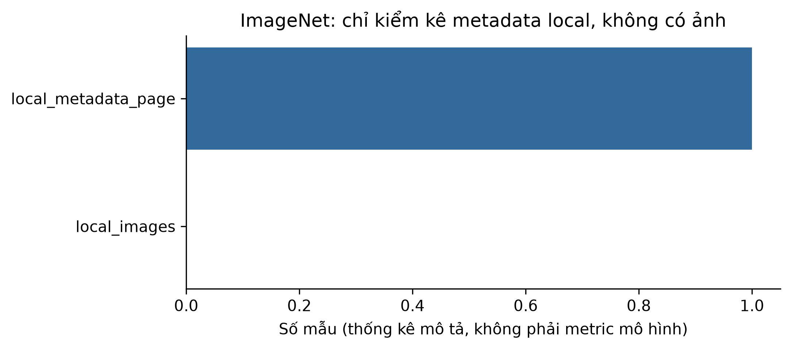

# ch1_imagenet_history — dữ liệu và kiểm tra Phase 24

Phạm vi: **historical_case_metadata_only**. Không huấn luyện hay đánh giá TEST trong Phase 24.

## Nguồn, kích cỡ và cấu trúc

Nguồn: [Russakovsky, O. et al. (2015). ImageNet Large Scale Visual Recognition Challenge. IJCV. DOI:10.1007/s11263-015-0816-y.](https://www.image-net.org/challenges/LSVRC/2012/index.php)
Phiên bản: ILSVRC 2012 official challenge metadata only; sha256:9d63dd697cceeeb640da708183bbbd6f4c35f98175d4cbec0439c3f3ea4373cc

Giấy phép/phạm vi: Only a local provenance copy of the public challenge webpage, not an image dataset license. Cite/paraphrase metadata; no redistribution of page or ImageNet images. Full image access remains subject to ImageNet terms.

Raw: 18,582 byte; 1 official metadata webpage, ZERO local images.

Số đo và schema phần dùng trong V3:

```json
{
  "records": 1,
  "features": null,
  "unit": "official metadata webpage, ZERO local images"
}
```

## Mẫu input/output

Mẫu nguồn phục vụ lịch sử, không phải output của mô hình được train trong Phase24.

```json
[
  {
    "input": "Trang metadata ILSVRC2012 đã lưu",
    "known_output": "1000 categories công bố; không có ảnh local"
  }
]
```

## Phân bố và chất lượng dữ liệu

```json
{
  "local_metadata_page": 1,
  "local_images": 0
}
```

## Cách chia tập và tiền xử lý

Ch1 không huấn luyện. Giữ official split nếu có; không tạo TEST hay preprocessing fit cho chương lịch sử.

## Nhận xét và giới hạn

- Chỉ metadata/citation lịch sử. Không bịa ảnh mẫu, phân bố ảnh hay thí nghiệm trên full ImageNet.
- Quy mô ảnh công bố trong source card không phải số mẫu đo trên máy.

## Bằng chứng tái lập

Chi tiết: `artifacts/manifests/phase24/ch1_imagenet_history/eda.json`.
Nguồn Phase23, raw và TEST Ch5 giữ nguyên; số đo mới không ghi ngược vào protocol.


