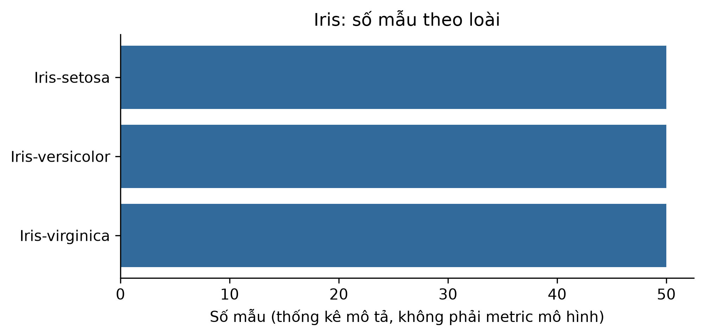

# ch1_iris_history — dữ liệu và kiểm tra Phase 24

Phạm vi: **historical_case**. Không huấn luyện hay đánh giá TEST trong Phase 24.

## Nguồn, kích cỡ và cấu trúc

Nguồn: [Fisher, R. A. (1936). Iris. UCI Machine Learning Repository. DOI:10.24432/C56C76.](https://archive.ics.uci.edu/static/public/53/iris.zip)
Phiên bản: UCI 53 original Iris snapshot; sha256:d11fe30213d36434a0879aab7cb00ce3c812eb7ba2495874438abff7b7b762e9

Giấy phép/phạm vi: CC BY 4.0; attribution required. https://archive.ics.uci.edu/dataset/53/iris

Raw: 3,738 byte; 150 raw rows.

Số đo và schema phần dùng trong V3:

```json
{
  "records": 150,
  "features": 4,
  "unit": "raw rows"
}
```

## Mẫu input/output

Mẫu nguồn phục vụ lịch sử, không phải output của mô hình được train trong Phase24.

```json
[
  {
    "input": [
      5.1,
      3.5,
      1.4,
      0.2
    ],
    "known_output": "Iris-setosa"
  },
  {
    "input": [
      4.9,
      3.0,
      1.4,
      0.2
    ],
    "known_output": "Iris-setosa"
  },
  {
    "input": [
      4.7,
      3.2,
      1.3,
      0.2
    ],
    "known_output": "Iris-setosa"
  }
]
```

## Phân bố và chất lượng dữ liệu

```json
{
  "Iris-setosa": 50,
  "Iris-versicolor": 50,
  "Iris-virginica": 50
}
```

## Cách chia tập và tiền xử lý

Ch1 không huấn luyện. Giữ official split nếu có; không tạo TEST hay preprocessing fit cho chương lịch sử.

## Nhận xét và giới hạn

- Benchmark nhỏ, cân bằng; chỉ minh họa lịch sử phân loại, không có thí nghiệm V3 Ch1.

## Bằng chứng tái lập

Chi tiết: `artifacts/manifests/phase24/ch1_iris_history/eda.json`.
Nguồn Phase23, raw và TEST Ch5 giữ nguyên; số đo mới không ghi ngược vào protocol.


