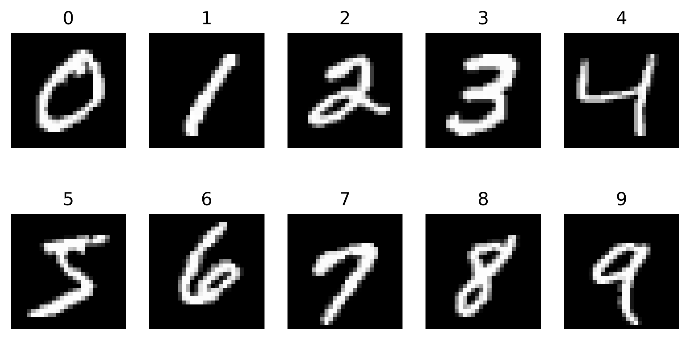
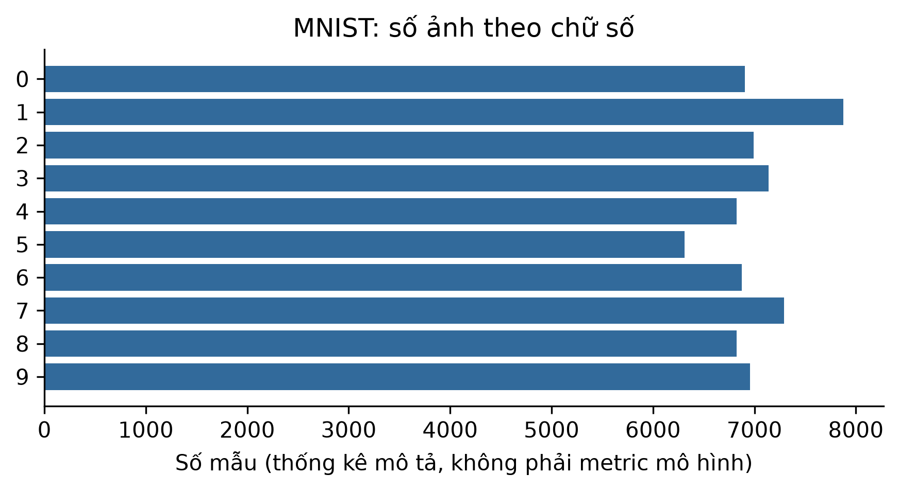

# ch1_mnist_history — dữ liệu và kiểm tra Phase 24

Phạm vi: **historical_case**. Không huấn luyện hay đánh giá TEST trong Phase 24.

## Nguồn, kích cỡ và cấu trúc

Nguồn: [LeCun, Y., Cortes, C., and Burges, C. MNIST handwritten digit database; NPZ distributed by Keras.](https://storage.googleapis.com/tensorflow/tf-keras-datasets/mnist.npz)
Phiên bản: Keras sanctioned MNIST NPZ; original 60000/10000 split; sha256:731c5ac602752760c8e48fbffcf8c3b850d9dc2a2aedcf2cc48468fc17b673d1

Giấy phép/phạm vi: CC BY-SA 3.0 as explicitly documented at https://keras.io/api/datasets/mnist/; retain attribution/share-alike for adaptations.

Raw: 11,490,434 byte; 70000 images (official 60000 train + 10000 test).

Số đo và schema phần dùng trong V3:

```json
{
  "records": 70000,
  "features": 784,
  "unit": "images (official 60000 train + 10000 test)"
}
```

## Mẫu input/output

Mẫu nguồn phục vụ lịch sử, không phải output của mô hình được train trong Phase24.

```json
[
  {
    "input": "official train index 0, uint8 28x28",
    "known_output": 5
  },
  {
    "input": "official train index 1, uint8 28x28",
    "known_output": 0
  },
  {
    "input": "official train index 2, uint8 28x28",
    "known_output": 4
  }
]
```

## Phân bố và chất lượng dữ liệu

```json
{
  "0": 6903,
  "1": 7877,
  "2": 6990,
  "3": 7141,
  "4": 6824,
  "5": 6313,
  "6": 6876,
  "7": 7293,
  "8": 6825,
  "9": 6958
}
```

## Cách chia tập và tiền xử lý

Ch1 không huấn luyện. Giữ official split nếu có; không tạo TEST hay preprocessing fit cho chương lịch sử.

## Nhận xét và giới hạn

- MNIST là case study lịch sử; không thay IDRiD/EuroSAT/CIFAR trong ma trận CNN V3.
- Official train có 0 ảnh trùng pixel; không tạo random split mới hay train Ch1.

## Bằng chứng tái lập

Chi tiết: `artifacts/manifests/phase24/ch1_mnist_history/eda.json`.
Nguồn Phase23, raw và TEST Ch5 giữ nguyên; số đo mới không ghi ngược vào protocol.




