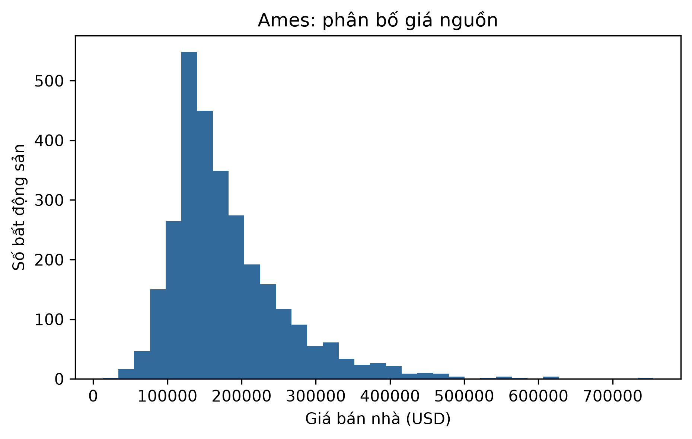

# ch2_ames_housing — dữ liệu và kiểm tra Phase 24

Phạm vi: **measured_tabular**. Không huấn luyện hay đánh giá TEST trong Phase 24.

## Nguồn, kích cỡ và cấu trúc

Nguồn: [De Cock, D. (2011). Ames, Iowa: Alternative to the Boston Housing Data as an End of Semester Regression Project. Journal of Statistics Education 19(3). DOI:10.1080/10691898.2011.11889627.](https://jse.amstat.org/v19n3/decock/AmesHousing.txt)
Phiên bản: De Cock JSE 2011 original 2930-row tab-delimited release; sha256:6cfe6cb525ba437de428653a1040e2aed7d696640bf75203786a6d7a0e67cfcc

Giấy phép/phạm vi: Author-published teaching/research dataset accompanying JSE article; retain attribution; no explicit SPDX license on original TXT. GPL-2 in topepo/AmesHousing applies to that package, not automatically to this original source. Local academic analysis only; no raw redistribution.

Raw: 960,807 byte; 2930 raw rows.

Số đo và schema phần dùng trong V3:

```json
{
  "rows": 2930,
  "features": [
    "ms_sub_class",
    "ms_zoning",
    "lot_frontage",
    "lot_area",
    "street",
    "alley",
    "lot_shape",
    "land_contour",
    "utilities",
    "lot_config",
    "land_slope",
    "neighborhood",
    "condition_1",
    "condition_2",
    "bldg_type",
    "house_style",
    "overall_qual",
    "overall_cond",
    "year_built",
    "year_remod_add",
    "roof_style",
    "roof_matl",
    "exterior_1st",
    "exterior_2nd",
    "mas_vnr_type",
    "mas_vnr_area",
    "exter_qual",
    "exter_cond",
    "foundation",
    "bsmt_qual",
    "bsmt_cond",
    "bsmt_exposure",
    "bsmt_fin_type_1",
    "bsmt_fin_sf_1",
    "bsmt_fin_type_2",
    "bsmt_fin_sf_2",
    "bsmt_unf_sf",
    "total_bsmt_sf",
    "heating",
    "heating_qc",
    "central_air",
    "electrical",
    "v_1st_flr_sf",
    "v_2nd_flr_sf",
    "low_qual_fin_sf",
    "gr_liv_area",
    "bsmt_full_bath",
    "bsmt_half_bath",
    "full_bath",
    "half_bath",
    "bedroom_abv_gr",
    "kitchen_abv_gr",
    "kitchen_qual",
    "tot_rms_abv_grd",
    "functional",
    "fireplaces",
    "fireplace_qu",
    "garage_type",
    "garage_yr_blt",
    "garage_finish",
    "garage_cars",
    "garage_area",
    "garage_qual",
    "garage_cond",
    "paved_drive",
    "wood_deck_sf",
    "open_porch_sf",
    "enclosed_porch",
    "v_3_ssn_porch",
    "screen_porch",
    "pool_area",
    "pool_qc",
    "fence",
    "misc_feature",
    "misc_val",
    "mo_sold",
    "yr_sold",
    "sale_type",
    "sale_condition"
  ],
  "model_input_width": 313,
  "target": "sale_price",
  "split": {
    "path": "data/splits/v3/ch2_ames_housing/split_contract.json",
    "sha256": "3c0db0100706a3b725b7e7af50a8fc1c9ec4ab9cb37cd18e1e041686b80b6505",
    "size_bytes": 1470
  },
  "matched_subset": {
    "path": "data/splits/v3/ch2_ames_housing/matched_train.ids.jsonl.gz",
    "sha256": "0542fa4ebf11a3bd430fb84850adf1b1d662be991f88c5ebb76a4c4ac611b5bd",
    "size_bytes": 4739
  },
  "counts": {
    "train": 2051,
    "validation": 439,
    "test": 440
  },
  "matched_train_count": 2051,
  "quarantine_count": 0
}
```

## Mẫu input/output

Ba mẫu thuộc matched train, output là nhãn/giá nguồn, không phải dự đoán. Input hiển thị tối đa 8 biến; samples.json chứa đủ biến.

```json
[
  {
    "id": "row_0001475",
    "input": {
      "ms_sub_class": 20,
      "ms_zoning": "RL",
      "lot_frontage": 65.0,
      "lot_area": 8450,
      "street": "Pave",
      "alley": null,
      "lot_shape": "Reg",
      "land_contour": "Lvl"
    },
    "known_output": 210000
  },
  {
    "id": "row_0001603",
    "input": {
      "ms_sub_class": 20,
      "ms_zoning": "RL",
      "lot_frontage": 37.0,
      "lot_area": 6951,
      "street": "Pave",
      "alley": null,
      "lot_shape": "IR1",
      "land_contour": "Lvl"
    },
    "known_output": 119500
  },
  {
    "id": "row_0001732",
    "input": {
      "ms_sub_class": 60,
      "ms_zoning": "RL",
      "lot_frontage": 63.0,
      "lot_area": 9729,
      "street": "Pave",
      "alley": null,
      "lot_shape": "IR1",
      "land_contour": "Lvl"
    },
    "known_output": 198444
  }
]
```

## Phân bố và chất lượng dữ liệu

```json
{
  "target_by_partition": {
    "train": {
      "count": 2051.0,
      "mean": 180007.88980984886,
      "std": 76288.62916288216,
      "min": 12789.0,
      "25%": 129650.0,
      "50%": 160000.0,
      "75%": 214000.0,
      "max": 615000.0
    },
    "validation": {
      "count": 439.0,
      "mean": 181666.46469248293,
      "std": 84922.31341486958,
      "min": 40000.0,
      "25%": 129450.0,
      "50%": 160500.0,
      "75%": 213000.0,
      "max": 745000.0
    },
    "test": {
      "count": 440.0,
      "mean": 183601.58181818182,
      "std": 90528.58532658328,
      "min": 35000.0,
      "25%": 128975.0,
      "50%": 160000.0,
      "75%": 211000.0,
      "max": 755000.0
    }
  },
  "missing_by_feature": {
    "ms_sub_class": 0,
    "ms_zoning": 0,
    "lot_frontage": 490,
    "lot_area": 0,
    "street": 0,
    "alley": 2732,
    "lot_shape": 0,
    "land_contour": 0,
    "utilities": 0,
    "lot_config": 0,
    "land_slope": 0,
    "neighborhood": 0,
    "condition_1": 0,
    "condition_2": 0,
    "bldg_type": 0,
    "house_style": 0,
    "overall_qual": 0,
    "overall_cond": 0,
    "year_built": 0,
    "year_remod_add": 0,
    "roof_style": 0,
    "roof_matl": 0,
    "exterior_1st": 0,
    "exterior_2nd": 0,
    "mas_vnr_type": 1775,
    "mas_vnr_area": 23,
    "exter_qual": 0,
    "exter_cond": 0,
    "foundation": 0,
    "bsmt_qual": 80,
    "bsmt_cond": 80,
    "bsmt_exposure": 83,
    "bsmt_fin_type_1": 80,
    "bsmt_fin_sf_1": 1,
    "bsmt_fin_type_2": 81,
    "bsmt_fin_sf_2": 1,
    "bsmt_unf_sf": 1,
    "total_bsmt_sf": 1,
    "heating": 0,
    "heating_qc": 0,
    "central_air": 0,
    "electrical": 1,
    "v_1st_flr_sf": 0,
    "v_2nd_flr_sf": 0,
    "low_qual_fin_sf": 0,
    "gr_liv_area": 0,
    "bsmt_full_bath": 2,
    "bsmt_half_bath": 2,
    "full_bath": 0,
    "half_bath": 0,
    "bedroom_abv_gr": 0,
    "kitchen_abv_gr": 0,
    "kitchen_qual": 0,
    "tot_rms_abv_grd": 0,
    "functional": 0,
    "fireplaces": 0,
    "fireplace_qu": 1422,
    "garage_type": 157,
    "garage_yr_blt": 159,
    "garage_finish": 159,
    "garage_cars": 1,
    "garage_area": 1,
    "garage_qual": 159,
    "garage_cond": 159,
    "paved_drive": 0,
    "wood_deck_sf": 0,
    "open_porch_sf": 0,
    "enclosed_porch": 0,
    "v_3_ssn_porch": 0,
    "screen_porch": 0,
    "pool_area": 0,
    "pool_qc": 2917,
    "fence": 2358,
    "misc_feature": 2824,
    "misc_val": 0,
    "mo_sold": 0,
    "yr_sold": 0,
    "sale_type": 0,
    "sale_condition": 0
  },
  "duplicate_rows": 2,
  "outliers": "feature_profile.json, ngưỡng IQR từ train"
}
```

## Cách chia tập và tiền xử lý

Gom exact feature duplicates và PID nếu có, rồi stratify theo nhóm 70/15/15 (xấp xỉ theo số dòng). Imputer/scaler/vocabulary/target scaler/class weight chỉ fit matched train; unknown category -> all-zero. Không tự xóa outlier.

## Nhận xét và giới hạn

- Giá bán tính bằng USD; thiếu ở một số trường có thể biểu thị không có tiện ích, không mặc định bằng 0.
- PID/Order không làm feature. Gom PID và trùng feature theo liên kết bắc cầu.
- Chia theo nhóm/ngẫu nhiên không đại diện cho triển khai dự báo giá nhà tương lai hay địa phương khác.

## Bằng chứng tái lập

Chi tiết: `artifacts/manifests/phase24/ch2_ames_housing/eda.json`.
Nguồn Phase23, raw và TEST Ch5 giữ nguyên; số đo mới không ghi ngược vào protocol.


