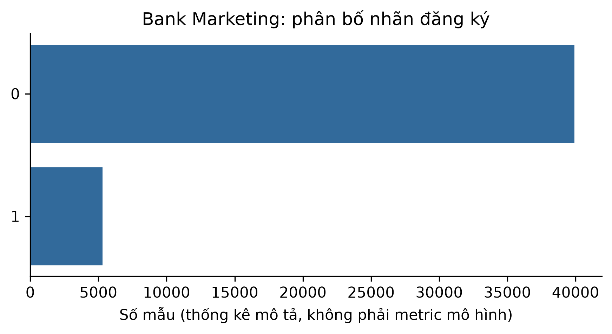

# ch2_bank_marketing — dữ liệu và kiểm tra Phase 24

Phạm vi: **measured_tabular**. Không huấn luyện hay đánh giá TEST trong Phase 24.

## Nguồn, kích cỡ và cấu trúc

Nguồn: [Moro, S., Rita, P., and Cortez, P. (2014). Bank Marketing. UCI. DOI:10.24432/C5K306.](https://archive.ics.uci.edu/static/public/222/bank+marketing.zip)
Phiên bản: UCI 222; bank.zip/bank-full.csv, original 45211-row variant; sha256:e0bf5f5de5b846e2f18e9d90606637267d46dfa260e0f17bb12e605db5efbeb4

Giấy phép/phạm vi: CC BY 4.0. https://archive.ics.uci.edu/dataset/222/bank+marketing . Retain attribution; exclude duration before-call prediction.

Raw: 1,023,843 byte; 45211 raw rows.

Số đo và schema phần dùng trong V3:

```json
{
  "rows": 45211,
  "features": [
    "age",
    "job",
    "marital",
    "education",
    "default",
    "balance",
    "housing",
    "loan",
    "contact",
    "day",
    "month",
    "campaign",
    "pdays",
    "previous",
    "poutcome"
  ],
  "model_input_width": 50,
  "target": "subscription",
  "split": {
    "path": "data/splits/v3/ch2_bank_marketing/split_contract.json",
    "sha256": "72136591aca9bb338d59aab29106974f1cdf1103624a46074782c3b0182c9035",
    "size_bytes": 1485
  },
  "matched_subset": {
    "path": "data/splits/v3/ch2_bank_marketing/matched_train.ids.jsonl.gz",
    "sha256": "b271747e61b6dcdfc4cf3f5b29b8a28643aaf82760b1efa5b14f3fdec3de811d",
    "size_bytes": 25066
  },
  "counts": {
    "train": 31648,
    "validation": 6781,
    "test": 6782
  },
  "matched_train_count": 10000,
  "quarantine_count": 0
}
```

## Mẫu input/output

Ba mẫu thuộc matched train, output là nhãn/giá nguồn, không phải dự đoán. Input hiển thị tối đa 8 biến; samples.json chứa đủ biến.

```json
[
  {
    "id": "row_0030605",
    "input": {
      "age": 31,
      "job": "self-employed",
      "marital": "single",
      "education": "secondary",
      "default": "no",
      "balance": 0,
      "housing": "no",
      "loan": "yes"
    },
    "known_output": 0
  },
  {
    "id": "row_0032873",
    "input": {
      "age": 32,
      "job": "services",
      "marital": "divorced",
      "education": "secondary",
      "default": "no",
      "balance": 453,
      "housing": "yes",
      "loan": "no"
    },
    "known_output": 0
  },
  {
    "id": "row_0038552",
    "input": {
      "age": 28,
      "job": "blue-collar",
      "marital": "married",
      "education": "primary",
      "default": "no",
      "balance": 278,
      "housing": "yes",
      "loan": "yes"
    },
    "known_output": 0
  }
]
```

## Phân bố và chất lượng dữ liệu

```json
{
  "target_by_partition": {
    "train": {
      "0": 27946,
      "1": 3702
    },
    "validation": {
      "0": 5988,
      "1": 793
    },
    "test": {
      "0": 5988,
      "1": 794
    }
  },
  "missing_by_feature": {
    "age": 0,
    "job": 0,
    "marital": 0,
    "education": 0,
    "default": 0,
    "balance": 0,
    "housing": 0,
    "loan": 0,
    "contact": 0,
    "day": 0,
    "month": 0,
    "campaign": 0,
    "pdays": 0,
    "previous": 0,
    "poutcome": 0
  },
  "duplicate_rows": 16,
  "outliers": "feature_profile.json, ngưỡng IQR từ train"
}
```

## Cách chia tập và tiền xử lý

Gom exact feature duplicates và PID nếu có, rồi stratify theo nhóm 70/15/15 (xấp xỉ theo số dòng). Imputer/scaler/vocabulary/target scaler/class weight chỉ fit matched train; unknown category -> all-zero. Không tự xóa outlier.

## Nhận xét và giới hạn

- Bỏ duration vì chỉ biết sau cuộc gọi; giữ nhãn y: yes=1, no=0.
- Chuỗi 'unknown' là mức danh mục nguồn, không tự coi là số 0.
- Không có mã khách hàng để bảo đảm độc lập theo khách; giữ hạn chế này.

## Bằng chứng tái lập

Chi tiết: `artifacts/manifests/phase24/ch2_bank_marketing/eda.json`.
Nguồn Phase23, raw và TEST Ch5 giữ nguyên; số đo mới không ghi ngược vào protocol.


