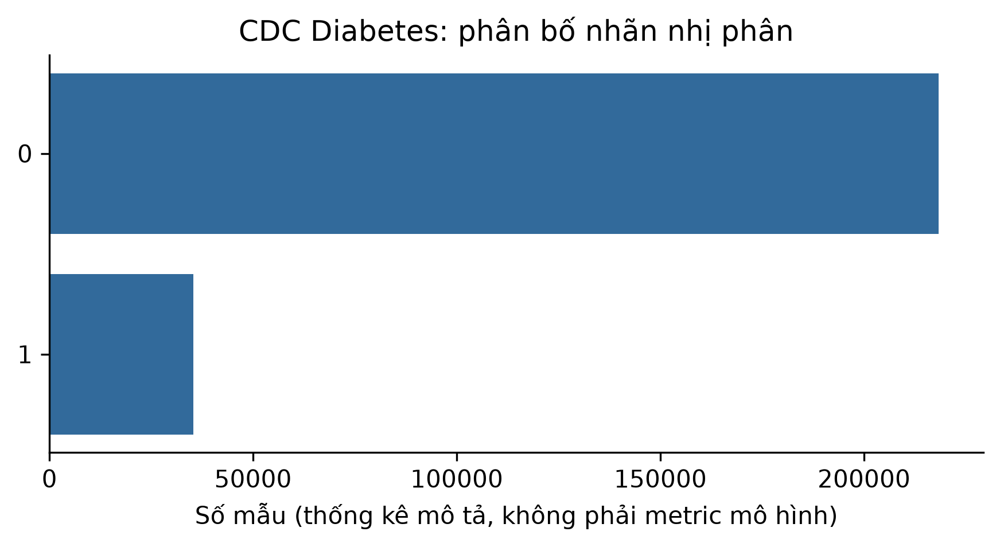

# ch2_cdc_diabetes — dữ liệu và kiểm tra Phase 24

Phạm vi: **measured_tabular**. Không huấn luyện hay đánh giá TEST trong Phase 24.

## Nguồn, kích cỡ và cấu trúc

Nguồn: [Teboul, A. (2021). Diabetes Health Indicators Dataset, derived from CDC BRFSS 2015. UCI dataset 891. DOI:10.24432/C53919.](https://archive.ics.uci.edu/static/public/891/data.csv)
Phiên bản: UCI 891 / CDC BRFSS 2015 binary diabetes; sha256:9f71fda9d4ae5f4878c99b9233b6a16accfa9a17c194116a6b78100540934964

Giấy phép/phạm vi: UCI directs licensing to upstream Kaggle; public Kaggle API confirms CC0: Public Domain. https://www.kaggle.com/datasets/alexteboul/diabetes-health-indicators-dataset . Not assumed to inherit UCI's default CC BY license.

Raw: 13,494,568 byte; 253680 raw rows.

Số đo và schema phần dùng trong V3:

```json
{
  "rows": 253680,
  "features": [
    "high_bp",
    "high_chol",
    "chol_check",
    "bmi",
    "smoker",
    "stroke",
    "heart_diseaseor_attack",
    "phys_activity",
    "fruits",
    "veggies",
    "hvy_alcohol_consump",
    "any_healthcare",
    "no_docbc_cost",
    "gen_hlth",
    "ment_hlth",
    "phys_hlth",
    "diff_walk",
    "sex",
    "age",
    "education",
    "income"
  ],
  "model_input_width": 21,
  "target": "diabetes_binary",
  "split": {
    "path": "data/splits/v3/ch2_cdc_diabetes/split_contract.json",
    "sha256": "557c1b646bf0259b9d475c2f0d25bf5bde33b8c4d8ed93d17fc4af2c1f813df4",
    "size_bytes": 1476
  },
  "matched_subset": {
    "path": "data/splits/v3/ch2_cdc_diabetes/matched_train.ids.jsonl.gz",
    "sha256": "5319b90adc4a6ae52918700506ae66054de74640f4012cb09b71f2a79d8c3759",
    "size_bytes": 53576
  },
  "counts": {
    "train": 177505,
    "validation": 38053,
    "test": 38122
  },
  "matched_train_count": 20000,
  "quarantine_count": 0
}
```

## Mẫu input/output

Ba mẫu thuộc matched train, output là nhãn/giá nguồn, không phải dự đoán. Input hiển thị tối đa 8 biến; samples.json chứa đủ biến.

```json
[
  {
    "id": "row_0048946",
    "input": {
      "high_bp": 1,
      "high_chol": 1,
      "chol_check": 1,
      "bmi": 24,
      "smoker": 0,
      "stroke": 0,
      "heart_diseaseor_attack": 0,
      "phys_activity": 1
    },
    "known_output": 0
  },
  {
    "id": "row_0129953",
    "input": {
      "high_bp": 0,
      "high_chol": 0,
      "chol_check": 1,
      "bmi": 21,
      "smoker": 0,
      "stroke": 0,
      "heart_diseaseor_attack": 0,
      "phys_activity": 1
    },
    "known_output": 0
  },
  {
    "id": "row_0216399",
    "input": {
      "high_bp": 0,
      "high_chol": 0,
      "chol_check": 1,
      "bmi": 22,
      "smoker": 0,
      "stroke": 0,
      "heart_diseaseor_attack": 0,
      "phys_activity": 1
    },
    "known_output": 0
  }
]
```

## Phân bố và chất lượng dữ liệu

```json
{
  "target_by_partition": {
    "train": {
      "0": 152760,
      "1": 24745
    },
    "validation": {
      "0": 32745,
      "1": 5308
    },
    "test": {
      "0": 32829,
      "1": 5293
    }
  },
  "missing_by_feature": {
    "high_bp": 0,
    "high_chol": 0,
    "chol_check": 0,
    "bmi": 0,
    "smoker": 0,
    "stroke": 0,
    "heart_diseaseor_attack": 0,
    "phys_activity": 0,
    "fruits": 0,
    "veggies": 0,
    "hvy_alcohol_consump": 0,
    "any_healthcare": 0,
    "no_docbc_cost": 0,
    "gen_hlth": 0,
    "ment_hlth": 0,
    "phys_hlth": 0,
    "diff_walk": 0,
    "sex": 0,
    "age": 0,
    "education": 0,
    "income": 0
  },
  "duplicate_rows": 25772,
  "outliers": "feature_profile.json, ngưỡng IQR từ train"
}
```

## Cách chia tập và tiền xử lý

Gom exact feature duplicates và PID nếu có, rồi stratify theo nhóm 70/15/15 (xấp xỉ theo số dòng). Imputer/scaler/vocabulary/target scaler/class weight chỉ fit matched train; unknown category -> all-zero. Không tự xóa outlier.

## Nhận xét và giới hạn

- CDC bản nhị phân: 1 gộp tiền tiểu đường/tiểu đường, không diễn giải thành ba lớp.
- Khảo sát tự báo cáo, quan sát chứ không chứng minh quan hệ nhân quả; không dùng để chẩn đoán.
- Không có patient ID được xác minh. Gom trùng feature không chứng minh độc lập bệnh nhân.

## Bằng chứng tái lập

Chi tiết: `artifacts/manifests/phase24/ch2_cdc_diabetes/eda.json`.
Nguồn Phase23, raw và TEST Ch5 giữ nguyên; số đo mới không ghi ngược vào protocol.


