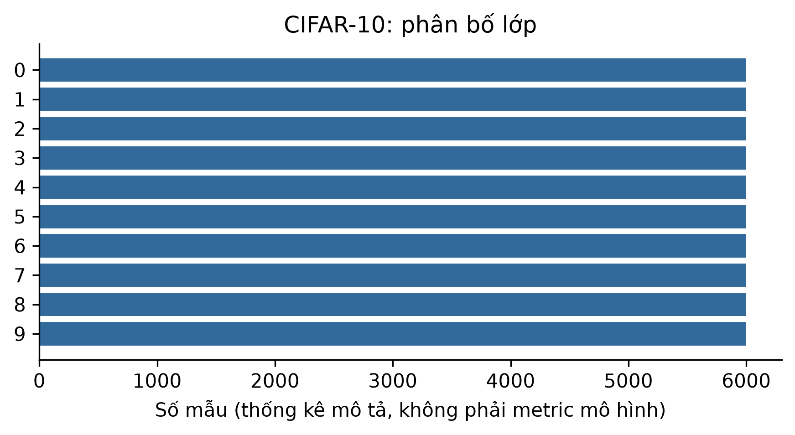

# ch3_cifar10 — dữ liệu và kiểm tra Phase 24

Phạm vi: **measured_image**. Không huấn luyện hay đánh giá TEST trong Phase 24.

## Nguồn, kích cỡ và cấu trúc

Nguồn: [Krizhevsky, A. (2009). Learning Multiple Layers of Features from Tiny Images. University of Toronto technical report.](https://www.cs.toronto.edu/~kriz/cifar-10-binary.tar.gz)
Phiên bản: CIFAR-10 original binary release 2009; not Python pickle; sha256:c4a38c50a1bc5f3a1c5537f2155ab9d68f9f25eb1ed8d9ddda3db29a59bca1dd

Giấy phép/phạm vi: Author-hosted public research benchmark; author requests citation. No explicit SPDX license asserted. Local academic analysis only; no raw redistribution. https://www.cs.toronto.edu/~kriz/cifar.html

Raw: 170,052,171 byte; 60000 images (50000 train + 10000 test).

Số đo và schema phần dùng trong V3:

```json
{
  "images": 60000,
  "classes": 10,
  "native_shapes": [
    [
      32,
      32
    ]
  ],
  "model_shape_hwc": [
    32,
    32,
    3
  ],
  "label_mapping": {
    "0": "airplane",
    "1": "automobile",
    "2": "bird",
    "3": "cat",
    "4": "deer",
    "5": "dog",
    "6": "frog",
    "7": "horse",
    "8": "ship",
    "9": "truck"
  },
  "split": {
    "path": "data/splits/v3/ch3_cifar10/split_contract.json",
    "sha256": "f7ac586f8cb07a23333d64c0fa238936c026b178c52add74299711111a7dd755",
    "size_bytes": 1436
  },
  "matched_subset": {
    "path": "data/splits/v3/ch3_cifar10/matched_train.ids.jsonl.gz",
    "sha256": "96bc6a3da4112ba292a6d2e95b999bede66bfdeefb5468af7ad277b8ec17579b",
    "size_bytes": 13588
  },
  "counts": {
    "train": 45000,
    "validation": 5000,
    "test": 10000
  },
  "matched_train_count": 5000,
  "quarantine_count": 0
}
```

## Mẫu input/output

Mẫu và hình chỉ lấy matched train. known_output là nhãn gốc, không phải dự đoán.

```json
[
  {
    "id": "data_batch_1.bin/00026",
    "input": {
      "member": "cifar-10-batches-bin/data_batch_1.bin",
      "native_shape": [
        32,
        32,
        3
      ],
      "model_shape": [
        32,
        32,
        3
      ]
    },
    "known_output": "3"
  },
  {
    "id": "data_batch_1.bin/00028",
    "input": {
      "member": "cifar-10-batches-bin/data_batch_1.bin",
      "native_shape": [
        32,
        32,
        3
      ],
      "model_shape": [
        32,
        32,
        3
      ]
    },
    "known_output": "4"
  },
  {
    "id": "data_batch_1.bin/00029",
    "input": {
      "member": "cifar-10-batches-bin/data_batch_1.bin",
      "native_shape": [
        32,
        32,
        3
      ],
      "model_shape": [
        32,
        32,
        3
      ]
    },
    "known_output": "0"
  }
]
```

## Phân bố và chất lượng dữ liệu

```json
{
  "class_counts": {
    "0": 6000,
    "1": 6000,
    "2": 6000,
    "3": 6000,
    "4": 6000,
    "5": 6000,
    "6": 6000,
    "7": 6000,
    "8": 6000,
    "9": 6000
  },
  "class_by_partition": {
    "train": {
      "6": 4500,
      "9": 4500,
      "4": 4500,
      "1": 4500,
      "2": 4500,
      "7": 4500,
      "8": 4500,
      "3": 4500,
      "5": 4500,
      "0": 4500
    },
    "validation": {
      "9": 500,
      "3": 500,
      "7": 500,
      "2": 500,
      "4": 500,
      "6": 500,
      "1": 500,
      "5": 500,
      "0": 500,
      "8": 500
    },
    "test": {
      "3": 1000,
      "8": 1000,
      "0": 1000,
      "6": 1000,
      "1": 1000,
      "9": 1000,
      "5": 1000,
      "7": 1000,
      "4": 1000,
      "2": 1000
    }
  },
  "decode_or_label_missing": 0,
  "pixel_duplicate_rows": 0,
  "quarantine": 0,
  "outlier_note": "IQR brightness/black fraction, no clinical quality claim or row deletion; feature_profile.json"
}
```

## Cách chia tập và tiền xử lý

Gom trùng pixel gốc và sau resize. Nếu có official TEST: giữ nguyên TEST, loại bản trùng TEST khỏi development bằng quarantine; validation chỉ lấy official train. Các phép fit/class weight dùng train. Không có augmentation khác nhau giữa framework.

## Nhận xét và giới hạn

- Giữ nguyên 10.000 ảnh official TEST, kể cả bản trùng trong chính TEST.
- Ảnh official train trùng pixel với TEST phải quarantine, không được âm thầm chuyển/xóa TEST.
- Đọc binary, không dùng pickle; test chỉ được đánh giá sau khi khóa release thí nghiệm.

## Bằng chứng tái lập

Chi tiết: `artifacts/manifests/phase24/ch3_cifar10/eda.json`.
Nguồn Phase23, raw và TEST Ch5 giữ nguyên; số đo mới không ghi ngược vào protocol.



