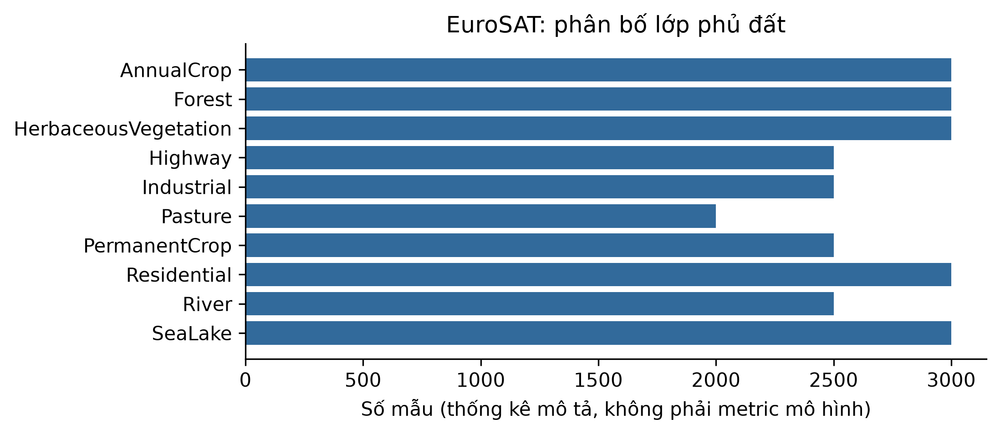

# ch3_eurosat — dữ liệu và kiểm tra Phase 24

Phạm vi: **measured_image**. Không huấn luyện hay đánh giá TEST trong Phase 24.

## Nguồn, kích cỡ và cấu trúc

Nguồn: [Helber, P., Bischke, B., Dengel, A., and Borth, D. (2019). EuroSAT: A Novel Dataset and Deep Learning Benchmark for Land Use and Land Cover Classification. IEEE JSTARS. DOI:10.1109/JSTARS.2019.2918242.](https://zenodo.org/records/7711810/files/EuroSAT_RGB.zip?download=1)
Phiên bản: Zenodo 7711810 v2; RGB only; sha256:b4f5b234ecb7d7ff9c6cddb046543b4717c53fd6e9815be6c0e80cc614f51b90

Giấy phép/phạm vi: MIT confirmed by Zenodo record metadata; also respect Copernicus Sentinel data terms as noted by authors. https://github.com/phelber/EuroSAT ; https://zenodo.org/records/7711810 . Multispectral 2.1 GB package deliberately not downloaded.

Raw: 94,658,721 byte; 27000 RGB image patches.

Số đo và schema phần dùng trong V3:

```json
{
  "images": 27000,
  "classes": 10,
  "native_shapes": [
    [
      64,
      64
    ]
  ],
  "model_shape_hwc": [
    32,
    32,
    3
  ],
  "label_mapping": {
    "AnnualCrop": "AnnualCrop",
    "Forest": "Forest",
    "HerbaceousVegetation": "HerbaceousVegetation",
    "Highway": "Highway",
    "Industrial": "Industrial",
    "Pasture": "Pasture",
    "PermanentCrop": "PermanentCrop",
    "Residential": "Residential",
    "River": "River",
    "SeaLake": "SeaLake"
  },
  "split": {
    "path": "data/splits/v3/ch3_eurosat/split_contract.json",
    "sha256": "369ba3a92317273cad5340c6a723da12515c95ee545fb64e36fbf1d7d85a8e50",
    "size_bytes": 1443
  },
  "matched_subset": {
    "path": "data/splits/v3/ch3_eurosat/matched_train.ids.jsonl.gz",
    "sha256": "f3b1bb18695870b08fd2aec5548a79b308df5688570f11a844eacd00680138ec",
    "size_bytes": 9001
  },
  "counts": {
    "train": 18900,
    "validation": 4050,
    "test": 4050
  },
  "matched_train_count": 3000,
  "quarantine_count": 0
}
```

## Mẫu input/output

Mẫu và hình chỉ lấy matched train. known_output là nhãn gốc, không phải dự đoán.

```json
[
  {
    "id": "EuroSAT_RGB/AnnualCrop/AnnualCrop_1.jpg",
    "input": {
      "member": "EuroSAT_RGB/AnnualCrop/AnnualCrop_1.jpg",
      "native_shape": [
        64,
        64,
        3
      ],
      "model_shape": [
        32,
        32,
        3
      ]
    },
    "known_output": "AnnualCrop"
  },
  {
    "id": "EuroSAT_RGB/Forest/Forest_100.jpg",
    "input": {
      "member": "EuroSAT_RGB/Forest/Forest_100.jpg",
      "native_shape": [
        64,
        64,
        3
      ],
      "model_shape": [
        32,
        32,
        3
      ]
    },
    "known_output": "Forest"
  },
  {
    "id": "EuroSAT_RGB/HerbaceousVegetation/HerbaceousVegetation_1003.jpg",
    "input": {
      "member": "EuroSAT_RGB/HerbaceousVegetation/HerbaceousVegetation_1003.jpg",
      "native_shape": [
        64,
        64,
        3
      ],
      "model_shape": [
        32,
        32,
        3
      ]
    },
    "known_output": "HerbaceousVegetation"
  }
]
```

## Phân bố và chất lượng dữ liệu

```json
{
  "class_counts": {
    "AnnualCrop": 3000,
    "Forest": 3000,
    "HerbaceousVegetation": 3000,
    "Highway": 2500,
    "Industrial": 2500,
    "Pasture": 2000,
    "PermanentCrop": 2500,
    "Residential": 3000,
    "River": 2500,
    "SeaLake": 3000
  },
  "class_by_partition": {
    "train": {
      "AnnualCrop": 2100,
      "Forest": 2100,
      "HerbaceousVegetation": 2100,
      "Residential": 2100,
      "SeaLake": 2100,
      "Highway": 1750,
      "Industrial": 1750,
      "PermanentCrop": 1750,
      "River": 1750,
      "Pasture": 1400
    },
    "validation": {
      "AnnualCrop": 450,
      "Forest": 450,
      "HerbaceousVegetation": 450,
      "Residential": 450,
      "SeaLake": 450,
      "Highway": 375,
      "Industrial": 375,
      "PermanentCrop": 375,
      "River": 375,
      "Pasture": 300
    },
    "test": {
      "AnnualCrop": 450,
      "Forest": 450,
      "HerbaceousVegetation": 450,
      "Residential": 450,
      "SeaLake": 450,
      "Highway": 375,
      "Industrial": 375,
      "PermanentCrop": 375,
      "River": 375,
      "Pasture": 300
    }
  },
  "decode_or_label_missing": 0,
  "pixel_duplicate_rows": 0,
  "quarantine": 0,
  "outlier_note": "IQR brightness/black fraction, no clinical quality claim or row deletion; feature_profile.json"
}
```

## Cách chia tập và tiền xử lý

Gom trùng pixel gốc và sau resize. Nếu có official TEST: giữ nguyên TEST, loại bản trùng TEST khỏi development bằng quarantine; validation chỉ lấy official train. Các phép fit/class weight dùng train. Không có augmentation khác nhau giữa framework.

## Nhận xét và giới hạn

- Ảnh RGB 64×64 gốc, track so sánh dùng 32×32 như protocol.
- Không có tọa độ/group địa lý được xác minh trong gói này; split không chứng minh độc lập không gian.
- Kiểm trùng pixel gốc và sau resize, không tự lọc ảnh theo kết quả mô hình.

## Bằng chứng tái lập

Chi tiết: `artifacts/manifests/phase24/ch3_eurosat/eda.json`.
Nguồn Phase23, raw và TEST Ch5 giữ nguyên; số đo mới không ghi ngược vào protocol.



