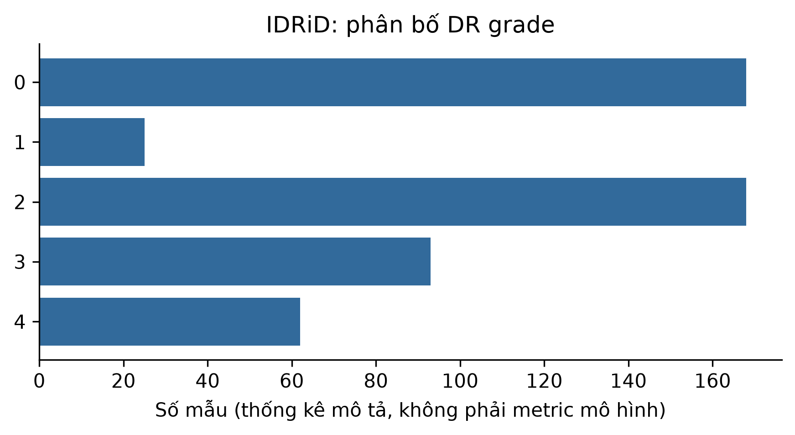

# ch3_idrid — dữ liệu và kiểm tra Phase 24

Phạm vi: **measured_image**. Không huấn luyện hay đánh giá TEST trong Phase 24.

## Nguồn, kích cỡ và cấu trúc

Nguồn: [Porwal, P., Pachade, S., and Kokare, M. (2018). Indian Diabetic Retinopathy Image Dataset (IDRiD). IEEE DataPort. DOI:10.21227/H25W98.](https://ieee-dataport.org/open-access/indian-diabetic-retinopathy-image-dataset-idrid)
Phiên bản: IDRiD original B. Disease Grading ZIP; sha256:8a9f4752b35d74cc35ff48b21ad44f295a6f800110ec218fc2d1c264803e4d8c

Giấy phép/phạm vi: CC BY 4.0, established from bundled IDRiD LICENSE.txt and CC-BY-4.0.txt; exact member hashes in import receipt. Retain authors/citation/license, identify adaptations; no clinical-use claims.

Raw: 212,405,123 byte; 516 fundus RGB images; official 413 train + 103 test.

Số đo và schema phần dùng trong V3:

```json
{
  "images": 516,
  "classes": 5,
  "native_shapes": [
    [
      2848,
      4288
    ]
  ],
  "model_shape_hwc": [
    128,
    128,
    3
  ],
  "label_mapping": {
    "0": "0",
    "1": "1",
    "2": "2",
    "3": "3",
    "4": "4"
  },
  "split": {
    "path": "data/splits/v3/ch3_idrid/split_contract.json",
    "sha256": "e4ba938f293fca2787d6670e4f0c989299e90df2c5dbc91081be47ab5160946b",
    "size_bytes": 1418
  },
  "matched_subset": {
    "path": "data/splits/v3/ch3_idrid/matched_train.ids.jsonl.gz",
    "sha256": "28328c2a0de708b03fd8022efcdaf88beb2c6966007b7c58776d4fe6d19f6847",
    "size_bytes": 784
  },
  "counts": {
    "train": 348,
    "validation": 64,
    "test": 103
  },
  "matched_train_count": 348,
  "quarantine_count": 1
}
```

## Mẫu input/output

Mẫu và hình chỉ lấy matched train. known_output là nhãn gốc, không phải dự đoán.

```json
[
  {
    "id": "train/IDRiD_001",
    "input": {
      "member": "B. Disease Grading/1. Original Images/a. Training Set/IDRiD_001.jpg",
      "native_shape": [
        2848,
        4288,
        3
      ],
      "model_shape": [
        128,
        128,
        3
      ]
    },
    "known_output": "3"
  },
  {
    "id": "train/IDRiD_003",
    "input": {
      "member": "B. Disease Grading/1. Original Images/a. Training Set/IDRiD_003.jpg",
      "native_shape": [
        2848,
        4288,
        3
      ],
      "model_shape": [
        128,
        128,
        3
      ]
    },
    "known_output": "2"
  },
  {
    "id": "train/IDRiD_006",
    "input": {
      "member": "B. Disease Grading/1. Original Images/a. Training Set/IDRiD_006.jpg",
      "native_shape": [
        2848,
        4288,
        3
      ],
      "model_shape": [
        128,
        128,
        3
      ]
    },
    "known_output": "4"
  }
]
```

## Phân bố và chất lượng dữ liệu

```json
{
  "class_counts": {
    "0": 168,
    "1": 25,
    "2": 168,
    "3": 93,
    "4": 62
  },
  "class_by_partition": {
    "train": {
      "2": 116,
      "0": 113,
      "3": 63,
      "4": 40,
      "1": 16
    },
    "validation": {
      "2": 20,
      "0": 20,
      "3": 11,
      "4": 9,
      "1": 4
    },
    "test": {
      "0": 34,
      "2": 32,
      "3": 19,
      "4": 13,
      "1": 5
    }
  },
  "decode_or_label_missing": 0,
  "pixel_duplicate_rows": 6,
  "quarantine": 1,
  "outlier_note": "IQR brightness/black fraction, no clinical quality claim or row deletion; feature_profile.json"
}
```

## Cách chia tập và tiền xử lý

Gom trùng pixel gốc và sau resize. Nếu có official TEST: giữ nguyên TEST, loại bản trùng TEST khỏi development bằng quarantine; validation chỉ lấy official train. Các phép fit/class weight dùng train. Không có augmentation khác nhau giữa framework.

## Nhận xét và giới hạn

- Dữ liệu nhỏ và mất cân bằng; nhãn DR grade không phải chẩn đoán cho người dùng.
- Giảm về 128×128 cho track so sánh đã khóa có thể mất chi tiết tổn thương.
- ID gồm split/basename. Không có patient key xác minh; chỉ bảo đảm không trùng pixel giữa tập.

## Bằng chứng tái lập

Chi tiết: `artifacts/manifests/phase24/ch3_idrid/eda.json`.
Nguồn Phase23, raw và TEST Ch5 giữ nguyên; số đo mới không ghi ngược vào protocol.



