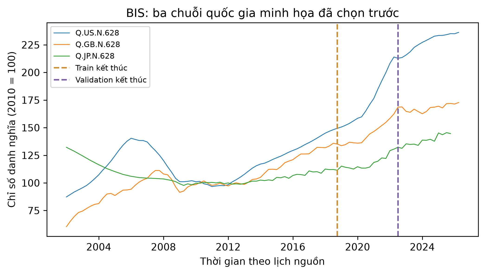

# ch4_bis_house_prices — dữ liệu và kiểm tra Phase 24

Phạm vi: **measured_timeseries**. Không huấn luyện hay đánh giá TEST trong Phase 24.

## Nguồn, kích cỡ và cấu trúc

Nguồn: [Bank for International Settlements (2026). Selected residential property prices (WS_SPP), BIS Data Portal; underlying national sources.](https://data.bis.org/static/bulk/WS_SPP_csv_col.zip)
Phiên bản: BIS WS_SPP selected residential property prices bulk snapshot; sha256:2ef20238c23983100a3ded6c1398a6026b3a18fe6b898520df2738c80d1aaebd

Giấy phép/phạm vi: BIS Terms of permitted use of statistics, not CC BY assumed. https://www.bis.org/about/legal/permitted-use-statistics ; attribute BIS and original national sources, label own calculations, do not imply endorsement. No raw redistribution in this repo.

Raw: 135,216 byte; 35780 nonmissing quarterly series-observations in entire raw bulk (not selected nominal panel).

Số đo và schema phần dùng trong V3:

```json
{
  "canonical_time_rows": 4689,
  "series": 49,
  "features": [
    "house_index",
    "index_change",
    "country_AT",
    "country_AU",
    "country_BE",
    "country_BG",
    "country_BR",
    "country_CA",
    "country_CH",
    "country_CL",
    "country_CN",
    "country_CO",
    "country_CY",
    "country_DE",
    "country_DK",
    "country_EE",
    "country_ES",
    "country_FI",
    "country_FR",
    "country_GB",
    "country_GR",
    "country_HK",
    "country_HR",
    "country_HU",
    "country_ID",
    "country_IE",
    "country_IL",
    "country_IS",
    "country_IT",
    "country_JP",
    "country_KR",
    "country_LT",
    "country_LV",
    "country_MA",
    "country_MK",
    "country_MT",
    "country_MX",
    "country_MY",
    "country_NL",
    "country_NO",
    "country_NZ",
    "country_PE",
    "country_PT",
    "country_RS",
    "country_RU",
    "country_SE",
    "country_SG",
    "country_SK",
    "country_TH",
    "country_US",
    "country_ZA"
  ],
  "lookback": 12,
  "horizons": [
    1,
    2,
    4
  ],
  "range": [
    "2002-01-01 00:00:00",
    "2026-04-01 00:00:00"
  ],
  "source_clock": "calendar markers; power civil clock as recorded, timezone/DST not reconstructed",
  "contract_time_encoding": "+00:00 is a normalized calendar coordinate for schema/ordering, NOT a claim that source measurements were timestamped in UTC",
  "valid_windows": 3660,
  "split": {
    "path": "data/splits/v3/ch4_bis_house_prices/split_contract.json",
    "sha256": "0525c25465cff66163dacd4d764c15707e216a3739762d28be08c0c222651e34",
    "size_bytes": 1585
  },
  "matched_subset": {
    "path": "data/splits/v3/ch4_bis_house_prices/matched_train.ids.jsonl.gz",
    "sha256": "5860881735bf9b4e2d4864cce30c2f44313c635fdd4ce335a60c3512c4bca65e",
    "size_bytes": 6946
  },
  "counts": {
    "train": 2504,
    "validation": 588,
    "test": 568
  },
  "matched_train_count": 2504,
  "quarantine_count": 0
}
```

## Mẫu input/output

Mẫu window thuộc matched train; known_output là giá trị tương lai đã có trong nguồn train, không phải dự đoán. Target thiếu không bao giờ được điền.

```json
[
  {
    "id": "Q.AT.N.628/2004-10-01T00:00:00",
    "input": {
      "context_start": "2002-01-01T00:00:00",
      "context_end": "2004-10-01T00:00:00",
      "last_values": {
        "house_index": 80.8486,
        "index_change": 1.7286000000000001,
        "country_AT": 1.0,
        "country_AU": 0.0
      }
    },
    "known_output": {
      "horizons": [
        1,
        2,
        4
      ],
      "target_times": [
        "2005-01-01T00:00:00",
        "2005-04-01T00:00:00",
        "2005-10-01T00:00:00"
      ],
      "values": [
        81.1628,
        81.9485,
        83.9914
      ]
    }
  },
  {
    "id": "Q.AT.N.628/2005-01-01T00:00:00",
    "input": {
      "context_start": "2002-04-01T00:00:00",
      "context_end": "2005-01-01T00:00:00",
      "last_values": {
        "house_index": 81.1628,
        "index_change": 0.3141999999999996,
        "country_AT": 1.0,
        "country_AU": 0.0
      }
    },
    "known_output": {
      "horizons": [
        1,
        2,
        4
      ],
      "target_times": [
        "2005-04-01T00:00:00",
        "2005-07-01T00:00:00",
        "2006-01-01T00:00:00"
      ],
      "values": [
        81.9485,
        82.0271,
        84.9342
      ]
    }
  },
  {
    "id": "Q.AT.N.628/2005-04-01T00:00:00",
    "input": {
      "context_start": "2002-07-01T00:00:00",
      "context_end": "2005-04-01T00:00:00",
      "last_values": {
        "house_index": 81.9485,
        "index_change": 0.7856999999999914,
        "country_AT": 1.0,
        "country_AU": 0.0
      }
    },
    "known_output": {
      "horizons": [
        1,
        2,
        4
      ],
      "target_times": [
        "2005-07-01T00:00:00",
        "2005-10-01T00:00:00",
        "2006-04-01T00:00:00"
      ],
      "values": [
        82.0271,
        83.9914,
        85.6413
      ]
    }
  }
]
```

## Phân bố và chất lượng dữ liệu

```json
{
  "target_observed_summary": {
    "count": 4689.0,
    "mean": 124.86578741735978,
    "std": 53.5634477795657,
    "min": 16.4856,
    "25%": 92.7579,
    "50%": 107.6851,
    "75%": 151.6941,
    "max": 416.5466
  },
  "missing_target_rows": 0,
  "calendar_boundaries": [
    "2018-10-01T00:00:00",
    "2022-07-01T00:00:00"
  ],
  "excluded_windows": {
    "cross_boundary": 294,
    "missing_target": 0,
    "unresolved_input": 0
  },
  "selected_series_count": 49,
  "per_series_counts": {
    "Q.AT.N.628": 98,
    "Q.AU.N.628": 98,
    "Q.BE.N.628": 97,
    "Q.BG.N.628": 97,
    "Q.BR.N.628": 98,
    "Q.CA.N.628": 98,
    "Q.CH.N.628": 98,
    "Q.CL.N.628": 97,
    "Q.CN.N.628": 85,
    "Q.CO.N.628": 97,
    "Q.CY.N.628": 97,
    "Q.DE.N.628": 97,
    "Q.DK.N.628": 97,
    "Q.EE.N.628": 85,
    "Q.ES.N.628": 97,
    "Q.FI.N.628": 97,
    "Q.FR.N.628": 98,
    "Q.GB.N.628": 98,
    "Q.GR.N.628": 98,
    "Q.HK.N.628": 98,
    "Q.HR.N.628": 97,
    "Q.HU.N.628": 97,
    "Q.ID.N.628": 98,
    "Q.IE.N.628": 98,
    "Q.IL.N.628": 97,
    "Q.IS.N.628": 98,
    "Q.IT.N.628": 98,
    "Q.JP.N.628": 96,
    "Q.KR.N.628": 98,
    "Q.LT.N.628": 98,
    "Q.LV.N.628": 82,
    "Q.MA.N.628": 86,
    "Q.MK.N.628": 98,
    "Q.MT.N.628": 85,
    "Q.MX.N.628": 86,
    "Q.MY.N.628": 98,
    "Q.NL.N.628": 97,
    "Q.NO.N.628": 98,
    "Q.NZ.N.628": 97,
    "Q.PE.N.628": 97,
    "Q.PT.N.628": 97,
    "Q.RS.N.628": 98,
    "Q.RU.N.628": 98,
    "Q.SE.N.628": 98,
    "Q.SG.N.628": 98,
    "Q.SK.N.628": 82,
    "Q.TH.N.628": 98,
    "Q.US.N.628": 98,
    "Q.ZA.N.628": 98
  },
  "selection": {
    "retained_series": [
      "Q.AT.N.628",
      "Q.AU.N.628",
      "Q.BE.N.628",
      "Q.BG.N.628",
      "Q.BR.N.628",
      "Q.CA.N.628",
      "Q.CH.N.628",
      "Q.CL.N.628",
      "Q.CN.N.628",
      "Q.CO.N.628",
      "Q.CY.N.628",
      "Q.DE.N.628",
      "Q.DK.N.628",
      "Q.EE.N.628",
      "Q.ES.N.628",
      "Q.FI.N.628",
      "Q.FR.N.628",
      "Q.GB.N.628",
      "Q.GR.N.628",
      "Q.HK.N.628",
      "Q.HR.N.628",
      "Q.HU.N.628",
      "Q.ID.N.628",
      "Q.IE.N.628",
      "Q.IL.N.628",
      "Q.IS.N.628",
      "Q.IT.N.628",
      "Q.JP.N.628",
      "Q.KR.N.628",
      "Q.LT.N.628",
      "Q.LV.N.628",
      "Q.MA.N.628",
      "Q.MK.N.628",
      "Q.MT.N.628",
      "Q.MX.N.628",
      "Q.MY.N.628",
      "Q.NL.N.628",
      "Q.NO.N.628",
      "Q.NZ.N.628",
      "Q.PE.N.628",
      "Q.PT.N.628",
      "Q.RS.N.628",
      "Q.RU.N.628",
      "Q.SE.N.628",
      "Q.SG.N.628",
      "Q.SK.N.628",
      "Q.TH.N.628",
      "Q.US.N.628",
      "Q.ZA.N.628"
    ],
    "excluded_series": [
      {
        "series": "Q.CZ.N.628",
        "reason": "fewer_than_80_nonmissing_observations"
      },
      {
        "series": "Q.IN.N.628",
        "reason": "fewer_than_80_nonmissing_observations"
      },
      {
        "series": "Q.LU.N.628",
        "reason": "fewer_than_80_nonmissing_observations"
      },
      {
        "series": "Q.PH.N.628",
        "reason": "fewer_than_80_nonmissing_observations"
      },
      {
        "series": "Q.PL.N.628",
        "reason": "fewer_than_80_nonmissing_observations"
      },
      {
        "series": "Q.RO.N.628",
        "reason": "fewer_than_80_nonmissing_observations"
      },
      {
        "series": "Q.SI.N.628",
        "reason": "fewer_than_80_nonmissing_observations"
      },
      {
        "series": "Q.TR.N.628",
        "reason": "fewer_than_80_nonmissing_observations"
      }
    ],
    "coverage": {
      "Q.AT.N.628": 160,
      "Q.AU.N.628": 226,
      "Q.BE.N.628": 225,
      "Q.BG.N.628": 113,
      "Q.BR.N.628": 102,
      "Q.CA.N.628": 226,
      "Q.CH.N.628": 226,
      "Q.CL.N.628": 97,
      "Q.CN.N.628": 85,
      "Q.CO.N.628": 153,
      "Q.CY.N.628": 97,
      "Q.CZ.N.628": 73,
      "Q.DE.N.628": 225,
      "Q.DK.N.628": 225,
      "Q.EE.N.628": 85,
      "Q.ES.N.628": 221,
      "Q.FI.N.628": 225,
      "Q.FR.N.628": 226,
      "Q.GB.N.628": 233,
      "Q.GR.N.628": 118,
      "Q.HK.N.628": 187,
      "Q.HR.N.628": 117,
      "Q.HU.N.628": 145,
      "Q.ID.N.628": 98,
      "Q.IE.N.628": 226,
      "Q.IL.N.628": 129,
      "Q.IN.N.628": 69,
      "Q.IS.N.628": 182,
      "Q.IT.N.628": 398,
      "Q.JP.N.628": 284,
      "Q.KR.N.628": 206,
      "Q.LT.N.628": 111,
      "Q.LU.N.628": 77,
      "Q.LV.N.628": 82,
      "Q.MA.N.628": 86,
      "Q.MK.N.628": 106,
      "Q.MT.N.628": 85,
      "Q.MX.N.628": 86,
      "Q.MY.N.628": 154,
      "Q.NL.N.628": 225,
      "Q.NO.N.628": 226,
      "Q.NZ.N.628": 256,
      "Q.PE.N.628": 113,
      "Q.PH.N.628": 73,
      "Q.PL.N.628": 65,
      "Q.PT.N.628": 153,
      "Q.RO.N.628": 69,
      "Q.RS.N.628": 106,
      "Q.RU.N.628": 102,
      "Q.SE.N.628": 226,
      "Q.SG.N.628": 114,
      "Q.SI.N.628": 77,
      "Q.SK.N.628": 82,
      "Q.TH.N.628": 142,
      "Q.TR.N.628": 66,
      "Q.US.N.628": 226,
      "Q.ZA.N.628": 242
    },
    "common_history_start": "2002-01-01T00:00:00",
    "history_rule": "earliest quarter with >=80% retained economies observed; schema/coverage only",
    "unit": "nominal index, 2010=100",
    "selection": "Q, N, 628; national economies only; >=80 nonmissing; no performance filter"
  }
}
```

## Cách chia tập và tiền xử lý

Split 70/15/15 theo lịch target chung. Mọi horizon của window phải ở cùng partition; context chỉ dùng quan sát trước target. Scaler/imputer chính fit prefix train, riêng từng rolling fold fit prefix của chính fold; không fit validation/test. Matched cap chỉ áp dụng train; giữ full validation/test. TEST RNN/LSTM mở chung ở Phase29 sau khóa cả hai họ.

## Nhận xét và giới hạn

- Chỉ VALUE=N và UNIT_MEASURE=628, chỉ số danh nghĩa 2010=100, không trộn Real/YoY.
- Loại aggregate; điều kiện coverage >=80, chọn lịch sử chung theo độ phủ 80% quốc gia, không theo giá trị/metric TEST.
- Bản đã revision, không có vintage/release calendar thật; kết quả là hồi cứu. Chỉ số khác giá nhà USD của Ames.

## Bằng chứng tái lập

Chi tiết: `artifacts/manifests/phase24/ch4_bis_house_prices/eda.json`.
Nguồn Phase23, raw và TEST Ch5 giữ nguyên; số đo mới không ghi ngược vào protocol.


