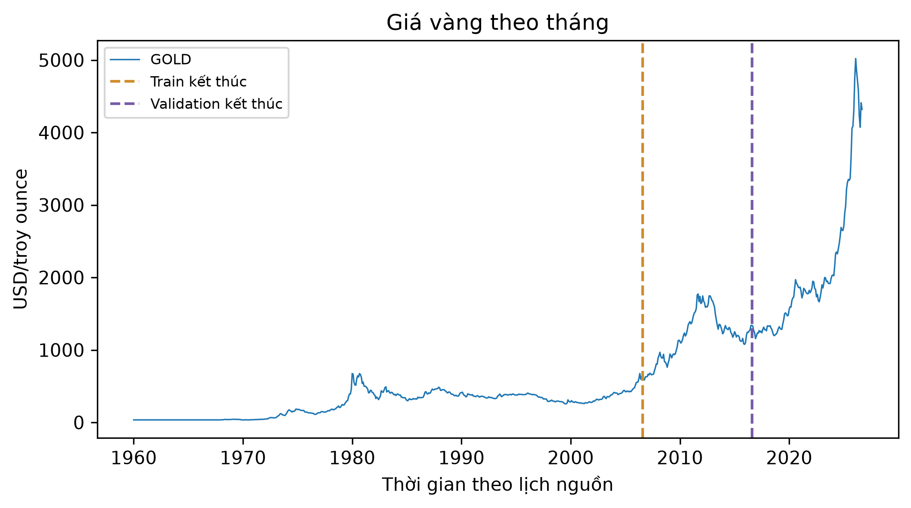

# ch4_gold_pink_sheet — dữ liệu và kiểm tra Phase 24

Phạm vi: **measured_timeseries**. Không huấn luyện hay đánh giá TEST trong Phase 24.

## Nguồn, kích cỡ và cấu trúc

Nguồn: [World Bank (2026). Commodity Price Data (The Pink Sheet), historical monthly data, October 2026 snapshot.](https://thedocs.worldbank.org/en/doc/74e8be41ceb20fa0da750cda2f6b9e4e-0050012026/related/CMO-Historical-Data-Monthly.xlsx)
Phiên bản: Pink Sheet October 2026 historical monthly workbook; latest revised vintage; sha256:ea1c350827878ea3bbe30e3cda16a13fd3bd5b409b8458940dc94a36b5a33154

Giấy phép/phạm vi: World Bank Commodity Prices - History and Projections catalog: CC BY 4.0. https://datacatalog.worldbank.org/search/dataset/0038238/commodity-prices-history-and-projections . Attribute World Bank and preserve unit/source notes. Not a real-time vintage.

Raw: 586,099 byte; 801 monthly observations, latest revised vintage.

Số đo và schema phần dùng trong V3:

```json
{
  "canonical_time_rows": 801,
  "series": 1,
  "features": [
    "gold",
    "silver_lag1",
    "platinum_lag1",
    "crude_oil_lag1"
  ],
  "lookback": 24,
  "horizons": [
    1,
    3,
    6
  ],
  "range": [
    "1960-01-01 00:00:00",
    "2026-09-01 00:00:00"
  ],
  "source_clock": "calendar markers; power civil clock as recorded, timezone/DST not reconstructed",
  "contract_time_encoding": "+00:00 is a normalized calendar coordinate for schema/ordering, NOT a claim that source measurements were timestamped in UTC",
  "valid_windows": 762,
  "split": {
    "path": "data/splits/v3/ch4_gold_pink_sheet/split_contract.json",
    "sha256": "91a1fb8d745b1017b056636d2d90c6ec3da35ce27b7c046a8045cf8d29f51ddb",
    "size_bytes": 1578
  },
  "matched_subset": {
    "path": "data/splits/v3/ch4_gold_pink_sheet/matched_train.ids.jsonl.gz",
    "sha256": "c9b193cc6d8d16d76c4d1343fbf7aa71723a01bbdbb0bf0e861a6f3a3ceab60a",
    "size_bytes": 1216
  },
  "counts": {
    "train": 531,
    "validation": 115,
    "test": 116
  },
  "matched_train_count": 531,
  "quarantine_count": 0
}
```

## Mẫu input/output

Mẫu window thuộc matched train; known_output là giá trị tương lai đã có trong nguồn train, không phải dự đoán. Target thiếu không bao giờ được điền.

```json
[
  {
    "id": "GOLD/1961-12-01T00:00:00",
    "input": {
      "context_start": "1960-01-01T00:00:00",
      "context_end": "1961-12-01T00:00:00",
      "last_values": {
        "gold": 35.0,
        "silver_lag1": 0.9,
        "platinum_lag1": 84.0,
        "crude_oil_lag1": 1.6
      }
    },
    "known_output": {
      "horizons": [
        1,
        3,
        6
      ],
      "target_times": [
        "1962-01-01T00:00:00",
        "1962-03-01T00:00:00",
        "1962-06-01T00:00:00"
      ],
      "values": [
        35,
        35,
        35
      ]
    }
  },
  {
    "id": "GOLD/1962-01-01T00:00:00",
    "input": {
      "context_start": "1960-02-01T00:00:00",
      "context_end": "1962-01-01T00:00:00",
      "last_values": {
        "gold": 35.0,
        "silver_lag1": 1.0,
        "platinum_lag1": 84.0,
        "crude_oil_lag1": 1.6
      }
    },
    "known_output": {
      "horizons": [
        1,
        3,
        6
      ],
      "target_times": [
        "1962-02-01T00:00:00",
        "1962-04-01T00:00:00",
        "1962-07-01T00:00:00"
      ],
      "values": [
        35,
        35,
        35
      ]
    }
  },
  {
    "id": "GOLD/1962-02-01T00:00:00",
    "input": {
      "context_start": "1960-03-01T00:00:00",
      "context_end": "1962-02-01T00:00:00",
      "last_values": {
        "gold": 35.0,
        "silver_lag1": 1.0,
        "platinum_lag1": 84.0,
        "crude_oil_lag1": 1.5
      }
    },
    "known_output": {
      "horizons": [
        1,
        3,
        6
      ],
      "target_times": [
        "1962-03-01T00:00:00",
        "1962-05-01T00:00:00",
        "1962-08-01T00:00:00"
      ],
      "values": [
        35,
        35,
        35
      ]
    }
  }
]
```

## Phân bố và chất lượng dữ liệu

```json
{
  "target_observed_summary": {
    "count": 801.0,
    "mean": 668.4631710362047,
    "std": 794.7810210708558,
    "min": 35.0,
    "25%": 159.0,
    "50%": 379.0,
    "75%": 1095.0,
    "max": 5020.0
  },
  "missing_target_rows": 0,
  "calendar_boundaries": [
    "2006-08-01T00:00:00",
    "2016-08-01T00:00:00"
  ],
  "excluded_windows": {
    "cross_boundary": 10,
    "missing_target": 0,
    "unresolved_input": 0
  },
  "selected_series_count": 1,
  "per_series_counts": {
    "GOLD": 801
  },
  "selection": {
    "publication_lag": "explanatory commodities lagged one month; revised vintage, not realtime"
  }
}
```

## Cách chia tập và tiền xử lý

Split 70/15/15 theo lịch target chung. Mọi horizon của window phải ở cùng partition; context chỉ dùng quan sát trước target. Scaler/imputer chính fit prefix train, riêng từng rolling fold fit prefix của chính fold; không fit validation/test. Matched cap chỉ áp dụng train; giữ full validation/test. TEST RNN/LSTM mở chung ở Phase29 sau khóa cả hai họ.

## Nhận xét và giới hạn

- Giá vàng USD/troy ounce; silver/platinum/crude oil giữ đơn vị nguồn và trễ một tháng.
- Snapshot đã chỉnh sửa hồi tố, không phải mô phỏng dữ liệu sẵn có theo vintage tại thời điểm thật.
- Chuỗi tháng ít mẫu; không tuyên bố khả năng giao dịch hoặc khuyến nghị đầu tư.

## Bằng chứng tái lập

Chi tiết: `artifacts/manifests/phase24/ch4_gold_pink_sheet/eda.json`.
Nguồn Phase23, raw và TEST Ch5 giữ nguyên; số đo mới không ghi ngược vào protocol.


