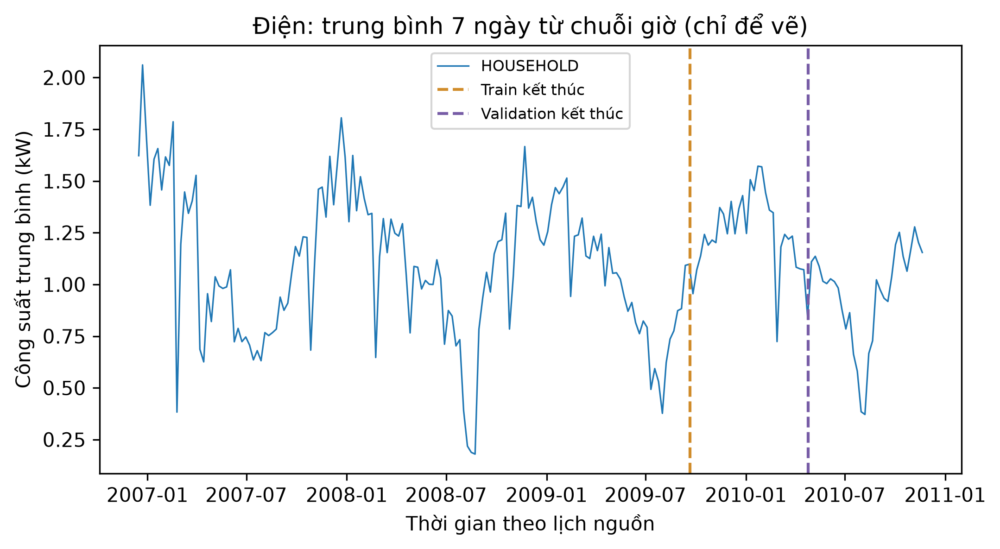

# ch4_household_power — dữ liệu và kiểm tra Phase 24

Phạm vi: **measured_timeseries**. Không huấn luyện hay đánh giá TEST trong Phase 24.

## Nguồn, kích cỡ và cấu trúc

Nguồn: [Hebrail, G. and Berard, A. (2006). Individual Household Electric Power Consumption. UCI. DOI:10.24432/C58K54.](https://archive.ics.uci.edu/static/public/235/individual+household+electric+power+consumption.zip)
Phiên bản: UCI 235 original minute-resolution household power release; sha256:9f84b46ade8a2d8e1286ec4b2b6c2987a45a755c59f263be3b3b3d10dfbda3ff

Giấy phép/phạm vi: CC BY 4.0. https://archive.ics.uci.edu/dataset/235/individual+household+electric+power+consumption . Single household, not population-independent evidence.

Raw: 20,640,916 byte; 2075259 raw minute rows, NOT hourly training windows.

Số đo và schema phần dùng trong V3:

```json
{
  "canonical_time_rows": 34589,
  "series": 1,
  "features": [
    "Global_active_power",
    "Global_active_power_missing",
    "Global_reactive_power",
    "Global_reactive_power_missing",
    "Voltage",
    "Voltage_missing",
    "Global_intensity",
    "Global_intensity_missing",
    "Sub_metering_1",
    "Sub_metering_1_missing",
    "Sub_metering_2",
    "Sub_metering_2_missing",
    "Sub_metering_3",
    "Sub_metering_3_missing"
  ],
  "lookback": 168,
  "horizons": [
    1,
    6,
    24
  ],
  "range": [
    "2006-12-16 17:00:00",
    "2010-11-26 21:00:00"
  ],
  "source_clock": "calendar markers; power civil clock as recorded, timezone/DST not reconstructed",
  "contract_time_encoding": "+00:00 is a normalized calendar coordinate for schema/ordering, NOT a claim that source measurements were timestamped in UTC",
  "valid_windows": 33741,
  "split": {
    "path": "data/splits/v3/ch4_household_power/split_contract.json",
    "sha256": "90053761ae0a15d0faa3323fb1a1261425d5204ab0e74416c225613e68f498b8",
    "size_bytes": 1582
  },
  "matched_subset": {
    "path": "data/splits/v3/ch4_household_power/matched_train.ids.jsonl.gz",
    "sha256": "f6de2e1df1ddc0a78130d7bd5ccfe432dc94f143f295d176076ddd3049750a72",
    "size_bytes": 30872
  },
  "counts": {
    "train": 23797,
    "validation": 5033,
    "test": 4911
  },
  "matched_train_count": 12000,
  "quarantine_count": 0
}
```

## Mẫu input/output

Mẫu window thuộc matched train; known_output là giá trị tương lai đã có trong nguồn train, không phải dự đoán. Target thiếu không bao giờ được điền.

```json
[
  {
    "id": "HOUSEHOLD/2006-12-23T20:00:00",
    "input": {
      "context_start": "2006-12-16T21:00:00",
      "context_end": "2006-12-23T20:00:00",
      "last_values": {
        "Global_active_power": 4.1814,
        "Global_active_power_missing": 0.0,
        "Global_reactive_power": 0.12476666666666666,
        "Global_reactive_power_missing": 0.0
      }
    },
    "known_output": {
      "horizons": [
        1,
        6,
        24
      ],
      "target_times": [
        "2006-12-23T21:00:00",
        "2006-12-24T02:00:00",
        "2006-12-24T20:00:00"
      ],
      "values": [
        3.2884333333333333,
        2.303033333333333,
        0.4741
      ]
    }
  },
  {
    "id": "HOUSEHOLD/2006-12-23T23:00:00",
    "input": {
      "context_start": "2006-12-17T00:00:00",
      "context_end": "2006-12-23T23:00:00",
      "last_values": {
        "Global_active_power": 5.5624666666666664,
        "Global_active_power_missing": 0.0,
        "Global_reactive_power": 0.12806666666666666,
        "Global_reactive_power_missing": 0.0
      }
    },
    "known_output": {
      "horizons": [
        1,
        6,
        24
      ],
      "target_times": [
        "2006-12-24T00:00:00",
        "2006-12-24T05:00:00",
        "2006-12-24T23:00:00"
      ],
      "values": [
        4.0280000000000005,
        1.6319000000000001,
        0.48633333333333334
      ]
    }
  },
  {
    "id": "HOUSEHOLD/2006-12-24T00:00:00",
    "input": {
      "context_start": "2006-12-17T01:00:00",
      "context_end": "2006-12-24T00:00:00",
      "last_values": {
        "Global_active_power": 4.0280000000000005,
        "Global_active_power_missing": 0.0,
        "Global_reactive_power": 0.09066666666666667,
        "Global_reactive_power_missing": 0.0
      }
    },
    "known_output": {
      "horizons": [
        1,
        6,
        24
      ],
      "target_times": [
        "2006-12-24T01:00:00",
        "2006-12-24T06:00:00",
        "2006-12-25T00:00:00"
      ],
      "values": [
        3.2757,
        1.8952,
        0.9995666666666667
      ]
    }
  }
]
```

## Phân bố và chất lượng dữ liệu

```json
{
  "target_observed_summary": {
    "count": 34151.0,
    "mean": 1.0916107761526015,
    "std": 0.8975997510598066,
    "min": 0.12400000000000001,
    "25%": 0.3419,
    "50%": 0.8026666666666666,
    "75%": 1.5792666666666666,
    "max": 6.560533333333334
  },
  "missing_target_rows": 438,
  "calendar_boundaries": [
    "2009-09-20T12:00:00",
    "2010-04-24T16:00:00"
  ],
  "excluded_windows": {
    "cross_boundary": 46,
    "missing_target": 611,
    "unresolved_input": 0
  },
  "selected_series_count": 1,
  "per_series_counts": {
    "HOUSEHOLD": 34151
  },
  "selection": {
    "raw_minute_rows": 2075259,
    "observed_minute_threshold": 45,
    "input_ffill_hours": 6,
    "target_imputation": "never",
    "sensor_units": {
      "Global_active_power": "kW",
      "Global_reactive_power": "kVAR",
      "Voltage": "V",
      "Global_intensity": "A",
      "Sub_metering_1/2/3": "Wh/min observations, hourly mean not summed kWh"
    }
  }
}
```

## Cách chia tập và tiền xử lý

Split 70/15/15 theo lịch target chung. Mọi horizon của window phải ở cùng partition; context chỉ dùng quan sát trước target. Scaler/imputer chính fit prefix train, riêng từng rolling fold fit prefix của chính fold; không fit validation/test. Matched cap chỉ áp dụng train; giữ full validation/test. TEST RNN/LSTM mở chung ở Phase29 sau khóa cả hai họ.

## Nhận xét và giới hạn

- Đích là kW trung bình giờ, không phải kWh. Một giờ cần >=45 phút quan sát.
- Không điền nhãn thiếu. Chỉ input ffill tối đa 6 giờ, sau đó imputer fit train và kèm cờ thiếu.
- Một hộ gia đình, không bảo đảm tổng quát hóa cho hộ khác; không shuffle thời gian.

## Bằng chứng tái lập

Chi tiết: `artifacts/manifests/phase24/ch4_household_power/eda.json`.
Nguồn Phase23, raw và TEST Ch5 giữ nguyên; số đo mới không ghi ngược vào protocol.


