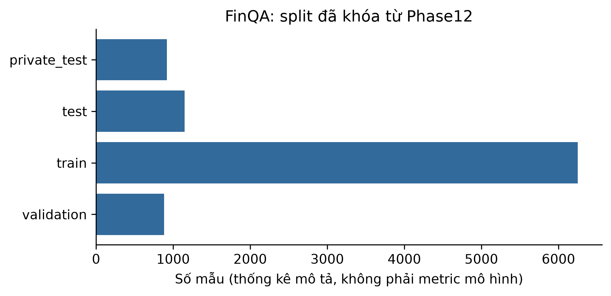

# ch5_finqa — dữ liệu và kiểm tra Phase 24

Phạm vi: **historical_baseline_READ_ONLY**. Không huấn luyện hay đánh giá TEST trong Phase 24.

## Nguồn, kích cỡ và cấu trúc

Nguồn: [Chen, Z. et al. (2021). FinQA: A Dataset of Numerical Reasoning over Financial Data. EMNLP. https://aclanthology.org/2021.emnlp-main.300/](https://github.com/czyssrs/FinQA)
Phiên bản: 0f16e2867befa6840783e58be38c9efb9229d742

Giấy phép/phạm vi: MIT; original license evidence and bytes preserved; do not re-download. Follow original restrictions and source attribution.

Raw: 122,256,362 byte; 9200 raw QA records including private_test.

Số đo và schema phần dùng trong V3:

```json
{
  "records": 9200,
  "features": null,
  "unit": "raw QA records including private_test",
  "frozen_slice": {
    "documents": 2789,
    "chunks": 86421,
    "queries": 9200,
    "evidence": 14108,
    "split_distribution": {
      "private_test": 919,
      "test": 1147,
      "train": 6251,
      "validation": 883
    },
    "document_split_distribution": {
      "test": 380,
      "train": 2110,
      "validation": 299
    },
    "page_group_distribution": {
      "private_test": 303,
      "test": 380,
      "train": 2110,
      "validation": 299
    },
    "public_page_group_overlaps": {
      "train__validation": 0,
      "train__test": 0,
      "validation__test": 0
    },
    "public_report_key_overlaps": {
      "train__validation": 197,
      "train__test": 243,
      "validation__test": 93
    },
    "private_test_page_overlap_with_test": 303,
    "gold_locator_missing": [],
    "gold_text_exact_spacing_mismatch_count": 328,
    "gold_text_token_mismatch_count": 0,
    "gold_text_token_mismatch_examples": []
  }
}
```

## Mẫu input/output

FinQA: raw official train. MedQuAD: ánh xạ ID -> trích đoạn corpus retrieval công khai đã đóng gói, không gán train/test vì bundle không có split, không phải QA gold hay output mô hình. Wikidata: cấu trúc snapshot. Không đọc lại TEST query/prediction để tạo ví dụ hay tính metric.

```json
[
  {
    "input": "what is the the interest expense in 2009?",
    "known_output": {
      "answer": "380",
      "program": "divide(100, 100), divide(3.8, #0)"
    }
  },
  {
    "input": "during the 2012 year , did the equity awards in which the prescribed performance milestones were achieved exceed the equity award compensation expense for equity granted during the year?",
    "known_output": {
      "answer": "",
      "program": "multiply(607, 18.13), multiply(#0, const_1000), multiply(3.3, const_1000000), greater(#1, #2)"
    }
  },
  {
    "input": "what was the total operating expenses in 2018 in millions",
    "known_output": {
      "answer": "41932",
      "program": "divide(9896, 23.6%)"
    }
  }
]
```

## Phân bố và chất lượng dữ liệu

```json
{
  "private_test": 919,
  "test": 1147,
  "train": 6251,
  "validation": 883
}
```

## Cách chia tập và tiền xử lý

Kế thừa manifest Phase12 và audit đã khóa; không chia lại, fit lại hay chạy TEST. Ch5 run_count vẫn 1; Wikidata chỉ structural audit.

## Nhận xét và giới hạn

- Re-use split/audit Phase12. Private_test tồn tại trong raw nhưng không phải nhãn được phép đánh giá.
- Page-group overlap giữa các public split =0, nhưng report-key overlap khác 0 (197/243/93); không tuyên bố độc lập theo công ty/báo cáo.

## Bằng chứng tái lập

Chi tiết: `artifacts/manifests/phase24/ch5_finqa/eda.json`.
Nguồn Phase23, raw và TEST Ch5 giữ nguyên; số đo mới không ghi ngược vào protocol.


