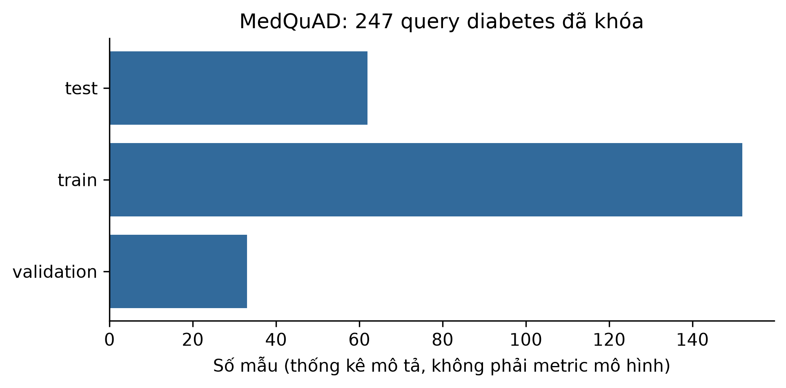

# ch5_medquad_diabetes — dữ liệu và kiểm tra Phase 24

Phạm vi: **historical_baseline_READ_ONLY**. Không huấn luyện hay đánh giá TEST trong Phase 24.

## Nguồn, kích cỡ và cấu trúc

Nguồn: [Abacha, A. and Demner-Fushman, D. (2019). A question-entailment approach to question answering. BMC Bioinformatics 20:511. MedQuAD.](https://github.com/abachaa/MedQuAD)
Phiên bản: 577bd37b96c02d1833b2c9eed2de9f96964e96cb

Giấy phép/phạm vi: CC BY 4.0; original license evidence and bytes preserved; do not re-download. Follow original restrictions and source attribution. Some copyrighted upstream answers were removed by MedQuAD; empty answers must not be reconstructed from another source.

Raw: 37,183,352 byte; 47441 QA pairs in entire preserved upstream corpus, NOT diabetes-only split.

Số đo và schema phần dùng trong V3:

```json
{
  "records": 47441,
  "features": null,
  "unit": "QA pairs in entire preserved upstream corpus, NOT diabetes-only split",
  "frozen_slice": {
    "candidate_records": 274,
    "deduplicated_queries": 247,
    "exact_duplicates_removed": 27,
    "documents": 247,
    "chunks": 762,
    "queries": 247,
    "evidence": 762,
    "groups": 62,
    "split_distribution": {
      "test": 62,
      "train": 152,
      "validation": 33
    }
  }
}
```

## Mẫu input/output

FinQA: raw official train. MedQuAD: ánh xạ ID -> trích đoạn corpus retrieval công khai đã đóng gói, không gán train/test vì bundle không có split, không phải QA gold hay output mô hình. Wikidata: cấu trúc snapshot. Không đọc lại TEST query/prediction để tạo ví dụ hay tính metric.

```json
[
  {
    "input": "med-chunk-007e45eccdb7816d5e0c",
    "known_output": "- Starting a physical activity program can help you lose weight or keep a healthy weight and keep your blood glucose levels on target. - Always talk with your health care team before you start a new physical activity program. - Ask your health care team if you need to change the amount of medicine you take or the food you eat before any physical activity. - Talk with your health care team about what types of physical activity are safe for you, such as walking, weightlifting, or housework. - To m",
    "scope": "published retrieval corpus evidence, benchmark question split unknown; not a QA query/gold or model output"
  },
  {
    "input": "med-chunk-00bc631490478ac2cf94",
    "known_output": "well. Children have a higher risk of type 2 diabetes if they are obese, have a family history of diabetes, or are not active, and do not eat well. To lower the risk of type 2 diabetes in children - Have them maintain a healthy weight - Be sure they are physically active - Have them eat smaller portions of healthy foods - Limit time with the TV, computer, and video Children and teens with type 1 diabetes may need to take insulin. Type 2 diabetes may be controlled with diet and exercise. If not, p",
    "scope": "published retrieval corpus evidence, benchmark question split unknown; not a QA query/gold or model output"
  },
  {
    "input": "med-chunk-00d0cff90bb719155edf",
    "known_output": "healthy tissues by mistake, signaling the body to attack them. At present, scientists do not know exactly what causes the body's immune system to attack the cells, but many believe that both genetic factors and environmental factors, such as viruses, are involved. Studies are now underway to identify these factors and prevent type 1 diabetes in people at risk. Learn more about the causes of type 1 diabetes. Type 2 Diabetes Type 2 diabetes -- the most common form -- is linked closely to overweigh",
    "scope": "published retrieval corpus evidence, benchmark question split unknown; not a QA query/gold or model output"
  }
]
```

## Phân bố và chất lượng dữ liệu

```json
{
  "test": 62,
  "train": 152,
  "validation": 33
}
```

## Cách chia tập và tiền xử lý

Kế thừa manifest Phase12 và audit đã khóa; không chia lại, fit lại hay chạy TEST. Ch5 run_count vẫn 1; Wikidata chỉ structural audit.

## Nhận xét và giới hạn

- Nguồn upstream có 47.441 QAPair, nhưng lát cắt diabetes khóa chỉ 247 query/62 nhóm; không đánh đồng hai mẫu số.
- Kế thừa 27 bản trùng đã loại và split 152/33/62; không rebuild filter/split hoặc đánh giá lại TEST.

## Bằng chứng tái lập

Chi tiết: `artifacts/manifests/phase24/ch5_medquad_diabetes/eda.json`.
Nguồn Phase23, raw và TEST Ch5 giữ nguyên; số đo mới không ghi ngược vào protocol.


