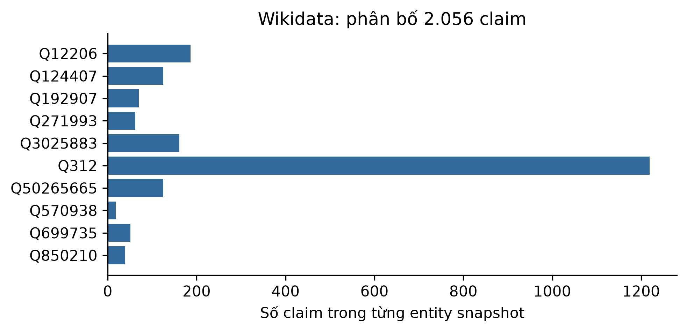

# ch5_wikidata_subgraphs — dữ liệu và kiểm tra Phase 24

Phạm vi: **historical_baseline_READ_ONLY**. Không huấn luyện hay đánh giá TEST trong Phase 24.

## Nguồn, kích cỡ và cấu trúc

Nguồn: [Wikidata contributors. EntityData snapshots, exact revision IDs in Phase11 snapshot manifest.](https://www.wikidata.org/wiki/Wikidata:Data_access)
Phiên bản: Phase11 exact Wikidata revision IDs

Giấy phép/phạm vi: CC0 1.0; original license evidence and bytes preserved; do not re-download. Follow original restrictions and source attribution.

Raw: 3,528,666 byte; 10 narrow entity snapshots, not a QA benchmark.

Số đo và schema phần dùng trong V3:

```json
{
  "records": 10,
  "features": null,
  "unit": "narrow entity snapshots, not a QA benchmark",
  "frozen_slice": {
    "records": 10,
    "features": null,
    "unit": "narrow entity snapshots, not a QA benchmark",
    "columns": [],
    "claims": 2056,
    "checks": [
      "revision_snapshot_hashes",
      "all_raw_files_match_phase20_baseline"
    ],
    "deferred": "Structural/provenance audit only; not an invented third QA TEST dataset."
  }
}
```

## Mẫu input/output

FinQA: raw official train. MedQuAD: ánh xạ ID -> trích đoạn corpus retrieval công khai đã đóng gói, không gán train/test vì bundle không có split, không phải QA gold hay output mô hình. Wikidata: cấu trúc snapshot. Không đọc lại TEST query/prediction để tạo ví dụ hay tính metric.

```json
[
  {
    "input": "Q12206",
    "known_output": {
      "revision": 2554502707,
      "claim_count": 186,
      "property_ids": [
        "P10283",
        "P1036",
        "P10376",
        "P1051",
        "P10565"
      ]
    }
  },
  {
    "input": "Q124407",
    "known_output": {
      "revision": 2556005597,
      "claim_count": 125,
      "property_ids": [
        "P10283",
        "P10376",
        "P10380",
        "P11143",
        "P11196"
      ]
    }
  },
  {
    "input": "Q192907",
    "known_output": {
      "revision": 2556173446,
      "claim_count": 70,
      "property_ids": [
        "P1014",
        "P10283",
        "P1036",
        "P10376",
        "P10565"
      ]
    }
  }
]
```

## Phân bố và chất lượng dữ liệu

```json
{
  "Q12206": 186,
  "Q124407": 125,
  "Q192907": 70,
  "Q271993": 62,
  "Q3025883": 161,
  "Q312": 1219,
  "Q50265665": 125,
  "Q570938": 18,
  "Q699735": 51,
  "Q850210": 39
}
```

## Cách chia tập và tiền xử lý

Kế thừa manifest Phase12 và audit đã khóa; không chia lại, fit lại hay chạy TEST. Ch5 run_count vẫn 1; Wikidata chỉ structural audit.

## Nhận xét và giới hạn

- KG hỗ trợ với 10 entity/2.056 claim, không phải benchmark QA thứ ba.
- Giữ revision/hash nguồn, chỉ audit cấu trúc; không thực hiện truy vấn web mới.

## Bằng chứng tái lập

Chi tiết: `artifacts/manifests/phase24/ch5_wikidata_subgraphs/eda.json`.
Nguồn Phase23, raw và TEST Ch5 giữ nguyên; số đo mới không ghi ngược vào protocol.


