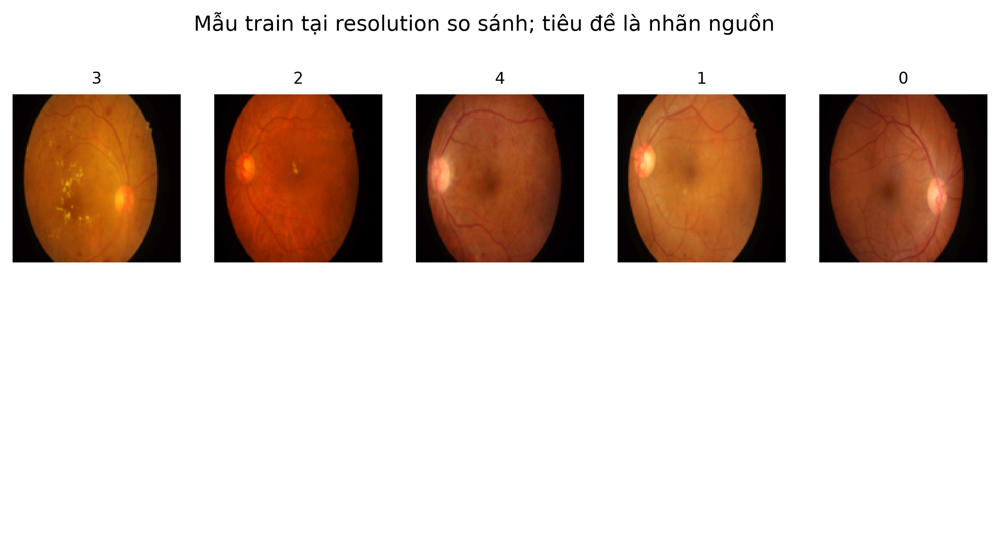
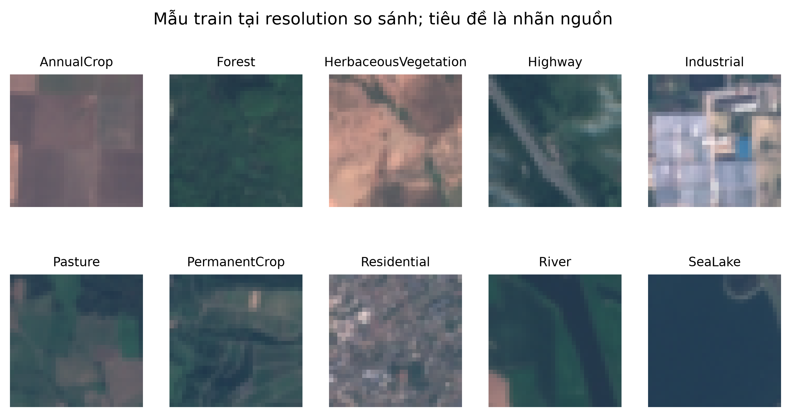
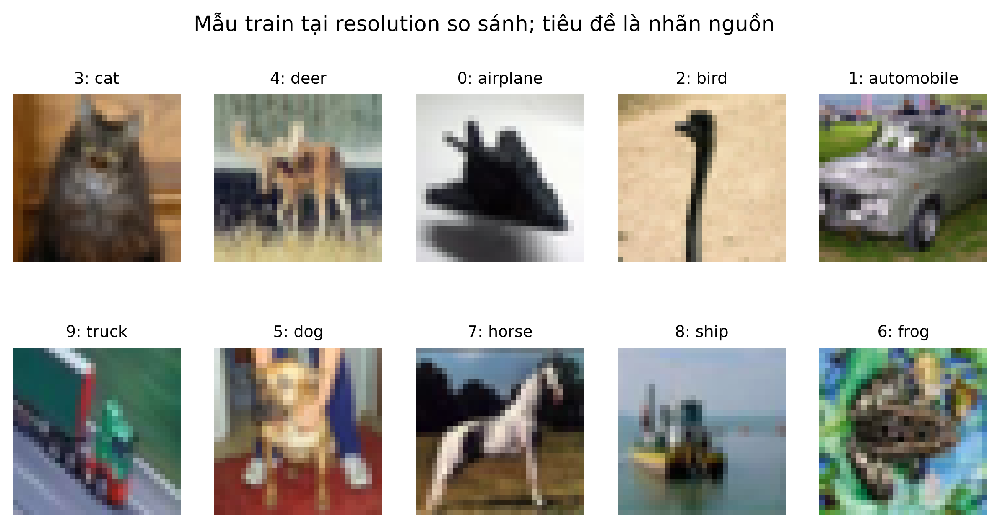
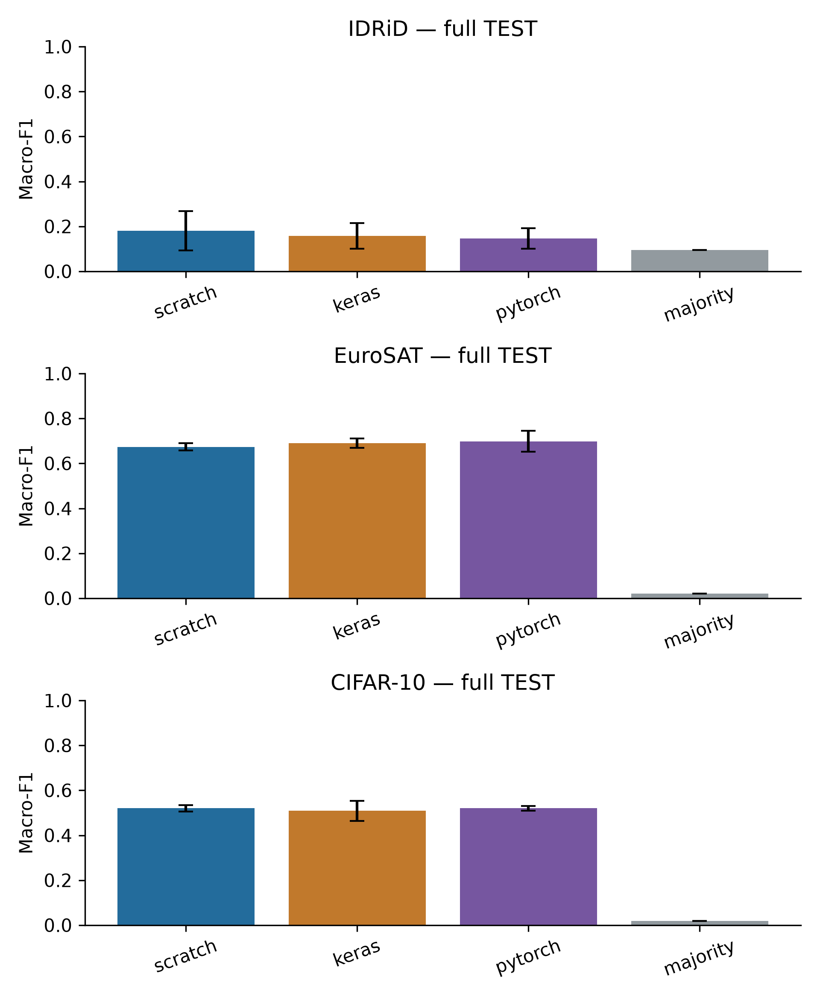
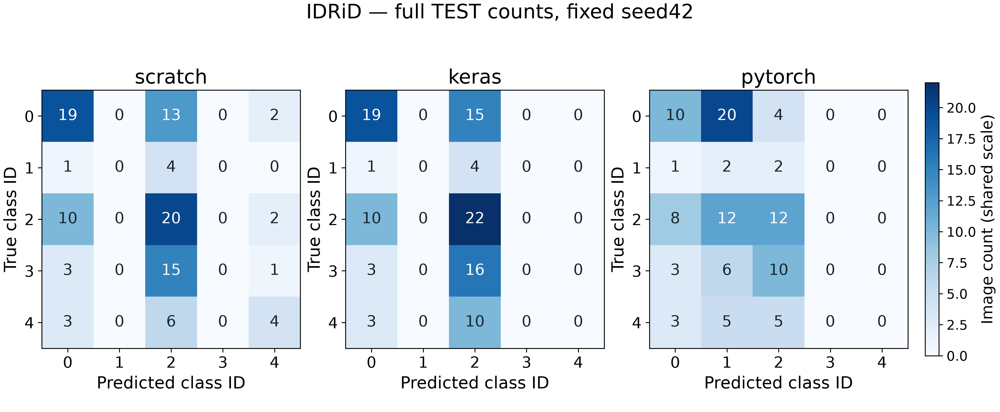
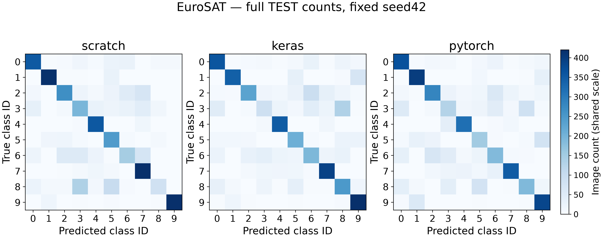
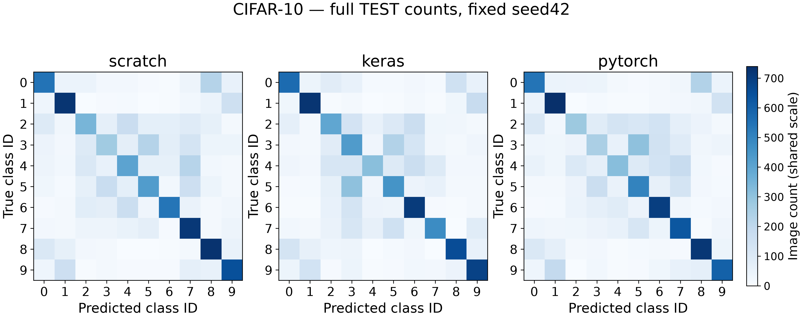
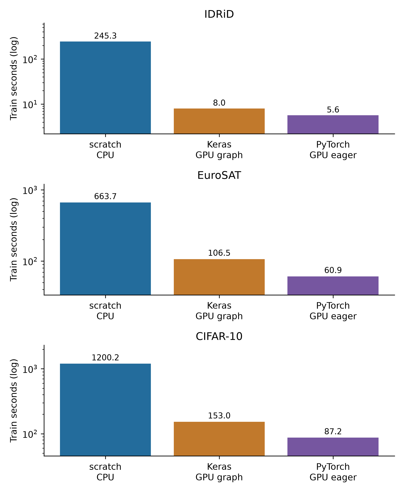
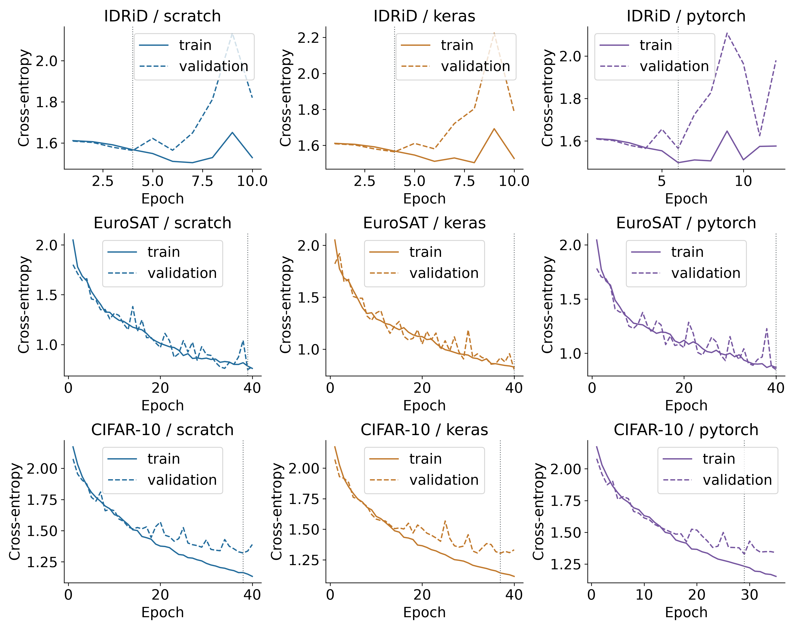
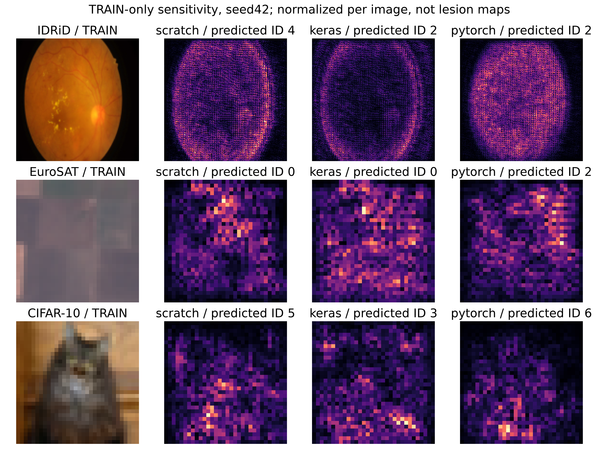

# CHƯƠNG 3. MẠNG NƠ-RON TÍCH CHẬP (CNN)

## 3.1. Mở đầu

Một ảnh RGB không chỉ là danh sách các con số: vị trí của từng điểm ảnh và quan hệ với vùng lân cận cũng mang thông tin. Khi phân biệt rừng với khu dân cư, mô hình cần nhận ra những mẫu màu và cấu trúc lặp lại. Với ảnh đáy mắt, các chi tiết nhỏ có thể liên quan đến nhãn mức độ bệnh đã được chuyên gia gán trong bộ dữ liệu. Việc làm phẳng toàn bộ ảnh ngay từ đầu khiến quan hệ không gian khó được khai thác trực tiếp.

Mạng nơ-ron tích chập, hay Convolutional Neural Network (CNN), xử lý các vùng ảnh bằng những bộ lọc có thể học. Các lớp đầu tạo đặc trưng cục bộ; các lớp sau kết hợp đặc trưng đó trước khi đưa ra điểm số cho từng lớp. Chương này dùng CNN cho ba bài toán: phân loại DR grade trên IDRiD, lớp phủ đất trên EuroSAT và vật thể trên CIFAR-10. Đây là ba miền có mức độ chi tiết và quy mô khác nhau, không phải ba tập thay thế cho nhau.

Câu hỏi thực nghiệm là: khi giữ nguyên ảnh đầu vào, kiến trúc, trọng số khởi tạo và lịch batch, cách tự viết bằng NumPy, Keras và PyTorch khác nhau thế nào về chất lượng và chi phí chạy? Mục tiêu là hiểu và kiểm chứng cách triển khai, không cạnh tranh với các mạng pretrained lớn. Đặc biệt, mô hình IDRiD chỉ phục vụ học thuật, không dùng để chẩn đoán hay quyết định điều trị.

## 3.2. Các thành phần cơ bản

### 3.2.1. Ảnh, kênh màu và batch

Một ảnh màu được biểu diễn bằng chiều cao, chiều rộng và ba kênh đỏ–lục–lam. Ví dụ, một ảnh CIFAR-10 có shape `[32,32,3]`; một batch 16 ảnh có shape canonical `[16,32,32,3]`. Sau khi giải mã RGB và resize bằng Pillow BILINEAR, giá trị uint8 từ 0 đến 255 được đổi thành float32 rồi chia 255. Đây là phép đổi thang cố định, không phải thống kê fit trên validation hoặc TEST.

Scratch và Keras dùng NHWC: batch, cao, rộng, kênh. PyTorch thực hiện các phép tích chập ở NCHW: batch, kênh, cao, rộng. Adapter đổi layout, không đổi nội dung hay thứ tự ID. Trong các hàm parity, đầu vào vẫn là NHWC và TorchBackend tự chuyển nội bộ; chuyển vị thêm một lần bên ngoài sẽ làm sai dữ liệu. Hai định dạng này cũng được mô tả trong [tài liệu Conv2D của Keras](https://keras.io/api/layers/convolution_layers/convolution2d/) và [Conv2d của PyTorch](https://docs.pytorch.org/docs/2.14/generated/torch.nn.Conv2d.html).

### 3.2.2. Tích chập: học một bộ lọc dùng ở nhiều vị trí

Có thể hình dung một bộ lọc 3×3 như một cửa sổ nhỏ trượt trên ảnh. Tại mỗi vị trí, mô hình nhân các giá trị trong cửa sổ với trọng số tương ứng, cộng chúng rồi thêm bias. Cùng một bộ trọng số được dùng ở nhiều vị trí. Nhiều bộ lọc tạo thành nhiều kênh đặc trưng đầu ra.

Biểu thức cần để đọc code là `y = conv_same(x,W) + b`. Ở đây `x` là batch ảnh/đặc trưng, `W` là bộ lọc học được, `b` là bias theo kênh đầu ra và `y` là bản đồ đặc trưng mới. `conv_same` trong thí nghiệm dùng bộ lọc 3×3, stride 1 và đệm một hàng/cột số 0 quanh biên, nên giữ chiều cao/rộng. Tên convolution trong hai framework ở đây dùng phép tương quan chéo, không lật kernel; scratch dùng đúng cùng quy ước, được kiểm bằng parity.

Ví dụ, Conv đầu nhận `[B,32,32,3]`, có 8 bộ lọc và trả `[B,32,32,8]`. Bộ trọng số canonical có shape `[3,3,3,8]`; thêm 8 bias được 224 tham số. Mỗi bộ lọc dùng chung ở mọi vị trí nên số tham số không tăng khi thay ảnh 32×32 bằng ảnh 128×128. Tuy nhiên, số phép tính và bộ nhớ kích hoạt vẫn tăng theo diện tích ảnh.

Trong scratch, code duyệt chín vị trí của kernel và dùng `np.einsum` để nhân–cộng theo kênh. Đây là phép tính mảng NumPy, không gọi layer hay autograd của framework. Phần backward tự cộng gradient trọng số từ các vùng ảnh và phân phối gradient về các điểm ảnh đầu vào. Mã đầy đủ nằm trong `src/common/numpy_engine.py` đã được kiểm chứng ở Phase25; không chỉ có hàm forward.

### 3.2.3. ReLU và pooling

ReLU giữ giá trị dương và đưa giá trị âm về 0. Nó tạo khả năng biểu diễn phi tuyến nhưng không thay shape và không có tham số học được. Khi truyền ngược, vị trí có đầu vào dương cho gradient đi qua; vị trí còn lại nhận 0 theo quy ước của core.

Max pooling 2×2 giữ giá trị lớn nhất của mỗi ô 2×2, làm chiều cao/rộng giảm một nửa. Ví dụ minh họa synthetic, ô có các số `[1,4;2,3]` trở thành `4`. Backward đưa gradient về vị trí cực đại đã lưu; nếu có nhiều giá trị bằng nhau, scratch chọn vị trí đầu theo thứ tự duyệt. Việc kiểm tra gradient tránh điểm không trơn và đối chiếu backend, không suy rằng mọi trường hợp đồng hạng sẽ có gradient duy nhất về mặt toán học.

Sau lớp Conv cuối, global average pooling lấy trung bình theo hai chiều không gian của từng kênh. Với `[B,8,8,32]`, kết quả là `[B,32]`. Bước này tạo một vector đặc trưng gọn trước Dense. Nó có thể làm mất thông tin vị trí chi tiết; đây là giới hạn đáng chú ý ở bài toán ảnh y khoa. ReLU, max pooling và global average pooling đều không được tính vào bảy lớp học được.

### 3.2.4. Dense, logits, softmax và loss

Dense kết hợp các đặc trưng theo phép `z = xW + b`. Trong chương này, Dense32 nhận 32 đặc trưng sau global pooling và tạo 32 giá trị mới; Dense cuối tạo 5 logit cho IDRiD hoặc 10 logit cho hai bộ còn lại. Logit chỉ là điểm số chưa chuẩn hóa, không phải xác suất.

Softmax chuyển các logit thành xác suất có tổng bằng 1. Code trừ logit lớn nhất của từng mẫu trước khi lấy hàm mũ để tránh tràn số; phép trừ chung này không thay kết quả softmax. Lớp dự đoán là lớp có xác suất lớn nhất. Nếu bằng nhau, `argmax` chọn ID nhỏ hơn theo thứ tự cố định.

Cross-entropy phạt dự đoán đặt xác suất thấp vào nhãn thật. Scratch tính loss ổn định và gradient tại logits rồi tự lan truyền ngược; hai backend native dùng phép loss tương ứng trên cùng nhãn ID. IDRiD dùng trọng số lớp đã fit từ train để tăng đóng góp của lớp ít mẫu. Loss có trọng số được chia cho tổng trọng số của batch, không chia tùy ý theo số ảnh. Metric cuối vẫn tính trên các ảnh thật, không nhân trọng số để làm đẹp accuracy/F1.

Adam cập nhật trọng số từ gradient và hai bộ nhớ moment. Cả ba đường dùng learning rate 0,001, betas 0,9/0,999, epsilon 1e-7 sau căn của moment bình phương đã hiệu chỉnh, cùng giới hạn global gradient norm bằng 1. Keras ở đây dùng cập nhật TensorFlow native với slots rõ ràng để khớp quy ước đã khóa; không thay bằng stock Adam có quy ước epsilon khác.

## 3.3. Kiến trúc và hợp các hàm

### 3.3.1. Bảy lớp học được

Luồng tổng quát là:

`Ảnh RGB → resize/rescale → Conv8/ReLU → Conv8/ReLU → MaxPool → Conv16/ReLU → Conv16/ReLU → MaxPool → Conv32/ReLU → GlobalAverage → Dense32/ReLU → DenseC → softmax → nhãn/xác suất`.

`B` là batch size, `C` là số lớp. Có **5 Conv + 2 Dense = 7 lớp có tham số học được**. Đếm lớp không dựa vào số dòng code, số đối tượng container hay số bước pooling.

| Bước | IDRiD: shape một mẫu | EuroSAT/CIFAR-10: shape một mẫu | Tham số |
|---|---|---|---:|
| RGB đã resize | 128×128×3 | 32×32×3 | 0 |
| Conv1 + ReLU | 128×128×8 | 32×32×8 | 224 |
| Conv2 + ReLU | 128×128×8 | 32×32×8 | 584 |
| MaxPool1 | 64×64×8 | 16×16×8 | 0 |
| Conv3 + ReLU | 64×64×16 | 16×16×16 | 1.168 |
| Conv4 + ReLU | 64×64×16 | 16×16×16 | 2.320 |
| MaxPool2 | 32×32×16 | 8×8×16 | 0 |
| Conv5 + ReLU | 32×32×32 | 8×8×32 | 4.640 |
| Global average | 32 | 32 | 0 |
| Dense32 + ReLU | 32 | 32 | 1.056 |
| DenseC | 5 | 10 | 165 / 330 |
| **Tổng** | **10.157** | **10.322** | **7 lớp học được** |

Các shape/count trên lấy từ computational plan và model contract Phase25, được dùng lại nguyên vẹn trong Phase27. IDRiD có đầu ra ít lớp hơn nên ít tham số hơn, dù ảnh đầu vào lớn hơn. Pooling nằm sau Conv thứ hai và thứ tư; chỉ số `[1,3]` trong config là chỉ số bắt đầu từ 0.

### 3.3.2. Hợp hàm: đầu ra bước trước là đầu vào bước sau

Viết ngắn gọn `F = f_L ∘ ... ∘ f_1` chỉ có nghĩa là thực hiện `f_1` trước, đưa kết quả vào `f_2`, rồi tiếp tục đến bước cuối `f_L`. `F` là mô hình đầy đủ, các `f` là bước xử lý đã nêu và `L` là tổng số bước. Số bước này còn tính activation/pooling nên không đồng nhất với bảy lớp học được. Luồng bằng lời ở trên là cách đọc chính; không cần suy diễn một công thức tích chập nhiều chỉ số để theo dõi pipeline.

Code `render_functions(model_contract)` sinh hợp hàm theo đúng function ID, shape và parameter count. Ví dụ Conv1 là `conv2d_1`, ReLU đầu là `activation_2`, Dense cuối là `dense_16`. Bảng chi tiết của ba framework cho từng dataset ở `report/references/functions/v3/`; mỗi run có bản `functions.json` gắn với checkpoint/config. Không thay thế bảng này bằng một sơ đồ kiến trúc khác khi đưa vào UI.

| Hàm/signature | Input → output | Vai trò và tham số | Lưu ý |
|---|---|---|---|
| `decode_rows(dataset,path,rows,resolution)` | Archive + ID → ảnh uint8 HWC | Đọc RGB/BILINEAR theo index; không học tham số | Không extract/pickle; kiểm hash pixel đã khóa |
| `ImageCache.batch(ids,implementation)` | ID → batch float32 và nhãn ID | Giữ thứ tự, rescale/layout; không fit | Từ chối ID lạ/trùng; development không chứa TEST |
| `conv2d(x,W,b)` | NHWC → bản đồ đặc trưng | Kernel 3×3, bias theo kênh | Same-padding, canonical HWIO; Torch đổi OIHW |
| `relu(x)` | Tensor → tensor cùng shape | Giữ tín hiệu dương | Không tham số; gradient theo quy ước tại 0 |
| `max_pool2(x)` | H×W×K → H/2×W/2×K | Giữ cực đại từng ô | Backward dùng vị trí cực đại đã lưu |
| `global_average(x)` | H×W×K → K | Trung bình từng kênh | Gradient chia đều theo số vị trí |
| `dense(x,W,b)` | Vector → vector mới | Kết hợp đặc trưng, học W/b | Dense cuối trả logits, chưa phải xác suất |
| `probabilities(logits)` | N×C → N×C | Softmax ổn định | Không nhận NaN/Inf; không dùng để tính loss lần hai |
| `loss_and_gradient(logits,y,"multiclass",weights)` | Logits/nhãn → loss, gradient | Cross-entropy, chuẩn hóa tổng weight | Nhãn phải thuộc 0…C−1; trọng số không âm |
| `loss_gradients(x,y,task,weights)` | Batch → loss/gradient | Scratch tự backward từng lớp | Native parity API chỉ nhận loss không trọng số; weighted update có test riêng |
| `trainer.step(x,y,task,weights)` | Batch → loss/norm và tham số mới | Clip global norm, Adam | Native giữ gradient/update trên GPU |
| `fit_images(...)` | Cache + train/val ID → checkpoint tốt nhất | Lịch batch chung, early stopping | Không lấy TEST để chọn epoch hoặc seed |
| `export_state()/restore_state(state)` | Trainer ↔ weights/m/v/step | Tiếp tục đúng optimizer | Conv slots phải đổi HWIO↔OIHW, không dùng `.T` cho tensor 4 chiều |

### 3.3.3. Ba cách triển khai cùng một mô hình

Scratch dùng NumPy cho Conv, pooling, Dense, loss, backward và Adam; không gọi autograd. Keras tạo lớp `Conv2D`, `MaxPooling2D`, `GlobalAveragePooling2D`, `Dense` trên backend TensorFlow độc lập. PyTorch dùng `Conv2d`, `MaxPool2d`, `AdaptiveAvgPool2d`, `Linear`. Cả hai native lấy canonical weights chung, không dùng initialization mặc định khác nhau.

Đường code scratch: `src/common/numpy_engine.py` → `CnnScratchTrainer`. Đường Keras: `KerasBackend` → `CnnKerasTrainer._cnn_step`. Đường PyTorch: `TorchBackend` → `NativeAdam` và `CnnTorchTrainer`. Adapter/backend nằm trong `src/common/backend_models.py`; runner và checkpoint riêng của chương nằm trong `src/ch03_cnn/`. Các lớp core đã khóa không được chỉnh ngầm trong lúc train.

```python
# Minh họa cách gọi; không phải kết quả của một lượt train mới.
plan = build_plan("cnn", [32, 32, 3], outputs=10)
weights = canonical_weights(plan, seed=42)
scratch = CnnScratchTrainer(plan, weights)       # NumPy CPU
keras = CnnKerasTrainer(plan, weights, "gpu")    # chạy ở env Keras riêng
torch = CnnTorchTrainer(plan, weights, "gpu")    # chạy ở env Torch riêng
# Cùng x NHWC, y class ID và sample_weight cho mỗi step.
```

Ba đối tượng trong ví dụ được tạo ở process/env phù hợp, không import đồng thời hai GPU framework trong một kernel. Notebook cung cấp đường demo CPU từ checkpoint đã train; chạy lại notebook demo không tự train hoặc mở lại TEST. Số liệu so sánh phải đọc artifact đo thật, không suy ra từ ví dụ code.

## 3.4. Dữ liệu và giao thức đánh giá

### 3.4.1. Ba nguồn ảnh và kích cỡ

| Dataset / nguồn | Kích cỡ nguồn local | Ảnh / lớp | Shape gốc → model | Matched train / validation / TEST |
|---|---:|---:|---|---:|
| [IDRiD, B. Disease Grading](https://ieee-dataport.org/open-access/indian-diabetic-retinopathy-image-dataset-idrid) | 212.405.123 byte | 516 / 5 | 4288×2848 RGB → 128×128 | 348 / 64 / 103 |
| [EuroSAT RGB](https://zenodo.org/records/7711810) | 94.658.721 byte | 27.000 / 10 | 64×64 RGB → 32×32 | 3.000 / 4.050 / 4.050 |
| [CIFAR-10 binary](https://www.cs.toronto.edu/~kriz/cifar.html) | 170.052.171 byte | 60.000 / 10 | 32×32 RGB → 32×32 | 5.000 / 5.000 / 10.000 |

Đây là byte của archive thực tải, không phải dung lượng float32 trong RAM. IDRiD có giấy phép CC BY 4.0 theo file kèm nguồn. EuroSAT dùng gói RGB, có thông tin MIT trong metadata Zenodo và cần tôn trọng điều khoản dữ liệu Sentinel liên quan. CIFAR là benchmark nghiên cứu công khai do tác giả lưu trữ; không tự gán giấy phép SPDX chưa được xác minh hoặc đóng gói lại raw để phân phối.

IDRiD ưu tiên miền tiểu đường theo định hướng tiểu luận. Hai tập còn lại kiểm tra mô hình ở ảnh vệ tinh và vật thể. Không ép dữ liệu bảng giá nhà/giá vàng thành ảnh chỉ để dùng CNN khi mục tiêu bài toán không phù hợp; các miền đó được khai thác ở Chương 2 và Chương 4.

### 3.4.2. Mẫu đầu vào/nhãn thật và phân bố

IDRiD có các lớp DR grade 0–4. Phân bố toàn bộ nguồn lần lượt là 168, 25, 168, 93, 62 ảnh; matched train là 113, 16, 116, 63, 40 ảnh. Lớp 1 rất ít mẫu nên accuracy đơn lẻ có thể che việc bỏ sót lớp nhỏ. Ví dụ train đã kiểm nguồn: `train/IDRiD_001 → grade 3`, `train/IDRiD_003 → grade 2`, `train/IDRiD_006 → grade 4`. Đây là **nhãn thật**, không phải dự đoán từ ảnh người dùng.

EuroSAT có AnnualCrop, Forest, HerbaceousVegetation, Highway, Industrial, Pasture, PermanentCrop, Residential, River, SeaLake. Số ảnh toàn nguồn lần lượt là 3.000, 3.000, 3.000, 2.500, 2.500, 2.000, 2.500, 3.000, 2.500, 3.000. Ví dụ: `AnnualCrop_1.jpg → AnnualCrop`, `Forest_100.jpg → Forest`, `HerbaceousVegetation_1003.jpg → HerbaceousVegetation`; ID đầy đủ luôn kèm thư mục lớp. Ảnh chỉ có RGB, không suy luận rằng mô hình đã sử dụng các băng phổ khác.

CIFAR-10 có 6.000 ảnh mỗi lớp trong toàn nguồn, 500 ảnh mỗi lớp ở validation và 1.000 ảnh mỗi lớp ở TEST. Ba ví dụ train: `data_batch_1.bin/00026 → cat`, `data_batch_1.bin/00028 → deer`, `data_batch_1.bin/00029 → airplane`. Nhãn ID 0–9 và thứ tự tên lớp lấy từ metadata binary, không tự sắp xếp lại theo tên tiếng Việt.







Thẻ dữ liệu đầy đủ, hình phân bố và mẫu có ID nằm ở `report/references/dataset_cards/v3_eda/ch3_*.md`. Số đo được giữ nguyên từ Phase24; không tính lại bộ chia dựa trên kết quả CNN.

### 3.4.3. Chống rò rỉ và phạm vi so sánh

IDRiD giữ official TEST 103 ảnh. Một ảnh official train trùng pixel với TEST đã được quarantine ở Phase24, nên 348 train + 64 validation + 103 TEST + 1 quarantine bằng 516. Nguồn còn có các nhóm ảnh trùng và nhãn mâu thuẫn; giữ nhãn gốc, không sửa bằng bỏ phiếu đa số. Không có patient ID đã xác minh nên không gọi đây là chia độc lập bệnh nhân. Resize trực tiếp từ ảnh chữ nhật về 128×128 vừa giảm chi tiết vừa thay tỉ lệ hình; track này không dùng crop hoặc bảo toàn tỉ lệ bằng padding.

EuroSAT có 18.900 ảnh train đầy đủ nhưng matched track chỉ học trên 3.000 ID đã chọn trước. CIFAR có 45.000 train sau khi tách validation, matched track học trên 5.000 ID cố định. Validation và TEST luôn đầy đủ cho cả scratch/Keras/PyTorch. Không so kết quả matched train với một mô hình khác đã học toàn bộ train rồi gọi đó là chênh lệch do framework. EuroSAT không có khóa vị trí địa lý đã xác minh, nên kiểm trùng pixel không chứng minh độc lập không gian.

Matched preprocessing đã khóa quy định **không augmentation**. Phase27 giữ điều này ở cả ba implementation; thêm xoay/lật/màu sắc phải tạo track bổ sung riêng, và mọi biến đổi ngẫu nhiên chỉ được phép ở train. Chọn không augmentation ở track này không có nghĩa augmentation nói chung không hữu ích.

### 3.4.4. Huấn luyện, metric và chi phí chạy

Thực nghiệm dùng ba seed 17/42/73; mỗi dataset có ba implementation cho mỗi seed, tổng 27 lượt CNN. Baseline majority luôn chọn lớp phổ biến nhất từ matched train rồi trả phân bố one-hot; được lưu theo cùng ma trận seed để đối chiếu, nhưng không coi các bản baseline giống nhau là bằng chứng độc lập mới.

Mỗi lượt có batch size 16, tối đa 40 epoch, patience 6, min_delta 1e-5, giới hạn 120 phút. Lưu checkpoint có validation loss nhỏ nhất thật; min_delta chỉ kiểm soát patience. Các lượt dùng cùng thứ tự batch theo seed và cùng initial weights. Từ chối NaN/OOM/timeout, không ngầm giảm batch, độ sâu hoặc số mẫu riêng cho một implementation.

Macro-F1 là metric chính: mỗi lớp góp phần như nhau, nên nhạy hơn accuracy với lớp nhỏ. Báo thêm accuracy, weighted-F1, recall từng lớp, confusion matrix, AUROC/AP khi đủ support. Confusion matrix có hàng là nhãn thật, cột là dự đoán. AUROC/AP không xác định khi thiếu support sẽ được ghi null kèm lý do, không gán 0 để lấp bảng.

So sánh ba seed dùng mean và sample standard deviation, không gọi độ lệch chuẩn là khoảng tin cậy hay kết luận có ý nghĩa thống kê từ ba lượt. Timing train bao gồm validation, chuyển batch và ghi trạng thái tiến trình. Inference đo batch 1, 5 warmup, 30 lần, đồng bộ GPU; gồm model/layout/transfer nhưng tách tiền xử lý ảnh. RAM là peak RSS cả đời process, VRAM là peak allocator framework, không phải tổng VRAM của máy.

Scratch chạy CPU; Keras và PyTorch chạy GPU local trong hai env khóa riêng. Vì thiết bị và chế độ graph/eager khác nhau, timing mô tả **các triển khai đã đo trên máy này**, không phải bằng chứng một ngôn ngữ/framework luôn nhanh hơn. Sai khác làm tròn tích chập có thể tích lũy trong quá trình học dù kiểm tra khởi tạo đạt tolerance. Không chọn seed hay sửa hyperparameter dựa trên TEST.

Máy đo dùng Intel Core i7-13620H (10 core/16 luồng phía host) và NVIDIA GeForce RTX 5050 Laptop, driver 591.74, VRAM được driver báo 8.151 MiB. Runtime khóa là WSL2/Python 3.11.17; PyTorch 2.14.1+cu130, Keras 3.15.1/TensorFlow 2.21.0 trong hai venv riêng. Code scratch/native CPU đặt chính sách hai luồng tính toán; GPU dùng float32, không mixed precision. Bằng chứng môi trường và metadata máy tại `artifacts/manifests/environment.json`, `uv.lock`, `artifacts/manifests/phase27/hardware_snapshot.json` và chi tiết từng run.

Toàn bộ config, code, evaluator, approved run IDs và checkpoint validation phải được khóa trước một batch TEST duy nhất cho mỗi dataset. Mỗi run tiêu thụ một claim; lỗi hoặc gián đoạn không cấp quyền dự đoán lại. Các phân tích sau TEST chỉ đọc prediction đã lưu. TEST Ch2 và Ch5 không được chạy lại để hoàn thiện chương này.


## 3.5. Kết quả thực nghiệm

Toàn bộ 27 CNN và 9 baseline đã hoàn tất. Các bảng dưới dùng full TEST, mean ± sample SD trên ba seed 17/42/73. Không chọn seed tốt nhất theo TEST. Baseline lặp theo seed để cùng định dạng, có kết quả giống nhau vì không có bước học ngẫu nhiên.

| Dataset | Cách triển khai | Macro-F1 | Accuracy | Weighted-F1 | AUROC |
|---|---|---:|---:|---:|---:|
| IDRiD | scratch | 0.1804 ± 0.0878 | 0.3754 ± 0.0569 | 0.2649 ± 0.1092 | 0.5527 ± 0.0149 |
| IDRiD | keras | 0.1579 ± 0.0570 | 0.3657 ± 0.0561 | 0.2523 ± 0.0946 | 0.5529 ± 0.0158 |
| IDRiD | pytorch | 0.1454 ± 0.0457 | 0.3139 ± 0.0826 | 0.2246 ± 0.0745 | 0.5592 ± 0.0009 |
| IDRiD | majority | 0.0948 ± 0.0000 | 0.3107 ± 0.0000 | 0.1473 ± 0.0000 | 0.5000 ± 0.0000 |
| EuroSAT | scratch | 0.6738 ± 0.0157 | 0.6995 ± 0.0179 | 0.6845 ± 0.0156 | 0.9534 ± 0.0053 |
| EuroSAT | keras | 0.6902 ± 0.0215 | 0.7082 ± 0.0155 | 0.7001 ± 0.0203 | 0.9573 ± 0.0043 |
| EuroSAT | pytorch | 0.6983 ± 0.0472 | 0.7137 ± 0.0429 | 0.7096 ± 0.0439 | 0.9574 ± 0.0075 |
| EuroSAT | majority | 0.0200 ± 0.0000 | 0.1111 ± 0.0000 | 0.0222 ± 0.0000 | 0.5000 ± 0.0000 |
| CIFAR-10 | scratch | 0.5199 ± 0.0137 | 0.5301 ± 0.0121 | 0.5199 ± 0.0137 | 0.9019 ± 0.0042 |
| CIFAR-10 | keras | 0.5086 ± 0.0448 | 0.5162 ± 0.0383 | 0.5086 ± 0.0448 | 0.8958 ± 0.0134 |
| CIFAR-10 | pytorch | 0.5201 ± 0.0111 | 0.5304 ± 0.0075 | 0.5201 ± 0.0111 | 0.9009 ± 0.0024 |
| CIFAR-10 | majority | 0.0182 ± 0.0000 | 0.1000 ± 0.0000 | 0.0182 ± 0.0000 | 0.5000 ± 0.0000 |



IDRiD: macro-F1 trung bình scratch/Keras/PyTorch lần lượt là 0.1804, 0.1579, 0.1454; majority là 0.0948. Đây là kết quả của kiến trúc nhỏ và matched train đã khóa, không phải chất lượng tối đa có thể đạt trên bộ dữ liệu.

EuroSAT: macro-F1 trung bình scratch/Keras/PyTorch lần lượt là 0.6738, 0.6902, 0.6983; majority là 0.0200. Đây là kết quả của kiến trúc nhỏ và matched train đã khóa, không phải chất lượng tối đa có thể đạt trên bộ dữ liệu.

CIFAR-10: macro-F1 trung bình scratch/Keras/PyTorch lần lượt là 0.5199, 0.5086, 0.5201; majority là 0.0182. Đây là kết quả của kiến trúc nhỏ và matched train đã khóa, không phải chất lượng tối đa có thể đạt trên bộ dữ liệu.

### 3.5.1. Recall từng lớp và lỗi nhầm lẫn

Confusion matrix dùng seed42 đã định trước để minh họa, không chọn seed bằng TEST. Hàng là nhãn thật, cột là dự đoán. Ba triển khai dùng cùng thang màu số đếm trong mỗi dataset. Với 10 lớp, không in số ở từng ô để tránh chồng chữ; ma trận số đầy đủ nằm trong `runs/<run_id>/test_details.json` của manifest Phase27. Bảng recall dùng cả ba seed; giá trị nhỏ cho biết mô hình bỏ sót nhiều ảnh của lớp đó.

#### IDRiD

| Lớp nguồn | Scratch recall | Keras recall | PyTorch recall |
|---|---:|---:|---:|
| 0: DR grade 0 | 0.5098 ± 0.4871 | 0.4804 ± 0.4464 | 0.3922 ± 0.4493 |
| 1: DR grade 1 | 0.0000 ± 0.0000 | 0.0000 ± 0.0000 | 0.1333 ± 0.2309 |
| 2: DR grade 2 | 0.6250 ± 0.3750 | 0.6667 ± 0.3130 | 0.5729 ± 0.3702 |
| 3: DR grade 3 | 0.0000 ± 0.0000 | 0.0000 ± 0.0000 | 0.0000 ± 0.0000 |
| 4: DR grade 4 | 0.1026 ± 0.1776 | 0.0000 ± 0.0000 | 0.0000 ± 0.0000 |



scratch, seed42: cặp nhầm nhiều nhất là DR grade 3 → DR grade 2, 15 ảnh. Đây là mô tả lỗi từ prediction đã lưu, không dùng để thay dữ liệu hoặc tuning sau TEST.

keras, seed42: cặp nhầm nhiều nhất là DR grade 3 → DR grade 2, 16 ảnh. Đây là mô tả lỗi từ prediction đã lưu, không dùng để thay dữ liệu hoặc tuning sau TEST.

pytorch, seed42: cặp nhầm nhiều nhất là DR grade 0 → DR grade 1, 20 ảnh. Đây là mô tả lỗi từ prediction đã lưu, không dùng để thay dữ liệu hoặc tuning sau TEST.

#### EuroSAT

| Lớp nguồn | Scratch recall | Keras recall | PyTorch recall |
|---|---:|---:|---:|
| 0: AnnualCrop | 0.7689 ± 0.0146 | 0.7533 ± 0.0422 | 0.7607 ± 0.0818 |
| 1: Forest | 0.9141 ± 0.0278 | 0.8148 ± 0.0500 | 0.9007 ± 0.0509 |
| 2: HerbaceousVegetation | 0.6267 ± 0.0407 | 0.5867 ± 0.0725 | 0.6563 ± 0.0361 |
| 3: Highway | 0.2827 ± 0.2066 | 0.2996 ± 0.0932 | 0.4160 ± 0.0690 |
| 4: Industrial | 0.9209 ± 0.0248 | 0.9209 ± 0.0169 | 0.8951 ± 0.0570 |
| 5: Pasture | 0.6756 ± 0.1733 | 0.7078 ± 0.1522 | 0.5789 ± 0.1978 |
| 6: PermanentCrop | 0.4898 ± 0.0847 | 0.5102 ± 0.0893 | 0.5360 ± 0.0333 |
| 7: Residential | 0.8785 ± 0.0533 | 0.8881 ± 0.0258 | 0.8474 ± 0.0651 |
| 8: River | 0.5271 ± 0.2691 | 0.6391 ± 0.0932 | 0.5529 ± 0.0466 |
| 9: SeaLake | 0.8067 ± 0.1289 | 0.8844 ± 0.0446 | 0.8719 ± 0.0438 |



scratch, seed42: cặp nhầm nhiều nhất là River → Highway, 136 ảnh. Đây là mô tả lỗi từ prediction đã lưu, không dùng để thay dữ liệu hoặc tuning sau TEST.

keras, seed42: cặp nhầm nhiều nhất là Highway → River, 133 ảnh. Đây là mô tả lỗi từ prediction đã lưu, không dùng để thay dữ liệu hoặc tuning sau TEST.

pytorch, seed42: cặp nhầm nhiều nhất là Highway → River, 85 ảnh. Đây là mô tả lỗi từ prediction đã lưu, không dùng để thay dữ liệu hoặc tuning sau TEST.

#### CIFAR-10

| Lớp nguồn | Scratch recall | Keras recall | PyTorch recall |
|---|---:|---:|---:|
| 0: airplane | 0.5857 ± 0.0811 | 0.5693 ± 0.0700 | 0.5170 ± 0.1103 |
| 1: automobile | 0.7473 ± 0.0231 | 0.7070 ± 0.0200 | 0.7047 ± 0.0595 |
| 2: bird | 0.3603 ± 0.0631 | 0.2817 ± 0.1621 | 0.3563 ± 0.0945 |
| 3: cat | 0.2173 ± 0.0465 | 0.3427 ± 0.0958 | 0.2820 ± 0.0318 |
| 4: deer | 0.4157 ± 0.0584 | 0.3660 ± 0.1178 | 0.3330 ± 0.1339 |
| 5: dog | 0.5020 ± 0.0659 | 0.5063 ± 0.0450 | 0.4530 ± 0.0420 |
| 6: frog | 0.6253 ± 0.0878 | 0.6157 ± 0.1256 | 0.7427 ± 0.0403 |
| 7: horse | 0.6700 ± 0.0621 | 0.5507 ± 0.0644 | 0.5963 ± 0.0416 |
| 8: ship | 0.6503 ± 0.0841 | 0.6787 ± 0.0199 | 0.7157 ± 0.0440 |
| 9: truck | 0.5270 ± 0.1421 | 0.5437 ± 0.1239 | 0.6033 ± 0.0721 |



scratch, seed42: cặp nhầm nhiều nhất là airplane → ship, 223 ảnh. Đây là mô tả lỗi từ prediction đã lưu, không dùng để thay dữ liệu hoặc tuning sau TEST.

keras, seed42: cặp nhầm nhiều nhất là dog → cat, 304 ảnh. Đây là mô tả lỗi từ prediction đã lưu, không dùng để thay dữ liệu hoặc tuning sau TEST.

pytorch, seed42: cặp nhầm nhiều nhất là cat → dog, 305 ảnh. Đây là mô tả lỗi từ prediction đã lưu, không dùng để thay dữ liệu hoặc tuning sau TEST.

### 3.5.2. Thời gian, bộ nhớ và checkpoint

| Dataset | Triển khai / thiết bị train | Train giây | Inference p50 ms | Peak RSS MiB | Allocator VRAM MiB | Checkpoint KiB |
|---|---|---:|---:|---:|---:|---:|
| IDRiD | scratch / CPU | 245.33 ± 13.53 | 25.16 ± 1.38 | 392.07 ± 0.51 | 0.00 ± 0.00 | 43.15 ± 0.00 |
| IDRiD | keras / GPU | 8.01 ± 1.47 | 1.50 ± 0.09 | 1854.41 ± 101.96 | 124.25 ± 0.00 | 43.15 ± 0.00 |
| IDRiD | pytorch / GPU | 5.65 ± 1.29 | 0.83 ± 0.15 | 1917.77 ± 2.55 | 120.20 ± 0.00 | 43.15 ± 0.00 |
| EuroSAT | scratch / CPU | 663.67 ± 134.22 | 2.11 ± 0.04 | 255.01 ± 0.19 | 0.00 ± 0.00 | 43.79 ± 0.00 |
| EuroSAT | keras / GPU | 106.53 ± 9.11 | 1.45 ± 0.16 | 1812.32 ± 13.41 | 65.88 ± 0.11 | 43.79 ± 0.00 |
| EuroSAT | pytorch / GPU | 60.88 ± 2.66 | 0.69 ± 0.01 | 1899.34 ± 1.21 | 67.64 ± 0.00 | 43.79 ± 0.00 |
| CIFAR-10 | scratch / CPU | 1200.16 ± 4.65 | 2.10 ± 0.03 | 266.72 ± 0.40 | 0.00 ± 0.00 | 43.79 ± 0.00 |
| CIFAR-10 | keras / GPU | 152.97 ± 35.92 | 1.34 ± 0.04 | 1816.03 ± 25.65 | 65.96 ± 0.07 | 43.79 ± 0.00 |
| CIFAR-10 | pytorch / GPU | 87.24 ± 8.83 | 0.71 ± 0.01 | 1911.50 ± 0.07 | 67.64 ± 0.00 | 43.79 ± 0.00 |

Train bao gồm validation/checkpoint I/O, không bao gồm import framework hoặc chuẩn bị cache trước timer. Inference gồm layout/transfer; thời gian tiền xử lý được lưu riêng. RSS là high-water của process; allocator VRAM không gồm driver/ứng dụng khác. Không suy ra framework nào luôn tốt hơn từ benchmark CPU scratch so với GPU native trên một laptop.

Lượt scratch IDRiD seed73 được resume từ epoch7 sau gián đoạn: thời gian train cộng các đoạn chạy, loại thời gian tạm dừng; timestamp metric thuộc invocation hoàn tất. Peak RSS của lượt này là process resume, không có số đo đã chốt từ process cũ để khẳng định peak gộp toàn lượt. Các số RAM trong bảng phải được đọc theo phạm vi process, không như một phép đo peak liên tục trên mọi lượt.

| Dataset | Tiền xử lý demo p50 ms | Tiền xử lý demo p95 ms |
|---|---:|---:|
| IDRiD | 28.191 | 58.855 |
| EuroSAT | 61.259 | 75.563 |
| CIFAR-10 | 102.846 | 125.592 |

Đo tiền xử lý dùng PNG đã nạp base64 ở kích thước model, gồm giải mã/resize/rescale và đọc–kiểm hash metadata hợp đồng, không gồm tải ảnh qua mạng hoặc đọc file ảnh. Đây không phải chi phí giải mã ảnh IDRiD gốc 4288×2848. Cả ba trường hợp dùng 5 warmup và 30 lần đo trên CPU.



### 3.5.3. Quá trình học và minh họa độ nhạy



Khi train loss giảm nhưng validation loss tăng, mô hình có dấu hiệu học quá sát train. Early stopping giữ checkpoint validation tốt nhất, không giữ epoch cuối chỉ vì train loss nhỏ hơn. Sai khác số học giữa CPU/GPU có thể tạo quỹ đạo cập nhật khác nhau sau nhiều bước; parity ban đầu không bảo đảm mọi epoch có cùng trọng số hoặc cùng nhãn dự đoán.



Saliency ở đây là trị tuyệt đối gradient logit của lớp dự đoán theo đầu vào, lấy cực đại qua kênh rồi chia cực đại của ảnh; ảnh có gradient bằng 0 giữ bản đồ 0. Vùng sáng chỉ cho biết độ nhạy cục bộ của mô hình ở ví dụ này, không xác nhận tổn thương, nguyên nhân hay vùng chú ý đúng. Không chọn ảnh theo kết quả TEST và không dùng heatmap để biện minh chẩn đoán.

## 3.6. Triển khai demo và giới hạn

Ba checkpoint được train độc lập nhưng có thể chuyển về cùng layout canonical và nạp bằng NumPy CPU, không cần CUDA ở server. Demo nhận một ảnh RGB, kiểm schema/size/media type, resize/rescale một lần rồi đưa cùng tensor cho cả ba checkpoint. Kết quả theo API contract ghi training implementation, actual backend `numpy`, device `cpu`, hash input/checkpoint và comparison group. Vì đây là portable serving, ba nhãn scratch/Keras/PyTorch không có nghĩa server đang chạy đồng thời ba framework native.

Chạy demo bằng `scripts.demo_phase27 --dataset ch3_idrid` trong wrapper WSL; ba notebook ở `experiments/notebooks/v3/ch03_cnn/` chỉ dùng fixed TRAIN input và đọc metric đã lưu. Chúng không train hoặc chạy lại TEST. HTTP API, tab React và kiểm tra Render được tích hợp ở Phase32–33; không tuyên bố đã có deployment live trong Phase27.

Hạn chế chính là train IDRiD nhỏ/mất cân bằng, ảnh giảm kích thước, CNN ít kênh, matched subset ở EuroSAT/CIFAR, không augmentation ở track chính, thiếu khóa bệnh nhân/địa lý và chỉ ba seed trên một máy. Xác suất softmax không tự chứng minh được hiệu chuẩn hay an toàn y khoa. Các phần này giới hạn cách sử dụng kết quả, không được bỏ khi trình bày chất lượng mô hình.

## 3.7. Tổng kết

Chương đã nối ba bài toán ảnh với cùng CNN bảy lớp, triển khai forward/backward/Adam scratch và hai backend GPU độc lập. Kiểm tra khởi tạo, batch/ID, optimizer resume, checkpoint CPU và TEST one-shot giúp phân biệt đúng đắn code với chất lượng dự đoán. Việc lựa chọn công cụ cần xét đồng thời metric, thời gian, bộ nhớ, độ dễ kiểm chứng và hạn chế dữ liệu, không chỉ accuracy cao nhất.

Nguồn số liệu: `artifacts/metrics/phase27/tables/`; source/split/preprocessing Phase23–25; run/selection/TEST seals và trained registry tại `artifacts/manifests/phase27/`.
