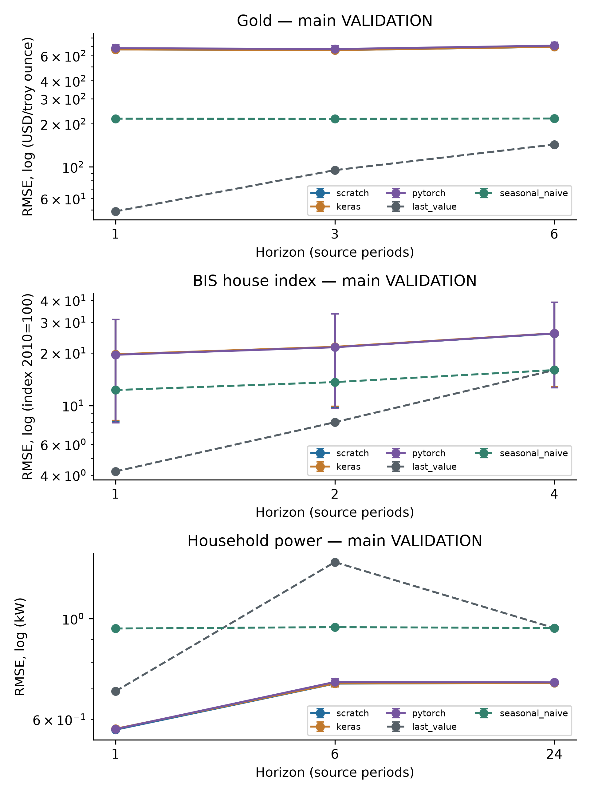
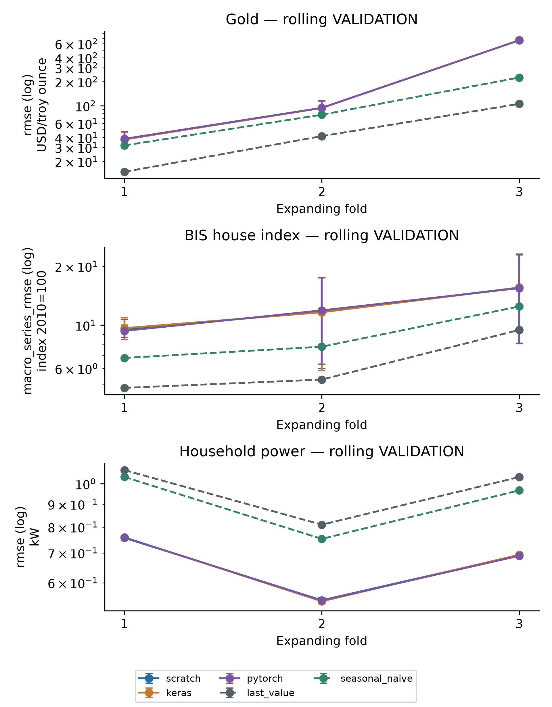
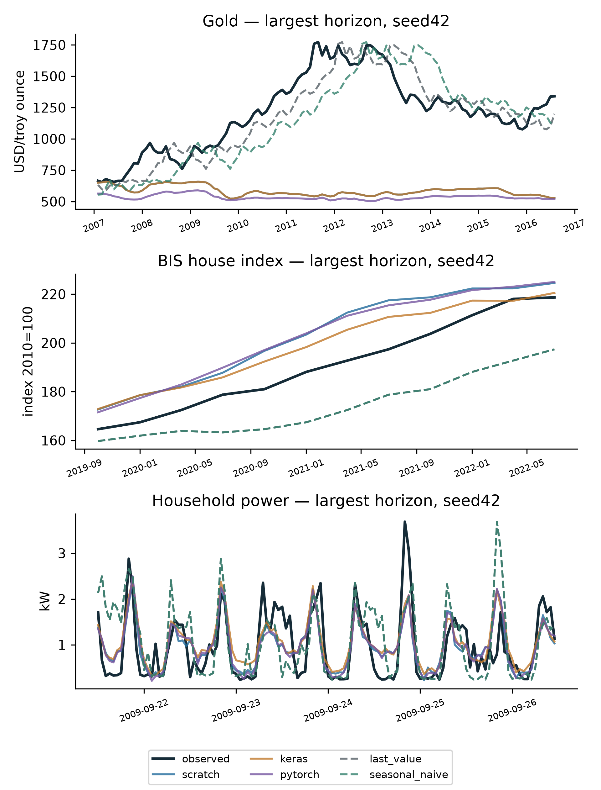
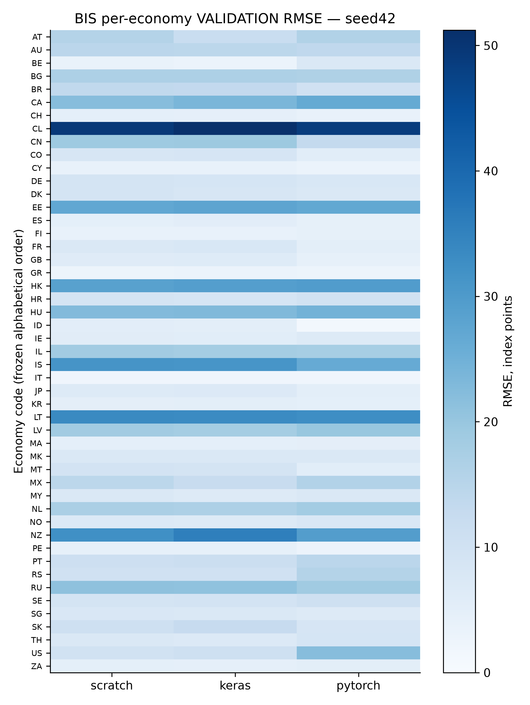
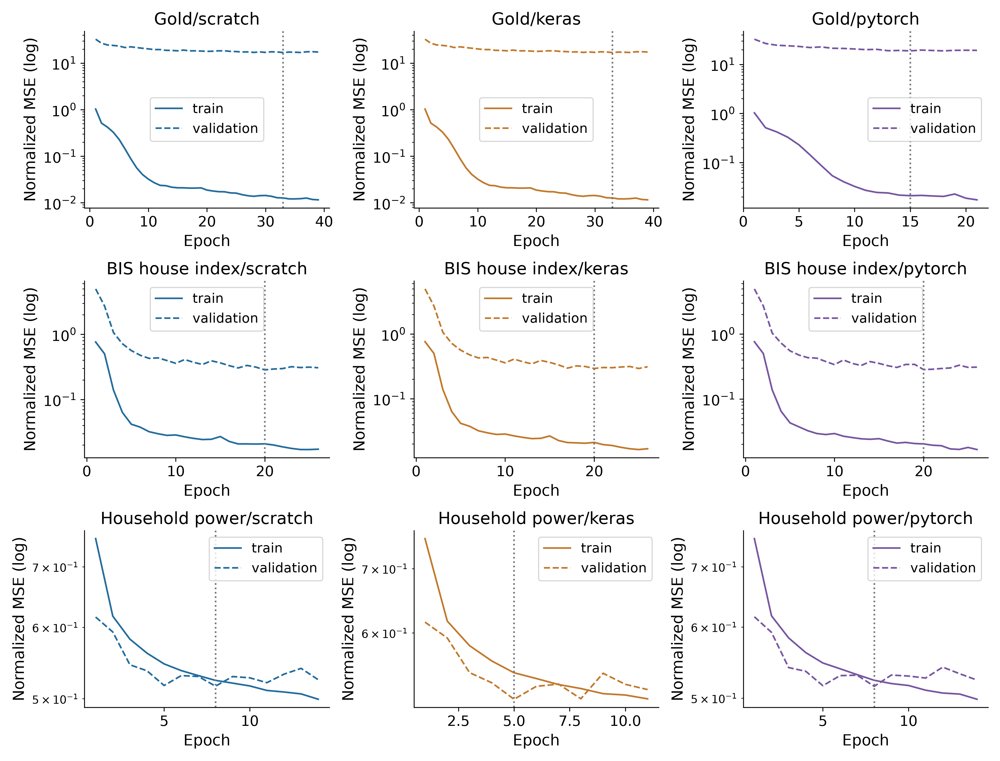
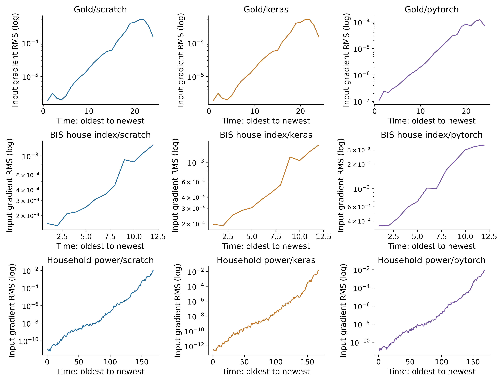
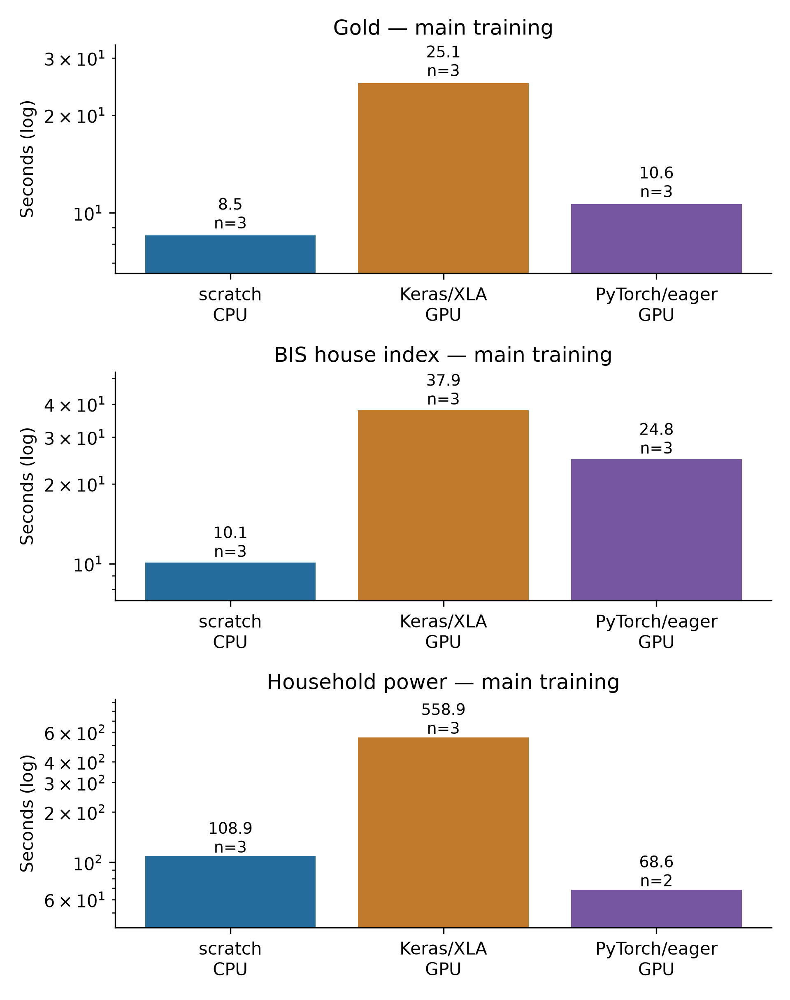

# CHƯƠNG 4A. RECURRENT NEURAL NETWORK — PHẦN RNN

Phần này ghi nhận RNN và kết quả **validation** của Phase 28. Chương 4 hoàn chỉnh sẽ ghép
thêm LSTM và TEST chung ở Phase 29; không coi các số validation là kết quả TEST cuối.

## 4.1. Bài toán dữ liệu tuần tự

Để dự đoán giá vàng tháng tới, chỉ biết giá của một tháng thường chưa đủ. Ta còn muốn biết
những tháng trước giá đang tăng, giảm hay dao động. Tương tự, chỉ số nhà theo quý có xu hướng
chậm, còn điện năng theo giờ thay đổi theo nhịp sinh hoạt. Thứ tự quan sát là một phần của dữ liệu.

Mạng hồi quy (Recurrent Neural Network, RNN) đọc lần lượt các quan sát và cập nhật một vector
tóm tắt lịch sử, gọi là trạng thái ẩn. Có thể hình dung mỗi bước mạng đọc thêm một dòng rồi sửa
bản ghi nhớ của mình. Khi đã đọc hết cửa sổ, trạng thái cuối được dùng để dự đoán các mốc tương lai.
Vector này không phải một bản sao đầy đủ của mọi quan sát; mạng có thể làm mất thông tin cũ.

Ở bài toán vàng, đầu vào có 24 tháng và 4 đặc trưng mỗi tháng. Đầu ra gồm 3 giá trị: giá sau 1,
3 và 6 tháng. Mạng dự đoán trực tiếp cả 3 mốc trong một lần, không lấy dự đoán tháng 1 làm dữ liệu
đầu vào để dự đoán tháng 3. Với điện năng, đầu vào dài 168 giờ; đầu ra ở 1,6 và 24 giờ tiếp theo.

Một **window** hay cửa sổ là đoạn lịch sử kết thúc tại một origin. Origin chỉ là mốc cuối của
lịch sử đã quan sát. Mọi nhãn dự đoán phải nằm sau mốc đó. Hai cửa sổ liên tiếp có thể chồng nhau;
điều này không cho phép đưa quan sát tương lai vào đầu vào hoặc chia ngẫu nhiên các cửa sổ.

Luồng chính: **lịch sử đã quan sát → tạo cửa sổ → chuẩn hóa theo train → RNN nhiều tầng →
Dense → dự đoán chuẩn hóa → đổi về đơn vị gốc → so với nhãn thật**.

## 4.2. Ba dataset và cách chia theo thời gian

### 4.2.1. Nguồn, kích cỡ và ý nghĩa đầu ra

| Dataset | Snapshot local và kích cỡ | Phần dùng trong mô hình | Đầu ra / đơn vị |
|---|---|---|---|
| World Bank Pink Sheet | XLSX 586.099 byte,801 tháng từ 1960-01 đến 2026-09 | Một chuỗi;24 tháng ×4 feature | Gold sau 1/3/6 tháng, USD/troy ounce |
| BIS WS_SPP | ZIP 135.216 byte;35.780 quan sát không thiếu trong toàn bulk | Panel 49 nền kinh tế,4.689 dòng, từ 2002;12 quý ×51 feature | Chỉ số nhà sau 1/2/4 quý, danh nghĩa 2010=100 |
| UCI Household Power | ZIP 20.640.916 byte;2.075.259 dòng phút | Tổng hợp 34.589 giờ;168 giờ ×14 feature | Công suất tác dụng trung bình sau 1/6/24 giờ, kW |

Các file nguồn và thẻ dữ liệu đã khóa ở Phase 23–24. Nguồn tải:
[World Bank Pink Sheet October 2026](https://thedocs.worldbank.org/en/doc/74e8be41ceb20fa0da750cda2f6b9e4e-0050012026/related/CMO-Historical-Data-Monthly.xlsx),
[BIS WS_SPP](https://data.bis.org/static/bulk/WS_SPP_csv_col.zip) và
[UCI Household Power](https://archive.ics.uci.edu/dataset/235/individual%2Bhousehold%2Belectric%2Bpower%2Bconsumption).
World Bank/UCI có ghi nhận CC BY 4.0 trong receipt. BIS dùng điều khoản thống kê riêng,
không tự gán giấy phép CC BY và không phát lại raw trong repository.

Giá vàng dùng thêm silver, platinum và dầu thô trễ một tháng; gold tại origin là quan sát đã có
trong cách đánh giá hồi cứu này. BIS chỉ giữ Q/N/628: chuỗi quý, chỉ số danh nghĩa,2010=100;
không trộn chỉ số thực hoặc phần trăm tăng trưởng.51 feature gồm chỉ số, thay đổi so với quý
trước và 49 cột định danh quốc gia. **Đây không phải giá bán căn nhà bằng USD như Ames**.

Điện năng cần ít nhất 45 phút có quan sát để nhận giá trị trung bình giờ. Có 438 giờ thiếu nhãn;
không điền các nhãn này để chấm điểm. Chỉ đặc trưng đầu vào được forward-fill tối đa 6 giờ,
sau đó dùng imputer đã fit train và các cờ thiếu. kW là công suất trung bình, không phải kWh.

### 4.2.2. Mẫu input/output thật và phân bố

Những mẫu sau thuộc TRAIN, đầu ra là nhãn nguồn đã biết, **không phải dự đoán của model**.

| Dataset / origin | Một phần đầu vào tại mốc cuối | Nhãn ở ba horizon |
|---|---|---|
| GOLD/1961-12 |24 tháng; gold 35, silver_lag 1=0,9, platinum_lag 1=84, crude_oil_lag 1=1,6 |35 /35 /35 USD/troy ounce |
| Q.AT.N.628/2004-10 |12 quý; house_index 80,8486; index_change 1,7286; country_AT=1 |81,1628 /81,9485 /83,9914 điểm chỉ số |
| HOUSEHOLD/2006-12-23 T 20:00 |168 giờ; Global_active_power 4,1814 kW; cờ thiếu 0 |3,288433 /2,303033 /0,4741 kW |

Ba mẫu đầy đủ mỗi dataset, toàn bộ feature/schema và provenance nằm trong
`report/references/dataset_cards/v3_eda/ch4_*.md`. Thống kê dưới đây là mô tả snapshot EDA đã
khóa, không được dùng để fit scaler hoặc lựa chọn mô hình dựa trên TEST.

| Dataset | Trung vị / khoảng 25%–75% của target quan sát | Min–max | Nhận xét |
|---|---|---|---|
| Gold |379 /159–1.095 USD/troy ounce |35–5.020 |Mức giá đổi mạnh qua thời gian; giai đoạn sau có thể vượt xa miền train |
| BIS |107,6851 /92,7579–151,6941 điểm |16,4856–416,5466 |Khác biệt giữa nền kinh tế; cần xem sai số riêng từng chuỗi |
| Power |0,8027 /0,3419–1,5793 kW |0,124–6,5605 |Lệch phải, có giờ dùng điện cao và nhãn thiếu; chỉ một hộ gia đình |

### 4.2.3. Causal windows, scaler và rolling validation

| Dataset | Full train / matched train | Full validation | TEST giữ niêm phong | Lookback → horizons |
|---|---:|---:|---:|---|
| Gold |531 /531 |115 |116 |24 tháng →1/3/6 tháng |
| BIS |2.504 /2.504 |588 |568 |12 quý →1/2/4 quý |
| Power |23.797 /12.000 |5.033 |4.911 |168 giờ →1/6/24 giờ |

Tập chính được chia theo lịch của **target**, không theo thứ tự ngẫu nhiên của window.
Mọi horizon trong một window phải thuộc cùng partition; các window cắt ngang ranh giới bị loại.
Context của validation được phép bắt đầu trước ranh giới train, vì đó là quá khứ đã quan sát.
Khi origin dịch chuyển trong validation, mô hình được nhận lịch sử thực tế tới origin mới:
đây là đánh giá rolling-origin, không phải dự đoán toàn giai đoạn bằng một mốc ban đầu duy nhất.

Scaler của tập chính fit trên prefix train đã khóa; mỗi rolling fold dùng scaler của prefix
riêng. Không fit lại trên validation. TensorAdapter áp dụng đúng canonical feature order,
không suy thứ tự từ dictionary JSON. Nhãn để tính metric lấy float 64 từ nguồn; dự đoán được
inverse-transform về đơn vị gốc, không dùng nhãn float 32 đã đổi ngược làm ground truth.

Ba rolling fold mở rộng vùng train bên trong phần pre-TEST, giúp xem kết quả có phụ thuộc
giai đoạn hay không. Các fold dùng lại nhiều quan sát, không phải các phép thử thống kê độc lập.
Khi fold 2/3 chứa origin bị loại tại ranh giới main cũ, adapter Phase 28 dựng lại index theo đúng
ID/calendar đã khóa; không đổi ID/split/scaler. Gold có 5, BIS 98 và power 23 ID bổ sung mỗi fold.

Gold và BIS là snapshot đã chỉnh sửa hồi tố; không có vintage và lịch công bố để khẳng định
dự đoán khả dụng trong giao dịch thật. Với BIS, “quá khứ đã quan sát” không bảo đảm được công bố
đúng ngày origin. Calendar key +00:00 chỉ chuẩn hóa tọa độ thời gian; riêng power không có bằng
chứng timezone/DST đầy đủ. Không suy ra khả năng đầu tư hoặc tổng quát hóa cho mọi hộ gia đình.

## 4.3. RNN sáu lớp và hợp các hàm

### 4.3.1. Một bước nhớ, hai chiều lặp

Ở mỗi tầng, bước thời gian mới kết hợp dữ liệu hiện tại với trạng thái trước rồi đi qua tanh:

`h_t^(l) = tanh(x_t^(l) W_l + h_(t-1)^(l) U_l + b_l)`.

Ở đây t là vị trí trong window, l là tầng RNN. x là vector đầu vào của tầng: tầng 1 dùng các
feature của quan sát, tầng 2–3 dùng output cùng thời điểm của tầng dưới. h là trạng thái 32 chiều.
W có shape `[D,32]`, U là `[32,32]`, b là `[32]`; D của tầng 1 lần lượt 4/51/14, tầng 2–3 là 32.
Với batch B, x có shape `[B,D]`, nên hai tích ma trận đều cho `[B,32]`. tanh giữ từng thành phần
trong khoảng−1 đến 1. Trạng thái trước bước đầu là 0, không mang sang window khác.

Ví dụ shape: một batch 32 cửa sổ vàng đi vào tầng 1 là `[32,24,4]`; output từng thời điểm của
tầng 1 là `[32,24,32]`. Có hai chiều cần phân biệt: **theo thời gian**, cùng một tầng dùng lại
W/U/b qua 24 bước; **theo tầng**, ba bộ W/U/b khác nhau xử lý lần lượt.24 bước thời gian không
được tính thành 24 layer học được.

### 4.3.2. Luồng tổng thể và bảng shape

Luồng model là **RNN 32 trả chuỗi → RNN 32 trả chuỗi → RNN 32 lấy bước cuối → Dense 16 → ReLU →
Dense 8 → ReLU → Dense 3**. Có 3 recurrent và 3 Dense, tức 6 lớp có tham số; activation và bước
lấy phần tử cuối không được dùng để tăng số đếm. Đầu ra cuối là tuyến tính để dự đoán giá trị số.

Viết gọn theo yêu cầu hợp hàm: `F = f_L ∘ ... ∘ f_1`. Cụ thể, dữ liệu đi qua chuẩn hóa,
ba phép lặp RNN, ba Dense xen ReLU rồi đổi ngược target. Dấu hợp hàm chỉ có nghĩa “đầu ra của
bước trước trở thành đầu vào của bước sau”, không thay thế cho sơ đồ thời gian đã giải thích.

| Bước | Gold input → output | Tham số học được |
|---|---|---:|
| RNN 1, trả toàn chuỗi |`[B,24,4] → [B,24,32]` |1.184 |
| RNN 2, trả toàn chuỗi |`[B,24,32] → [B,24,32]` |2.080 |
| RNN 3, lấy bước cuối |`[B,24,32] → [B,32]` |2.080 |
| Dense 16 + ReLU |`[B,32] → [B,16]` |528 |
| Dense 8 + ReLU |`[B,16] → [B,8]` |136 |
| Dense 3 tuyến tính |`[B,8] → [B,3]` |27 |

Tổng Gold 6.035 tham số; BIS 7.539; Power 6.355. Khác biệt nằm ở số feature đầu vào của RNN 1,
không phải thay số tầng hoặc kích thước hidden. Model contracts và shape trace được sinh từ
cùng computational plan Phase 25 cho cả ba implementation, không viết ba mô tả độc lập.

### 4.3.3. Các hàm cốt lõi và mapping sang code

| Hàm / signature | Vai trò và input → output | Corner case / mapping |
|---|---|---|
| `WindowData.batch(ids)` |ID → x`[B,T,D]`, y`[B,3]`; gather theo cửa sổ |Từ chối ID TEST/không biết/trùng; dùng cùng reader cho 3 implementation |
| `TensorAdapter.transform(frame)` |Feature gốc → float 32 chuẩn hóa |Dùng stats train và thứ tự cột đã khóa; không refit |
| Bước RNN |x`[B,D]`, h cũ`[B,32]` → h mới`[B,32]` |NumPyNetwork tự matmul/tanh; Keras `SimpleRNN`; Torch `nn.RNN` |
| Lấy trạng thái cuối |Chuỗi`[B,T,32]` → `[B,32]` |Chỉ tầng RNN 3; hai tầng đầu phải trả toàn chuỗi |
| Dense / ReLU |Vector → vector kích thước mới / giữ shape |Dense có W/b; ReLU không có tham số, zero là điểm gấp |
| `loss_and_gradient(pred,y,"mse")` |`[B,3]` → scalar loss và gradient |MSE là trung bình bình phương sai số trên batch và 3 đầu ra chuẩn hóa |
| `NumpyNetwork.backward(dy)` |Gradient output → gradient weights/input |Tự BPTT từ cuối về đầu và từ tầng trên xuống; không gọi autograd |
| `clip_gradients(grads,1)` |Gradient → gradient cùng hướng, norm≤1 |Chặn global norm, không clip riêng từng phần tử; gradient không hữu hạn là lỗi |
| `Adam.step(weights,grads)` |Weights + gradient → weights mới |Lưu m/v/step; giữ quy ước `sqrt(v_hat)+epsilon` như Chương 2 |
| `EarlyStopping.observe(loss,epoch)` |Validation MSE → lưu best/dừng |Lưu minimum thật; min_delta chỉ điều khiển patience |
| `inverse_target(values)` |Dự đoán chuẩn hóa → USD/index/kW |Không làm tròn về số nguyên, không impute nhãn |
| `regression_metrics(y,p,horizons,series)` |Giá trị gốc → RMSE/MAE/sMAPE |Có breakdown horizon/series; không trộn đơn vị giữa dataset |

BPTT, tức lan truyền ngược theo thời gian, áp dụng chuỗi đạo hàm qua các bước mà forward đã
dùng. Scratch lưu trạng thái trung gian để dùng khi quay ngược. Qua nhiều bước tanh, ảnh hưởng
của quan sát cũ có thể suy giảm hoặc gradient có thể lớn bất thường. Gradient clipping giúp
hạn chế update quá lớn, nhưng không tự khắc phục việc mất thông tin dài hạn. LSTM ở Phase 29
sẽ được so sánh trên cùng windows, không mặc định tốt hơn chỉ vì có thêm cổng.

Gradient diagnostics dùng 4 window TRAIN cố định và weights được chọn bằng validation.
Biểu đồ ghi độ lớn gradient theo từng vị trí đầu vào bằng RMS (căn của trung bình bình phương),
giúp quan sát loss còn nhạy đến mức nào với từng đoạn lịch sử. Các chuẩn gradient và ma trận
chi tiết được giữ trong `gradient_diagnostics.json` để đối chiếu kỹ thuật.
Giá trị nhỏ ở một vị trí chỉ là độ nhạy cục bộ của loss/ví dụ đó; không chứng minh mô hình luôn
quên quá khứ hoặc feature đó không quan trọng. Biểu đồ này không phải giải thích nhân quả.

### 4.3.4. Scratch, Keras và PyTorch

Ba cách triển khai nhận cùng NTF tensor, cùng weights khởi tạo và batch order theo seed.
Scratch thực hiện forward, MSE, BPTT, clipping và Adam bằng NumPy CPU. Keras dùng 3 SimpleRNN
và 3 Dense của TensorFlow GPU; PyTorch dùng 3 nn.RNN và 3 Linear trên GPU. Trong Torch,
bias recurrent thứ hai được đặt 0 và frozen để không tăng tham số so với canonical W/U/b.

Đoạn khởi tạo ngắn, code đầy đủ nằm trong source và function contracts:

```python
plan = build_plan("rnn", [24, 4], outputs=3)
weights = canonical_weights(plan, seed=42)
scratch_trainer = ScratchTrainer(plan, weights)       # NumPy CPU, tự BPTT
keras_trainer = RnnKerasTrainer(plan, weights, "gpu") # TensorFlow GPU + XLA
torch_trainer = RnnTorchTrainer(plan, weights, "gpu") # PyTorch GPU eager
```

Để thấy rõ thao tác của từng cách viết, dưới đây là các đoạn cốt lõi tối giản. Chúng minh họa
forward/kiến trúc, không thay runner đã khóa; code train thật gán canonical weights và dùng
loss/BPTT/Adam, kiểm tra và checkpoint trong `src/common/` và `src/ch04_rnn_lstm/`.

Scratch tự tính một tầng theo thời gian, không gọi lớp RNN hay autograd:

```python
def simple_rnn(x, W, U, b, return_sequences=True):
    h = np.zeros((len(x), U.shape[0]), dtype=x.dtype)
    sequence = []
    for t in range(x.shape[1]):
        h = np.tanh(x[:, t] @ W + h @ U + b)
        sequence.append(h)
    return np.stack(sequence, axis=1) if return_sequences else h
```

Hai lần đầu trả cả chuỗi, lần thứ ba chỉ trả h cuối. Dense và ReLU xử lý vector đó; backward
trong `NumpyNetwork` quay ngược những trạng thái đã lưu để tính gradient W/U/b bằng phép toán mảng.

Keras thể hiện rõ sáu lớp có tham số trên ví dụ Gold:

```python
import keras
model = keras.Sequential([
    keras.Input(shape=(24, 4)),
    keras.layers.SimpleRNN(32, return_sequences=True),
    keras.layers.SimpleRNN(32, return_sequences=True),
    keras.layers.SimpleRNN(32),
    keras.layers.Dense(16, activation="relu"),
    keras.layers.Dense(8, activation="relu"),
    keras.layers.Dense(3),
])
```

PyTorch trả tuple từ mỗi RNN nên cần lấy chuỗi output trước khi chuyển sang tầng kế tiếp:

```python
import torch
from torch import nn
class RNN6(nn.Module):
    def __init__(self, features=4):
        super().__init__()
        self.rnns = nn.ModuleList([
            nn.RNN(d, 32, batch_first=True) for d in (features, 32, 32)
        ])
        self.head = nn.Sequential(nn.Linear(32, 16), nn.ReLU(),
                                  nn.Linear(16, 8), nn.ReLU(), nn.Linear(8, 3))
        for layer in self.rnns:
            with torch.no_grad():
                layer.bias_hh_l0.zero_()
            layer.bias_hh_l0.requires_grad_(False)
    def forward(self, x):
        for layer in self.rnns:
            x, _ = layer(x)
        return self.head(x[:, -1])
```

Mỗi native framework chạy trong process/env riêng; đoạn trên chỉ minh họa cách gọi, không phải
hướng dẫn import hai engine CUDA vào chung một process. Hai tầng recurrent đầu bật
`return_sequences`, tầng cuối lấy trạng thái cuối; các API đối chiếu tại
[Keras SimpleRNN](https://keras.io/api/layers/recurrent_layers/simple_rnn/) và
[PyTorch RNN 2.14](https://docs.pytorch.org/docs/2.14/generated/torch.nn.RNN.html).

Keras dùng graph/XLA sau probe trước khai báo, giữ nguyên loss/optimizer/architecture. XLA có thể
bỏ TF Assert nên wrapper kiểm finite/shape ở host và kiểm loss/gradient trả về. Chi phí compile
được tính trong train wall nếu xảy ra trong timer; graph không đồng nghĩa luôn nhanh hơn eager.
Xem [TensorFlow tf.function](https://www.tensorflow.org/guide/function) về graph tracing/thực thi.

Huấn luyện dùng batch 32, tối đa 40 epoch, patience 6, min_delta 0,00001 và Adam learning_rate 0,001,
epsilon 0,0000001, clip global norm 1. Seed 17/42/73 không đổi split. Mỗi epoch được lưu weights,
m/v/iteration, best/history/early stopping để resume đúng lịch batch; Torch chuyển cả W và U
moments về canonical layout. NaN/OOM/timeout ghi lỗi, không tự giảm dữ liệu riêng cho một engine.

## 4.4. Đánh giá validation và giới hạn cách kết luận

RMSE phạt mạnh các lỗi lớn và có cùng đơn vị với target; MAE cho biết độ lớn sai số trung bình.
sMAPE biểu thị sai số tương đối theo phần trăm; trường hợp cả giá trị thật và dự đoán bằng 0
được gán đóng góp 0. Không dùng MAPE khi có nguy cơ mẫu số bằng hoặc gần 0. BIS dùng
macro-series RMSE làm metric chính: tính RMSE từng nền kinh tế rồi lấy trung bình, tránh chỉ
nhìn một số pooled bị chi phối bởi các chuỗi biến động lớn. Breakdown theo horizon vẫn phải giữ.

Last-value lặp lại giá trị quan sát cuối trong lookback. Seasonal-naive lấy giá trị cùng mùa
ở quá khứ:12 tháng với vàng,4 quý với nhà,24 giờ với điện; thiếu nguồn seasonal thì lùi về
last observed trong lookback. Baseline không được nhìn nhãn tương lai. Một RNN phức tạp không
được xem là thành công chỉ vì train loss giảm; nó cần được đối chiếu với hai mốc đơn giản này.

Mean ± sample SD dùng ba seed riêng cho từng dataset/implementation/view. Không cộng chung
sai số USD, điểm chỉ số và kW; không gọi SD là khoảng tin cậy. Cũng không dùng main validation
hoặc rolling validation để trình bày như TEST. Các bảng số đo thực được ghép sau khi hàng đợi
hoàn tất và audit prediction đã lưu; Phase 29 mới cung cấp TEST chung RNN–LSTM.

Lookback khác nhau đi kèm khác miền dữ liệu, số mẫu, feature và đơn vị. Vì vậy, các thí nghiệm
này không cô lập riêng tác động của độ dài chuỗi. Chúng cho phép mô tả RNN trên ba tình huống
đã khai báo, không chứng minh cứ tăng lookback là sai số tăng hoặc giảm.

Một quan sát thuộc main validation có thể nằm trong prefix train của rolling fold sau,
nhưng scaler mỗi fold chỉ fit train của chính fold đó. Các checkpoint rolling chỉ phục vụ
kiểm tra phát triển, không thay checkpoint main để chấm TEST. Bàn giao Phase 29 chỉ phê duyệt
các model main đã chọn đúng theo main validation, không refit bằng toàn bộ vùng pre-TEST.

Checkpoint được chọn bằng validation MSE đã chuẩn hóa theo giao thức chung. Macro-series RMSE
là metric so sánh chính của BIS, không phải tiêu chí để chọn lại epoch sau khi train.
Chỉ thứ tự các window train được shuffle theo lịch seed; thứ tự thời gian bên trong mỗi window
và ranh giới các tập không bị xáo trộn.


**Ghi chú kiểm chứng export r2.** Model được train bằng framework đã khai báo; bản NumPy CPU được kiểm riêng với native CPU ở cùng ngưỡng rtol=1e-4, atol=1e-5. Đối chiếu GPU/cuDNN với CPU của Power/PyTorch seed17 vượt ngưỡng ở một đầu ra; lỗi gốc vẫn được lưu, không gọi là PASS. Lượt này được khôi phục từ đúng best checkpoint, không thêm optimizer update hoặc chọn lại epoch. Chi tiết nằm trong hồ sơ revision r2.

Riêng lượt Power/PyTorch seed17 đã mất số đo cuối của process train trước khi lưu: train wall, peak RSS và VRAM gốc được để null và loại khỏi aggregate chi phí tương ứng. Các ô chi phí Power/PyTorch main dùng n=2; metric chất lượng vẫn đủ ba seed. Inference của lượt này được đo ở process khôi phục, không thay cho thời gian train.

Kết quả chính cần lưu ý: trên Gold và BIS, cả ba cách hiện thực RNN đều có sai số main validation cao hơn last-value. Với Household Power, cả ba RNN có RMSE thấp hơn hai baseline. Do đó, mạng sâu hơn chưa đủ để bảo đảm dự báo tốt hơn một quy tắc đơn giản; kết luận phải gắn với từng miền và cấu hình đã khóa. Đây vẫn là validation, không phải bằng chứng TEST hay cơ sở để chọn lại hyperparameter sau thực nghiệm.


### 4.4.1. Kết quả tập validation chính

Các số dưới là VALIDATION, chưa phải TEST. Ba seed17/42/73 của RNN dùng mean ± sample SD. Hai baseline xác định chỉ có một lượt mỗi view, không tạo SD giả.

| Dataset | Triển khai | RMSE | MAE | sMAPE % | Macro-series RMSE |
|---|---|---:|---:|---:|---:|
| Gold | scratch | 670.155 ± 12.049 | 590.012 ± 3.949 | 61.121 ± 0.380 | 670.155 ± 12.049 |
| Gold | keras | 670.155 ± 12.049 | 590.012 ± 3.950 | 61.121 ± 0.380 | 670.155 ± 12.049 |
| Gold | pytorch | 683.270 ± 34.619 | 606.308 ± 32.272 | 63.616 ± 4.712 | 683.270 ± 34.619 |
| Gold | last_value | 103.054 (n=1) | 76.986 (n=1) | 6.628 (n=1) | 103.054 (n=1) |
| Gold | seasonal_naive | 217.229 (n=1) | 177.154 (n=1) | 15.626 (n=1) | 217.229 (n=1) |
| BIS house index | scratch | 22.463 ± 12.147 | 14.201 ± 7.464 | 8.323 ± 4.294 | 16.388 ± 7.595 |
| BIS house index | keras | 22.544 ± 12.083 | 14.216 ± 7.453 | 8.335 ± 4.286 | 16.407 ± 7.581 |
| BIS house index | pytorch | 22.453 ± 12.210 | 14.150 ± 7.415 | 8.255 ± 4.223 | 16.392 ± 7.541 |
| BIS house index | last_value | 10.585 (n=1) | 6.845 (n=1) | 4.148 (n=1) | 8.929 (n=1) |
| BIS house index | seasonal_naive | 14.019 (n=1) | 10.210 (n=1) | 6.301 (n=1) | 11.798 (n=1) |
| Household power | scratch | 0.674 ± 0.006 | 0.489 ± 0.009 | 42.730 ± 0.759 | 0.674 ± 0.006 |
| Household power | keras | 0.675 ± 0.009 | 0.493 ± 0.004 | 43.508 ± 0.383 | 0.675 ± 0.009 |
| Household power | pytorch | 0.677 ± 0.009 | 0.495 ± 0.012 | 43.389 ± 1.346 | 0.677 ± 0.009 |
| Household power | last_value | 1.026 (n=1) | 0.732 (n=1) | 58.567 (n=1) | 1.026 (n=1) |
| Household power | seasonal_naive | 0.954 (n=1) | 0.663 (n=1) | 52.180 (n=1) | 0.954 (n=1) |

Đơn vị RMSE/MAE lần lượt là USD/troy ounce, điểm chỉ số2010=100 và kW; không so độ lớn giữa dataset. Với Gold/Power chỉ một chuỗi, macro-series RMSE trùng RMSE. BIS dùng macro-series làm metric chính.

Gold: metric chính trung bình scratch/Keras/PyTorch là 670.155, 670.155, 683.270; baseline tốt hơn trong hai baseline có giá trị 103.054. Đây là mô tả các cấu hình đã khóa, không dùng để chọn lại hyperparameter sau hàng đợi.

BIS house index: metric chính trung bình scratch/Keras/PyTorch là 16.388, 16.407, 16.392; baseline tốt hơn trong hai baseline có giá trị 8.929. Đây là mô tả các cấu hình đã khóa, không dùng để chọn lại hyperparameter sau hàng đợi.

Household power: metric chính trung bình scratch/Keras/PyTorch là 0.674, 0.675, 0.677; baseline tốt hơn trong hai baseline có giá trị 0.954. Đây là mô tả các cấu hình đã khóa, không dùng để chọn lại hyperparameter sau hàng đợi.

Mạng nhỏ không được bảo đảm vượt baseline. Train loss thấp cùng validation error lớn có thể phản ánh overfit hoặc dịch chuyển mức/đặc trưng theo thời gian. Với vàng, prefix train và validation thuộc những chế độ mức giá khác nhau; không được gọi khả năng bám một đoạn train là khả năng giao dịch tương lai.

### 4.4.2. Sai số theo horizon và rolling fold

| Dataset | Triển khai | Horizon | RMSE | MAE | sMAPE % |
|---|---|---:|---:|---:|---:|
| Gold | scratch | 1 | 662.756 ± 19.577 | 580.396 ± 17.303 | 60.353 ± 2.495 |
| Gold | scratch | 3 | 655.261 ± 18.237 | 572.787 ± 8.419 | 58.710 ± 0.950 |
| Gold | scratch | 6 | 691.463 ± 24.626 | 616.852 ± 22.105 | 64.301 ± 3.220 |
| Gold | keras | 1 | 662.756 ± 19.577 | 580.396 ± 17.303 | 60.353 ± 2.495 |
| Gold | keras | 3 | 655.261 ± 18.237 | 572.787 ± 8.419 | 58.710 ± 0.950 |
| Gold | keras | 6 | 691.463 ± 24.626 | 616.852 ± 22.105 | 64.301 ± 3.220 |
| Gold | pytorch | 1 | 676.838 ± 35.714 | 596.856 ± 29.422 | 62.855 ± 4.136 |
| Gold | pytorch | 3 | 667.137 ± 38.402 | 587.607 ± 35.049 | 60.952 ± 5.040 |
| Gold | pytorch | 6 | 704.824 ± 42.092 | 634.460 ± 43.628 | 67.040 ± 6.532 |
| Gold | last_value | 1 | 48.761 (n=1) | 38.417 (n=1) | 3.318 (n=1) |
| Gold | last_value | 3 | 94.797 (n=1) | 74.339 (n=1) | 6.375 (n=1) |
| Gold | last_value | 6 | 143.166 (n=1) | 118.200 (n=1) | 10.191 (n=1) |
| Gold | seasonal_naive | 1 | 217.214 (n=1) | 177.539 (n=1) | 15.916 (n=1) |
| Gold | seasonal_naive | 3 | 216.654 (n=1) | 176.209 (n=1) | 15.565 (n=1) |
| Gold | seasonal_naive | 6 | 217.816 (n=1) | 177.713 (n=1) | 15.396 (n=1) |
| BIS house index | scratch | 1 | 19.566 ± 11.470 | 11.993 ± 6.736 | 7.096 ± 3.902 |
| BIS house index | scratch | 2 | 21.576 ± 11.796 | 13.605 ± 7.188 | 8.007 ± 4.156 |
| BIS house index | scratch | 4 | 25.775 ± 13.172 | 17.005 ± 8.471 | 9.865 ± 4.827 |
| BIS house index | keras | 1 | 19.634 ± 11.413 | 12.008 ± 6.724 | 7.106 ± 3.895 |
| BIS house index | keras | 2 | 21.653 ± 11.733 | 13.608 ± 7.185 | 8.010 ± 4.155 |
| BIS house index | keras | 4 | 25.871 ± 13.101 | 17.031 ± 8.452 | 9.889 ± 4.811 |
| BIS house index | pytorch | 1 | 19.495 ± 11.552 | 11.797 ± 6.731 | 6.924 ± 3.852 |
| BIS house index | pytorch | 2 | 21.528 ± 11.890 | 13.549 ± 7.100 | 7.931 ± 4.050 |
| BIS house index | pytorch | 4 | 25.838 ± 13.204 | 17.103 ± 8.423 | 9.911 ± 4.774 |
| BIS house index | last_value | 1 | 4.194 (n=1) | 3.046 (n=1) | 1.899 (n=1) |
| BIS house index | last_value | 2 | 8.019 (n=1) | 5.789 (n=1) | 3.544 (n=1) |
| BIS house index | last_value | 4 | 15.944 (n=1) | 11.700 (n=1) | 7.002 (n=1) |
| BIS house index | seasonal_naive | 1 | 12.257 (n=1) | 8.991 (n=1) | 5.716 (n=1) |
| BIS house index | seasonal_naive | 2 | 13.608 (n=1) | 9.938 (n=1) | 6.185 (n=1) |
| BIS house index | seasonal_naive | 4 | 15.944 (n=1) | 11.700 (n=1) | 7.002 (n=1) |
| Household power | scratch | 1 | 0.569 ± 0.005 | 0.405 ± 0.010 | 35.481 ± 0.967 |
| Household power | scratch | 6 | 0.719 ± 0.005 | 0.530 ± 0.010 | 46.163 ± 0.890 |
| Household power | scratch | 24 | 0.722 ± 0.008 | 0.532 ± 0.009 | 46.547 ± 0.991 |
| Household power | keras | 1 | 0.572 ± 0.006 | 0.410 ± 0.002 | 36.139 ± 0.263 |
| Household power | keras | 6 | 0.720 ± 0.012 | 0.531 ± 0.007 | 46.617 ± 0.830 |
| Household power | keras | 24 | 0.721 ± 0.008 | 0.538 ± 0.004 | 47.768 ± 0.494 |
| Household power | pytorch | 1 | 0.571 ± 0.005 | 0.409 ± 0.007 | 36.067 ± 0.717 |
| Household power | pytorch | 6 | 0.725 ± 0.013 | 0.539 ± 0.016 | 47.105 ± 1.744 |
| Household power | pytorch | 24 | 0.724 ± 0.009 | 0.536 ± 0.013 | 46.995 ± 1.706 |
| Household power | last_value | 1 | 0.692 (n=1) | 0.464 (n=1) | 37.631 (n=1) |
| Household power | last_value | 6 | 1.331 (n=1) | 1.068 (n=1) | 85.897 (n=1) |
| Household power | last_value | 24 | 0.953 (n=1) | 0.662 (n=1) | 52.174 (n=1) |
| Household power | seasonal_naive | 1 | 0.951 (n=1) | 0.660 (n=1) | 51.951 (n=1) |
| Household power | seasonal_naive | 6 | 0.957 (n=1) | 0.666 (n=1) | 52.415 (n=1) |
| Household power | seasonal_naive | 24 | 0.953 (n=1) | 0.662 (n=1) | 52.174 (n=1) |



| Dataset | Triển khai | Fold1 metric chính | Fold2 | Fold3 |
|---|---|---:|---:|---:|
| Gold | scratch | 37.792 ± 8.768 | 93.723 ± 19.979 | 661.679 ± 44.607 |
| Gold | keras | 37.792 ± 8.768 | 93.722 ± 19.979 | 661.973 ± 44.354 |
| Gold | pytorch | 38.477 ± 8.756 | 94.275 ± 20.977 | 662.658 ± 43.781 |
| Gold | last_value | 14.836 (n=1) | 41.622 (n=1) | 105.653 (n=1) |
| Gold | seasonal_naive | 31.803 (n=1) | 77.126 (n=1) | 226.063 (n=1) |
| BIS house index | scratch | 9.543 ± 1.127 | 11.712 ± 5.732 | 15.589 ± 7.544 |
| BIS house index | keras | 9.656 ± 1.238 | 11.645 ± 5.803 | 15.560 ± 7.494 |
| BIS house index | pytorch | 9.344 ± 0.687 | 11.913 ± 5.591 | 15.480 ± 7.402 |
| BIS house index | last_value | 4.775 (n=1) | 5.267 (n=1) | 9.454 (n=1) |
| BIS house index | seasonal_naive | 6.795 (n=1) | 7.761 (n=1) | 12.477 (n=1) |
| Household power | scratch | 0.756 ± 0.003 | 0.548 ± 0.007 | 0.692 ± 0.007 |
| Household power | keras | 0.758 ± 0.003 | 0.545 ± 0.007 | 0.693 ± 0.006 |
| Household power | pytorch | 0.758 ± 0.003 | 0.548 ± 0.004 | 0.689 ± 0.001 |
| Household power | last_value | 1.073 (n=1) | 0.809 (n=1) | 1.035 (n=1) |
| Household power | seasonal_naive | 1.035 (n=1) | 0.752 (n=1) | 0.966 (n=1) |



### 4.4.3. Ví dụ dự đoán và khác biệt giữa chuỗi



Đường dự đoán đọc trực tiếp từ JSONL.GZ đã lưu, không forward model lần nữa. Các điểm là dự đoán từ nhiều origin liên tiếp, không phải một dự báo dài phát ra ở một ngày. BIS minh họa chuỗi đầu theo ID; bảng đầy đủ49 chuỗi nằm trong `tables/series.json`.



### 4.4.4. Quá trình học và gradient





Gradient và loss được mô tả theo phạm vi ví dụ đã đo. Không suy ra quan hệ nhân quả, không dùng tỷ số hai vị trí để chứng minh ưu thế LSTM khi chưa chạy Phase29. Lịch sử còn lưu norm trước clip và tỷ lệ batch bị clip từng epoch.

### 4.4.5. Thời gian và bộ nhớ

| Dataset | Triển khai / thiết bị | Train giây | Inference p50 ms | Peak RSS MiB | Allocator VRAM MiB | Checkpoint KiB |
|---|---|---:|---:|---:|---:|---:|
| Gold | scratch / CPU | 8.518 ± 0.698 | 0.330 ± 0.012 | 227.3 ± 0.3 | 0.0 ± 0.0 | 27.22 ± 0.00 |
| Gold | keras / GPU | 25.116 ± 1.018 | 4.179 ± 1.197 | 1516.0 ± 2.2 | 2.0 ± 0.0 | 27.22 ± 0.00 |
| Gold | pytorch / GPU | 10.640 ± 3.491 | 0.782 ± 0.025 | 1739.1 ± 2.1 | 74.4 ± 0.0 | 27.22 ± 0.00 |
| BIS house index | scratch / CPU | 10.095 ± 2.473 | 0.201 ± 0.022 | 237.3 ± 0.4 | 0.0 ± 0.0 | 33.10 ± 0.00 |
| BIS house index | keras / GPU | 37.904 ± 9.290 | 1.959 ± 0.061 | 1522.7 ± 1.5 | 1.9 ± 0.0 | 33.10 ± 0.00 |
| BIS house index | pytorch / GPU | 24.752 ± 7.211 | 0.816 ± 0.013 | 1749.7 ± 0.4 | 73.4 ± 0.0 | 33.10 ± 0.00 |
| Household power | scratch / CPU | 108.922 ± 24.083 | 2.211 ± 0.249 | 325.9 ± 1.2 | 0.0 ± 0.0 | 28.47 ± 0.00 |
| Household power | keras / GPU | 558.896 ± 149.511 | 17.190 ± 2.784 | 1597.2 ± 0.5 | 16.4 ± 0.0 | 28.47 ± 0.00 |
| Household power | pytorch / GPU | 68.641 ± 0.552 (n=2) | 0.829 ± 0.097 | 1827.0 ± 0.7 (n=2) | 88.2 ± 0.0 (n=2) | 28.47 ± 0.00 |



Train wall gồm batch gather, validation và progress I/O, cả graph compile nếu nằm trong timer; không gồm import framework hoặc xây data view trước timer. Inference batch1 dùng5 warmup/30 lần, có transfer/layout và đồng bộ GPU, tách preprocessing. RSS là peak cả process, không phải phần tăng thêm của model; VRAM là framework allocator, không phải tổng VRAM máy. Baseline không có fitting tham số nên không xếp hạng bằng timer tạo một mảng đánh dấu.

Máy: Intel i7-13620H (10 core/16 luồng host), RTX 5050 Laptop, driver 591.74, VRAM driver báo 8.151 MiB; WSL2 Python 3.11.17, PyTorch 2.14.1+cu130 và Keras 3.15.1/TensorFlow 2.21.0 trong hai env độc lập. Dtype float32, chính sách hai luồng tính toán CPU, source/environment/data hashes được pin. Metadata tại `artifacts/manifests/phase28/hardware_snapshot.json`. Timing trên một laptop và số epoch dừng sớm khác nhau không tách được mọi nguyên nhân chênh lệch.

## 4.5. Triển khai RNN ngắn và bàn giao LSTM

Ba model seed42 của mỗi dataset được chuyển về canonical NPZ và chạy bằng NumPy CPU. Demo nhận ma trận feature gốc đã được tạo nhân quả, theo thứ tự cột và lookback cố định; chuẩn hóa một lần rồi đưa cùng tensor cho ba checkpoint. Job có prediction/horizon/unit, input/checkpoint/comparison hash, training implementation và actual backend/device. Việc nạp checkpoint train bằng Keras hoặc PyTorch không có nghĩa server đang chạy native engine đó.

Ba notebook tại `experiments/notebooks/v3/ch04_rnn/` dùng fixed TRAIN input và đọc metric validation đã lưu; không train hoặc mở TEST. Demo `scripts.demo_phase28 --dataset ch4_gold_pink_sheet` chạy qua wrapper WSL. API HTTP/tab React/Render thuộc Phase32–33; đây chưa phải deployment live.

Giới hạn chính gồm snapshot revised, thiếu lịch công bố thật, dữ liệu ít/khác chế độ ở vàng, country encoding chỉ dùng được các nền kinh tế đã khai báo, power chỉ một hộ, matched train12.000 và không có calibration khoảng dự đoán. Không dùng đầu ra để đưa lời khuyên đầu tư hay khẳng định tổng quát hóa dân số.

Phase28 khóa config, weights được chọn bằng validation và toàn bộ bằng chứng. Phase29 phải giữ cùng windows/scaler/budget để triển khai LSTM rồi mới mở một batch TEST chung cho cả hai họ. Không tự chạy lại TEST Ch2/Ch3/Ch5.

Nguồn kết quả: `artifacts/metrics/phase28/tables/`, `artifacts/manifests/phase28/`; provenance dữ liệu Phase23–25.
