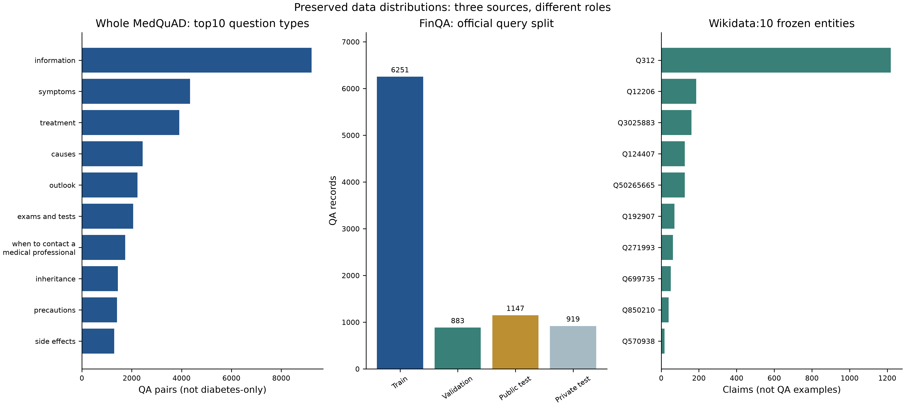
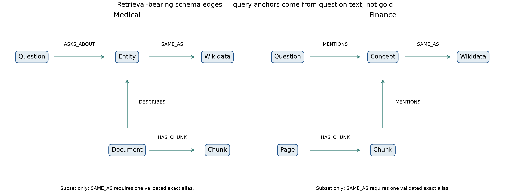
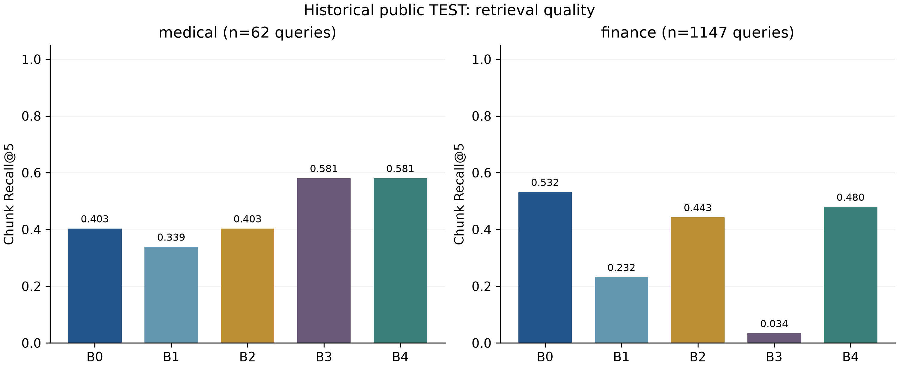
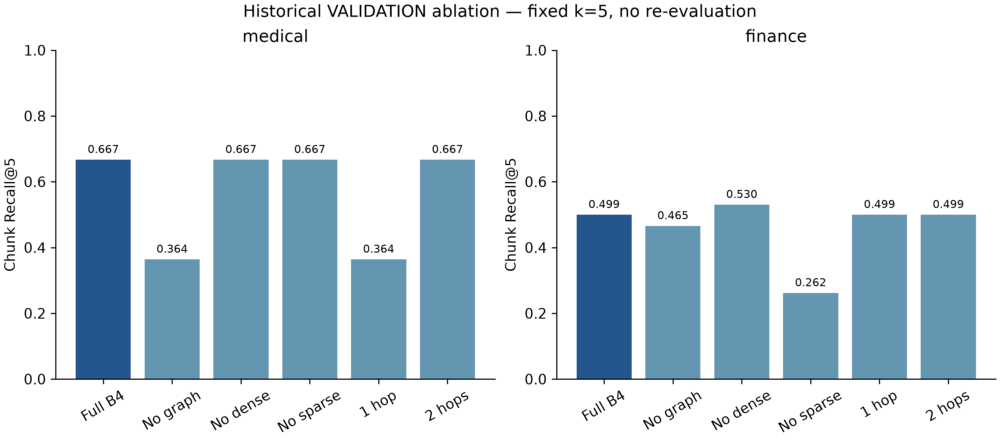
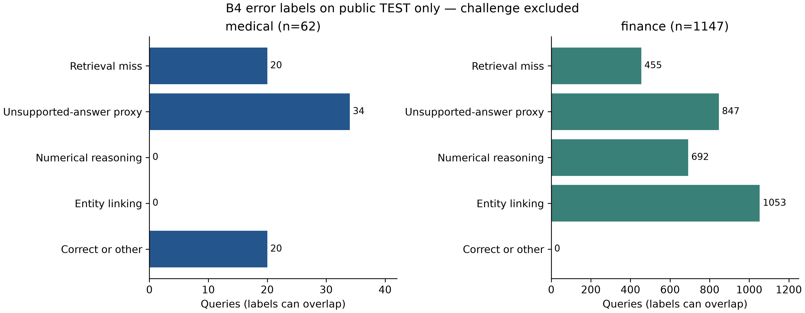
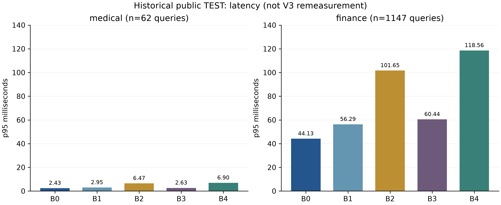
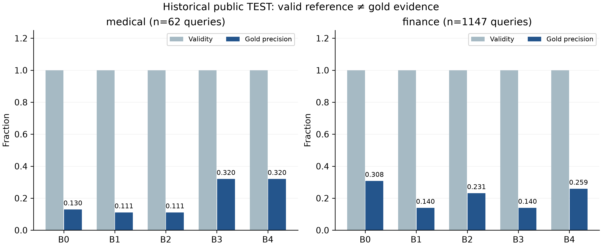

# CHƯƠNG 5. KNOWLEDGE BASE, KNOWLEDGE GRAPH VÀ RETRIEVAL-AUGMENTED GENERATION

Chương này khảo sát cách một hệ thống hỏi đáp kết hợp kho tri thức (Knowledge Base — KB), đồ thị tri thức (Knowledge Graph — KG) và sinh có tăng cường truy hồi (Retrieval-Augmented Generation — RAG). Trọng tâm không phải xây dựng một mô hình ngôn ngữ lớn mới, mà là tổ chức tri thức, truy hồi bằng chứng có nguồn gốc và tạo câu trả lời trích xuất có khả năng từ chối. Hai miền được chọn có yêu cầu kiểm chứng cao: hỏi đáp y khoa về đái tháo đường từ MedQuAD và hỏi đáp báo cáo doanh nghiệp từ FinQA. Wikidata cung cấp một lớp định danh ngoài hẹp để kiểm tra liên kết thực thể; nó không thay thế nội dung gốc của hai bộ dữ liệu.

Thực nghiệm dùng năm cấu hình B0–B4 trên cùng corpus và cùng evaluator. B0 là BM25, B1 là TF–IDF kết hợp Latent Semantic Analysis (LSA), B2 hợp nhất hai danh sách bằng Reciprocal Rank Fusion (RRF), B3 chỉ dùng lân cận đồ thị và B4 hợp nhất sparse, dense và graph. Cấu hình được chọn trên VALIDATION rồi khóa trước khi mở public TEST. TEST gồm 62 câu hỏi y khoa và 1.147 câu hỏi tài chính; private test của FinQA không được dùng vì không có đầy đủ gold reference. Tất cả metric trong chương truy ngược được tới prediction và manifest của Phase 15. Khóa cấu hình là `560c671a3920bd6bde9f7fc005f3c952f857c55969c989bb6109932623210c9e`, và public TEST chỉ được chạy một lần.

Kết quả phải được đọc theo đúng phạm vi. Hệ thống đo khả năng tìm đúng đoạn bằng chứng, tính hợp lệ của citation, chất lượng câu trả lời trích xuất và hành vi từ chối. Nó không đo chất lượng chẩn đoán lâm sàng, không thực hiện dự báo giá cổ phiếu và chưa có bộ sinh chương trình tính toán FinQA. Vì vậy, các kết quả dương về retrieval không được diễn giải thành độ đúng chuyên môn của một trợ lý y khoa hoặc tài chính hoàn chỉnh.

**Ghi nhận V3:** số liệu/citation là baseline đã khóa; Phase30 chỉ kiểm saved outputs và tích hợp, không mở public TEST. Wikidata không phải benchmark QA thứ ba.

## 5.1. Mở đầu

### 5.1.1. Từ kho tri thức đến KG và RAG

Một KB là tập hợp thông tin được lưu để máy có thể truy vấn. Nội dung có thể là tài liệu, bảng, record quan hệ, triple hoặc kết hợp nhiều dạng. Khái niệm này rộng hơn KG: một thư mục các đoạn văn đã đánh chỉ mục vẫn là KB, nhưng chưa nhất thiết mô tả quan hệ ngữ nghĩa giữa các thực thể. Trong chương này, corpus MedQuAD và FinQA cùng metadata, locator và provenance tạo thành lớp KB; KG là lớp cấu trúc bổ sung được dựng trên chính corpus đó.

KG biểu diễn tri thức thành đỉnh, cạnh và thuộc tính. Cách nhìn triple có dạng `(subject, predicate, object)` tương thích với mô hình dữ liệu RDF: tài nguyên được định danh và liên hệ bằng các cung có nhãn [@w3c2014rdfconcepts]. Tuy nhiên, triển khai của đề tài dùng property graph JSONL/GraphML thay vì một RDF store. Lựa chọn này cho phép mỗi đỉnh và cạnh mang trực tiếp `source_id`, `source_file`, `locator`, phương pháp trích xuất và mức tin cậy. Tổng quan của Hogan và cộng sự nhấn mạnh rằng KG không chỉ là một sơ đồ trực quan; chất lượng định danh, ngữ nghĩa quan hệ và provenance quyết định việc graph có thể được sử dụng đáng tin cậy hay không [@hogan2021knowledgegraphs].

RAG đưa một bước truy hồi vào trước lớp trả lời. Trong công trình gốc của Lewis và cộng sự, tham số mô hình được kết hợp với bộ nhớ ngoài không tham số để cung cấp tri thức cho bài toán ngôn ngữ [@lewis2020rag]. Thí nghiệm ở đây giữ nguyên trực giác “truy hồi trước, trả lời sau” nhưng chủ động dùng câu trả lời trích xuất, không gọi mô hình sinh bên ngoài. Thiết kế này làm giảm số biến không kiểm soát: nếu câu trả lời sai, có thể tách lỗi tìm nhầm bằng chứng, lỗi chọn câu và lỗi dữ liệu thay vì trộn thêm sai số của một bộ sinh đóng.

### 5.1.2. Vai trò và ý nghĩa của việc kết hợp

Ba thành phần giải quyết ba lớp vấn đề khác nhau. KB giữ nội dung có thể kiểm chứng. KG nối tài liệu, đoạn, câu hỏi, thực thể và khái niệm để cung cấp đường đi cấu trúc. RAG biến câu hỏi thành một danh sách bằng chứng rồi dựng câu trả lời kèm citation. Nếu không có KB, graph chỉ còn nhãn và liên kết ít nội dung. Nếu không có KG, hệ thống vẫn có thể truy hồi lexical nhưng khó mở rộng qua tên đồng nghĩa hoặc quan hệ document–entity. Nếu không có RAG, người dùng phải tự đọc danh sách tài liệu thay vì nhận một câu trả lời có giới hạn.

Sự kết hợp này không mặc nhiên tốt hơn mọi baseline. Một graph hẹp có thể bỏ sót thực thể; mở rộng hai hop có thể kéo vào đoạn không liên quan; hợp nhất nhiều ranker làm tăng latency. Vì vậy, giả thuyết được kiểm tra theo hai tầng. Tầng thứ nhất hỏi B4 có cải thiện Recall@5 so với B2 hay không. Tầng thứ hai dùng ablation để phân biệt ảnh hưởng của graph, sparse và dense. Báo cáo giữ nguyên cả trường hợp B4 cải thiện lẫn trường hợp BM25 đơn giản vẫn cao hơn.

Phạm vi “GraphRAG” trong chương cần được định nghĩa thận trọng. Công trình GraphRAG của Edge và cộng sự xây dựng community summaries để trả lời câu hỏi toàn cục trên corpus lớn [@edge2024graphrag]. Hệ thống này không tái tạo pipeline đó. Nó là RAG có hướng dẫn bởi property graph cục bộ: graph tạo danh sách đoạn ứng viên qua lân cận một hoặc hai hop, sau đó RRF hợp nhất với sparse và dense. Vì vậy, thuật ngữ chính được dùng là “KG-RAG” hoặc “graph-guided RAG”; “GraphRAG” chỉ xuất hiện khi đối chiếu với hướng nghiên cứu rộng hơn.

## 5.2. Knowledge Base và Knowledge Graph

### 5.2.1. Dữ liệu, giấy phép và phạm vi sử dụng

Ba nguồn dữ liệu được chọn vì bổ sung cho nhau. [MedQuAD](https://github.com/abachaa/MedQuAD) chứa câu hỏi–trả lời y khoa từ các trang NIH và được dùng cho case đái tháo đường [@benabacha2019medquad; @medquad2023repo]. [FinQA](https://github.com/czyssrs/FinQA) kết hợp văn bản, bảng và chương trình suy luận số trong báo cáo doanh nghiệp [@chen2021finqa]. [Wikidata](https://www.wikidata.org/wiki/Wikidata:Data_access) là knowledge base cộng tác, cung cấp QID và quan hệ ngoài [@vrandecic2014wikidata; @wikidata2026dataaccess]. Quyền sử dụng được ghi theo snapshot: MedQuAD CC BY 4.0, FinQA MIT và Wikidata CC0 1.0 [@wikidata2026copyright]. Bảng 5.1 tổng hợp kích cỡ, giấy phép và vai trò của từng nguồn.

**Bảng 5.1. Quy mô, giấy phép và vai trò của ba nguồn dữ liệu**

| Nguồn | Snapshot local | Kích cỡ logic | License | Vai trò trong thí nghiệm |
|---|---|---:|---|---|
| MedQuAD | commit `577bd37…`; 37.183.352 byte | 11.274 XML; 47.441 QA; 16.407 câu có answer | CC BY 4.0 | Corpus y khoa; lọc subset diabetes |
| FinQA | commit `0f16e2…`; 122.256.362 byte | 9.200 câu hỏi; 6.251 train, 883 dev, 1.147 public test, 919 private test | MIT | Corpus báo cáo doanh nghiệp và gold locator |
| Wikidata | 10 entity khóa revision; 3.528.666 byte | 5 entity y khoa, 5 entity tài chính; 785 property bucket; 2.056 claim | CC0 1.0 | Liên kết định danh ngoài hẹp, không phải full dump |

*Nguồn: `source_registry.csv`, dataset cards Chương 5 và `phase11_snapshot_manifest.json`; số đếm là kết quả audit snapshot local ngày 12-10-2026.*

Với MedQuAD, README upstream nêu 47.457 QA nhưng parser trên commit đã khóa đo được 47.441, chênh 16. Chương sử dụng số local vì có thể tái lập. Trong số đó, 16.407 record có answer và 31.034 record thiếu answer; hệ thống không crawl lại nội dung đã bị gỡ. Filter dựa trên focus/question tạo 274 candidate, sau loại 27 duplicate còn 247 tài liệu/câu hỏi và 762 đoạn. Group split theo focus cho 152 TRAIN, 33 VALIDATION và 62 TEST. Manual audit 60 mẫu cho 40 true positive, 0 false positive, 17 true negative và 3 false negative; inclusion precision quan sát là 1,000, nhưng recall của filter không hoàn hảo.

Với FinQA, 9.200 câu hỏi gồm 8.281 mẫu public có chương trình và 919 private-test không có đầy đủ gold để chấm. Preprocessing tạo 2.789 tài liệu trang, 86.421 đoạn và 14.108 liên kết evidence. Phân bố toán tử đầu tiên không đều: `subtract` 3.214, `divide` 3.029, `add` 1.140, `multiply` 488, `greater` 138 và nhóm table operation 272. Đây là bằng chứng rằng bài toán không chỉ là tìm một câu giống truy vấn; phần lớn câu hỏi còn cần xác định toán hạng và thực hiện chuỗi phép tính.

Wikidata snapshot chỉ có 10 entity, không đại diện cho toàn bộ Wikidata. Entity lớn nhất trong snapshot là Q312 với 1.219 claim. Mục tiêu của tập hẹp là kiểm tra pipeline cache, revision, alias và `SAME_AS`, không tối đa hóa entity coverage. Cách dùng này phù hợp với mô hình cộng tác và định danh ổn định của Wikidata nhưng không cho phép suy luận rằng graph đã bao phủ đầy đủ y khoa hoặc báo cáo doanh nghiệp.



**Hình 5.1. Phân bố chính của ba nguồn dữ liệu trong snapshot đã khóa.**

*Nguồn: tác giả tổng hợp từ `phase11_data_audit.json`; ba biểu đồ gốc được sinh bởi `build_phase11_sources.py`.*

Hình 5.1 cho thấy MedQuAD tập trung vào các nhóm `information`, `symptoms`, `treatment`, `causes` và `outlook`; riêng nhóm `information` có 9.214 câu. FinQA có TRAIN lớn hơn đáng kể dev và public TEST, còn Wikidata có phân bố claim lệch mạnh theo entity. Hình này cho biết cấu trúc và độ lệch của snapshot, nhưng không phản ánh trực tiếp độ khó retrieval của subset diabetes hay chất lượng câu trả lời cuối.

Một mẫu MedQuAD sau chuẩn hóa có `document_id`, `question_id`, `focus`, `question`, `answer`, `source_url` và `split`. Ví dụ câu hỏi “How to prevent Kidney Disease of Diabetes?” được nối đến tài liệu cùng focus và các chunk của tài liệu đó. Một mẫu FinQA giữ `report_id`, `page_id`, câu hỏi, answer, program và locator như `text_3` hoặc `table_1`. Với Wikidata, record giữ QID, revision ID, label, alias và claim; chỉ alias exact đã kiểm định mới được tạo cạnh `SAME_AS`. Các mẫu hiện hành nằm trong ba EDA card Phase24; đây là ví dụ dữ liệu, không phải output mô hình được chấm lại. Các processed JSONL lớn lịch sử không cần được dựng lại để demo bundle compact.

### 5.2.2. Schema, provenance và hai đồ thị miền

Schema thống nhất dùng các loại đỉnh `Document`, `Chunk`, `Question`, `MedicalEntity`, `Company`, `Report`, `Page`, `FinancialConcept`, `QuestionType` và `WikidataEntity`. Các cạnh chính gồm `HAS_CHUNK`, `ASKS_ABOUT`, `DESCRIBES`, `MENTIONS`, `PART_OF`, `HAS_PAGE`, `HAS_QUESTION` và `SAME_AS`. Câu hỏi không nối trực tiếp đến gold chunk bằng một cạnh phục vụ retrieval; gold evidence chỉ nằm trong artifact đánh giá. Quy tắc này ngăn leakage rõ nhất: graph không được biết trước đáp án cần tìm. Hình 5.2 trình bày schema, còn quy mô sau kiểm tra được báo trong Bảng 5.2.



**Hình 5.2. Tập con các cạnh phục vụ truy hồi trong schema property graph; không phải toàn bộ topology.**

*Nguồn: `docs/ch5/graph_schema.md`, extractor `build_phase13_graphs.py` và `phase13_graph_manifest.json`; hình vẽ lại ở presentation r2. Bảng mô tả cũ còn một dòng nói kế thừa gold document; extractor và mục chống rò rỉ thực tế dùng longest exact phrase từ câu hỏi để tạo ASKS_ABOUT, không dùng gold để chọn anchor.*

**Bảng 5.2. Thống kê hai property graph sau kiểm tra toàn vẹn**

| Miền | Đỉnh | Cạnh | Thành phần nội dung chính | Liên kết Wikidata | Provenance | Ghi chú |
|---|---:|---:|---|---:|---:|---|
| Medical | 1.336 đỉnh | 1.506 | 247 document, 762 chunk, 247 question, 62 entity | 3 exact `SAME_AS`; coverage 4,84% | 100% | Không có dangling/duplicate edge |
| Finance | 99.355 đỉnh | 97.809 | 799 report, 2.789 page, 86.421 chunk, 9.200 question, 137 company | 5 exact `SAME_AS`; coverage 3,55% | 100% | 8.340 question cô lập do không có concept/entity match |

*Nguồn: `phase13_graph_statistics.json`, `phase13_entity_link_audit.csv` và manifest Phase 13.*

Medical graph có 1.336 đỉnh và 1.506 cạnh; finance graph có 99.355 đỉnh và 97.809 cạnh. Entity-link audit gồm 203 hàng: 8 liên kết, 195 unresolved và 0 forced ambiguous link. Coverage thấp là hệ quả có chủ ý của snapshot Wikidata hẹp và chính sách không ép khớp. Bảng 5.2 cho thấy provenance đạt 100% và không có cạnh treo, nhưng không cho phép kết luận graph có ontology hoàn chỉnh. Đặc biệt, 8.340 câu hỏi finance cô lập dự báo rằng graph-only retrieval sẽ yếu nếu câu hỏi không chứa ticker hoặc financial concept trong lexicon.

Mỗi node/edge được gắn nguồn tạo và locator. Ví dụ, `Chunk` trỏ về `document_id` hoặc `page_id`; `Company` được suy ra từ report ID; `FinancialConcept` chỉ được tạo bằng từ điển exact cố định. Việc giữ phương pháp trích xuất quan trọng hơn số lượng cạnh: một graph nhiều cạnh nhưng không biết cạnh đến từ đâu sẽ khó kiểm toán và có thể vô tình mã hóa gold. JSON adjacency lưu cả hướng `out` và `in` để runtime mở rộng lân cận không cần Neo4j server.

## 5.3. Retrieval-Augmented Generation

### 5.3.1. Ingestion, chunking và lập chỉ mục

Pipeline bắt đầu bằng snapshot bất biến, sau đó parse, chuẩn hóa định danh, loại duplicate, chia split và chunk. MedQuAD dùng đoạn tối đa 120 từ, overlap 20 từ. FinQA giữ từng `pre_text`, `post_text` hoặc bảng như một chunk gắn locator upstream; không trộn bảng với câu ở trang khác. Tất cả ranker B0–B4 dùng cùng 762 đoạn medical và 86.421 đoạn finance. Việc cố định corpus giúp chênh lệch metric phản ánh cơ chế xếp hạng thay vì khác biệt dữ liệu đầu vào.

BM25 B0 dùng tần suất từ có bão hòa và chuẩn hóa độ dài. Từ khóa hiếm có giá trị hơn từ phổ biến; lặp một từ rất nhiều lần không làm điểm tăng vô hạn. Đoạn dài được điều chỉnh để không tự chiếm ưu thế.


Hai mức điều chỉnh đã khóa là k1=1,5 (bão hòa tần suất) và b=0,75 (chuẩn hóa độ dài). BM25 phù hợp khi câu hỏi và bằng chứng chia sẻ từ khóa hiếm; nền tảng Okapi đã được đánh giá từ các chiến dịch TREC đầu tiên [@robertson1994okapi]. Điểm yếu là synonym hoặc cách diễn đạt khác có thể không gặp nhau trong không gian token.

B1 biểu diễn TF–IDF rồi giảm xuống 128 chiều bằng Truncated SVD. Đây là một hiện thực hóa nhẹ của Latent Semantic Analysis, phương pháp tìm cấu trúc tiềm ẩn từ ma trận term–document [@deerwester1990lsa]. Vector truy vấn và chunk được so bằng cosine. “Dense” trong chương vì vậy nghĩa là vector LSA dày sau SVD, không phải embedding từ một transformer đã pretrained. Cách gọi này tránh diễn giải quá mức năng lực ngữ nghĩa của baseline.

B2 dùng weighted RRF để hợp nhất thứ hạng B0/B1. Với danh sách (R_j), hạng (r_j(d)) và trọng số (w_j):

\[
\operatorname{RRF}(d)=\sum_j\frac{w_j}{60+r_j(d)}.
\]

RRF dựa trên thứ hạng nên không cần hiệu chỉnh hai thang điểm BM25 và cosine; công trình gốc cho thấy cách hợp nhất này cạnh tranh tốt với từng ranker riêng [@cormack2009rrf]. Ở công thức trên, d là chunk, j là nhánh retriever, w_j là trọng số, r_j(d) là hạng của chunk; 60 là hằng làm trơn đã khóa, không phải xác suất. Nhánh không chứa chunk đóng góp0. Ví dụ synthetic: chunk đứng hạng1/2 ở hai nhánh cho điểm 0,75/61 +0,25/62 ≈0,01633. Trọng số sparse 0,75 được chọn trên macro Recall@5 của hai miền ở VALIDATION, không chọn theo TEST.

B3 lấy anchor từ câu hỏi bằng exact entity/concept lexicon, mở rộng tối đa hai hop để lấy tập ứng viên; `graph_filter_ranking` ưu tiên thứ tự BM25 trong tập đó, rồi bổ sung ID còn lại theo thứ tự cố định. B4 hợp nhất B0, B1 và B3 bằng weighted RRF với trọng số sparse/dense/graph là 0,6/0,1/0,3. Nếu không tìm thấy anchor, nhánh graph trả danh sách rỗng thay vì đoán entity. Điều đó bảo vệ precision nhưng khiến B3 abstain nhiều trong finance. Bảng 5.3 khóa vai trò đối chứng của từng cấu hình.

**Bảng 5.3. Năm cấu hình retrieval và mục đích đối chứng**

| Mã | Thành phần | Cấu hình khóa | Câu hỏi đối chứng |
|---|---|---|---|
| B0 | BM25 | (k_1=1,5), (b=0,75) | Lexical retrieval đơn giản mạnh đến đâu? |
| B1 | TF–IDF + LSA | 12.000 feature, 128 chiều | Biểu diễn tiềm ẩn nhẹ có vượt sparse không? |
| B2 | BM25 + LSA | RRF (k=60), sparse weight 0,75 | Fusion không graph cải thiện gì? |
| B3 | Graph-only | exact anchor, tối đa 2 hop | Cấu trúc graph tự nó đủ dùng không? |
| B4 | Sparse + dense + graph | RRF (k=60), trọng số 0,6/0,1/0,3 | Toàn bộ KG-RAG thay đổi retrieval thế nào? |

*Nguồn: `phase14_locked.json`, `phase15_locked.json` và `evaluation_contract.md`.*

### 5.3.2. Trả lời grounded, citation và từ chối

Sau retrieval, lớp answer chọn một span/câu từ các chunk top-k, không sinh thêm sự kiện. Citation được tạo từ ID của chính chunk đã truy hồi và validator yêu cầu ID tồn tại trong corpus. Nếu overlap giữa câu hỏi và bằng chứng dưới ngưỡng, nếu không có graph anchor ở B3, hoặc nếu guardrail nhận diện truy vấn ngoài miền/prompt injection, hệ thống từ chối và không phát citation. “Citation validity = 1,000” chỉ có nghĩa mọi citation trỏ đến record hợp lệ; nó không đồng nghĩa citation là gold evidence hoặc câu trả lời đúng.

Challenge set có 16 câu, gồm 8 medical và 8 finance; mỗi miền có 4 out-of-domain và 4 adversarial. B3 và B4 đều đạt 16/16 expected abstention, đồng thời citation-free 16/16. Kết quả này chứng minh rule hoạt động trên bộ challenge đã thiết kế. Nó không chứng minh hệ thống an toàn trước mọi kiểu prompt injection hoặc mọi câu hỏi nguy hiểm ngoài thực tế.

### 5.3.3. Protocol và metric

MedQuAD dùng grouped split 152/33/62 để cùng focus không bị rải tùy ý. FinQA giữ official split 6.251/883/1.147/919. Không có page trùng giữa public split, nhưng company-year report key vẫn overlap 197 cặp train–validation, 243 train–test và 93 validation–test. Đây là limitation cấu trúc của protocol official được giữ lại để so sánh; báo cáo không gọi split này là hoàn toàn độc lập theo doanh nghiệp/năm.

Retrieval được đo ở (k\in\{1,3,5,10\}). Chunk Recall@k bằng tỷ lệ câu hỏi có ít nhất một gold chunk trong top-k; document Recall@k dùng document/page; MRR@10 thưởng gold xuất hiện sớm. Answer dùng normalized exact match và token F1. Citation validity đo ID hợp lệ; citation gold precision đo citation có trùng gold không. FinQA execution/program accuracy được khai báo nhưng program accuracy là `not applicable` vì B0–B4 không sinh program. Latency p50/p95 là phép đo môi trường local, dùng để so cấu hình trong cùng lượt chạy, không phải cam kết SLA cloud.



**Hình 5.3. Chunk Recall@5 trên public TEST, báo riêng medical và finance.**

*Nguồn: `phase15_test_metrics.json`; public TEST chạy one-shot bởi `build_phase15_experiments.py` sau khi khóa cấu hình.*

**Bảng 5.4. Kết quả public TEST của năm cấu hình**

| Miền | Mô hình | Recall@5 | MRR@10 | Token F1 | Citation validity | p95 (ms) |
|---|---|---:|---:|---:|---:|---:|
| Medical | B0 | 0,403 | 0,250 | 0,186 | 1,000 | 2,428 |
| Medical | B1 | 0,339 | 0,210 | 0,208 | 1,000 | 2,946 |
| Medical | B2 | 0,403 | 0,232 | 0,193 | 1,000 | 6,469 |
| Medical | B3 | 0,581 | 0,418 | 0,234 | 1,000 | 2,634 |
| Medical | B4 | 0,581 | 0,418 | 0,234 | 1,000 | 6,898 |
| Finance | B0 | 0,532 | 0,404 | 0,0001 | 1,000 | 44,134 |
| Finance | B1 | 0,232 | 0,162 | 0,0001 | 1,000 | 56,285 |
| Finance | B2 | 0,443 | 0,320 | 0,0000 | 1,000 | 101,650 |
| Finance | B3 | 0,034 | 0,020 | 0,0017 | 1,000 | 60,438 |
| Finance | B4 | 0,480 | 0,353 | 0,0001 | 1,000 | 118,561 |

*Nguồn: `phase15_test_metrics.csv/json`; số làm tròn để trình bày, dữ liệu máy đọc giữ precision gốc.*

Hình 5.3 và Bảng 5.4 cho thấy hai miền có hành vi khác nhau. Medical B4 tăng Recall@5 từ 0,403 của B2 lên 0,581; bootstrap difference là +0,177 với khoảng tin cậy 95% từ 0,096 đến 0,274. Finance B4 tăng từ 0,443 lên 0,480 so với B2; difference +0,037, khoảng 0,022–0,052. Tuy nhiên, B4 vẫn thấp hơn B0 = 0,532 trên finance và có p95 118,561 ms so với 44,134 ms. Do đó kết luận phù hợp là graph-guided fusion có hiệu ứng dương so với hybrid B2 trong protocol đã khóa, không phải B4 luôn là lựa chọn cao nhất.



**Hình 5.4. Ablation của B4 trên VALIDATION theo miền.**

*Nguồn: `phase15_ablation_validation.csv`; ablation chạy trước public TEST.*

Hình 5.4 cho thấy ablation medical có Recall@5 full B4 = 0,667; bỏ graph giảm còn 0,364, còn bỏ dense hoặc bỏ sparse vẫn là 0,667. Với finance, full = 0,499; bỏ graph = 0,465, bỏ dense tăng lên 0,530 và bỏ sparse giảm mạnh còn 0,262. Hai hop cần thiết cho medical vì hop 1 chỉ đạt 0,364; finance hop 1 và 2 cùng 0,499. Kết quả này xác nhận graph có đóng góp lớn trong medical và nhỏ trong finance; đồng thời dense branch làm giảm finance validation ở cấu hình hiện tại. Vì B4 thay đổi cả trọng số fusion so với B2, chênh lệch TEST B4–B2 không được quy toàn bộ cho graph.

## 5.4. Case study KB và RAG cho bệnh đái tháo đường

### 5.4.1. Truy hồi qua thực thể và đường đi graph

Case medical sử dụng 247 tài liệu đã lọc, 762 chunk và 62 focus group. Khi câu hỏi chứa một focus/entity exact, B3/B4 tìm node `MedicalEntity`, đi qua cạnh `DESCRIBES` tới `Document`, rồi `HAS_CHUNK` tới các đoạn. Ví dụ “How to prevent Kidney Disease of Diabetes?” có đường đi từ entity/focus tới tài liệu và chunk liên quan. B4 đưa gold chunk vào top-5 trong khi B2 bỏ lỡ. Hai case khác về điều trị biến chứng mắt và yếu tố nguy cơ cũng nhận lợi ích từ graph path.

Điểm mạnh của graph ở đây xuất phát từ cấu trúc metadata MedQuAD: focus của tài liệu gắn khá trực tiếp với chủ đề câu hỏi. Điều đó giải thích vì sao graph-only B3 đạt Recall@5 0,581, cao hơn B0/B2 0,403. Nhưng 3/62 focus/entity local link tới Wikidata không phải nguyên nhân chính; phần lớn đường đi dùng entity local. Nói cách khác, KG có ích vì tổ chức quan hệ nội bộ đúng, không phải vì thêm thật nhiều dữ liệu ngoài.

Normalized exact match của B4 là 0,032 và token F1 là 0,234. Một span trích xuất có thể tìm đúng vùng bằng chứng nhưng không trùng toàn bộ cách diễn đạt của answer gold. Ngược lại, Recall@5 tốt không bảo đảm span cuối cùng chính xác. Vì vậy, hệ thống hiển thị evidence và citation để người dùng kiểm tra, đồng thời giữ cảnh báo đây không phải tư vấn y khoa. Không dùng output để chẩn đoán, kê đơn, thay đổi thuốc hoặc thay thế chuyên gia y tế.

### 5.4.2. Sai số và giới hạn an toàn

Trong 62 câu TEST medical, phân tích B4 ghi 20 retrieval miss, 34 unsupported-answer proxy, 0 nhãn entity linking trên TEST (8 nhãn này thuộc challenge) và 20 trường hợp correct-or-other; các nhóm có thể chồng lấp nên tổng không phải partition độc quyền. Retrieval miss xảy ra khi gold không nằm trong top-k. Unsupported-answer proxy xảy ra khi câu trả lời trích xuất không được metric đối chiếu xem là đủ hỗ trợ, dù citation ID vẫn hợp lệ. Entity-link error phản ánh graph hẹp hoặc alias không khớp.

Không có case B4 làm giảm Recall@5 so với B2 trên medical TEST: 11 câu được giúp và 51 câu trung tính. Mẫu TEST chỉ có 62 câu nên không nên suy rộng tỷ lệ này ra toàn bộ MedQuAD hay dữ liệu bệnh nhân. Manual filter còn ba false negative quan sát được, dataset chứa câu trả lời giáo dục sức khỏe chứ không phải hồ sơ lâm sàng, và snapshot chỉ giữ nội dung còn tồn tại ở nguồn. Những giới hạn đó ngăn việc dùng metric retrieval như một chỉ số về hiệu quả điều trị hoặc an toàn y khoa.

## 5.5. Case study KB và RAG cho báo cáo doanh nghiệp

### 5.5.1. Retrieval không đồng nhất với suy luận số

FinQA yêu cầu tìm số liệu trong văn bản/bảng và thường thực hiện phép toán. B0–B4 của đề tài chỉ truy hồi và chọn câu; không sinh chương trình như `divide(subtract(...), ...)` và không có calculator được nối vào answer path đánh giá. Vì vậy, normalized exact match B0/B1/B2/B4 đều bằng 0,000 trên public TEST, execution accuracy bằng 0,000; B3 có 0,001744 do trùng ngẫu nhiên hiếm. Program accuracy được ghi `not applicable`, không được thay bằng 0 để giả vờ đã đánh giá một module không tồn tại.

Graph finance nối company–report–page–chunk và chunk–financial concept. Nhưng chỉ 137 company, bốn concept chuẩn hóa và năm `SAME_AS` exact hiện diện. Với nhiều câu hỏi như “what percentage…”, token chung không đủ xác định company/report, dẫn đến không có graph candidate. B3 vì vậy abstain 91,9% và Recall@5 chỉ 0,034. B4 tránh phụ thuộc hoàn toàn vào graph nhờ BM25/LSA, đạt 0,480, song vẫn không vượt BM25 0,532.

Các case giúp và làm xấu phải được giữ cùng nhau. Có 61/1.147 câu B4 đưa gold vào top-5 khi B2 không có; 19 câu làm ngược lại và 1.067 câu trung tính. Các ví dụ làm xấu gồm câu hỏi về tỷ lệ capital spending, phần trăm giao dịch principal do interest rate và employee portion. Với một số case được giúp, trace không có graph candidate; thay đổi đến từ trọng số hybrid/fusion chứ không thể gán cho graph. Đây là lý do chương gọi chênh lệch B4–B2 là hiệu ứng của toàn cấu hình.

### 5.5.2. Phân tích lỗi, provenance và giới hạn sử dụng



**Hình 5.5. Các nhãn lỗi/proxy của B4 trên hai miền public TEST.**

*Nguồn: `phase15_error_analysis.csv` và `phase15_test_metrics.json`; nhóm lỗi có thể chồng lấp.*

Finance có 455 retrieval miss, 692 numerical-reasoning error, 847 unsupported-answer proxy và 1.053 entity-linking observation trên TEST;8 nhãn bổ sung thuộc challenge. JSON aggregate gốc cộng TEST+challenge nên giữ1.061/8 nhãn entity linking finance/medical; hình và đoạn phân tích TEST ở đây chỉ dùng1.053/0. Không đổi CSV/JSON gốc. Các con số lớn không được cộng để suy ra tỷ lệ lỗi vì một query có thể mang nhiều nhãn. Hình 5.5 chỉ ra điểm nghẽn: ngay cả khi retrieval được cải thiện, lớp trả lời trích xuất không giải được phép tính; còn graph coverage hẹp làm cho nhánh graph không ổn định. Bảng 5.5 đặt kết quả, quy tắc an toàn và điều không được suy diễn cạnh nhau. Điều chưa thể kết luận là “KG-RAG giải được FinQA”, vì metric answer gần 0 bác bỏ kết luận đó.

**Bảng 5.5. Tổng hợp case, lỗi và quy tắc an toàn**

| Miền/case | Quan sát có bằng chứng | Diễn giải cho phép | Không được diễn giải |
|---|---|---|---|
| Medical tổng thể | B4–B2 Recall@5 +0,177; CI 95% [0,096; 0,274] | Graph-guided fusion tăng retrieval trong TEST đã khóa | Chẩn đoán hoặc tư vấn điều trị chính xác |
| Finance tổng thể | B4–B2 +0,037; CI [0,022; 0,052], nhưng B0 = 0,532 > B4 = 0,480 | B4 hơn B2, BM25 vẫn mạnh hơn | KG-RAG vượt mọi baseline hoặc giải numerical QA |
| Challenge | B3/B4 từ chối đúng 16/16 và không phát citation | Guardrail đúng trên bộ 16 câu | An toàn trước mọi tấn công ngoài thực tế |
| Citation | Validity 1,000 cho tất cả B0–B4 | ID citation đều tồn tại trong corpus | Citation luôn là gold hoặc answer luôn đúng |
| Deploy | Runtime CPU-only 65,23 MiB, không cần API key | Có thể chạy demo bounded trên Render | SLA, tính sẵn sàng cao hoặc khuyến nghị đầu tư |

*Nguồn: `phase15_test_metrics.json`, `phase15_bootstrap_ci.csv`, `phase15_case_studies.jsonl` và `phase16_deployment_report.md`.*

Case tài chính chỉ dùng để đọc báo cáo doanh nghiệp đã có trong snapshot. Kết quả không phải khuyến nghị đầu tư, không dự báo giá/chuyển động thị trường và không đánh giá doanh nghiệp. Citation cho biết câu nào hoặc bảng nào đã được truy hồi, không xác nhận số tính cuối. Một hệ thống sản xuất cần program generator, parser toán tử an toàn, calculator deterministic, kiểm tra đơn vị và evaluation execution trước khi trả lời câu hỏi tỷ lệ hoặc chênh lệch.
## 5.6. Hợp các hàm và contract dùng chung

Ví dụ demo y khoa nhận một câu hỏi, trả năm slot B0–B4 trên cùng input; mỗi slot có thể
trả lời trích xuất hoặc từ chối. Đây là retrieval CPU dùng index cũ, không phải mô hình
scratch/Keras/PyTorch mới hay mạng sáu tầng. Quy tắc độ sâu thuộc Chương2–4; số tham số
neural/layer ở contract Chương5 là null vì không áp dụng, không dùng0 thay cho số chưa đo.

Hợp hàm tổng thể được hiểu là `F = cite ∘ answer ∘ retrieve ∘ validate`:
**request → kiểm tra → các nhánh truy hồi → fusion nếu có → chọn trích đoạn → citation/job**.
BM25/LSA/graph là các nhánh song song; ký hiệu hợp hàm không có nghĩa bắt mọi slot chạy
tuần tự qua cả ba. B3 chỉ nhận candidate từ graph nhưng vẫn dùng lexical order để xếp
ứng viên; “graph-only” không có nghĩa không sử dụng BM25 cho thứ tự trong candidate set.

| Function/signature | Vai trò | Input/output và trường hợp biên |
|---|---|---|
| `validate` / `validate_request(request)` | Kiểm tra dataset, miền, độ dài và schema | request JSON → question string; Input lạ hoặc rỗng bị từ chối. Source: `src/ch05_knowledge_rag/service.py` |
| `bm25` / `BM25Index.search(query, top_k)` | Tìm đoạn chia sẻ từ khóa và điều chỉnh độ dài | string + sparse index → ranked (chunk_id, score); Không có token trong từ điển: danh sách rỗng. Source: `src/term_paper/tools/phase14_rag.py` |
| `lsa` / `DenseLSAIndex.search(query, top_k)` | TF–IDF/SVD rồi so vector LSA | string + fitted LSA → ranked (chunk_id, score); Không có từ trong vocabulary: danh sách rỗng. Source: `src/term_paper/tools/phase14_rag.py` |
| `graph` / `graph_candidates(question, graph)` | Khớp tối đa bốn nhãn anchor và lấy chunk reachable | question + compact anchor map → candidate IDs + anchor→chunk paths; Không match anchor: không đoán entity. Source: `src/ch05_knowledge_rag/runtime.py` |
| `rrf` / `weighted_rrf(rankings, weights, top_k, rrf_k)` | Hợp thứ hạng, không cộng trực tiếp BM25 với cosine | ranked lists + weights → ranked IDs; Nhánh rỗng không có đóng góp; trọng số hợp lệ cộng bằng1. Source: `src/term_paper/tools/phase15_kgrag.py` |
| `answer` / `grounded_answer(query, ranking, chunk_lookup, ...)` | Chọn trích đoạn đạt overlap, không tạo nội dung mới | question + retrieved chunk texts → answer/citations/abstention; Thiếu bằng chứng hoặc guardrail: từ chối không citation. Source: `src/term_paper/tools/phase14_rag.py` |
| `cite` / `KgRagService.compare(request)` | Đóng gói V3 job với citation tới container được bảo toàn | answer + chunk/document IDs → five-slot job + evidence; URL cấp dataset; không giả locator raw đã bị lược khỏi bundle. Source: `src/ch05_knowledge_rag/service.py` |
| `browse` / `inspect_entity(qid)` | Đọc entity JSON và kiểm revision/hash | one of ten allowlisted QIDs → claims/revision/citation; Không có QID: không tải mạng hoặc tạo QA score. Source: `src/ch05_knowledge_rag/structural.py` |

Bảng này được sinh từ `DESCRIPTIONS` trong `src/ch05_knowledge_rag/catalog.py`, cùng nguồn
với15 pipeline contract ở `artifacts/manifests/phase30/contracts/`. Các API request/job/
citation vẫn kiểm bằng schema V3 gốc; extension `phase30.retrieval_pipeline.1` không sửa
schema neural hoặc protocol đã khóa. Năm contract Wikidata ghi unavailable cho QA,
không tạo thêm năm kết quả benchmark. Công cụ riêng `inspect_entity('Q12206')` trả revision,
186 claim và hash snapshot; không tải mạng hay sinh câu trả lời dựa trên một QA gold giả.

Đoạn code kết nối chính, với chữ ký/giá trị đầy đủ nằm trong source:

```python
candidates, paths = graph_candidates(question, bundle.graph[domain])
rankings = compare_rankings(sparse, dense, candidates, 0.75,
                           {"sparse": 0.6, "dense": 0.1, "graph": 0.3}, 10, 60)
# Mỗi ranking đi qua grounded_answer, rồi đóng gói job/citation.
```

Demo tìm trong toàn corpus compact không còn split metadata; protocol benchmark lịch sử giới hạn candidate theo split. Demo câu hỏi tự do dùng graph anchor compact, khác graph/query-ID lịch sử của TEST.
Không xem output demo là lần chấm lại hoặc tái hiện hệt ranking TEST. Corpus bundle không
còn metadata split/URL raw từng chunk; MedQuAD demo là câu hỏi minh họa tự soạn,
không gán TRAIN/TEST. FinQA demo dùng câu hỏi TRAIN trong EDA card. Citation V3 có
`source_sha256` của container `kg_chunks.jsonl.gz`, locator chunk/document ID và URL
nguồn cấp dataset. Hash xác minh container local nêu ở locator, không phải bytes của
URL landing page; không giả rằng đã phục hồi raw URL/locator từng đoạn bị lược khỏi bundle.



**Hình 5.6. p95 latency đọc nguyên artifact Phase15; không đo lại trên runtime mới.**
Số đo demo chỉ cộng component dùng chung và answer, loại cold load/serialize; không phải
năm benchmark độc lập hoặc HTTP latency và không gộp với số TEST trong hình.



**Hình 5.7. Citation validity và gold precision lịch sử cho hai miền.**
Validity1,000 trong khi gold precision thấp là bằng chứng cụ thể rằng nguồn có thể tồn tại
nhưng không đúng evidence cần thiết. Giữ hai phép đo riêng giúp tránh trình bày quá mức.

## 5.7. Cầu nối sang hệ đa tác tử

Prototype trước đây có một router chọn medical/finance rồi gọi retriever. Đây chưa phải
benchmark hệ nhiều agent độc lập. Chương5 dừng ở bằng chứng và truy hồi; Chương6 sẽ so
A0/A1/A2 với router, specialist, verifier và reporter, dùng tool/evidence đã khóa của chương
này. Hệ nhiều agent không mặc nhiên sửa được nhược điểm reasoning số FinQA hoặc coverage
graph; các lợi ích đó phải được đo riêng ở Phase31.

## 5.8. Triển khai ngắn gọn

Runtime CPU kế thừa sáu artifact68.393.687 byte,87.183 chunk và203 graph anchor;
không cần GPU, Neo4j server, API key hoặc gọi LLM bên ngoài. V3 lazy loader kiểm manifest,
role/path/size/hash/budget trước khi nạp bốn index joblib local được allowlist. Không nhận
uploaded pickle hoặc đường dẫn từ request. Namespace `term_paper` giữ để load class cũ;
không fit/rebuild/re-serialize artifact vì migration. Lỗi bundle trả đủ slot unavailable
với lỗi có cấu trúc. Guardrail từ chối câu nguy hiểm trước khi nạp model, nhưng chỉ là rule
hữu hạn, không bảo đảm an toàn tổng quát.

Ba notebook và CLI `scripts.demo_phase30` cho local demo; catalog đã có descriptor cho ba
dataset tab. API contract đã kiểm local, còn tích hợp HTTP/React V3 ở Phase32–33 và deploy
Render phải được kiểm riêng. Không dùng ảnh giao diện Agent cũ như bằng chứng cloud hiện
tại. Hướng dẫn vận hành dài đặt `docs/phase30_operations.md`; deploy không thành chương riêng.

## 5.9. Tiểu kết

KG hỗ trợ truy hồi rõ ở medical, nhưng B4 không vượt BM25 trên finance. Chất lượng retrieval
và tính hợp lệ citation không giải quyết thay reasoning số, chẩn đoán hoặc tư vấn tài chính.
Phase30 giữ nguyên metric, citation lịch sử, raw/config và TEST run_count1; bản V3 chỉ thêm
contract/provenance và demo có phạm vi rõ. Ba nguồn thật gồm hai miền QA và một snapshot
cấu trúc, không phải ba phép đánh giá QA tương đương.
