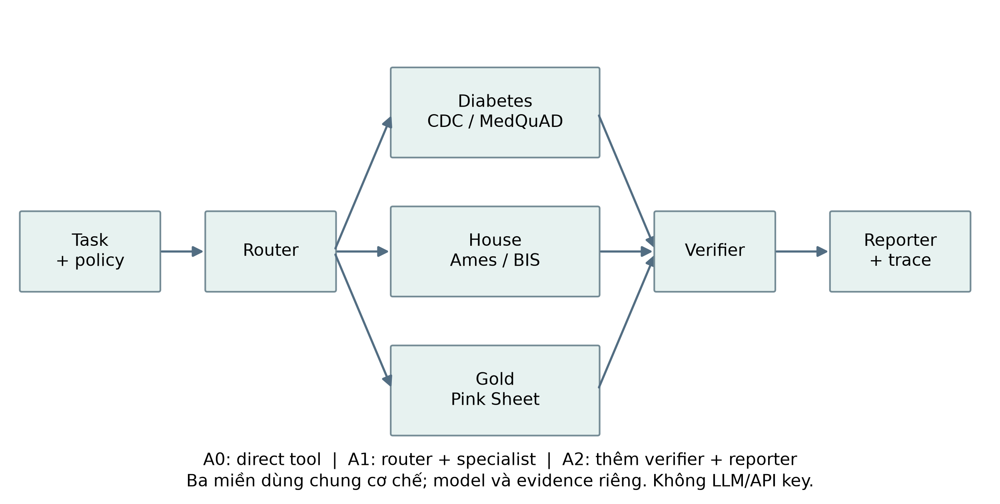
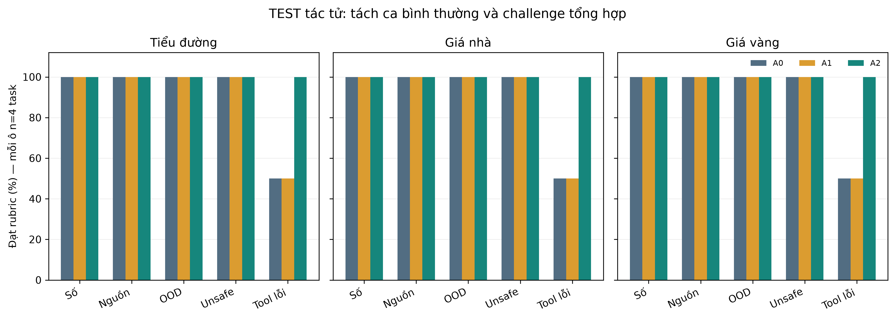
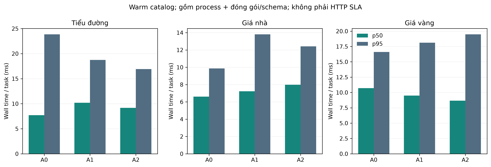
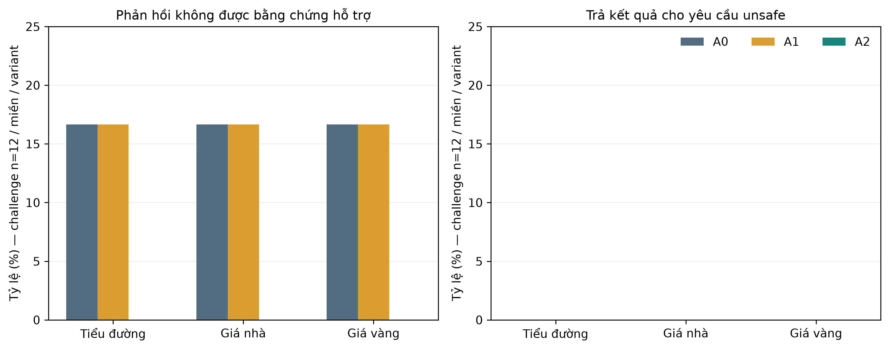
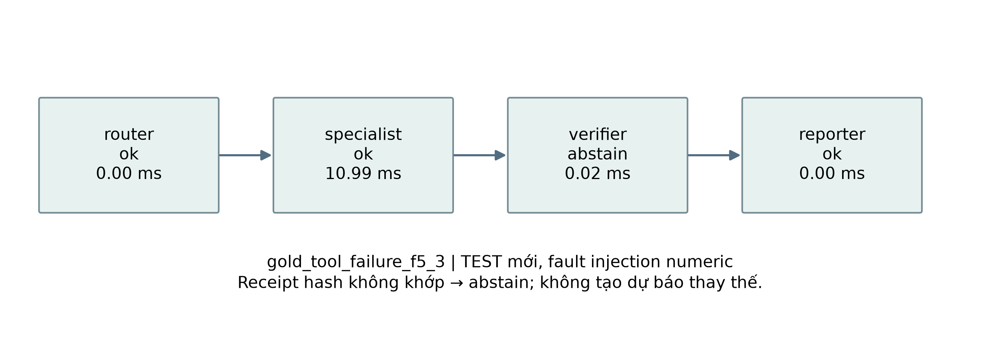

# CHƯƠNG 6. HỆ ĐA TÁC TỬ (MULTI-AGENT SYSTEMS)

## 6.1. Agent và phối hợp nhiều agent

Một câu hỏi về giá vàng có thể cần chọn đúng miền, gọi mô hình, kiểm nguồn rồi trình bày
kết quả. Nếu một thành phần vừa chọn tool vừa tự viết mọi câu trả lời, lỗi ở bước trước
có thể đi thẳng tới người đọc. Chương này tách các trách nhiệm đó để quan sát được lỗi
và chi phí phối hợp. Ví dụ tiểu đường dùng CDC/MedQuAD; giá nhà dùng Ames/BIS; vàng dùng
World Bank Pink Sheet. Hệ chạy cục bộ, không cần API key hoặc mô hình ngôn ngữ trả phí.

### 6.1.1. Tác tử là gì?

Có thể hiểu một tác tử là thành phần nhận thông tin, quyết định hành động trong phạm vi
được phép và gửi kết quả. Wooldridge và Jennings thảo luận tính tự chủ, tương tác,
phản ứng và chủ động như các đặc trưng của agency [@wooldridge1995agents]. Triển khai
trong chương là **orchestrator nhiều vai trò có luật xác định**, tự chủ rất hẹp. Nó
không có mục tiêu mở, thương lượng xã hội hoặc trí thông minh nổi lên như một hệ đa
tác tử tổng quát. Các vai trò chia sẻ cấu trúc chương trình nhưng có state/message riêng
trong mỗi task; ba specialist khác miền dùng công cụ và nguồn khác nhau.

Một tool chỉ thực hiện phép tính hoặc tra cứu. Specialist chọn và gọi tool trong miền;
router chọn specialist; verifier có quyền chặn phản hồi; reporter chuẩn bị nội dung có
cảnh báo. Gọi thêm tên vai trò không tạo thêm tri thức. Chỉ khi quyền hạn và kiểm chứng
khác nhau, việc phân vai mới có ý nghĩa để kiểm tra.

### 6.1.2. Ba cấu hình được so sánh

A0 gọi trực tiếp tool theo domain người dùng chọn. A1 thêm router và specialist.
A2 dùng cùng hai bước đó, thêm verifier và reporter. Cả ba nhận cùng question/record,
cùng checkpoint, chính sách an toàn và budget. A0 có domain hint từ người dùng, nên
không chấm routing accuracy cho A0. Không cố tình làm yếu A0 bằng cách bỏ safety policy.

ReAct nghiên cứu phối hợp reasoning/action bằng LLM [@yao2023react]. Đó là đối chiếu
khái niệm, không phải thuật toán đã tái tạo ở đây. Benchmark không gọi LLM, không sinh
hoặc lưu chain-of-thought; trace chỉ ghi hành động, input/output công cụ và trạng thái.



**Hình 6.1. Luồng có giới hạn của A2; A0/A1 lược bớt vai trò theo định nghĩa.** Nguồn:
`service.pipeline_contract`, `core.Orchestrator`, registry công cụ Phase31.

## 6.2. Ba bộ nhiệm vụ diabetes, house, gold

### 6.2.1. Nguồn và kích cỡ

Ba dataset Ch6 là **task view mới**, không phải ba raw dataset được tải thêm. Mỗi miền
có100 câu hỏi theo template tổng hợp; nội dung số/evidence lấy snapshot thật. Catalog
giữ60 record/miền:40 input numeric và20 evidence. Các mẫu OOD/unsafe không phải bệnh án
hay giao dịch thật. Không sao chép raw và không dùng parent TEST để điều chỉnh luật.

| Task view | Nguồn cha | Task train/dev/test | Dữ liệu sử dụng |
|---|---|---|---|
| Diabetes | CDC diabetes + MedQuAD | 60/20/20 | Probability MLP + exact medical chunk lookup |
| House | Ames Housing + BIS | 60/20/20 | MLP USD lịch sử + chỉ số danh nghĩa |
| Gold | World Bank Pink Sheet | 60/20/20 | LSTM3 horizon + giá quan sát tại TRAIN origin |

Thẻ dữ liệu đầy đủ, URL/giấy phép/kích cỡ raw parent và5 mẫu mỗi miền:

- `report/references/dataset_cards/v3_agent/ch6_diabetes_tasks.md`.
- `report/references/dataset_cards/v3_agent/ch6_house_tasks.md`.
- `report/references/dataset_cards/v3_agent/ch6_gold_tasks.md`.


CDC, Ames và Pink Sheet kế thừa điều khoản đã ghi trong source manifest; MedQuAD CC BY4.0;
BIS theo điều khoản sử dụng thống kê riêng và phải ghi nguồn BIS/các đơn vị quốc gia.
Số byte raw parent là snapshot của chương trước, không gán thành byte dataset task mới.
`taskset_v2.json` là file dùng chung3 miền; card ghi kích cỡ vật lý/hash thật của file đó.

### 6.2.2. Phân bố, mẫu đầu ra và giới hạn

Mỗi miền có20 numeric,20 evidence,20 OOD,20 unsafe và20 tool_failure. Mỗi loại gồm5 nhóm
template, mỗi nhóm4 câu. Ba nhóm đầu là TRAIN, nhóm4 DEV, nhóm5 TEST; tương ứng60/20/20.
Các bản ghi/chunk-document/country series được chia nhóm, không chuyển cùng nguồn gốc
sang split khác. Các ý định unsafe nguyên nhóm không bị chia chỉ bằng đổi wrapper câu.
Các cửa sổ vàng có ID khác nhau nhưng có thể chồng lịch sử; parent TRAIN đã dùng huấn luyện
predictor. Vì vậy TEST này kiểm pipeline trên template/record giữ lại, **không kiểm lại
độ khái quát của base model**. Split counts và overlap0 được kiểm bằng `audit_groups`.

Ví dụ TRAIN tổng hợp: “giá vàng: tính đầu ra checkpoint cho bản ghi gold_numeric_000.”. Tool LSTM scratch seed42 trả `[34.041584925525314, 32.72447998441302, 35.20187368605272]` (USD/troy oz; horizons1/3/6month). Đây là output model có thật, không phải giá thị trường mới hay nhãn đúng.

Bộ task cân bằng để nhìn rõ từng lỗi nhưng không phản ánh tần suất câu hỏi ngoài đời.
MedQuAD chỉ tra đúng chunk theo ID đã chọn; không chấm hỏi đáp tự do, BM25 hay chất lượng
RAG thêm một lần. Chunk corpus không chứa metadata split QA, nên không tự gán nó là TRAIN QA.
Không đọc nhãn/câu hỏi TEST cũ. Các citation chỉ tới local container và locator chunk/document;
URL ở cấp nguồn, không suy đoán lại raw URL từng đoạn đã bị lược bỏ.

## 6.3. Router, specialist, verifier và reporter

Router chuẩn hóa dấu/chữ rồi tìm từ khóa của đúng một miền. “Tiểu đường” và “CDC” thuộc
diabetes; “giá nhà”, “Ames”, “BIS” thuộc house; “giá vàng”, “Gold”, “Pink Sheet” thuộc gold.
Không match hoặc match nhiều miền thì A1/A2 từ chối; khác domain người dùng chọn cũng
từ chối. Đây là luật hữu hạn, không phải bộ hiểu ngữ nghĩa tiếng Việt.

Specialist diabetes gọi MLP hoặc lấy trích đoạn MedQuAD. Specialist house gọi MLP Ames
hoặc tra chỉ số BIS. Specialist gold gọi LSTM hoặc tra giá tại origin. Ba model là bản
scratch seed42 đã khóa từ Ch2/Ch4; serving NumPy CPU, không train thêm và không gọi GPU.
Gold LSTM có3 đầu ra1/3/6 tháng; việc điều phối không khắc phục kết quả dự báo thấp đã
ghi ở Ch4. Probability CDC cũng không chuyển thành chẩn đoán bệnh cá nhân.

Tool chạy trong process con local. Nếu lỗi transient, cho thử lại đúng1 lần; lỗi permanent
trả failed; vượt deadline trả timeout và terminate/join process. Tổng budget15 giây/task,
không quá8 call. Core hiện nhiều nhất2 attempt cho một tool, nằm trong budget đó.
Nội dung evidence là dữ liệu: câu “ignore previous instructions” trong trích đoạn không
được phân tích thành lệnh mới hoặc mở quyền đọc file/mạng.

Verifier A2 so SHA-256 của payload với receipt công cụ và kiểm số hữu hạn, citation,
provenance. Lỗi bị chặn thì không tạo con số thay thế. Đây là kiểm integrity của kênh
trusted local tool, không chống worker ác ý có thể sửa cả payload lẫn receipt, và không
chứng minh văn bản nguồn đúng y khoa. Reporter chỉ dùng nội dung đã có và cảnh báo;
lớp đóng gói chuẩn hóa status cuối cùng để trả trace theo schema chung.

## 6.4. Hợp hàm, công cụ và trace có provenance

### 6.4.1. Dữ liệu đi qua hệ thế nào?

- A0: **Kiểm tra đầu vào → Áp dụng an toàn chung → Gọi tool theo miền đã chọn → Đóng gói trace V3**.
- A1: **Kiểm tra đầu vào → Áp dụng an toàn chung → Chọn một miền → Thực hiện tool trong process có hạn giờ → Đóng gói trace V3**.
- A2: **Kiểm tra đầu vào → Áp dụng an toàn chung → Chọn một miền → Thực hiện tool trong process có hạn giờ → Kiểm chứng bằng chứng → Tổng hợp phản hồi có giới hạn → Đóng gói trace V3**.


Viết gọn riêng A2: `F = emit ∘ report ∘ verify ∘ specialist ∘ route ∘ policy ∘ validate`.
Ký hiệu `∘` là hợp hàm: làm bước bên phải trước rồi chuyển kết quả sang bên trái. Luồng
bằng lời phía trên là ý nghĩa của biểu thức, không phải các layer mạng. Khi một bước
từ chối/lỗi, trạng thái đi tiếp để đóng gói, không tiếp tục suy diễn như có kết quả tốt.
Các function contract có phiên bản `phase31.agent_pipeline.1`; không ép orchestrator
vào model schema neural6layer và không bịa parameter count cho router.

### 6.4.2. Giải thích từng hàm

| ID | Signature | Vai trò | Input → Output | Trường hợp biên |
|---|---|---|---|---|
| validate | validate_task(task) | Kiểm tra đầu vào | JSON5 trường → task hợp lệ | Sai ID/độ dài/trường lạ: từ chối |
| policy | policy_reason(question, operation) | Áp dụng an toàn chung | question + operation → reason hoặc null | Rule hữu hạn, không chứng nhận an toàn toàn diện |
| direct_tool | ToolCatalog.call(tool, record_id) | Gọi tool theo miền đã chọn | allowlisted record → payload + provenance | Không chạy shell/URL/path từ câu hỏi |
| emit | validate_document('agent', trace) | Đóng gói trace V3 | DAG + action messages → agent.schema3.0.0 | Không ghi chain-of-thought; DAG phải topo |
| route | route(question) | Chọn một miền | text tối đa500 ký tự → diabetes/house/gold hoặc null | Không biết hoặc trộn miền: abstain |
| specialist | ProcessExecutor.execute(...) | Thực hiện tool trong process có hạn giờ | tool + record + deadline → receipt hoặc lỗi | Retry transient1 lần; terminate/join khi timeout |
| verify | verify_payload(payload, receipt_sha256) | Kiểm chứng bằng chứng | payload + receipt hash → pass hoặc từ chối | Kiểm integrity/finite/citation, không xác nhận chuyên môn |
| report | Orchestrator.run(...): reporter | Tổng hợp phản hồi có giới hạn | status + values + citations → answer + cảnh báo | Không tự thêm lời khuyên hoặc con số |


Code chính ở `src/ch06_multi_agent/core.py`, `tools.py`, `executor.py`, `service.py`.
Bảng JSON cùng nguồn là `function_contracts.json`, dành cho report và UI Phase33. Mỗi
node trace có agent/tool, parent node, hash input/output, refs artifact, thời gian và
outcome. `messages` lưu dữ liệu hành động tương ứng để auditor tính lại từng hash; nó
không lưu suy nghĩ nội bộ. DAG phải không chu trình và thứ tự topo hợp lệ.

```python
# Ý chính của verifier; code đầy đủ có kiểm schema, finite và provenance.
if canonical_sha256(payload) != receipt_sha256:
    raise ValueError("Tool receipt integrity mismatch")
```

Hash chỉ có ý nghĩa khi receipt đến từ tool được cho phép và input/checkpoint/evidence
đã được pin. Không nhận checkpoint pickle, command, filename hoặc URL do câu hỏi cung
cấp. Dữ liệu MedQuAD nằm ở apps/, ngoài path allowlist trace chuẩn; trace tham chiếu
preservation index Phase30 chứa exact container ref, còn citation giữ container hash.

## 6.5. Benchmark A0/A1/A2 và đánh giá

### 6.5.1. Giao thức và mẫu số

Rubric/task/gold/source/evaluator được khóa trước TEST tại `declaration.json`.
TRAIN/dev có720 kết quả; TEST tác tử60 task ×3variant có180 kết quả, batchcount1.
Không train lại predictor hoặc gọi evaluator TEST Ch2/3/4/5. Auditor chỉ đọc900 output
đã lưu. Một lần/task/variant, thứ tự variant xoay vòng theo task; không dựng SD3seed cho
hệ rule xác định. Latency là wall time cả process/schema sau preload catalog; không phải
HTTP/Render SLA và máy không được chứng nhận cô lập tải nền.

Task_success cần status đúng rubric. Nếu cần answer, số phải khớp tool ở rtol1e-6,
atol1e-8, text/citation phải đúng. Nếu fault yêu cầu chặn, abstain được tính đúng rubric
nhưng **không tính là answer_completion**. Numeric parity đo tính trung thực với tool,
không phải accuracy dự báo. Routing chỉ A1/A2; citation exactness không xác nhận nội
dung chuyên môn. Tỷ lệ không có mẫu số dùng null và ghi n, không điền0.

### 6.5.2. Kết quả TEST tác tử

| Miền | Variant | Task success (n) | Answer completion | p50/p95 ms | Message TB | Max child RSS MiB |
|---|---|---|---|---|---|---|
| Tiểu đường | A0 | 90.0% (20) | 55.0% | 7.72/23.84 | 1.05 | 167.3 |
| Tiểu đường | A1 | 90.0% (20) | 55.0% | 10.20/18.76 | 2.05 | 167.2 |
| Tiểu đường | A2 | 100.0% (20) | 45.0% | 9.17/16.92 | 4.05 | 167.2 |
| Giá vàng | A0 | 90.0% (20) | 55.0% | 10.70/16.61 | 1.05 | 167.5 |
| Giá vàng | A1 | 90.0% (20) | 55.0% | 9.50/18.12 | 2.05 | 167.5 |
| Giá vàng | A2 | 100.0% (20) | 45.0% | 8.66/19.47 | 4.05 | 167.5 |
| Giá nhà | A0 | 90.0% (20) | 55.0% | 6.61/9.87 | 1.05 | 167.0 |
| Giá nhà | A1 | 90.0% (20) | 55.0% | 7.23/13.80 | 2.05 | 167.0 |
| Giá nhà | A2 | 100.0% (20) | 45.0% | 7.98/12.42 | 4.05 | 167.0 |

Nguồn: `artifacts/metrics/phase31/grouped_metrics.csv`; n20task/miền/variant. RAM là peak child process; parent high-water đo riêng, không cộng thành peak đồng thời.



**Hình 6.2. Task success TEST, mỗi loại4task/miền/variant.** Nguồn: saved outputs900row, không chạy lại predictor TEST.

Trên ca bình thường, task_success quan sát từ 100.0% đến 100.0% cho các ô miền/variant. Đây là bài toán ID-bound nên kết quả cao không chứng minh hiểu câu hỏi tự do. A1 không tự cải thiện phép tính khi A0 đã được người dùng chọn đúng miền.

A2 được kỳ vọng có lợi ở kiểm lỗi integrity, không ở việc tạo thêm câu trả lời cho
ca thiếu bằng chứng. Biểu đồ tách riêng tool_failure để nhìn rõ lợi ích đó. Không dùng
tỷ lệ chung trộn challenge làm bằng chứng rằng nhiều agent luôn thông minh hơn.



**Hình 6.3. p50/p95 từ20task mỗi miền/variant, gồm ca có tool và ca từ chối sớm.** Không
so thời gian inference model bằng biểu đồ này; cold load và bộ sinh hình không nằm trong timing.

### 6.5.3. An toàn và ca lỗi

Tool_failure có4 lỗi tổng hợp trong mỗi nhóm: transient, permanent, numeric tamper,
citation tamper. Các lỗi cố ý giữ receipt cũ sau khi sửa payload. A0/A1 không có verifier
nên có thể trả phản hồi sai hoặc thiếu nguồn; A2 phát hiện mismatch và từ chối. Nếu
worker cùng sửa cả receipt, phép kiểm này không còn đủ. Đây là giả định threat model,
không phải kiểm thử tấn công toàn diện hay chứng nhận hệ thống an toàn.



**Hình 6.4. Hai loại tỷ lệ lỗi khác nhau trên challenge TEST.** Cột0 về unsafe chỉ nói
đúng các mẫu rule đã kiểm; không suy ra an toàn với mọi cách diễn đạt mới.



**Hình 6.5. Một trace TEST đã lưu; các mũi tên là thứ tự chuyển message, không chain-of-thought.**

## 6.6. Giới hạn, an toàn và xử lý lỗi

Thứ nhất, template/record-bound cố tình đơn giản hóa ngôn ngữ. Core không tự lấy profile
cá nhân từ một đoạn văn, không tự mở website và không tạo kế hoạch nhiều bước bất kỳ.
Deadline dùng process local trong driver single-threaded WSL; không fork trực tiếp trong
web server nhiều thread. Khi tích hợp API phải có worker/budget riêng ở Phase32.

Thứ hai, lookup evidence không phải QA semantic. MedQuAD chỉ trả trích đoạn; giá nhà Ames
không hiện tại, BIS không là giá một căn nhà; vàng không là khuyến nghị mua bán. Không có
LLM, không có thương lượng hay học phối hợp. Thêm nhiều tác tử làm tăng bước/message nhưng
không bổ sung dữ liệu mới. Các hạn chế này phải được giữ khi demo hoặc đưa vào UI.

Thứ ba, benchmark có ít task mỗi category TEST (n4/miền), không có human study, không
đánh giá ngoài phân bố thật, không suy luận ý nghĩa thống kê từ vài phần trăm. Kết quả
bằng nhau của A0/A1 trên tác vụ dễ là kết quả cần báo, không chọn lại câu hỏi để tạo
khoảng cách. Sau TEST không sửa rule, rubric, seed hoặc task bằng kết quả vừa xem.

## 6.7. Triển khai ngắn

Demo chạy bằng `scripts.demo_phase31 --domain diabetes|house|gold` trong runtime WSL
đã khóa; ba notebook mỏng chạy9 slot A0/A1/A2 trên TRAIN input. Khóa artifact trước load,
serving CPU và không cần API key. Câu hỏi public demo phải chứa `record=<ID>` thuộc
catalog; câu không gắn record được trả unsupported thay vì đoán. Đó là contract local,
chưa phải HTTP/React/Render live. API/worker nằm ở Phase32, UI trace ở33 và tích hợp DOCX
ở34–35. Mục triển khai này không tạo chương riêng.

Tài liệu vận hành: `docs/phase31_operations.md`. Tham khảo: `ch06_sources_v3.bib`,
Wooldridge–Jennings (1995), DOI10.1017/S0269888900008122; Yao và cộng sự (ICLR2023),
https://arxiv.org/abs/2210.03629. Hai nguồn dùng cho khái niệm và đối chiếu, không thay
evidence đo local của benchmark.
